# Day 1 — Circuit Analysis Fundamentals (Network Theory)

**Covers:** KCL/KVL · node and mesh analysis · supernode / supermesh · dependent sources · source transformation · star–delta (wye–delta)
**Matches:** Day 1 of `03_Study_Plans/20_Day_Plan_Networks_Signals_Control.md` (Gate-O-Pedia pp. 2.1 – 2.19)
**Time:** about 5 hours in total (concepts, methods, past-year questions, practice, conceptual questions)
**Companion:** `Day01_Conceptual_Questions.md`, 20 GATE-style conceptual questions with solutions

Every number in this note (all worked examples, all 8 past-year questions, all practice answers) is re-checked by
`tools/verify_day1.py`, and the past-year answers also match the official answer keys in `02_Previous_Year_Papers/`.

## How to use this note

| Step | What | Time |
|---|---|---|
| 1 | Read §1–§6 (the ideas that everything else rests on) | 60–75 min |
| 2 | Read §7–§11 (the methods). For each worked example, **cover the solution, solve it, then compare** | 90 min |
| 3 | Do §12: the 8 past-year questions. Try each first, then read the trick | 45 min |
| 4 | Do §13 practice problems, then §14 mistakes checklist | 45 min |
| 5 | Take the **20 conceptual questions** in `Day01_Conceptual_Questions.md` (timed, then review the ones you missed) | 40 min |
| 6 | Copy §15 onto your one-page Networks formula sheet | 10 min |

---

## 1. The big picture: why only two laws matter

A circuit with **b** branches has **2b unknowns** (a voltage and a current per branch). Three kinds of equations are available:

| Equation type | How many | Comes from |
|---|---|---|
| Element laws (`v = iR`, source values) | **b** | what each element is |
| KCL, one per node (one is redundant) | **n − 1** independent | charge conservation |
| KVL, one per loop | **b − n + 1** independent | energy conservation |

`b + (n−1) + (b−n+1) = 2b`, so the circuit is always exactly solvable. **All of circuit analysis is bookkeeping to solve these 2b equations with as little work as possible.**

The key insight that makes nodal and mesh analysis click:

- **Nodal analysis** uses *node voltages* as variables. Branch voltages written as differences of node voltages **automatically satisfy KVL**, so you only write KCL.
- **Mesh analysis** uses *mesh currents* as variables. Branch currents written as sums of mesh currents **automatically satisfy KCL**, so you only write KVL.

They are not two different tricks. They are the same two laws, with one law "pre-satisfied" by the choice of variables.

---

## 2. Vocabulary (and how to read a diagram correctly)

| Term | Meaning |
|---|---|
| **Node** | A set of points joined by ideal wire. All of them are at one voltage. |
| **Branch** | One element (or a series string of elements) between two nodes. |
| **Loop** | Any closed path through elements. |
| **Mesh** | A loop with no other loop inside it (planar circuits only). |
| **Reference (ground) node** | The node you call 0 V. Every node voltage is measured from it. |

**Relation for planar circuits:** `b = n + m − 1` (m = number of meshes).
Check on Ex 3 below: 4 nodes, 2 meshes, 5 branches → 5 = 4 + 2 − 1. ✓

**Reading diagrams like the exam draws them**

- A **wire has zero resistance**: everything it touches is one node. Redraw the circuit with merged nodes before doing anything else.
- Two crossing wires are connected **only if there is a dot**. A little "hop" (arc) means *no connection* (see 2021 Q18 and 2022 Q14).
- A voltage label `v_ab` means "potential of a minus potential of b".
- The assumed current direction is arbitrary. A negative answer simply means "other way".

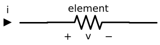

---

## 3. Voltage, current, power and the sign convention

- **Voltage** `v_ab = V_a − V_b` is energy per unit charge. Potential has meaning only relative to a reference.
- **Current** is the flow of positive charge. Direction is a choice; sign tells the truth.
- **Passive sign convention (PSC):** if current enters the **+** terminal of an element, then `p = v·i` is the power the element **absorbs**.
  - `p > 0` → absorbing (a load). `p < 0` → delivering (a source).
- **Resistor** (PSC): `v = iR`, `p = i²R = v²/R ≥ 0`. Conductance `G = 1/R` (siemens).
- **Conservation check (Tellegen):** the powers absorbed by all elements add to **zero**. Use this to check any answer (see Ex 8).

---

## 4. The elements

### Independent sources

| Source | Fixes | Whatever the circuit demands | When set to zero |
|---|---|---|---|
| Voltage source | its voltage | its current | becomes a **short circuit** |
| Current source | its current | its voltage | becomes an **open circuit** |

Impossible circuits (they violate KVL / KCL, so don't try to solve them): two different ideal voltage sources in parallel; two different ideal current sources in series; a voltage source shorted by a wire; a current source in an open circuit.

### Dependent (controlled) sources

Their value depends on a voltage or current **somewhere else** in the circuit. Drawn as a **diamond**. They model active devices such as transistors and op-amps.

| Type | Output = gain × control | Gain unit |
|---|---|---|
| VCVS | `v = μ · v_x` | none |
| VCCS | `i = g · v_x` | siemens |
| CCVS | `v = r · i_x` | ohms |
| CCCS | `i = β · i_x` | none |

Three rules that cover everything:

1. **Write the equations as if the dependent source were independent.**
2. **Then add one extra equation** that expresses the control variable in terms of your unknowns (node voltages or mesh currents).
3. **Move the unknown terms to the left-hand side** and solve.

A dependent source controlled by **its own terminal** acts like a resistor: a VCCS with `i = g·v` across itself is a resistor `1/g` (Ex 8 and P5 show this).

---

## 5. KCL and KVL: statements, reasons, corollaries

**KCL:** the sum of currents *leaving* any node is zero. `Σ i_out = 0`.
Why: charge cannot pile up at a point. It applies to **any closed surface**, not just one node. That is why a *supernode* (§7) is legitimate.

**KVL:** the voltages around any closed loop add to zero. `Σ v = 0`.
Why: energy conservation. A charge that comes back to where it started has gained and lost the same energy.

**Both laws assume the "lumped" model:** the circuit is small compared to the signal's wavelength, charge does not accumulate inside elements, and no changing magnetic flux threads the loops. In the lumped model, Maxwell's equations reduce to these two algebraic rules. (This is the "lumped matter discipline" taught in MIT 6.002.)

**Corollaries you will use constantly**

| Fact | Reason |
|---|---|
| Elements in **series** carry the **same current** | KCL at the joining node |
| Elements in **parallel** have the **same voltage** | KVL around the loop they form |
| **One wire joining two otherwise separate networks carries zero current** | KCL on a surface around one network: only one wire crosses it (2022 Q14) |
| A **current source in series** with anything forces that current through the whole branch | KCL |
| A **voltage source in parallel** with anything forces that voltage across the whole branch | KVL |

---

## 6. Series, parallel, dividers, equivalent resistance

```
Series:    R_eq = R1 + R2 + ...             (same current)
Parallel:  1/R_eq = 1/R1 + 1/R2 + ...       (same voltage)
           two resistors: R_eq = R1·R2 / (R1 + R2)

Voltage divider (series):    V_R1 = V_total · R1 / (R1 + R2)     "own R over sum"
Current divider (parallel):  I_R1 = I_total · R2 / (R1 + R2)     "OTHER R over sum"
```

The current divider flips because **more current takes the lower-resistance path**. Getting this backwards is the most common slip.

**Shortcuts that save minutes**

- A resistor with a **wire across it** carries no current: delete it.
- A branch that goes to an **open end** carries no current: delete it.
- **Symmetry:** nodes that are symmetric under the circuit's mirror image are at the same voltage, so you can join them.
- A **balanced bridge** (`R1/R2 = R3/R4`) has zero voltage across its middle arm: remove or short the middle arm (see §11).

---

## 7. Nodal analysis

**Procedure**

1. Merge wire-connected points into nodes. Choose a **reference node** (the node with the most branches, or the negative end of a voltage source).
2. Label the other node voltages `V1, V2, …`.
3. Write **KCL at each unknown node**, with every branch current as `(V_from − V_to)/R`.
4. Handle voltage sources (see below), then solve.

**Equations by inspection** (only resistors and independent current sources):

```
Diagonal term G_kk   = sum of all conductances touching node k
Off-diagonal G_kj    = − (conductance between node k and node j)
Right-hand side I_k  = net source current flowing INTO node k
```

### Voltage sources in nodal analysis

| Situation | What to do |
|---|---|
| Source from a node to **ground** | That node's voltage is known. One fewer unknown. |
| **Floating** source between two non-reference nodes | **Supernode:** treat the source and both its nodes as one surface. Write **one KCL** for the whole surface, plus the **constraint** `V_a − V_b = E` |

### Ex 1: basic nodal (by inspection)

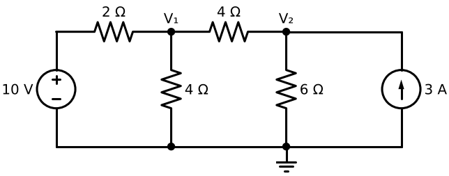

Node V₁: `(10 − V₁)/2 = V₁/4 + (V₁ − V₂)/4` → `4V₁ − V₂ = 20`
Node V₂: `(V₁ − V₂)/4 + 3 = V₂/6` → `3V₁ − 5V₂ = −36`

Solve: **V₁ = 8 V, V₂ = 12 V.**
Check KCL at V₂: 3 A comes in from the source; 1 A leaves towards V₁ (`(12−8)/4`); 2 A goes down the 6 Ω (`12/6`). `3 = 1 + 2` ✓.

### Ex 2: supernode

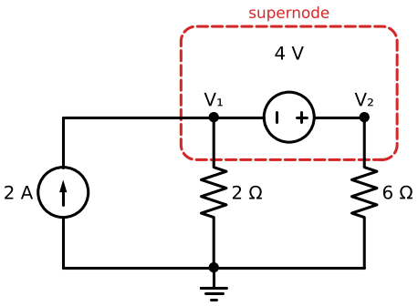

The 4 V source is floating between V₁ and V₂, so:

- Constraint: `V₂ = V₁ + 4`
- One KCL on the dashed surface (the red box). Current in: 2 A. Current out: through the 2 Ω and the 6 Ω.
  `2 = V₁/2 + V₂/6` → `2 = V₁/2 + (V₁+4)/6` → `12 = 4V₁ + 4` → **V₁ = 2 V, V₂ = 6 V.**

**Why it works:** the source's own current is unknown, but it enters one node and leaves the other, so it **cancels** inside the surface. That is why one KCL for the whole surface works.

### Ex 5: nodal with a dependent source (VCCS)

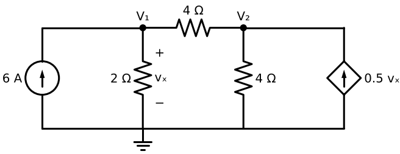

Control variable: `vₓ = V₁` (the voltage across the 2 Ω). The source pushes `0.5·V₁` into node V₂.

Node V₁: `6 = V₁/2 + (V₁ − V₂)/4` → `3V₁ − V₂ = 24`
Node V₂: `(V₁ − V₂)/4 + 0.5V₁ = V₂/4` → `3V₁ = 2V₂` (the dependent term is **moved to the left**)

**V₁ = 16 V, V₂ = 24 V.**

---

## 8. Mesh analysis (planar circuits)

**Procedure**

1. Draw one **mesh current** in each mesh, **all clockwise** (this makes the equations symmetric).
2. Write **KVL around each mesh**: `Σ (R × current through it) = Σ (source voltage rises along the mesh current)`.
3. A resistor shared by two meshes sees the **difference** of the two mesh currents.

**Equations by inspection** (only resistors and independent voltage sources, all meshes clockwise):

```
Diagonal term R_kk  = sum of all resistances in mesh k
Off-diagonal R_kj   = − (resistance shared by meshes k and j)
Right-hand side V_k = net source voltage RISE along the mesh current direction
```

### Ex 3: basic mesh

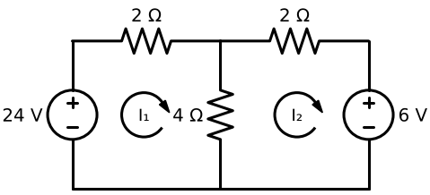

Mesh 1: `24 = 2I₁ + 4(I₁ − I₂)` → `6I₁ − 4I₂ = 24`
Mesh 2: going clockwise we pass **down** through the 6 V source (+ to −, a drop of 6): `2I₂ + 6 + 4(I₂ − I₁) = 0` → `−4I₁ + 6I₂ = −6`

**I₁ = 6 A, I₂ = 3 A**; current down through the 4 Ω is `I₁ − I₂ = 3 A`.

### Current sources in mesh analysis

| Situation | What to do |
|---|---|
| Current source on an **outer** branch (belongs to one mesh only) | That mesh current **equals the source**, with sign from the arrow. One fewer unknown. |
| Current source **shared** by two meshes | **Supermesh:** write one KVL around the **outer loop that avoids the source branch** (and any resistor in series with it), plus the **constraint** `I_a − I_b = I_s` |

### Ex 4: supermesh

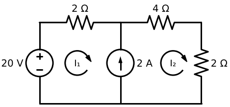

- Constraint (source arrow points up; I₂ goes up in the middle, I₁ goes down): `I₂ − I₁ = 2`
- KVL around the outer loop: `20 = 2I₁ + 4I₂ + 2I₂` → `20 = 2I₁ + 6I₂`

Substitute `I₂ = I₁ + 2`: `20 = 8I₁ + 12` → **I₁ = 1 A, I₂ = 3 A.**

**Why a supermesh is needed:** the voltage across a current source is unknown, so you cannot write a KVL equation through it. Going around the *outside* avoids it.

---

## 9. Nodal or mesh? A counting rule

Pick whichever gives **fewer equations after you exploit the sources**:

```
Nodal unknowns ≈ (n − 1) − (number of ideal voltage sources)
Mesh  unknowns ≈  m      − (number of ideal current sources)
```

| Circuit looks like… | Usually better |
|---|---|
| Many parallel branches, current sources, few nodes | **Nodal** |
| Many series elements, voltage sources, few meshes | **Mesh** |
| Non-planar | **Nodal** (the only option) |
| Asked for a **voltage** | lean nodal. Asked for a **current** in one branch: lean mesh |

Tie-breaker and safety net: **solve by one method, check with the other**, or check power balance. If you have time in the exam, a second method catches sign errors.

---

## 10. Source transformation

A **voltage source `Vs` in series with `R`** is equivalent to a **current source `Vs/R` in parallel with `R`**, as seen from the outside terminals.

```
Norton current:  I_N = V_s / R          Norton resistance: R_N = R
The current arrow points toward the + end of the voltage source.
```

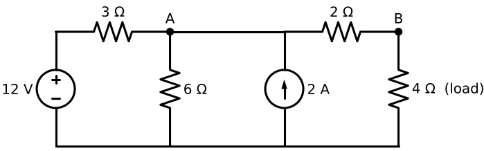

### Ex 6

Left branch: 12 V in series with 3 Ω ⇒ **4 A in parallel with 3 Ω**, pointing into node A.
At node A the currents add: 4 A + 2 A = **6 A**, and the resistors in parallel are `3 ∥ 6 = 2 Ω`.
Convert back: 6 A × 2 Ω = **12 V in series with 2 Ω**. The whole thing now is a single loop: 12 V, 2 Ω, 2 Ω, 4 Ω.

Load current = `12 / (2 + 2 + 4) = 1.5 A`.

**Rules and traps**

- Only the **outside** is equivalent. **Inside**, the power dissipated differs (open-circuited, the voltage-source version dissipates nothing in `R`, the current-source version dissipates `I²R`).
- An **ideal** voltage source (no series R) or ideal current source (no parallel R) **cannot** be transformed.
- **Do not transform away the element whose voltage or current you are asked for**, or the one that controls a dependent source. Recover it from the original circuit afterwards.
- With a dependent source, transformation works the same way, but its control variable must stay visible.

**Two "free" simplifications** (they change nothing for the *rest* of the circuit):

| Delete… | …when it is |
|---|---|
| a **resistor in series** with an ideal current source | any value. It only changes the voltage across the source itself. |
| a **resistor in parallel** with an ideal voltage source | any value. It only changes the current through the source itself. |

2022 Q13 (§12) is built on the first one.

---

## 11. Star–delta (wye–delta) transformation

Use it when a **bridge cannot be reduced by series/parallel** and is not balanced.

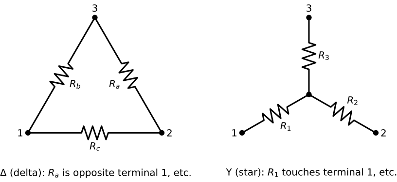

```
Δ → Y     R1 = Rb·Rc / (Ra + Rb + Rc)        R1 touches terminal 1;
          R2 = Rc·Ra / (Ra + Rb + Rc)        Rb and Rc are the two delta
          R3 = Ra·Rb / (Ra + Rb + Rc)        resistors that touch terminal 1

Y → Δ     Ra = (R1R2 + R2R3 + R3R1) / R1     Ra is opposite terminal 1
          Rb = (R1R2 + R2R3 + R3R1) / R2
          Rc = (R1R2 + R2R3 + R3R1) / R3
```

**Memory aids**

- Δ→Y: *"product of the two delta resistors that touch the terminal, over the sum of all three."*
- Y→Δ: *"sum of pairwise products, over the wye resistor opposite."*
- **Balanced** (all arms equal): `R_Y = R_Δ / 3` and `R_Δ = 3 R_Y`.

**Where it comes from (so you can rebuild it in the exam).** The two networks are equivalent if the resistance between **every pair of terminals** (third terminal left open) is the same:

```
Terminals 1–2:  R1 + R2 = Rc (Ra + Rb) / S        S = Ra + Rb + Rc
Terminals 2–3:  R2 + R3 = Ra (Rb + Rc) / S
Terminals 3–1:  R3 + R1 = Rb (Rc + Ra) / S
```
Add the first and third, subtract the second: `2R1 = 2·Rb·Rc / S`, so `R1 = Rb·Rc / S`. ✓

### Ex 7: a bridge

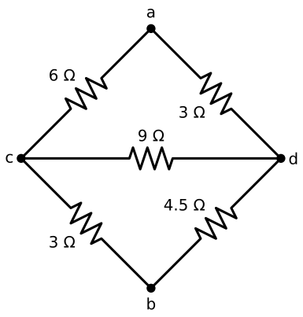

Not balanced (`6/3 ≠ 3/4.5`), and no series/parallel pair exists. Convert the delta **a–c–d** (6, 3, 9 Ω; `S = 18`):

```
R_a = (6·3)/18 = 1 Ω      R_c = (6·9)/18 = 3 Ω      R_d = (3·9)/18 = 1.5 Ω
```
Now from the star centre: via c: `3 + 3 = 6 Ω`; via d: `1.5 + 4.5 = 6 Ω`; these are in parallel = `3 Ω`; add the 1 Ω arm at a.
**R_ab = 1 + 3 = 4 Ω.**

### Ex 8: a dependent source inside a loop

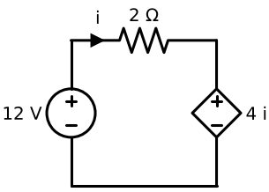

KVL: `12 − 2i − 4i = 0` → **i = 2 A**. The CCVS `4i` behaves like a **4 Ω resistor** (it is controlled by its own current).
Power check: the 12 V source delivers `12 × 2 = 24 W`. The 2 Ω absorbs `i²R = 8 W`; the CCVS absorbs `4i · i = 16 W`. Total absorbed 24 W ✓.

---

## 12. Past-year questions on Day 1 topics (all solved, all match the official keys)

Question papers and keys: `02_Previous_Year_Papers/<year>/`. **Try each question from the paper first.**

| # | Question | Official answer | Concept it tests |
|---|---|---|---|
| 1 | 2021 Q18 (NAT) | 0.5 A | Merge wire-connected nodes; parallel resistors; current source |
| 2 | 2021 Q19 (NAT) | 1.0 V | Nodal analysis with two current sources |
| 3 | 2022 Q13 (MCQ) | B: 0.75 × 10⁻³ A | Resistor in series with a current source |
| 4 | 2022 Q14 (MCQ) | B: 0 A | One wire between separate networks |
| 5 | 2023 Q32 (NAT) | 1.30 to 1.40 mA | Source transformation + nodal |
| 6 | 2024 Q31 (NAT) | 2 mA | Dependent source (CCVS) |
| 7 | 2025 Q19 (MCQ) | A: 20/3 V | Use only the part of the circuit you need |
| 8 | 2026 Q30 (NAT) | 0.95 to 1.05 V | Symmetry and KCL; the battery drops out |

### 2022 Q13: the series resistor trick
The right-hand 2 kΩ is in series with the ideal 1 mA source, so **exactly 1 mA flows through it** (from the source's node towards the middle node), whatever its value. At the middle node M (units mA, kΩ):

```
(5 − V_M)/2 + 1 = V_M/2     →     5 − V_M + 2 = V_M     →     V_M = 3.5 V
I = (5 − 3.5)/2 = 0.75 mA                                               → (B)
```

### 2022 Q14: one wire, no current
The left circuit and the right circuit are joined **only through the 10 Ω resistor** (the bottom wires do not meet). Draw a closed surface around the right-hand circuit: only one wire crosses it, so by KCL that wire carries **0 A**. Answer **(B)**. No calculation needed.

### 2023 Q32: Norton, then nodal
Left branch: 2 V with 2 kΩ ⇒ 1 mA in parallel with 2 kΩ. Together with the other 2 kΩ and the 1 mA source: **2 mA into node V₁ with 1 kΩ to ground**. Then (units mA, kΩ):

```
Node V1:  2 = V1 + 1 + (V1 − V2)     →   2V1 − V2 = 1
Node V2:  1 + (V1 − V2) = 5·V2       →   V1 = 6V2 − 1
⇒ V2 = 3/11 V,    i = V2 / 200 Ω = 1.364 mA                              (key 1.30–1.40)
```
(The 1 mA source on top feeds V₂ and leaves V₁, which is why it appears with opposite signs.)

### 2024 Q31: dependent source
The middle branch (1 kΩ in series with the 2 mA source) carries **exactly 2 mA**, whatever the resistor. Let `I₀` (mA) flow down the left 1 kΩ, so `V_A = 1000·I₀` volts at the top-left node.

```
CCVS (+ on the right):   V_B = V_A + 1000·I₀ = 2000·I₀   →   I_x = V_B/1 kΩ = 2·I₀
KCL at A:  current into the CCVS branch = 5 − I₀
KCL at B:  5 − I₀ = 2 + I_x = 2 + 2·I₀   →   I₀ = 1 mA,  I_x = 2 mA        (key 2)
```

### 2025 Q19: ignore the part you do not need
The unknown delta network on the right is a distraction. The 3 Ω carries 1 A downward from 9 V, so the centre node is `V_M = 9 − 3(1) = 6 V`. The path from 8 V to that node is `2 + 1 = 3 Ω`, carrying `(8 − 6)/3 = 2/3 A`, so

```
V_X = 8 − 2 Ω × (2/3 A) = 8 − 4/3 = 20/3 V                               → (A)
```

### 2026 Q30: symmetry, and the battery does not matter
Let the top rail be T, bottom rail ground, and the two middle nodes L and R, with the battery of voltage E between them (**either polarity**). Let `i` be the battery current from L to R. Work in mA and kΩ.

```
KCL at L:  (Vo − V_L) = V_L + i
KCL at R:  (Vo − V_R) + i = V_R
Add:       2·Vo − V_L − V_R = V_L + V_R        →   Vo = V_L + V_R
KCL at T:  1 = (Vo − V_L) + (Vo − V_R) = 2·Vo − Vo = Vo      →   Vo = 1 V
```
`E` never appears. The two 2 kΩ paths in parallel give 1 kΩ, and `1 mA × 1 kΩ = 1 V`.

### 2021 Q19: nodal with two current sources
The wire joins the top-left node to the middle node: call it M. The right node is R.
KCL at R (units mA, kΩ): the 6 mA source and the 2 mA source both leave R, so

```
6 + (V_R − V_M) + 2 = 0      →   V_R − V_M = −8
KCL at M:  6 + (V_R − V_M) = V_M + (V_M − 4)      →   −2 = 2·V_M − 4     →   V_M = 1 V
```
`v₀ = V_M = 1.0 V`.

### 2021 Q18: redraw first
The tall vertical wire joins the top and bottom nodes (the arc where it crosses the 7 Ω wire means **no** connection there). So between P and that node (call it T) are `3 Ω ∥ 6 Ω = 2 Ω`; between T and Q are `2 Ω ∥ 2 Ω = 1 Ω`; the 5 A source pushes current from Q into T; and 7 Ω goes directly from P to Q. With `V_Q = 0`:

```
Node P:  (V_T − V_P)/2 = V_P/7      →   V_T = (9/7)·V_P
Node T:  5 = V_T + (V_T − V_P)/2    →   5 = (9/7)V_P + (1/7)V_P = (10/7)V_P      →   V_P = 3.5 V
I = 3.5/7 = 0.5 A
```

---

## 13. Practice (answers at the end of this section)

**P1 · Dependent source forming a supernode.** Find V₁ and V₂.
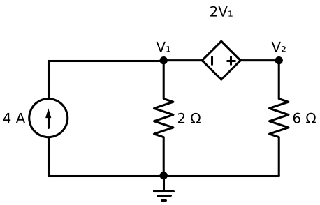

**P2 · Mesh with a current source on the outside.** Find the current down through the 3 Ω.
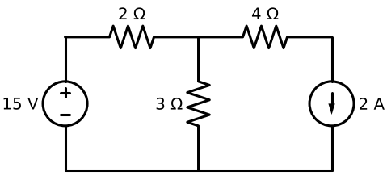

**P3 · Balanced delta.** Find the resistance between a and ground.
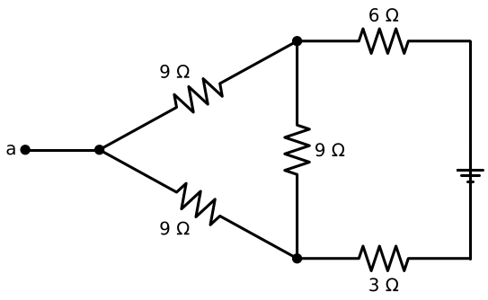

**P4 · Mixed sources.** Find the current in the 3 Ω load (V₂ ÷ 3 Ω).
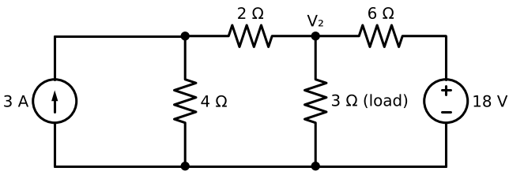

**P5 · A dependent source that controls itself.** Find V.
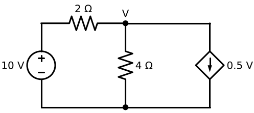

**C1.** Two circuits are joined by a single wire. What current flows in it, and why?
**C2.** Why is it meaningless to put a 1 A ideal current source in series with a 2 A ideal current source?
**C3.** A 5 kΩ resistor is in series with a 2 mA ideal current source, and the pair is part of a bigger circuit. Does changing the 5 kΩ to 50 kΩ change any *other* voltage or current in the circuit?

<details>
<summary><b>Answers</b></summary>

- **P1:** supernode V₂ = V₁ + 2V₁ = 3V₁. KCL: `4 = V₁/2 + V₂/6 = V₁/2 + V₁/2` ⇒ **V₁ = 4 V, V₂ = 12 V**.
- **P2:** I₂ = 2 A (outer current source, clockwise down). Mesh 1: `15 = 2I₁ + 3(I₁ − 2)` ⇒ I₁ = 4.2 A. Current down the 3 Ω = `I₁ − I₂` = **2.2 A**.
- **P3:** balanced Δ (9 Ω each) → Y arms of **3 Ω**. Arm to c: `3 + 6 = 9`; arm to d: `3 + 3 = 6`; parallel `9 ∥ 6 = 3.6`; plus 3 Ω at a ⇒ **6.6 Ω**.
- **P4:** nodal at V₂ after converting the 18 V + 6 Ω to 3 A ∥ 6 Ω, or write two node equations: V₂ = 7.5 V ⇒ **I = 2.5 A**.
- **P5:** KCL at V: `(10 − V)/2 = V/4 + 0.5V` ⇒ **V = 4 V**. The 0.5 V source is just a 2 Ω resistor in parallel with the 4 Ω.
- **C1:** **Zero.** KCL on a closed surface around one circuit: only one wire crosses it.
- **C2:** KCL at the joining node would require 1 A = 2 A. The circuit is inconsistent.
- **C3:** **No.** The current through that branch is fixed at 2 mA either way. Only the voltage across the 5 kΩ / the source changes.
</details>

---

## 14. The mistakes that cost marks (checklist)

1. **Not merging wires first.** Redraw with nodes merged before writing anything.
2. **Reading a "hop" as a connection** (or a dot as no connection).
3. **Current divider inverted.** It is the *other* resistor over the sum.
4. **Sign of a source in KVL.** Going through a source from − to + is a *rise*; + to − is a *drop*. Decide before you start.
5. **Forgetting the constraint equation** for a supernode or supermesh. One KCL/KVL alone is one equation short.
6. **Writing KVL through a current source** (unknown voltage). Use a supermesh, or fix the mesh current.
7. **Writing KCL at a voltage source** without a supernode (unknown current).
8. **Leaving the dependent term on the right-hand side.** Move it to the left and combine with the unknowns.
9. **Transforming away the control variable** of a dependent source, or the element you are asked about.
10. **Mixing units** (mA with kΩ is fine, mA with Ω is not).
11. **Mesh currents in mixed directions** in the same circuit. Keep them all clockwise.
12. **Not sanity-checking.** KCL at one unused node, or total power delivered = total power absorbed.

---

## 15. One-page formula sheet (copy this)

```
KCL: Σ i_out = 0 (node or any closed surface)       KVL: Σ v = 0 (loop)
b = n + m − 1          independent KCL: n−1          independent KVL: b−n+1

PSC: current into + terminal → p = v·i is ABSORBED.   Σ p_absorbed = 0

R_series = ΣR      R_parallel = 1/Σ(1/R)     2 in parallel: R1R2/(R1+R2)
V-divider: V_R1 = V·R1/(R1+R2)      I-divider: I_R1 = I·R2/(R1+R2)

NODAL:   G·V = I_in           diag = ΣG at node;  off-diag = −G between;  RHS = source current INTO node
         floating V-source → supernode: ONE KCL + constraint (V_a − V_b = E)
MESH:    R·I = V_rise         diag = ΣR in mesh;  off-diag = −shared R;   RHS = source voltage RISE (all CW)
         shared I-source → supermesh: outer-loop KVL + constraint (I_a − I_b = I_s)
Dependent source: write as independent, add control-variable equation, move to LHS.
Self-controlled VCCS (i = g·v) = resistor 1/g;  self-controlled CCVS (v = r·i) = resistor r.

Choose:  nodal unknowns ≈ (n−1) − #V-sources ;  mesh unknowns ≈ m − #I-sources

SOURCE TRANSFORMATION:  Vs in series with R  ⇔  I = Vs/R in parallel with R
   (arrow toward the + end).  Not for ideal sources.  Keep the element you are asked about.
   R in series with ideal I-source: irrelevant to the rest.   R in parallel with ideal V-source: irrelevant to the rest.

Δ → Y:  R1 = Rb·Rc/S, R2 = Rc·Ra/S, R3 = Ra·Rb/S       (S = Ra+Rb+Rc)
Y → Δ:  Ra = (R1R2+R2R3+R3R1)/R1 (opposite terminal 1), etc.      Balanced: R_Y = R_Δ/3
Balanced bridge R1/R2 = R3/R4 → middle arm carries no current.
```

---

## 16. Self-test before you move to Day 2

You are ready if you can, **without looking**:

- [ ] explain why nodal analysis needs only KCL and mesh analysis only KVL
- [ ] write the passive-sign-convention rule and use it to decide if an element absorbs or delivers power
- [ ] set up a supernode and a supermesh and write the constraint equation for each
- [ ] handle a dependent source (extra equation, move to the left)
- [ ] say when source transformation is **not** allowed
- [ ] write Δ→Y and Y→Δ from memory (or rebuild them from the terminal-pair argument)
- [ ] solve 2022 Q13, 2022 Q14 and 2025 Q19 in under 2 minutes each
- [ ] score at least 17/20 on `Day01_Conceptual_Questions.md`

**Day 2 preview:** superposition, Thevenin, Norton and maximum power transfer. They build directly on source transformation (§10) and on nodal analysis with dependent sources (§7), so make sure those are solid.

---

## 17. Sources and further reading

**Pages read for this note** (via a research pass, not just search results):

- [LibreTexts, *DC Electrical Circuit Analysis* (Fiore), §7.2 Nodal Analysis](https://eng.libretexts.org/Bookshelves/Electrical_Engineering/Electronics/DC_Electrical_Circuit_Analysis_-_A_Practical_Approach_(Fiore)/07%3A_Nodal_and_Mesh_Analysis_Dependent_Sources/7.2%3A_Nodal_Analysis): inspection method, supernode, source-conversion caution
- [Wikipedia: Mesh analysis](https://en.wikipedia.org/wiki/Mesh_analysis): essential meshes, supermesh, dependent sources, planarity
- [Spinning Numbers: Delta–Wye derivations](https://spinningnumbers.org/a/delta-wye-derivations.html): terminal-pair derivation and the conductance form

**Recommended lectures and notes** (found by search; titles only, I did not extract their text):

- [MIT OCW 6.002 (Spring 2007), Lecture 2](https://ocw.mit.edu/courses/6-002-circuits-and-electronics-spring-2007/99b2a662083d1b1f487c55ea0f0d0220_6002_l2.pdf) and Lecture 3: the lumped-matter discipline, KVL/KCL method, and the node method. (The PDF could not be text-extracted in this session, so nothing in this note is quoted from it.)
- [NPTEL, IIT Madras course 117106108](https://archive.nptel.ac.in/courses/117106108): lecture titles include "Setting up nodal analysis equations", "Nodal analysis with VCCS", and "Mesh analysis with independent current sources – Supermesh"
- [NPTEL, IIT Kharagpur *Network Analysis* 108105159](https://archive.nptel.ac.in/courses/108105159): lectures 4–8 cover mesh analysis I–II and nodal analysis I–III
- [All About Circuits: Delta/Wye transforms, behind the scenes](https://www.allaboutcircuits.com/technical-articles/delta-wye-transforms-behind-the-scenes/): an extra derivation of §11

**In this repo:** `01_Notes/GateOPedia_EC_ShortNotes_PW_2022.pdf` pp. 2.1–2.19 for extra worked problems on these same topics; `tools/verify_day1.py` to re-check every number here.
