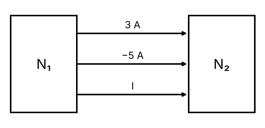
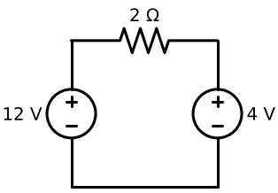
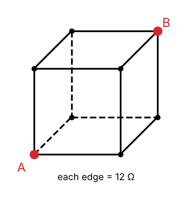
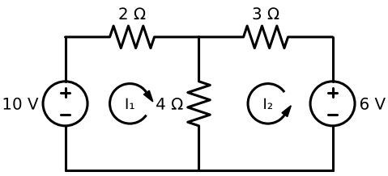
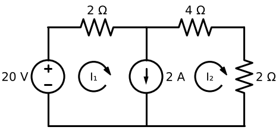
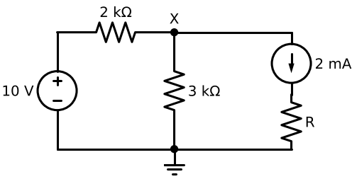
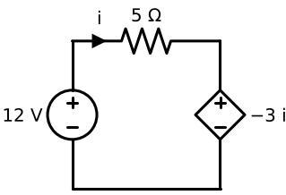
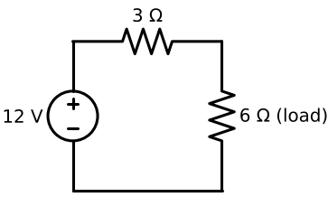
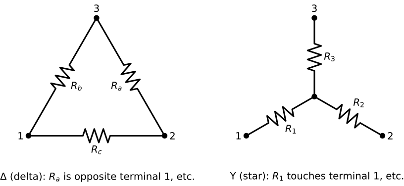
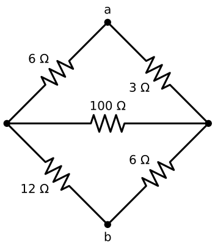

# Day 1 — 20 Conceptual Questions (Network Theory)

**Companion to:** `Day01_Circuit_Analysis_Fundamentals.md` (read §1–§11 first)
**Time:** 35–40 minutes, pencil and paper, no calculator needed
**Format:** GATE style. Each question tests **one idea**, and the wrong options are the mistakes students actually make.

| Type | How it works | Self-score |
|---|---|---|
| **MCQ** | exactly one correct option | 1 mark if right |
| **MSQ** | one or more correct options; **no partial credit** | 1 mark only if your set is exactly right |
| **NAT** | type a number, no options | 1 mark if right |

Every number in the solutions is re-checked by `tools/verify_day1.py` (a circuit solver), and each answer was also derived by hand.

## What is in the set

| # | Type | Concept | Level | Review in the Day 1 note |
|---|---|---|---|---|
| 1 | MSQ | What KCL/KVL actually assume (and what they don't) | Medium | §5 |
| 2 | NAT | KCL on a closed surface (cut-set) | Easy | §5 |
| 3 | MSQ | Node voltages are relative to the reference | Easy | §2, §7 |
| 4 | MSQ | Power sign convention: a source that absorbs power | Medium | §3 |
| 5 | MSQ | Ideal-source connections: inconsistent or indeterminate | Medium | §4 |
| 6 | NAT | Symmetry: merging equipotential nodes | Hard | §6 |
| 7 | MSQ | Structure of the nodal matrix | Medium | §7 |
| 8 | NAT | Reading a circuit back from its nodal equations | Medium | §7 |
| 9 | MCQ | What a supernode really is | Hard | §7 |
| 10 | MSQ | Mesh equations with mixed current directions | Medium | §8 |
| 11 | NAT | Supermesh: the sign of the constraint | Medium | §8 |
| 12 | MCQ | Counting unknowns: nodal or mesh? | Medium | §9 |
| 13 | MSQ | A resistor in series with an ideal current source | Medium | §10 |
| 14 | MCQ | Dependent sources cannot start a circuit | Medium | §4 |
| 15 | NAT | A dependent source that acts as a negative resistance | Medium | §4, §11 (Ex 8) |
| 16 | MSQ | Source transformation: what is and is not preserved | Medium | §10 |
| 17 | NAT | The classic source-transformation trap | Hard | §10 |
| 18 | NAT | Star to delta: which resistor is "opposite"? | Easy | §11 |
| 19 | MCQ | Delta with one resistor removed | Medium | §11 |
| 20 | NAT | Balanced bridge: the detector does not matter | Hard | §6, §11 |

---

## Part A: Foundations (laws, signs, ideal sources)

### Q1 · MSQ
Kirchhoff's current law and voltage law, as used in lumped-circuit analysis, are guaranteed to hold under which of the following conditions? Select **all** that apply.

- (A) Every element in the circuit is linear.
- (B) No net charge accumulates at any node or inside any element.
- (C) Any time-varying magnetic flux is confined inside the circuit elements; none links the loops through the space between the elements.
- (D) The dimensions of the circuit are much smaller than the wavelength of the signals involved.

### Q2 · NAT
Two networks N₁ and N₂ are joined by exactly three wires. The currents in the wires, all measured as flowing **from N₁ towards N₂**, are 3 A, −5 A and I.



The value of I is ______ A.

### Q3 · MSQ
A circuit is solved with node 0 as the reference and gives V₁ = 7 V, V₂ = 3 V and V₃ = 4 V. The analysis is repeated with **node 3** as the reference. Select all correct statements.

- (A) The new voltage of node 1 is 3 V.
- (B) The new voltage of node 2 is +1 V.
- (C) The current in the resistor connected between nodes 1 and 2 changes.
- (D) The voltage across every branch is unchanged.

### Q4 · MSQ
A 12 V source, a 2 Ω resistor and a 4 V source form a single loop. The **+** terminals of both sources are at the top.



Select all correct statements.

- (A) The 4 V source delivers 16 W.
- (B) The 12 V source delivers 48 W.
- (C) The resistor absorbs 32 W.
- (D) The 4 V source absorbs 16 W.

### Q5 · MSQ
Select all correct statements about ideal sources.

- (A) Two ideal voltage sources of equal value connected in parallel with the same polarity fix the terminal voltage, but KCL and KVL cannot determine how the load current is shared between them.
- (B) An ideal 2 A current source in series with an ideal 3 A current source (same branch, same direction) has no solution.
- (C) An ideal voltage source connected across an open circuit (no load) has no solution.
- (D) An ideal 2 A current source and an ideal 3 V voltage source connected in a closed loop, with nothing else, have no solution.

### Q6 · NAT
Each of the 12 edges of a cube is a 12 Ω resistor. A and B are opposite corners (the two ends of a body diagonal).



The resistance between A and B is ______ Ω.

*(Hint: no equations are needed. Ask which nodes must be at the same potential.)*

---

## Part B: Nodal analysis, mesh analysis, supernode, supermesh

### Q7 · MSQ
Nodal equations **G·V = I** are written for a resistive circuit (reference node excluded). Select all correct statements.

- (A) With only resistors and independent current sources, G is symmetric.
- (B) In that case the diagonal entry G_kk equals the sum of the conductances of all resistors connected to node k (including those going to the reference node), and each off-diagonal entry G_kj equals the **negative** of the total conductance connected directly between nodes k and j.
- (C) Adding an independent current source in parallel with any resistor changes G.
- (D) Replacing an independent current source by a VCCS controlled by the voltage between two other nodes always leaves G symmetric.

### Q8 · NAT
The nodal equations of a resistive circuit, written for nodes 1 and 2 (node 0 is the reference), are

```
[  0.75  −0.25 ] [V1]   [3]
[ −0.25   0.50 ] [V2] = [0]        (siemens, volts, amperes)
```

The value of the resistor connected between node 1 and the reference node is ______ Ω.

### Q9 · MCQ
Which statement about the **supernode** technique in nodal analysis is correct?

- (A) A supernode is required whenever any voltage source is present, even if one of its terminals is the reference node.
- (B) The KCL equation for the supernode must include the unknown current through the voltage source, which is then eliminated using the constraint equation.
- (C) The current through the floating voltage source does not appear in the supernode's KCL equation. The extra equation needed comes from the constraint V_a − V_b = E.
- (D) A resistor connected directly across the floating voltage source appears in the supernode's KCL equation.

### Q10 · MSQ
Two adjacent meshes share a 4 Ω resistor. Mesh current I₁ (left mesh) is drawn **clockwise** and I₂ (right mesh) is drawn **anticlockwise**.



Select all correct statements.

- (A) In mesh 1's KVL equation, the term involving I₂ is **+**4 I₂.
- (B) In mesh 2's KVL equation, the term involving I₁ is −4 I₁.
- (C) The current in the shared 4 Ω resistor, directed from top to bottom, is I₁ + I₂.
- (D) The coefficient matrix of the mesh equations is no longer symmetric.

### Q11 · NAT
The 20 V source, the resistors and a 2 A ideal current source are connected as shown. Note the arrow of the current source **points down**. I₁ and I₂ are clockwise mesh currents.



The value of I₂ is ______ A.

### Q12 · MCQ
A planar circuit has 8 nodes and 13 branches. Two of the branches are ideal current sources, each lying on the outer boundary of the circuit, so each belongs to only one mesh. One more branch is an ideal voltage source connected between a non-reference node and the reference node.

After using the source constraints, the smallest number of unknowns left to solve for in **(i) mesh analysis** and **(ii) nodal analysis** are, respectively:

- (A) 4 and 6
- (B) 6 and 7
- (C) 4 and 7
- (D) 6 and 6

---

## Part C: Sources (dependent sources, source transformation)

### Q13 · MSQ
An ideal 10 V source feeds node X through a 2 kΩ resistor. Node X is connected to ground through a 3 kΩ resistor and through a branch made of an ideal 2 mA current source (arrow pointing down) in series with a resistor R.



R is increased from 1 kΩ to 5 kΩ. Which of the following **change**? Select all that apply.

- (A) The voltage at node X.
- (B) The voltage across the 2 mA current source.
- (C) The power supplied by the 10 V source.
- (D) The power dissipated in R.

### Q14 · MCQ
A linear circuit made of resistors, independent sources and dependent sources has a unique solution. All the independent sources are now set to zero (voltage sources replaced by short circuits, current sources by open circuits) and the dependent sources are left in place. All node voltages and branch currents will then be:

- (A) non-zero, because the dependent sources can still deliver power on their own
- (B) undefined, because the dependent sources have no control variable to act on
- (C) equal to their original values, scaled by the gains of the dependent sources
- (D) zero

### Q15 · NAT
A 12 V source, a 5 Ω resistor and a current-controlled voltage source form a single loop. The dependent source has voltage **v = −3 i** (the + terminal at the top), where **i** is the loop current in the clockwise direction.



The loop current i is ______ A.

### Q16 · MSQ
A 12 V ideal source in series with 3 Ω (Thevenin form) is replaced by a 4 A ideal current source in parallel with 3 Ω (Norton form). Select all correct statements.

- (A) With the terminals open, the 3 Ω resistor dissipates 0 W in the Thevenin form and 48 W in the Norton form.
- (B) For every possible load, the terminal voltage and terminal current are the same in both forms.
- (C) For every possible load, the current in the 3 Ω resistor is the same in both forms.
- (D) For every possible load, the power supplied by the ideal source itself (the 12 V source or the 4 A source) is the same in both forms.

### Q17 · NAT
A 12 V source with a series resistance of 3 Ω feeds a 6 Ω load.



A student replaces the source and its 3 Ω by a 4 A current source in parallel with 3 Ω, and then finds the power in the 3 Ω resistor as V²/R using the voltage across that parallel resistor. The power actually dissipated in the series 3 Ω resistor of the **original** circuit is ______ W (round off to two decimal places).

---

## Part D: Star–delta and bridges

Notation used in Q18 and Q19: terminal 1, 2, 3; delta resistor **R_a** is between terminals 2 and 3 (opposite terminal 1), **R_b** between 3 and 1, **R_c** between 1 and 2; star arm **R₁** is at terminal 1, and so on.



### Q18 · NAT
A star (Y) network has R₁ = 2 Ω at terminal 1, R₂ = 3 Ω at terminal 2 and R₃ = 6 Ω at terminal 3. In the equivalent delta, the resistor connected between terminals 2 and 3 (opposite terminal 1) is ______ Ω.

### Q19 · MCQ
In a delta network, the resistor R_a (between terminals 2 and 3) is removed, i.e. R_a → ∞. Only R_b (between 3 and 1) and R_c (between 1 and 2) remain. The equivalent star network has:

- (A) R₁ = R_b R_c / (R_b + R_c), R₂ = R₃ = 0
- (B) R₁ = 0, R₂ = R_c, R₃ = R_b
- (C) R₁ = R_b + R_c, R₂ = R₃ = 0
- (D) R₁ = R₂ = R₃ = 0

### Q20 · NAT
A bridge has arms 6 Ω (a–c), 3 Ω (a–d), 12 Ω (c–b) and 6 Ω (d–b), with a 100 Ω detector between c and d.



The resistance between terminals a and b is ______ Ω.

---

## Score yourself

<details>
<summary><b>Answer key (open after you finish all 20)</b></summary>

| Q | Answer | Q | Answer |
|---|---|---|---|
| 1 | B, C, D | 11 | 2 (range 2 to 2) |
| 2 | 2 (range 2 to 2) | 12 | A |
| 3 | A, D | 13 | B, D |
| 4 | B, C, D | 14 | D |
| 5 | A, B | 15 | 6 (range 6 to 6) |
| 6 | 10 (range 10 to 10) | 16 | A, B |
| 7 | A, B | 17 | 5.33 (range 5.32 to 5.34) |
| 8 | 2 (range 2 to 2) | 18 | 18 (range 18 to 18) |
| 9 | C | 19 | B |
| 10 | A, C | 20 | 6 (range 6 to 6) |

**How to read your score**

| Score | What to do |
|---|---|
| 17–20 | You are ready for Day 2 (Thevenin, Norton, superposition). |
| 13–16 | Re-read the "Review" section for each question you missed, then redo only those questions tomorrow. |
| 12 or less | Re-read §1–§6 of the Day 1 note, redo the worked examples with the solution covered, then retake this set after 24 hours. |

Keep a note of **why** each miss happened: concept gap, sign slip, or misread diagram. Those are the three different fixes.

</details>

## Solutions

<details>
<summary><b>Q1 · What KCL and KVL assume</b></summary>

**Answer: B, C, D.**

- **(B)** KCL is conservation of charge: nothing piles up at a node or inside an element.
- **(C)** KVL is conservation of energy around a loop. If changing magnetic flux leaked through a loop in the space between elements, the loop would pick up an induced voltage that KVL does not include. In the lumped model all such flux is inside inductors and transformers, whose terminal voltages already account for it.
- **(D)** This guarantees that signal delay across the circuit is negligible. At 1 GHz the free-space wavelength is 30 cm, so even a 10 cm board is not lumped. Then you must use a distributed model (transmission lines).
- **(A) is false.** Nothing in the derivation of KCL or KVL refers to what the elements are, so both laws hold for diodes, transistors and any nonlinear or time-varying element. Linearity matters for superposition, Thevenin and reciprocity, **not** for Kirchhoff's laws.

*Review:* §5.
</details>

<details>
<summary><b>Q2 · KCL on a closed surface</b></summary>

**Answer: 2 A.**

Draw a closed surface around N₁. Charge cannot pile up inside it, so the currents leaving N₁ add to zero:

`3 + (−5) + I = 0  →  I = 2 A`

The same idea gives two special cases: if only **two** wires join the networks, their currents are equal and opposite; if only **one** wire joins them, its current is **zero** (this is 2022 Q14).

*Review:* §5 (corollaries).
</details>

<details>
<summary><b>Q3 · Reference node</b></summary>

**Answer: A, D.**

A node voltage is a potential **difference** measured from the reference. Node 3 was 4 V above node 0, so choosing node 3 as reference subtracts 4 V from every node voltage:

- node 1: 7 − 4 = **3 V** ✓ (A)
- node 2: 3 − 4 = **−1 V** (so (B), which says +1 V, is the sign trap)
- node 0 becomes −4 V

Branch voltages are differences of node voltages, so none of them can change (D). Branch currents follow from branch voltages (Ohm's law), so the current in the resistor between nodes 1 and 2 is unchanged and (C) is false. Choosing the reference is purely a convenience.

*Review:* §2, §7.
</details>

<details>
<summary><b>Q4 · Power sign convention</b></summary>

**Answer: B, C, D.**

KVL: `12 − 2i − 4 = 0 → i = 4 A`, clockwise.

- Current leaves the 12 V source at its **+** terminal, so it **delivers** `12 × 4 = 48 W` (B ✓).
- Current enters the 4 V source at its **+** terminal, so it **absorbs** `4 × 4 = 16 W`, like a battery being charged. That makes (A) false and (D) true.
- The resistor absorbs `i²R = 16 × 2 = 32 W` (C ✓).

Check: delivered 48 W = absorbed 32 + 16 W ✓. A source is not always a supplier. The direction of the current through it decides.

*Review:* §3.
</details>

<details>
<summary><b>Q5 · Ideal-source connections</b></summary>

**Answer: A, B.**

- **(A) True.** KVL is satisfied (5 V = 5 V) but KCL and KVL cannot say how the current splits. The ideal model is under-determined. Real batteries have internal resistance, which decides the split.
- **(B) True.** KCL at the joining node would demand 2 A = 3 A, which is impossible.
- **(C) False.** Voltage source with nothing connected is fine: the voltage is 5 V and the current is 0 A.
- **(D) False.** The current source forces i = 2 A, the voltage source forces its 3 V, and KVL then fixes the voltage across the current source. One element delivers 6 W and the other absorbs 6 W.

(A voltage source across a **wire** would break KVL, `V = 0`, and a current source into an **open circuit** would break KCL, `I = 0`. Those are the true "no solution" cases.)

*Review:* §4.
</details>

<details>
<summary><b>Q6 · Cube and symmetry</b></summary>

**Answer: 10 Ω.**

By symmetry, the three neighbours of A are at the same potential, and so are the three neighbours of B. Merge each trio into one node:

- A to its three neighbours: 3 edges in parallel → `R/3`
- between the two trios: 6 edges in parallel → `R/6` (each near-A node connects to two near-B nodes)
- the three neighbours of B to B: 3 edges in parallel → `R/3`

Total `= R(1/3 + 1/6 + 1/3) = 5R/6 = 10 Ω`.

The same method gives `3R/4 = 9 Ω` across a face diagonal and `7R/12 = 7 Ω` across an edge. **Rule:** nodes that are mirror images of each other, with respect to the two terminals, are at the same voltage and can be joined.

*Review:* §6.
</details>

<details>
<summary><b>Q7 · Nodal matrix structure</b></summary>

**Answer: A, B.**

- **(A, B) True.** A resistor between nodes k and j adds `+G` to both diagonal entries and `−G` to both off-diagonal entries (k,j) and (j,k), so G is symmetric.
- **(C) False.** Independent current sources only appear on the **right-hand side** vector I. G depends only on the resistors (and any dependent sources).
- **(D) False.** A VCCS puts its gain in the **row** of the node it feeds and the **column** of the node it is controlled by. These are generally different, so the mirror entry is missing and G is not symmetric. (This is why G loses its symmetry as soon as dependent sources are present.)

*Review:* §7.
</details>

<details>
<summary><b>Q8 · Reading a circuit back from its nodal equations</b></summary>

**Answer: 2 Ω.**

- Off-diagonal −0.25 S says 0.25 S (= 4 Ω) is connected **directly between** nodes 1 and 2.
- The diagonal entry is the **sum** of all conductances at node 1: `G₁₁ = G₁₀ + G₁₂`, so `G₁₀ = 0.75 − 0.25 = 0.5 S`, i.e. **2 Ω**.

The common trap is `1/0.75 = 1.33 Ω`, which wrongly treats the diagonal entry as the conductance to the reference.

Full circuit: 3 A into node 1, 2 Ω from node 1 to the reference, 4 Ω between nodes 1 and 2, and 4 Ω from node 2 to the reference. This gives V₁ = 4.8 V, V₂ = 2.4 V. Check at node 1: 2.4 A through the 2 Ω + 0.6 A through the 4 Ω = 3 A ✓.

*Review:* §7.
</details>

<details>
<summary><b>Q9 · Supernode</b></summary>

**Answer: C.**

A supernode is a **closed surface** around the floating source and its two nodes. The source's current enters at one end and leaves at the other, so it is internal to the surface and does not appear in the surface's KCL. The equation you lose (one KCL per node) is replaced by the **constraint** `V_a − V_b = E`.

- **(A) False.** A source with one terminal on the reference simply fixes the other node's voltage. No supernode is needed.
- **(B) False.** That is what you would do if you wrote KCL at each node separately; adding the two equations makes the source current cancel.
- **(D) False.** A resistor across the source has both ends inside the surface, so its current is also internal and does not cross the surface.

*Review:* §7.
</details>

<details>
<summary><b>Q10 · Mixed mesh directions</b></summary>

**Answer: A, C.**

With opposite rotations, both mesh currents flow **downward** through the shared resistor, so they add. The voltage drop in the direction of either current is `4(I₁ + I₂)`:

- Mesh 1 equation contains `… + 4I₁ + 4I₂ = …`, so the I₂ term is **+4 I₂** (A ✓).
- Mesh 2 equation contains `… + 4I₂ + 4I₁ = …`, so the I₁ term is **+4 I₁**, which makes (B) false.
- The shared current is `I₁ + I₂` downward (C ✓).
- The matrix is still symmetric (both off-diagonals are +4), so (D) is false.

With **both** meshes clockwise the off-diagonals are negative and the shared current is `I₁ − I₂`. The physical answer is the same either way. Just stay consistent.

*Review:* §8.
</details>

<details>
<summary><b>Q11 · Supermesh sign</b></summary>

**Answer: 2 A.**

The current source is shared, so use a supermesh.

- Constraint: the arrow points **down** and I₁ goes down in the middle branch while I₂ goes up, so `I₁ − I₂ = 2`.
- KVL around the outer loop (skipping the source branch): `20 = 2I₁ + 4I₂ + 2I₂`.

Substituting `I₁ = I₂ + 2`: `20 = 8I₂ + 4`, so **I₂ = 2 A** (and I₁ = 4 A).

If you copy the Ex 4 constraint (arrow **up**: `I₂ − I₁ = 2`) you get I₂ = 3 A. That is the classic sign trap. Always read the arrow.

*Review:* §8.
</details>

<details>
<summary><b>Q12 · Counting unknowns</b></summary>

**Answer: A (4 and 6).**

- **Mesh:** `m = b − n + 1 = 13 − 8 + 1 = 6` mesh currents. The two boundary current sources fix two of them, leaving **4**.
- **Nodal:** `n − 1 = 7` node voltages. The grounded voltage source fixes one, leaving **6**.

So mesh analysis is lighter here. (A floating voltage source would also remove one unknown through a supernode constraint, and a shared current source would remove one through a supermesh constraint.)

*Review:* §9.
</details>

<details>
<summary><b>Q13 · Resistor in series with a current source</b></summary>

**Answer: B, D.**

The ideal source forces exactly 2 mA out of node X **whatever R is**, so R cannot affect node X's KCL. For both values of R:

- `V_X = 3.6 V`, current in the 3 kΩ = 1.2 mA, and the 10 V source supplies `(10 − 3.6)/2 kΩ = 3.2 mA`, i.e. **32 mW** (so (A) and (C) do not change).
- The voltage across the current source is `V_X − 2 mA × R`: **1.6 V** for 1 kΩ and **−6.4 V** for 5 kΩ (B changes).
- The power in R is `(2 mA)² R`: **4 mW** and **20 mW** (D changes).

**Dual statement:** a resistor connected directly across an ideal voltage source can be deleted for the rest of the circuit. Only the current in that source changes.

*Review:* §10.
</details>

<details>
<summary><b>Q14 · Dependent sources cannot start a circuit</b></summary>

**Answer: D.**

With no independent sources the circuit equations become **homogeneous**: `G·V = 0`. A unique solution means G is non-singular, so `V = 0`. All control variables are then zero, so every dependent source is also zero.

Dependent sources are *active* (they can amplify, and even deliver power as in Q15), but they have no energy of their own to start things. They only reshape the effect of independent sources. This is why, on Day 2, superposition and Thevenin **turn off the independent sources but keep the dependent ones**.

*Review:* §4.
</details>

<details>
<summary><b>Q15 · Negative resistance</b></summary>

**Answer: 6 A.**

The CCVS is controlled by its own current, with `i` entering its + terminal, so it behaves like a **−3 Ω resistor**. KVL clockwise:

`12 − 5i − (−3i) = 0  →  12 − 2i = 0  →  i = 6 A`

Power: the 12 V source delivers 72 W; the 5 Ω absorbs 180 W; the dependent source absorbs `v·i = (−18)(6) = −108 W`, i.e. it **delivers 108 W**. Check: 72 + 108 = 180 ✓.

If the gain were `−5i` the loop's net resistance would be 0 Ω and the circuit would have **no solution**. (Small-signal hook: a MOSFET with gate tied to drain is a VCCS controlled by its own terminal voltage, which is why its small-signal resistance is about `1/g_m`, ignoring r_o.)

*Review:* §4, §11 (Ex 8).
</details>

<details>
<summary><b>Q16 · Source transformation</b></summary>

**Answer: A, B.**

- **(A) True.** Open terminals: the Thevenin form has no current. The Norton form circulates 4 A through its 3 Ω: `4² × 3 = 48 W`.
- **(B) True.** This is what "equivalent" means: identical terminal behaviour for any load.
- **(C) False.** With a 6 Ω load, the series 3 Ω carries 4/3 A in the original, but the Norton 3 Ω carries 8/3 A.
- **(D) False.** Same 6 Ω load: the 12 V source supplies `12 × 4/3 = 16 W`, while the 4 A source supplies `4 × 8 = 32 W`.

Only what is **outside** the transformed pair is preserved. An ideal voltage source with no series resistor cannot be transformed, because a Norton current would be `V/0`.

*Review:* §10.
</details>

<details>
<summary><b>Q17 · The transformation trap</b></summary>

**Answer: 5.33 W.**

Original circuit: `i = 12/(3 + 6) = 4/3 A`, so `P = i²R = (16/9) × 3 = 16/3 = 5.33 W`. (Voltage across that 3 Ω is only 4 V.)

The student's Norton picture has the 3 Ω in **parallel** with the load, so it sees the full terminal voltage of 8 V and "dissipates" `8²/3 = 21.33 W`. That is a different resistor current and a different power. Only the terminal quantities (8 V and 4/3 A at the load) carry over.

**Rule:** if you are asked about an element that sits *inside* a pair you transformed, go back to the original circuit and recover it from the terminal values.

*Review:* §10.
</details>

<details>
<summary><b>Q18 · Star to delta</b></summary>

**Answer: 18 Ω.**

The delta resistor **opposite** terminal 1 is the sum of the pairwise products divided by the star arm at terminal 1:

`R_a = (R₁R₂ + R₂R₃ + R₃R₁)/R₁ = (6 + 18 + 12)/2 = 18 Ω`

Check: between terminals 2 and 3 (terminal 1 open) the star gives `3 + 6 = 9 Ω`; the delta gives `18 ∥ (12 + 6) = 9 Ω` ✓. The other two delta arms are 12 Ω (opposite terminal 2) and 6 Ω (opposite terminal 3). The usual mistake is dividing by the wrong arm.

*Review:* §11.
</details>

<details>
<summary><b>Q19 · Delta with a resistor removed</b></summary>

**Answer: B.**

Use `R₁ = R_bR_c/S`, `R₂ = R_cR_a/S`, `R₃ = R_aR_b/S` with `S = R_a + R_b + R_c` and let `R_a → ∞`:

`R₁ → 0,  R₂ → R_c,  R₃ → R_b`

Intuition: with R_a gone, what is left is R_c and R_b in series through terminal 1. That is already a star whose centre is terminal 1 itself, so `R₁ = 0`.

*Review:* §11.
</details>

<details>
<summary><b>Q20 · Balanced bridge</b></summary>

**Answer: 6 Ω.**

Compare the arm ratios: `6/12 = 3/6`, so the bridge is **balanced**. Then `V_c = V_d`, no current flows in the detector, and its value (1 Ω, 100 Ω, or even infinity) does not matter. Remove it:

`R_ab = (6 + 12) ∥ (3 + 6) = 18 ∥ 9 = 6 Ω`

(You could also short c to d and get `(6 ∥ 3) + (12 ∥ 6) = 2 + 4 = 6 Ω`. Same answer, which confirms the balance.) For an **unbalanced** bridge the detector matters and you need star–delta (Ex 7 in the Day 1 note).

*Review:* §6, §11.
</details>
