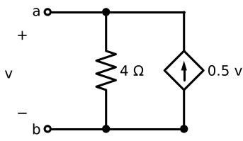
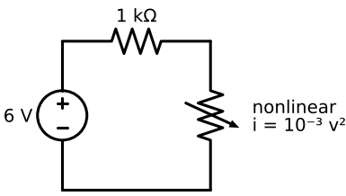
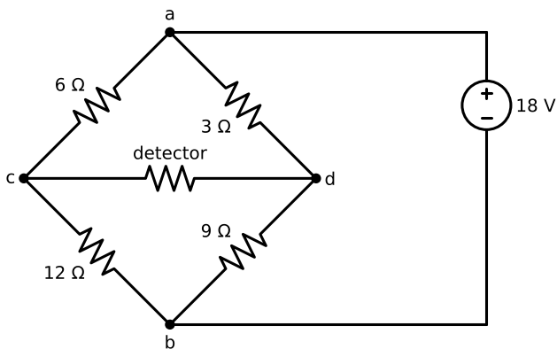

# Day 2 — 20 Conceptual Questions (Network Theorems)

**Companion to:** `Day02_Network_Theorems.md` (read §1–§8 first)
**Time:** 35–40 minutes, pencil and paper, no calculator needed
**Format:** GATE style. Each question tests **one idea**, and the wrong options are the mistakes students actually make.

| Type | How it works | Self-score |
|---|---|---|
| **MCQ** | exactly one correct option | 1 mark if right |
| **MSQ** | one or more correct options; **no partial credit** | 1 mark only if your set is exactly right |
| **NAT** | type a number, no options | 1 mark if right |

Every number in the solutions is re-checked by `tools/verify_day02.py` (a circuit solver), and each answer was also derived by hand.

## What is in the set

| # | Type | Concept | Level | Review in the Day 2 note |
|---|---|---|---|---|
| 1 | MSQ | Which quantities superpose | Easy | §1, §2 |
| 2 | MSQ | Which circuits allow superposition | Easy | §1, §2 |
| 3 | MCQ | Turning sources off when a dependent source is present | Medium | §2 |
| 4 | NAT | The power cross term | Medium | §2 (Ex 1) |
| 5 | MCQ | Scaling and adding responses | Easy | §1 |
| 6 | MSQ | Facts about Thevenin's theorem | Medium | §3 |
| 7 | NAT | Equivalent from open- and short-circuit tests | Easy | §3 |
| 8 | MSQ | When Thevenin or Norton exists | Medium | §3 |
| 9 | NAT | A negative R_th | Hard | §3 (Ex 4) |
| 10 | NAT | A Thevenin source with a nonlinear load | Hard | §3 |
| 11 | MSQ | Thevenin equivalent of a bridge detector | Medium | §3 |
| 12 | MCQ | Efficiency at maximum power | Easy | §5 |
| 13 | NAT | Variable source resistance, fixed load | Hard | §5 |
| 14 | MSQ | Maximum-power statements | Medium | §5 |
| 15 | NAT | A load that is partly fixed | Hard | §5 |
| 16 | MCQ | AC maximum power with a purely resistive load | Medium | §5 (AC preview) |
| 17 | MSQ | What makes a network reciprocal | Medium | §6 |
| 18 | NAT | Reciprocity: voltage → current | Easy | §6 |
| 19 | MCQ | Reciprocity: current → voltage | Easy | §6 |
| 20 | NAT | Maximum power from two measurements | Medium | §3, §5 |

---

## Part A: Linearity and superposition

### Q1 · MSQ
A linear circuit contains several independent sources. Which of the following can be found as the **algebraic sum** of the values produced by each source acting alone? Select **all** that apply.

- (A) The voltage at a particular node.
- (B) The current through a particular resistor.
- (C) The power dissipated in a particular resistor.
- (D) The energy stored in a particular capacitor at a given instant.

### Q2 · MSQ
Superposition (add the responses to each independent source acting alone) is valid for which of the following circuits? Select **all** that apply.

- (A) Resistors, capacitors and inductors with independent sources only.
- (B) A circuit that also contains a linear dependent source such as a VCVS.
- (C) A circuit that also contains an ideal diode.
- (D) A circuit that also contains a resistor whose current is `i = v³`.

### Q3 · MCQ
A circuit has an independent voltage source `V_s`, an independent current source `I_s` and a CCVS. To find the contribution of `V_s` **alone**, you should:

- (A) open `I_s` and replace the CCVS by a short circuit.
- (B) open `I_s` and leave the CCVS in the circuit, with its control relation unchanged.
- (C) short `I_s` and leave the CCVS in the circuit.
- (D) open `I_s` and open the CCVS.

### Q4 · NAT
A 2 Ω resistor is part of a linear circuit with two independent sources. Source 1 acting alone produces **3 A** in the resistor, and source 2 acting alone produces **1 A in the opposite direction**. The power dissipated in the resistor when both sources act together is ______ W.

### Q5 · MCQ
A linear circuit contains two independent voltage sources `V₁` and `V₂` and nothing else that is independent. The output voltage is 4 V when `(V₁, V₂) = (10 V, 0)` and −3 V when `(V₁, V₂) = (0, 5 V)`. The output when `(V₁, V₂) = (5 V, 15 V)` is:

- (A) 11 V
- (B) −5 V
- (C) −7 V
- (D) 1 V

---

## Part B: Thevenin and Norton

### Q6 · MSQ
Select **all** correct statements about Thevenin's theorem.

- (A) `R_th` can always be found by turning off all independent sources and combining resistors, even when dependent sources are present.
- (B) `R_th` equals the ratio of the open-circuit voltage to the short-circuit current, provided the short-circuit current is finite and nonzero.
- (C) The power dissipated inside the Thevenin equivalent equals the power dissipated inside the original network.
- (D) If the network contains no independent sources, its Thevenin equivalent is just a resistance (`V_th = 0`).

### Q7 · NAT
At the terminals of a linear network the open-circuit voltage is 12 V and the short-circuit current is 3 A. The current through a 6 Ω resistor connected across the terminals is ______ A.

### Q8 · MSQ
Select **all** correct statements.

- (A) An ideal voltage source has a Thevenin equivalent but no Norton equivalent.
- (B) An ideal current source has a Norton equivalent but no Thevenin equivalent.
- (C) Every linear two-terminal network has both a Thevenin and a Norton equivalent.
- (D) A linear one-port that contains dependent sources always has `R_th > 0`.

### Q9 · NAT
A one-port consists of a 4 Ω resistor in parallel with a VCCS. The VCCS **injects** a current `0.5·v` into the top terminal, where `v` is the voltage across the terminals (+ at the top).

The Thevenin resistance of this one-port is ______ Ω.

### Q10 · NAT
A linear network has `V_oc = 6 V` and `R_th = 1 kΩ` at its terminals. A **nonlinear** resistor with `i = 10⁻³ v²` (`i` in amperes, `v` in volts, `v > 0`) is connected across the terminals.

The voltage across the nonlinear resistor is ______ V.

### Q11 · MSQ
An 18 V supply feeds the bridge shown. We want the Thevenin equivalent seen by the **detector** (the terminals c–d with the detector removed).

Select **all** correct statements.

- (A) The magnitude of the Thevenin voltage between c and d is 1.5 V.
- (B) The Thevenin resistance seen at c–d is 6.25 Ω.
- (C) If the detector is a 3.75 Ω resistor, the detector current is 0.4 A.
- (D) The Thevenin resistance would be the same for any other value of the (ideal) supply voltage.

---

## Part C: Maximum power transfer

### Q12 · MCQ
A source is represented by its Thevenin equivalent. When the load resistance is adjusted for maximum power transfer, the fraction of the power generated by the Thevenin voltage source that is delivered to the load is:

- (A) 25%
- (B) 75%
- (C) 100%
- (D) 50%

### Q13 · NAT
A source with `V_th = 20 V` has an **adjustable** internal resistance `R_th` in the range 2 Ω to 20 Ω. It drives a **fixed** load `R_L = 10 Ω`. The maximum power that can be delivered to the load is ______ W (round off to two decimal places).

### Q14 · MSQ
Select **all** correct statements.

- (A) For a fixed source and a variable load resistor, maximum power is transferred when `R_L = R_th`.
- (B) At the maximum-power condition the load voltage is `V_th/2`.
- (C) If `R_L` is fixed and `R_th` is adjustable, the load power is maximum when `R_th = R_L`.
- (D) If `R_th` is negative, the maximum power transfer theorem still gives `R_L = |R_th|`.

### Q15 · NAT
A source has `V_th = 30 V` and `R_th = 4 Ω`. The load is a **fixed 6 Ω** resistor in series with a **variable** resistor `R_v`. The value of `R_v` that makes the power in `R_v` a maximum is ______ Ω.

### Q16 · MCQ
A source has Thevenin impedance `Z_th = 3 + j4 Ω`. The load is a **purely resistive** `R_L` (only `R_L` can be adjusted, with `X_L = 0`). The value of `R_L` for maximum average power is:

- (A) 5 Ω
- (B) 3 Ω
- (C) 4 Ω
- (D) 7 Ω

---

## Part D: Reciprocity and measurements

### Q17 · MSQ
Select **all** correct statements.

- (A) A network made only of resistors, inductors, capacitors and mutual inductors is reciprocal.
- (B) A network containing a VCCS is always reciprocal.
- (C) A reciprocal two-port must have `z₁₁ = z₂₂`.
- (D) For a reciprocal two-port, `y₁₂ = y₂₁`.

### Q18 · NAT
In a reciprocal resistive two-port, a 10 V source at port 1 (port 2 shorted) drives 2 A through the short. A 25 V source is now applied at port 2 with port 1 shorted. The magnitude of the current through the short at port 1 is ______ A.

### Q19 · MCQ
In a reciprocal network, a 2 A current source at port 1 (port 2 open) produces 6 V across port 2. A 5 A current source is now connected at port 2 with port 1 open. The open-circuit voltage at port 1 is:

- (A) 6 V
- (B) 15 V
- (C) 2.4 V
- (D) 30 V

### Q20 · NAT
The open-circuit voltage at the terminals of a linear network is measured as 8 V. When a 6 Ω resistor is connected across the terminals the voltage drops to 6 V. The **maximum** power that this network can deliver to any resistive load is ______ W.

---

## Score yourself

<b>Answer key (open after you finish all 20)</b>

| Q | Answer | Q | Answer |
|---|---|---|---|
| 1 | A, B | 11 | A, B, D |
| 2 | A, B | 12 | D |
| 3 | B | 13 | 27.78 (range 27.70 to 27.85) |
| 4 | 8 (range 8 to 8) | 14 | A, B |
| 5 | C | 15 | 10 (range 10 to 10) |
| 6 | B, D | 16 | A |
| 7 | 1.2 (range 1.2 to 1.2) | 17 | A, D |
| 8 | A, B | 18 | 5 (range 5 to 5) |
| 9 | -4 (range -4 to -4) | 19 | B |
| 10 | 2 (range 2 to 2) | 20 | 8 (range 8 to 8) |

**How to read your score**

| Score | What to do |
|---|---|
| 17–20 | You are ready for Day 3 (transients). |
| 13–16 | Re-read the "Review" section for each question you missed, then redo only those questions tomorrow. |
| 12 or less | Re-read §1–§5 of the Day 2 note, redo the worked examples with the solution covered, then retake this set after 24 hours. |

Keep a note of **why** each miss happened: concept gap, sign slip, or misread diagram. Those are three different fixes.

## Solutions

<b>Q1 · Which quantities superpose</b>

**Answer: A, B.**

In a linear circuit every node voltage and every branch current is a weighted sum of the independent-source values, so each equals the sum of the partial responses (A, B).

Power and energy are **quadratic** in the sources: `P = (V' + V")²/R = V'²/R + V"²/R + 2V'V"/R`, and `W = ½Cv²` likewise. The cross term is missing from the sum of partial powers, so (C) and (D) do not superpose. Example from the note: in Ex 1 the true power is 30.375 W but the sum of partial powers is only 16.875 W.

*Review:* §1, §2.

<b>Q2 · Which circuits allow superposition</b>

**Answer: A, B.**

Superposition needs **linearity**. R, L, C and *linear* dependent sources are linear (A, B). Dependent sources are not inputs, so they simply stay in the circuit. An ideal diode (C) and a resistor with `i = v³` (D) are nonlinear: the response to two sources is not the sum of the responses.

*Review:* §1, §2.

<b>Q3 · Turning sources off</b>

**Answer: B.**

Turn off only **independent** sources: an independent voltage source becomes a short, an independent current source becomes an open circuit. A dependent source is not an input; its value is set by the circuit, so it **stays**, with its control relation unchanged.

- (A) and (D) destroy the dependent source (a short is 0 V, an open is 0 A), which gives the wrong answer.
- (C) shorts a current source, which is wrong: a 0 A source is an *open* circuit.

Ex 2 of the note shows the damage: keeping the CCVS gives `V_X = 13.33 − 2.67 = 10.67 V`, shorting it gives `9.33 V`.

*Review:* §2.

<b>Q4 · The power cross term</b>

**Answer: 8 W.**

The two responses are in opposite directions, so the currents subtract: `i = 3 − 1 = 2 A` and `P = i²R = 4 × 2 = 8 W`.

The sum of the individual powers is `9 × 2 + 1 × 2 = 20 W`, which is wrong. The missing cross term is `2 × 3 × (−1) × 2 = −12 W` (and `20 − 12 = 8 W` ✓). The cross term is negative when the responses oppose each other.

*Review:* §2 (Ex 1).

<b>Q5 · Scaling and adding</b>

**Answer: C.**

Linearity gives output `= k₁V₁ + k₂V₂` with `k₁ = 4/10 = 0.4` and `k₂ = −3/5 = −0.6`. Then `0.4 × 5 + (−0.6) × 15 = 2 − 9 = −7 V`.

Two measurements are enough to find both weights. The tempting wrong answer is to add the two given outputs (1 V), which ignores that the sources have different values this time.

*Review:* §1.

<b>Q6 · Facts about Thevenin</b>

**Answer: B, D.**

- **(B) True.** `V_oc = V_th` and `I_sc = V_th/R_th`, so the ratio is `R_th` (if `I_sc` is finite and nonzero).
- **(D) True.** With no independent source there is no `V_th`. The network is a resistance, which a dependent source can even make negative.
- **(A) False.** After turning off the independent sources the dependent sources remain, so you cannot just combine resistors. Use a test source or `V_oc/I_sc`.
- **(C) False.** The equivalent matches the outside only. Internal power is generally different.

*Review:* §3.

<b>Q7 · Equivalent from two tests</b>

**Answer: 1.2 A.**

`R_th = V_oc/I_sc = 12/3 = 4 Ω`. Connecting 6 Ω gives `I = 12/(4 + 6) = 1.2 A`.

*Review:* §3.

<b>Q8 · Existence of the equivalents</b>

**Answer: A, B.**

- **(A) True.** An ideal voltage source is its own Thevenin equivalent (`R_th = 0`), but a Norton current would be `V/0`, which is infinite.
- **(B) True.** An ideal current source is its own Norton equivalent (`R_N = ∞`), but a Thevenin voltage would be `I × ∞`.
- **(C) False.** Those two cases are linear one-ports with only one of the equivalents.
- **(D) False.** Dependent sources can make `R_th` negative or infinite (Ex 4: `R_th = 6/(1 + β)`).

*Review:* §3.

<b>Q9 · A negative R_th</b>

**Answer: −4 Ω.**

Drive the terminals with a test current `i_t` entering the top terminal. KCL at that node: the test current plus the injected `0.5v` must equal the current in the resistor:

`i_t + 0.5v = v/4  →  i_t = −0.25 v  →  R_th = v/i_t = −4 Ω.`

The one-port is **active**: the dependent source supplies more current than the resistor draws, so it behaves like a negative resistance. (If it had *drawn* `0.5v` instead of injecting it, the answer would be `1/(1/4 + 1/2) = 1.33 Ω`.)

*Review:* §3 (Ex 4).

<b>Q10 · A nonlinear load on a Thevenin source</b>

**Answer: 2 V.**

Thevenin's theorem requires only the *source side* to be linear. The load can be anything. The load line of the equivalent is `v = 6 − 1000·i`, and the load obeys `i = 10⁻³v²`. Substituting:

`v + 1000 × 10⁻³ v² = 6  →  v² + v − 6 = 0  →  v = 2 V` (the root −3 V is rejected because `v > 0`).

The current is `10⁻³ × 4 = 4 mA`, and indeed `6 − 1000 × 0.004 = 2 V` ✓. (Superposition would **not** work here, because the load is nonlinear. Thevenin does.)

*Review:* §3.

<b>Q11 · The bridge as seen by the detector</b>

**Answer: A, B, D.**

- Open-circuit voltages: `V_c = 18 × 12/18 = 12 V` and `V_d = 18 × 9/12 = 13.5 V`, so `|V_th| = 1.5 V` (A ✓).
- `R_th`: short the ideal supply, so a and b become one node. Then c sees `6 ∥ 12 = 4 Ω` to it and d sees `3 ∥ 9 = 2.25 Ω`, giving `R_th = 4 + 2.25 = 6.25 Ω` (B ✓).
- With a 3.75 Ω detector: `I = 1.5/(6.25 + 3.75) = 0.15 A`, so (C) with 0.4 A is false.
- Since the supply is an ideal source and gets shorted, `R_th` does not depend on its value (D ✓). Only `V_th` scales with the supply.

*Review:* §3 (and Day 1 §6, §11 for bridges).

<b>Q12 · Efficiency at maximum power</b>

**Answer: D.**

At `R_L = R_th` the same current flows through `R_th` and `R_L`, so they dissipate the **same power**. Half of the generated power reaches the load: `η = R_L/(R_L + R_th) = 50%`.

Note this is the efficiency of the *Thevenin model*. The question says so explicitly because the real network's internal losses can differ.

*Review:* §5.

<b>Q13 · Variable source resistance, fixed load</b>

**Answer: 27.78 W.**

Now `R_th` is the variable, so the "match" rule does not apply. The load power is `P = V_th² R_L/(R_th + R_L)²`, which **falls** as `R_th` rises, so the best choice is the smallest allowed value, `R_th = 2 Ω`:

`P = 400 × 10/(2 + 10)² = 4000/144 = 27.78 W.`

For comparison, the matched choice `R_th = 10 Ω` gives only 10 W.

*Review:* §5.

<b>Q14 · Maximum-power statements</b>

**Answer: A, B.**

- **(A, B) True.** At `R_L = R_th` the load voltage is half of `V_th`.
- **(C) False.** With `R_L` fixed and `R_th` variable, `R_th = 0` is best (see Q13). This is the "opposite scenario" trap.
- **(D) False.** For `R_th < 0` the load power has no finite maximum in the usual sense, and `R_L = |R_th|` would make the circuit equations inconsistent (Practice P5).

*Review:* §5.

<b>Q15 · A partly fixed load</b>

**Answer: 10 Ω.**

Treat the fixed 6 Ω as part of the source: the source seen by `R_v` has `R_th' = 4 + 6 = 10 Ω`, so the power in `R_v` is largest at `R_v = 10 Ω` (power 22.5 W).

Caution: the power in the **whole** load `6 + R_v` cannot be matched, because 6 Ω already exceeds `R_th = 4 Ω`. That total is largest at `R_v = 0` (54 W, against 36 W at `R_v = 10 Ω`). Always check **which** power is being maximised.

*Review:* §5.

<b>Q16 · AC maximum power, resistive load only</b>

**Answer: A.**

The load power is `P ∝ R_L/((3 + R_L)² + 4²)`. Setting the derivative to zero gives `R_L² = 3² + 4²`, so `R_L = |Z_th| = 5 Ω`.

The conjugate match `Z_L = 3 − j4` is not available because the load cannot have a reactive part. The wrong answer `R_L = R_th = 3 Ω` forgets the reactance.

*Review:* §5 (AC preview).

<b>Q17 · What makes a network reciprocal</b>

**Answer: A, D.**

- **(A) True.** R, L, C and mutual inductors are reciprocal elements.
- **(D) True.** For a reciprocal two-port `y₁₂ = y₂₁` (and `z₁₂ = z₂₁`).
- **(B) False.** A VCCS puts its gain in one place only, so `y₁₂ ≠ y₂₁` in general.
- **(C) False.** `z₁₁ = z₂₂` is **symmetry**, a different property. A reciprocal network need not look the same from both ports.

*Review:* §6.

<b>Q18 · Reciprocity: voltage → current</b>

**Answer: 5 A.**

The transfer admittance is `y₂₁ = 2/10 = 0.2 S`. By reciprocity `y₁₂ = y₂₁ = 0.2 S`, so 25 V at port 2 gives `25 × 0.2 = 5 A` in the short at port 1. (The reciprocity theorem equates the *ratios*, so the current scales with the new source value.)

*Review:* §6.

<b>Q19 · Reciprocity: current → voltage</b>

**Answer: B.**

The transfer impedance is `z₂₁ = 6 V/2 A = 3 Ω`. By reciprocity `z₁₂ = 3 Ω`, so a 5 A source at port 2 gives `5 × 3 = 15 V` at port 1. The tempting choice (A) repeats the old 6 V and forgets that the source value changed.

*Review:* §6.

<b>Q20 · Maximum power from two measurements</b>

**Answer: 8 W.**

`V_th = 8 V` (open circuit). With 6 Ω connected, `6 = 8 × 6/(R_th + 6)`, so `R_th + 6 = 8` and `R_th = 2 Ω`. The maximum power is at `R_L = 2 Ω`:

`P_max = V_th²/(4R_th) = 64/8 = 8 W.`

No circuit diagram is needed: two measurements fix a Thevenin equivalent.

*Review:* §3, §5.

