# Day 2 — Network Theorems: Superposition, Thevenin, Norton, Maximum Power, Reciprocity

**Covers:** linearity · superposition · Thevenin and Norton equivalents (with dependent sources) · Millman · maximum power transfer · reciprocity
**Matches:** Day 2 of `03_Study_Plans/20_Day_Plan_Networks_Signals_Control.md` (Gate-O-Pedia pp. 2.30 – 2.34)
**Time:** about 5 hours in total
**Companion:** `Day02_Conceptual_Questions.md`, 20 GATE-style conceptual questions with solutions
**Needs from Day 1:** nodal analysis (§7), dependent sources (§4), source transformation (§10)

Every number in this note is re-checked by `tools/verify_day02.py`, and the five past-year answers match the official keys in `02_Previous_Year_Papers/`.

## How to use this note

| Step | What | Time |
|---|---|---|
| 1 | Read §1–§8 (the ideas). For each worked example, **cover the solution, solve it, then compare** | 90 min |
| 2 | Do §9: the past-year questions. Try each one first | 45 min |
| 3 | Do §10 practice problems, then read §11 (mistakes) | 40 min |
| 4 | Take the **20 conceptual questions** (timed, then review the ones you missed) | 40 min |
| 5 | Copy §12 onto your Networks formula sheet | 10 min |

---

## 1. The one idea behind every theorem: linearity

A circuit is **linear** when every element obeys a linear law: resistors, inductors, capacitors and *linear* dependent sources. The independent sources are the **inputs**. In such a circuit every branch voltage and current is a weighted sum of the independent-source values:

```
y = k₁·s₁ + k₂·s₂ + … + kₙ·sₙ         (no constant term: with every source off, every response is zero)
```

Four theorems are just this one fact seen from different angles:

| What linearity says | Theorem it gives |
|---|---|
| the responses to each source add | **Superposition** |
| scale every source by α and every response scales by α | **Proportionality** (the unit-output trick, Ex 5) |
| the terminal `v`–`i` relation of any linear two-terminal network is a straight line | **Thevenin / Norton** |
| for bilateral networks the weights `k` are symmetric | **Reciprocity** |

**Not linear:** diodes, transistors in large signal, saturating op-amps, nonlinear resistors, and anything where the output grows like the *square* of a source. **Power is quadratic in the sources, so it never superposes** (§2).

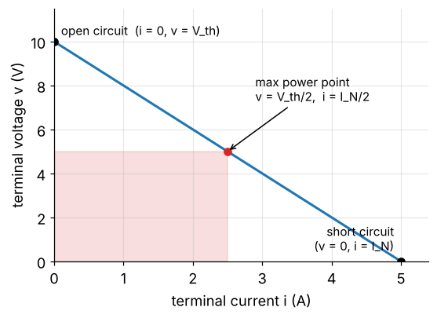

**The picture to keep in your head.** A linear one-port has a straight-line terminal characteristic `v = V_th − R_th·i`. Its two intercepts are the **open-circuit** point (`i = 0`, `v = V_th`) and the **short-circuit** point (`v = 0`, `i = I_N`). A load is another curve, and the circuit works where the two curves meet. For a resistive load the power `v·i` is the area of the shaded rectangle, and that area is largest at the **midpoint** of the line. That is the whole story of maximum power transfer (§5).

---

## 2. Superposition

**Statement.** In a linear circuit with several independent sources, any voltage or current equals the **algebraic sum** of the values produced by each independent source acting **alone**, with all the other independent sources turned off.

| Source | "Turned off" means | Why |
|---|---|---|
| independent **voltage** source | replace by a **short circuit** | a 0 V source *is* a wire |
| independent **current** source | replace by an **open circuit** | a 0 A source *is* a gap |
| **dependent** source (any type) | **leave it in the circuit** | its value is set by the circuit, not by you. It is not an input |

**Rules of use**

1. Only **voltages and currents** superpose. Never power or energy.
2. Only for **linear** circuits (no diodes, no saturation).
3. Sources at **different frequencies** must be superposed in the **time domain**: solve each frequency separately, then add the *waveforms*. You can never add phasors of different frequencies. (This is exactly how analog circuits split into a DC **bias** analysis and an AC **small-signal** analysis.)
4. It is a good tool for **a few sources of different kinds**, or when you want each source's *contribution*. With many sources, nodal analysis is usually less work.

### Ex 1: basic superposition, and why power does not superpose

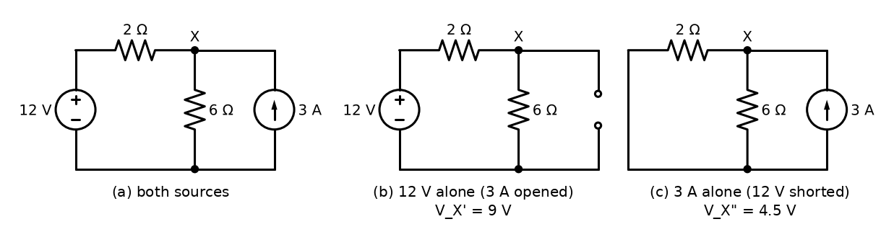

- 12 V alone (current source opened): voltage divider, `V_X' = 12 × 6/(2 + 6) = 9 V`.
- 3 A alone (voltage source shorted): `V_X" = 3 × (2 ∥ 6) = 3 × 1.5 = 4.5 V`.
- Together: **V_X = 9 + 4.5 = 13.5 V**. (Check by nodal analysis: `(12 − V)/2 + 3 = V/6 → V = 13.5 V` ✓.)

Now the power in the 6 Ω:

```
true power            P  = 13.5² / 6        = 30.375 W
sum of the partials   P' + P" = 9²/6 + 4.5²/6 = 13.5 + 3.375 = 16.875 W      ← wrong
cross term            2·V'·V"/R = 2·9·4.5/6  = 13.5 W   (this is the missing piece)
```

Because `P = (V' + V")²/R = V'²/R + V"²/R + 2V'V"/R`, the **cross term** is always there. It can even be negative, which is how the total power can be *smaller* than the sum (Conceptual Q4).

### Ex 2: a dependent source stays in the circuit

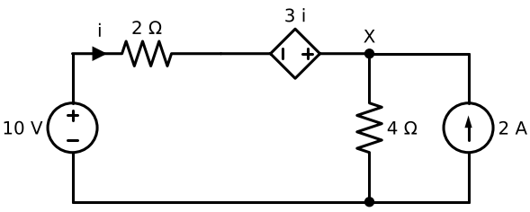

The CCVS is `3i`, where `i` is the current in the 2 Ω. Find V_X.

- **10 V alone** (2 A opened, CCVS **kept**): KCL `i = V/4`; KVL `V = 10 − 2i + 3i = 10 + i` → `V' = 40/3 = 13.33 V`.
- **2 A alone** (10 V shorted, CCVS **kept**): `V = −2i + 3i = i` and `i + 2 = V/4` → `V" = −8/3 = −2.67 V`.
- Total **V_X = 32/3 = 10.67 V**. (Full circuit: `V = 10 + i` and `i + 2 = V/4` → same ✓.)

**If you wrongly shorted the CCVS** in each step you would get `6.67 + 2.67 = 9.33 V`, which is wrong.

---

## 3. Thevenin's theorem

**Statement.** Seen from two terminals a–b, any **linear** network behaves exactly like a single voltage source `V_th` in series with a single resistance `R_th`.

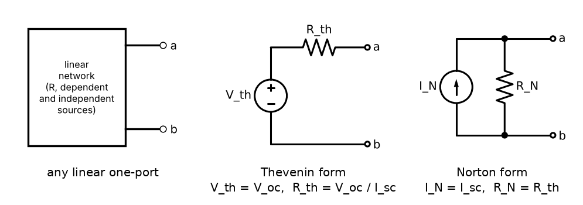

- **V_th = V_oc**: the voltage across a–b with the load **removed** (open circuit).
- **R_th**: the resistance seen at a–b with the independent sources turned off. **Method C below is the safe way to get it.**
- The equivalence holds **only from the outside**: voltages, currents and power in anything connected to a–b are identical, but the power dissipated *inside* the equivalent differs from the power inside the real network.

### Three ways to find R_th

| Method | Use when | Steps | Trap |
|---|---|---|---|
| **A. Turn off and reduce** | no dependent sources | short the V sources, open the I sources, combine resistors | **invalid** if a dependent source is present |
| **B. Open and short** | any circuit | `R_th = V_oc / I_sc` (two analyses) | fails if `I_sc = 0` or `V_oc = I_sc = 0` (a `0/0`) |
| **C. Test source** | any circuit; **always works with dependent sources** | turn off the **independent** sources only, drive a–b with `v_t` or `i_t`, then `R_th = v_t / i_t` | keep the dependent sources and be careful with signs |

**Special cases you should recognise**

| Case | What it means |
|---|---|
| `V_th = 0` | no independent source inside; the equivalent is just a resistance (it may be negative) |
| `R_th < 0` | an *active* one-port (a dependent source feeds energy to the terminals). Maximum-power transfer no longer makes sense, and a load `R_L = \|R_th\|` makes the circuit equations inconsistent |
| `R_th = 0` | the port behaves as an **ideal voltage source**: Thevenin exists, **Norton does not** |
| `R_th = ∞` | the port behaves as an **ideal current source**: Norton exists, **Thevenin does not** |

**Only the rest of the circuit must be linear. The load can be anything.** A diode or any nonlinear device connected to a–b is solved with the *Thevenin line* and the device's own curve (Conceptual Q10).

### Ex 3: two sources, one equivalent, many loads

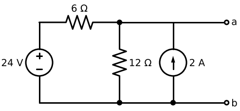

- `V_oc`: `(24 − V)/6 + 2 = V/12 → V_oc = 24 V`.
- `R_th`: sources off (24 V shorted, 2 A opened): `6 ∥ 12 = 4 Ω`.
- `I_sc`: short a–b: `24/6 + 2 = 6 A`, and `V_oc / I_sc = 24/6 = 4 Ω` ✓.

So the whole network is **24 V in series with 4 Ω** (or 6 A in parallel with 4 Ω). Now any load is one line:

| R_L | 1 Ω | 4 Ω | 12 Ω |
|---|---|---|---|
| `I_L = 24/(4 + R_L)` | 4.8 A | 3 A | 1.5 A |
| `P_L` | 23.04 W | **36 W** (maximum, §5) | 27 W |

### Ex 4: how a dependent source changes R_th

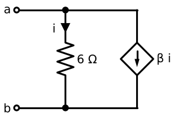

A 6 Ω resistor in parallel with a CCCS `β·i`, where `i` is the current in the 6 Ω. Drive the terminals with a test current `i_t`:

```
i_t = i + β·i = (1 + β)·(v/6)        →        R_th = v / i_t = 6 / (1 + β)
```

| β | 2 | 0 | −0.5 | −1 | −2 |
|---|---|---|---|---|---|
| R_th | 2 Ω | 6 Ω | 12 Ω | **∞** | **−6 Ω** |

So a dependent source can make `R_th` larger, infinite (the port looks like an open circuit) or **negative**. This is why you may never get `R_th` by "just combining resistors" when a dependent source is present.

---

## 4. Norton's theorem, and Millman's shortcut

**Norton.** The same network is equivalent to a current source `I_N` in parallel with `R_N`:

```
I_N = I_sc          R_N = R_th          V_th = I_N · R_th
```

Thevenin ↔ Norton is exactly the **source transformation** of Day 1 §10, so everything said there (only the outside is equivalent, ideal sources cannot be transformed) applies.

**Millman's theorem** is the Norton idea applied to a *two-node* circuit. For `n` branches in parallel, each a source `V_k` in series with `R_k` (or a current source `I_k`, or a bare resistor with `V_k = 0`):

```
V_node = ( Σ V_k/R_k + Σ I_k ) / ( Σ 1/R_k )        R_eq = 1 / Σ(1/R_k)
```

Example (Practice P1): `V_X = (24/4 + 12/6 + 6) / (1/4 + 1/6 + 1/12) = 14/0.5 = 28 V` in one line.

---

## 5. Maximum power transfer

A source with `V_th` and `R_th` drives a load `R_L`:

```
P_L = V_th² · R_L / (R_th + R_L)²          dP_L/dR_L = V_th² (R_th − R_L)/(R_th + R_L)³
```

The derivative is positive below `R_th`, zero at `R_th` and negative above it, so for a positive `R_th`:

```
R_L = R_th          P_max = V_th² / (4 R_th) = I_N² R_th / 4          load voltage = V_th/2,  load current = I_N/2
```

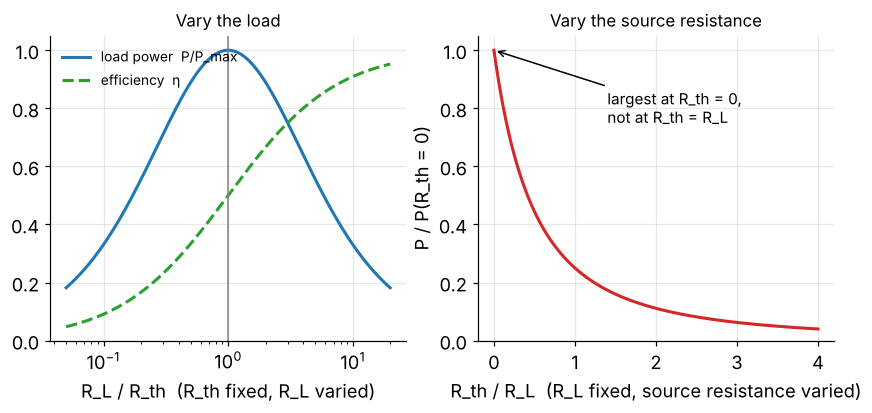

| R_L / R_th | 0.25 | 0.5 | **1** | 2 | 4 |
|---|---|---|---|---|---|
| P / P_max | 0.64 | 0.89 | **1.00** | 0.89 | 0.64 |
| efficiency `R_L/(R_L + R_th)` | 20% | 33% | **50%** | 67% | 80% |

Two things to take from the table: the peak is **flat** (a factor of 2 mismatch costs only 11% of the power), and at the maximum the **efficiency is only 50%**. Half of the power generated by the Thevenin source is lost in `R_th`. (That is the efficiency of the *Thevenin model*. The real network's internal dissipation can differ, because equivalence is only external.)

### The cases that GATE likes to test

| Situation | Answer |
|---|---|
| `R_L` variable, source fixed | `R_L = R_th` |
| **`R_th` variable, `R_L` fixed** (right-hand plot) | the load power is largest at `R_th = 0`. **Do not match** here |
| load = fixed `R_f` in series with variable `R_v`; want max power **in R_v** | `R_v = R_th + R_f` (treat `R_f` as part of the source) |
| same load; want max power in the **whole** load `R_f + R_v` | `R_f + R_v = R_th` if possible; if `R_f > R_th`, the best is `R_v = 0` |
| `R_th < 0` or the theorem's conditions fail | no meaningful maximum |
| maximum **efficiency** instead of maximum power | make `R_L ≫ R_th`. Power systems care about efficiency, signal sources about power |

**AC preview (derived on Day 4).** With `Z_th = R_th + jX_th` and a load `Z_L = R_L + jX_L`:

| What you can adjust | Condition for maximum power | `P_max` (rms values) |
|---|---|---|
| `R_L` and `X_L` both | `Z_L = Z_th*` (complex conjugate) | `\|V_th\|² / (4 R_th)` |
| only `R_L` (`X_L` fixed) | `R_L = √( R_th² + (X_th + X_L)² )`; for `X_L = 0` this is `R_L = \|Z_th\|` | less than the conjugate value |
| only the magnitude `\|Z_L\|` (angle fixed) | `\|Z_L\| = \|Z_th\|` | less than the conjugate value |

---

## 6. Reciprocity

**Statement (for a linear, bilateral network with no dependent sources).** Interchanging the points where an ideal source is applied and where the response is measured leaves the **ratio** of response to source unchanged. There are two equivalent forms:

| Form | What you do | What stays equal |
|---|---|---|
| **voltage → current** | put a voltage source at port 1 and measure the current in a **short** at port 2; then move the same source to port 2 and measure the short-circuit current at port 1 | the two currents (`y₁₂ = y₂₁`) |
| **current → voltage** | inject a current at port 1 and measure the **open-circuit** voltage at port 2; then inject the same current at port 2 and measure port 1 | the two voltages (`z₁₂ = z₂₁`) |

The unexcited port must be a **short circuit** (ammeter) for the voltage form and an **open circuit** (voltmeter) for the current form.

**Why it holds.** The node-admittance matrix of a network of two-terminal bilateral elements is symmetric (Day 1 §7), and eliminating internal nodes keeps it symmetric. So the transfer parameters are equal: `y₁₂ = y₂₁`, `z₁₂ = z₂₁`.

**What breaks it:** dependent sources (a VCCS puts its gain in one row only), transistor models, gyrators, circulators and isolators (ferrites), and time-varying elements. Resistors, inductors, capacitors and mutual inductors are all reciprocal.

**Reciprocal does not mean symmetric.** Reciprocity needs `z₁₂ = z₂₁`. It does *not* need `z₁₁ = z₂₂` (the network need not look the same from both ports). Day 5 adds the matching conditions for h and ABCD parameters.

---

## 7. Two ideas that save time

### Ex 5: the unit-output (proportionality) method

Because the circuit is linear, you can assume the **answer**, work back to the **source**, and scale.

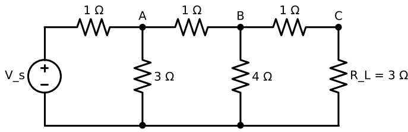

Find `I_L` when `V_s = 30 V`. Assume `I_L = 1 A`:

```
V_C = 3 V  →  the 1 Ω before C carries 1 A  →  V_B = 4 V
the 4 Ω at B carries 1 A  →  the 1 Ω between A and B carries 2 A  →  V_A = 4 + 2 = 6 V
the 3 Ω at A carries 2 A  →  the source current is 4 A  →  V_s = 6 + 4 = 10 V
```

So `V_s = 10 V` gives `I_L = 1 A`, and therefore `V_s = 30 V` gives **I_L = 3 A**. No equations were solved.

### Substitution

If the voltage across (or the current in) a branch is known, you may replace that branch by an independent source of the same value without changing any other voltage or current. This is how a *nonlinear* load is handled with a Thevenin equivalent, and it is used throughout two-port analysis (Day 5).

---

## 8. Which tool for which question?

| You are asked… | Reach for |
|---|---|
| the current or voltage in **one** branch (or for **many** loads) | Thevenin / Norton at that branch |
| the load for **maximum power** | Thevenin, then `R_L = R_th` (check which resistance is variable!) |
| the contribution of **one source**, a bias + signal split, or sources of **different frequencies** | superposition |
| a **ladder** with one source and the answer at the far end | unit-output method |
| a **two-node** circuit with many parallel branches | Millman |
| a quantity after **interchanging source and meter** | reciprocity |
| a circuit with **dependent sources** | nodal/mesh with the extra equation, or test-source Thevenin. **Never zero the dependent source** |

---

## 9. Past-year questions (all solved, all match the official keys)

Papers and keys: `02_Previous_Year_Papers/<year>/`. **Try each question from the paper first.**

| # | Question | Official answer | Concept it tests |
|---|---|---|---|
| 1 | 2019 Q4 (MCQ) | B: 1 A | Reciprocity: the circuit values are decoys |
| 2 | 2020 Q9 (MCQ) | C: 3.6 V | Thevenin voltage by source transformation |
| 3 | 2022 Q54 (NAT) | 3.9 to 4.1 mA | A Thevenin line read from a measurement, then a load with a battery |
| 4 | 2024 Q62 (NAT) | 2.5 Ω | Maximum power when a dependent source is present: test source |
| 5 | 2020 Q15 (NAT), 2023 Q33 (NAT) | 48 Ω, 80 Ω | Maximum power into a load at a two-port's output (full treatment on Day 5) |

### 2019 Q4: reciprocity
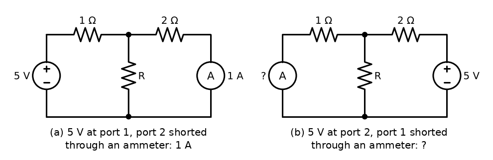

A 5 V source at port 1 produces 1 A in the short at port 2. The same source at port 2 produces the same current in the short at port 1: **1 A, option (B)**. The values 1 Ω, 2 Ω and R do not matter. (Check: the "1 A" in (a) forces `R = 1 Ω`. In (b), `V_M = 5 × (1 ∥ 1)/(2 + 0.5) = 1 V`, so the current in the short at port 1 is `1 V / 1 Ω = 1 A` ✓. The same equality holds for every value of R.)

### 2020 Q9: V_TH by source transformations
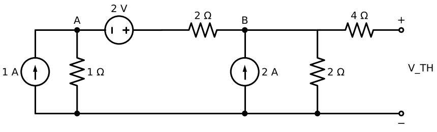

Transform the sources (Day 1 §10):

- 1 A in parallel with 1 Ω → **1 V in series with 1 Ω** (+ at node A).
- From ground to node B: `1 V + 2 V` of series EMF and `1 + 2 = 3 Ω` of series resistance → **1 A in parallel with 3 Ω** at B.
- At B the currents add: `1 A + 2 A = 3 A`, and the resistors to ground are `3 Ω ∥ 2 Ω = 1.2 Ω`.

`V_B = 3 A × 1.2 Ω = 3.6 V`. No current flows in the open 4 Ω, so **V_TH = 3.6 V, option (C)**. (The same circuit gives `R_th = 4 + 1.2 = 5.2 Ω`, so a load for maximum power would be 5.2 Ω taking 0.62 W.)

### 2022 Q54: a Thevenin line from measurements
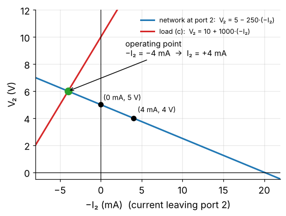

Looking into port 2 (with 10 V on port 1) the network is a Thevenin source: the measured line passes through (0, 5 V) and (4 mA, 4 V), so `V_th = 5 V` and `R_th = (5 − 4)/4 mA = 250 Ω`. In terms of `I₂` (current **into** port 2): `V₂ = 5 + 250·I₂`.

The load in (c) is a 1 kΩ resistor in series with a 10 V battery whose **+ side faces A**, so `V₂ = 10 − 1000·I₂`. Equating:

```
5 + 250·I₂ = 10 − 1000·I₂      →      I₂ = 5/1250 = 4 mA          (V₂ = 6 V)
```

**I₂ = +4 mA.** The positive sign means the 10 V battery is pushing current *into* the network, because it is larger than the 5 V open-circuit voltage.

### 2024 Q62: maximum power with a dependent source
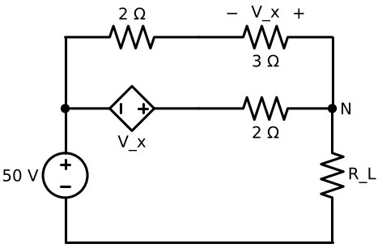

Remove R_L and find the Thevenin equivalent at N (take V_x with + at the right end of the 3 Ω, as drawn).

- **V_oc.** With R_L open, KCL at N gives `I₁ + I₂ = 0` for the two branch currents (both measured from the source towards N). Branch 1: `V_N = 50 − 5I₁`. Branch 2: `V_N = 50 + V_x − 2I₂` with `V_x = −3I₁`, so `V_N = 50 − 3I₁ + 2I₁ = 50 − I₁`. Equating the two gives `I₁ = 0`, hence `V_x = 0` and `V_oc = 50 V`.
- **R_th by test source.** Short the 50 V source (the dependent source stays) and put a voltage `v` at N. Branch 1 carries `v/5` toward the grounded end, so `V_x = 3 × v/5 = 0.6 v`. In branch 2, `v = 0 + V_x − 2·I₂`, so `I₂ = (0.6 v − v)/2 = −0.2 v`. The current drawn **out of** N is `v/5 + 0.2 v = 0.4 v`, hence `R_th = v/(0.4 v) = 2.5 Ω`.
- **Cross-check by V_oc / I_sc.** Short N: branch 1 gives 10 A, `V_x = −30 V`, so branch 2 has `(50 − 30)/2 = 10 A`. `I_sc = 20 A` and `R_th = 50/20 = 2.5 Ω` ✓.

Maximum power needs **R_L = R_th = 2.5 Ω** (and `P_max = 50²/(4 × 2.5) = 250 W`). If you had dropped the dependent source you would get `5 ∥ 2 = 1.43 Ω`, which is wrong.

### 2020 Q15 and 2023 Q33: maximum power at the output of a two-port
In both, a source with a 10 Ω series resistor drives port 1, and the load sits at port 2. The load sees the **Thevenin equivalent of everything to its left**, so the best load equals the **output impedance** seen at port 2 with the source off:

- Z parameters: `Z_out = z₂₂ − z₁₂z₂₁/(z₁₁ + R_s) = 120 − 60·60/(40 + 10) = 48 Ω`.
- Y parameters (`y = (1/100)[[2, −1],[−1, 4/3]]`): `Y_out = y₂₂ − y₁₂y₂₁/(y₁₁ + 1/R_s) = 0.0125 S`, so **80 Ω**.

Both match the keys. The derivation of these formulas is on Day 5.

---

## 10. Practice (answers at the end of this section)

**P1 · Three sources, one node.** Find `V_X` by superposition, then check with Millman.
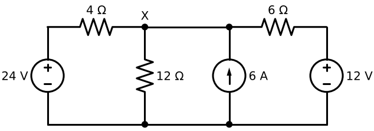

**P2 · Thevenin with a dependent source.** Find `V_th`, `R_th` and `I_N` at a–b. (`i` is the current in the 2 Ω resistor.)
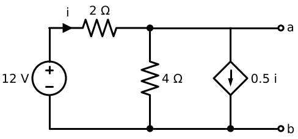

**P3 · Maximum power.** A source has `V_th = 20 V`, `R_th = 5 Ω`. (a) Find `R_L` for maximum power and `P_max`. (b) What is the efficiency there? (c) What power does `R_L = 20 Ω` receive? (d) If the load is fixed at 5 Ω and `R_th` can be set anywhere between 0 and 10 Ω, what is the maximum load power?

**P4 · Reciprocity.** In a reciprocal resistive two-port, 10 V at port 1 (port 2 shorted) drives 0.5 A through the short. (a) What short-circuit current at port 1 does 4 V at port 2 produce? (b) With port 2 open, 1 A injected at port 1 gives 3 V at port 2. What open-circuit voltage appears at port 1 when 2 A is injected at port 2 (port 1 open)?

**P5 · Negative resistance.** A 6 Ω resistor is in parallel with a VCCS that **injects** `0.25·v` into the top terminal (`v` is the terminal voltage). Find `R_th`, and say what happens if you connect a 12 Ω load.

<details>
<summary><b>Answers</b></summary>

- **P1:** each source alone: 24 V → `24 × (1/4)/0.5 = 12 V`; 12 V → `12 × (1/6)/0.5 = 4 V`; 6 A → `6/0.5 = 12 V` (the total conductance to the node is `1/4 + 1/6 + 1/12 = 0.5 S`). **V_X = 12 + 4 + 12 = 28 V**. Millman gives the same in one line.
- **P2:** open circuit: `i = V/4 + 0.5 i → i = V/2` and `V = 12 − 2i` → **V_th = 6 V**. Test source (12 V shorted): `i_t = V/2` → **R_th = 2 Ω**. So `I_N = 3 A`. (Wrongly ignoring the CCCS gives `2 ∥ 4 = 1.33 Ω`.)
- **P3:** (a) `R_L = 5 Ω`, `P_max = 400/20 = 20 W`. (b) **50%**. (c) `P = 400 × 20/25² = 12.8 W`. (d) the load power is `400·5/(R_th + 5)²`, largest at `R_th = 0`: **80 W**.
- **P4:** (a) the transfer admittance is `0.5/10 = 0.05 S` in both directions, so `4 × 0.05 = 0.2 A`. (b) `z₁₂ = z₂₁ = 3 Ω`, so `2 × 3 = 6 V`.
- **P5:** `i_t + 0.25v = v/6`, so `i_t = −v/12` and **R_th = −12 Ω**. With a 12 Ω load the total resistance seen is `−12 ∥ 12 = ∞`: the node equation `v(1/12 − 1/12) = I` has no finite solution. The circuit is not physically realisable as drawn, which is the danger of negative resistance.
</details>

---

## 11. The mistakes that cost marks (checklist)

1. **Zeroing a dependent source.** It stays in the circuit in superposition *and* in the test-source method.
2. **Superposing power or energy.** Only voltages and currents.
3. **Opening a voltage source or shorting a current source** when turning sources off. V → short, I → open.
4. **Leaving the load connected** while finding `V_oc` and `R_th`. Remove it first.
5. **Using `R_th = R seen` when a dependent source is present.** Use the test source or `V_oc/I_sc`.
6. **Wrong polarity of V_th.** Define `V_th = V_a − V_b` with `+` at a, and keep the equivalent consistent with that.
7. **Matching `R_L = R_th` when `R_th` is the variable.** That is the opposite scenario: smaller `R_th` is better.
8. **Maximum power ≠ maximum efficiency.** Matching gives 50%.
9. **Reciprocity with the wrong terminations.** The unexcited port must be shorted (voltage form) or opened (current form), and dependent sources spoil reciprocity.
10. **Reading "reciprocal" as "symmetric".** `z₁₂ = z₂₁` does not imply `z₁₁ = z₂₂`.
11. **Using the Thevenin equivalent for internal power.** It is correct only outside a–b.
12. **Adding phasors of different frequencies.** Superpose the time waveforms instead.

---

## 12. One-page formula sheet (copy this)

```
LINEARITY      y = Σ k_i·s_i  (no constant).  Power is NOT linear.

SUPERPOSITION  one independent source at a time; V → short, I → open; KEEP dependent sources.
               different frequencies → add in the TIME domain.

THEVENIN       V_th = V_oc (load removed)        R_th = V_oc / I_sc        R_th = v_t / i_t  (test source, independent sources off)
NORTON         I_N = I_sc    R_N = R_th    V_th = I_N·R_th        ideal V source: no Norton;  ideal I source: no Thevenin
MILLMAN        V_node = (Σ V_k/R_k + Σ I_k) / Σ(1/R_k)

MAX POWER      R_L = R_th  →  P_max = V_th²/(4R_th),  v_L = V_th/2,  efficiency = 50%.   P/P_max = 4x/(1+x)², x = R_L/R_th
               R_th variable, R_L fixed  →  smallest R_th (zero) is best.
               load = R_f (fixed) + R_v:   max in R_v  →  R_v = R_th + R_f.
               AC: Z_L = Z_th*;   only R_L adjustable: R_L = √(R_th² + (X_th+X_L)²);   only |Z_L|: |Z_L| = |Z_th|

RECIPROCITY    linear + bilateral + no dependent sources:  y₁₂ = y₂₁,  z₁₂ = z₂₁.
               V at port 1 → short-circuit I at port 2  =  V at port 2 → short-circuit I at port 1.
               I at port 1 → open-circuit V at port 2   =  I at port 2 → open-circuit V at port 1.
               reciprocal ≠ symmetric.

UNIT-OUTPUT    assume the output, work back to the source, scale.
```

---

## 13. Self-test before you move to Day 3

You are ready if you can, **without looking**:

- [ ] explain why power does not superpose and compute the cross term in a simple case
- [ ] turn off sources correctly, including leaving dependent sources in place
- [ ] find `R_th` with a test source and say when `V_oc/I_sc` fails
- [ ] state when Thevenin or Norton does not exist (`R_th = 0` or `∞`) and what a negative `R_th` means
- [ ] give the maximum-power condition for a variable load, a variable source resistance, and a partly fixed load
- [ ] state reciprocity in both forms with the right terminations, and name what breaks it
- [ ] solve 2020 Q9, 2024 Q62 and 2022 Q54 in under 3 minutes each
- [ ] score at least 17/20 on `Day02_Conceptual_Questions.md`

**Day 3 preview:** transients. Thevenin is the key tool there too. The time constant of any RC or RL circuit is `R_th·C` or `L/R_th`, where `R_th` is the Thevenin resistance seen by the energy-storage element.

---

## 14. Sources and further reading

**Pages read for this note** (via a research pass over the full pages):

- [Wikipedia: Thévenin's theorem](https://en.wikipedia.org/wiki/Th%C3%A9venin%27s_theorem): statement, the `V_oc` and `R_th` procedures, the test-source method for dependent sources, and the point that the equivalent matches only the external behaviour
- [Wikipedia: Maximum power transfer theorem](https://en.wikipedia.org/wiki/Maximum_power_transfer_theorem): derivation, 50% efficiency at matching, the case of a variable source resistance, and the warning against applying the theorem in the opposite scenario
- [Wikipedia: Superposition principle](https://en.wikipedia.org/wiki/Superposition_principle): the general statement for linear systems
- [Wikipedia: Reciprocity (electrical networks)](https://en.wikipedia.org/wiki/Reciprocity_(electrical_networks)): the two forms, the swap test, what makes a network non-reciprocal, and the point that a symmetric matrix does not imply a symmetric network

**Derived and checked in this repo, not taken from those pages:** the AC special cases of maximum power (only `R_L`, or only `|Z_L|`, adjustable), negative and infinite `R_th` with dependent sources, the nonlinear-load use of Thevenin, the unit-output method, and every worked example. All of them are verified numerically in `tools/verify_day02.py`.

**Recommended practice:** the Gate-O-Pedia notes (`01_Notes/`), pp. 2.30–2.34, for extra problems on the same topics. Lecture series on circuit theorems from MIT OCW 6.002 and the NPTEL network-analysis courses are good companions, but I did not extract their text for this note.
