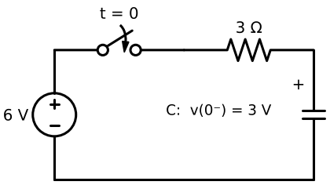
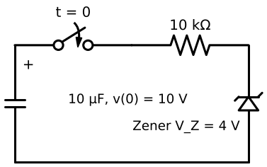

# Day 3 — 20 Conceptual Questions (Transient Analysis)

**Companion to:** `Day03_Transient_Analysis.md` (read §1–§7 first)
**Time:** 35–40 minutes, pencil and paper, no calculator needed (a few answers need `ln 2 ≈ 0.693`, `ln 5 ≈ 1.609`)
**Format:** GATE style. Each question tests **one idea**, and the wrong options are the mistakes students actually make.

| Type | How it works | Self-score |
|---|---|---|
| **MCQ** | exactly one correct option | 1 mark if right |
| **MSQ** | one or more correct options; **no partial credit** | 1 mark only if your set is exactly right |
| **NAT** | type a number, no options | 1 mark if right |

Every number in the solutions is re-checked by `tools/verify_day03.py`, and each answer was also derived by hand.

## What is in the set

| # | Type | Concept | Level | Review in the Day 3 note |
|---|---|---|---|---|
| 1 | MSQ | What cannot jump at a switching instant | Easy | §1 |
| 2 | MCQ | Capacitor and inductor models at 0⁺ and ∞ | Easy | §2 |
| 3 | NAT | A current that jumps while the capacitor voltage does not | Medium | §2 |
| 4 | NAT | `di/dt` at 0⁺ | Medium | §2 |
| 5 | MCQ | Energy lost when two capacitors are connected | Medium | §4 |
| 6 | MSQ | A current impulse into a capacitor | Medium | §1, §7 |
| 7 | NAT | Time to reach a given voltage | Easy | §3 |
| 8 | MSQ | Facts about first-order circuits | Medium | §3 |
| 9 | MCQ | The 99% point | Easy | §3 |
| 10 | NAT | Settling time for N-bit accuracy | Medium | §3 |
| 11 | MCQ | Energy lost while charging a capacitor | Medium | §3 |
| 12 | NAT | Energy in a Zener while a capacitor discharges | Hard | §3, §8 |
| 13 | MCQ | Effect of R on series and parallel damping | Medium | §5 |
| 14 | NAT | Damping ratio of a series RLC | Easy | §5 |
| 15 | MSQ | Facts about the damping cases | Medium | §5 |
| 16 | MCQ | Percentage overshoot | Medium | §5 |
| 17 | NAT | Damped frequency of a parallel RLC | Medium | §5 |
| 18 | MSQ | s-domain models and the value theorems | Medium | §7 |
| 19 | NAT | Time domain from a Laplace expression | Medium | §7 |
| 20 | MCQ | A voltage impulse across an inductor | Medium | §1, §7 |

---

## Part A: Continuity and initial conditions

### Q1 · MSQ
A switch operates in a circuit containing resistors, capacitors and inductors. Assuming no impulses occur, which of the following quantities **cannot** change instantaneously at the switching instant? Select **all** that apply.

- (A) The voltage across a capacitor.
- (B) The current through a capacitor.
- (C) The current through an inductor.
- (D) The energy stored in a capacitor.

### Q2 · MCQ
A circuit with **zero initial conditions** (no initial charge on any capacitor, no initial current in any inductor) is connected to a DC source at `t = 0`. Just after switching (`t = 0⁺`) and a long time later (`t → ∞`), the capacitors and inductors behave respectively as:

- (A) 0⁺: capacitors open, inductors short. ∞: capacitors short, inductors open.
- (B) 0⁺: both open. ∞: both short.
- (C) 0⁺: capacitors short, inductors open. ∞: capacitors open, inductors short.
- (D) 0⁺: both short. ∞: both open.

### Q3 · NAT
In the circuit, the capacitor has `v(0⁻) = 3 V` (+ at the top). The switch closes at `t = 0`.

The current in the loop just after the switch closes, `i(0⁺)`, is ______ A.

### Q4 · NAT
A series RL circuit (`R = 4 Ω`, `L = 2 H`) carries `i(0⁻) = 3 A`. At `t = 0` the supply is replaced by a 10 V source that drives current in the **same** direction. The value of `di/dt` at `t = 0⁺` is ______ A/s.

### Q5 · MCQ
A 3 µF capacitor charged to 100 V is connected, through an ideal switch and a resistor `R`, to an **uncharged** 2 µF capacitor. The energy dissipated in `R` is:

- (A) 15 mJ
- (B) 9 mJ
- (C) it depends on the value of `R`
- (D) 6 mJ

### Q6 · MSQ
An ideal current impulse `qδ(t)` is applied to an initially uncharged capacitor `C` (nothing else is connected to it). Select **all** correct statements.

- (A) The voltage just after the impulse is `q/C`.
- (B) The capacitor voltage is continuous at `t = 0`.
- (C) The energy stored just after the impulse is `q²/(2C)`.
- (D) If a resistor were connected in parallel with the capacitor, the jump in voltage would be smaller than `q/C`.

---

## Part B: First-order circuits

### Q7 · NAT
A capacitor `C = 5 µF` is charged from zero through `R = 2 kΩ` by a 10 V source. The time taken for the capacitor voltage to reach 8 V is ______ ms (round off to two decimal places).

### Q8 · MSQ
Select **all** correct statements about a first-order (single L or single C) circuit after a switching event.

- (A) Every voltage and current in the circuit has the same time constant.
- (B) The time constant depends on the energy stored before switching.
- (C) After `5τ` the response is within about 1% of its final value.
- (D) The time constant is always `R·C`, where `R` is the resistor connected directly in series with the capacitor.

### Q9 · MCQ
A first-order step response (zero initial state) reaches 99% of its final value after approximately:

- (A) 2.3 τ
- (B) 3 τ
- (C) 5 τ
- (D) 4.6 τ

### Q10 · NAT
A sample-and-hold switch has an on-resistance and capacitor giving `τ = 2 µs`. To make the capacitor voltage settle to within `1/2¹⁰` of the full scale (10-bit accuracy), the switch must stay closed for at least ______ µs (round off to two decimal places).

### Q11 · MCQ
A capacitor, initially uncharged, is charged to a voltage `V` through a resistor `R` from a DC source `V`. The energy dissipated in `R` during the charging is:

- (A) `CV²`
- (B) it depends on `R`
- (C) `½CV²`, independent of `R`
- (D) `¼CV²`

### Q12 · NAT
A 10 µF capacitor charged to 10 V discharges through a 10 kΩ resistor and a Zener diode (`V_Z = 4 V`). The diode is oriented so that the discharge current flows through it in breakdown, and it stops conducting when the capacitor voltage falls to 4 V.

The total energy dissipated in the Zener diode is ______ mJ (round off to two decimal places).

---

## Part C: Second-order circuits

### Q13 · MCQ
When the resistance `R` is **increased**, the damping of (i) a series RLC circuit and (ii) a parallel RLC circuit:

- (A) increases in both.
- (B) increases in (i) and decreases in (ii).
- (C) decreases in (i) and increases in (ii).
- (D) is unchanged in both.

### Q14 · NAT
A series RLC circuit has `R = 40 Ω`, `L = 0.1 H` and `C = 100 µF`. Its damping ratio `ζ` is ______ (round off to two decimal places).

### Q15 · MSQ
Select **all** correct statements about the natural response of a second-order RLC circuit.

- (A) In the overdamped case both characteristic roots are real and negative.
- (B) In the underdamped case the oscillation frequency equals `ω₀ = 1/√(LC)`.
- (C) With `R = 0` (series loop) the response oscillates forever at `ω₀`.
- (D) Critical damping gives the fastest decay without overshoot.

### Q16 · MCQ
A series RLC circuit has `R = 1 Ω`, `L = 1 H`, `C = 1 F` and is driven by a unit step from a zero initial state. The percentage overshoot of the capacitor voltage is approximately:

- (A) 16.3%
- (B) 35.1%
- (C) 9.5%
- (D) 4.3%

### Q17 · NAT
A parallel RLC circuit has `R = 100 Ω`, `L = 10 mH` and `C = 1 µF`. The frequency of its damped natural oscillation, `ω_d`, is ______ rad/s (round off to the nearest integer).

---

## Part D: Laplace analysis

### Q18 · MSQ
Select **all** correct statements.

- (A) A capacitor with initial voltage `v(0⁻)` can be modelled in the s-domain by `1/(sC)` in series with a source `v(0⁻)/s`.
- (B) An inductor with initial current `i(0⁻)` can be modelled by `sL` in series with a source `L·i(0⁻)` that aids the initial current.
- (C) The initial-value theorem gives `f(0⁺) = lim s·F(s)` as `s → ∞` (for a proper `F(s)` with no impulse at 0).
- (D) The final-value theorem `f(∞) = lim s·F(s)` as `s → 0` can be used for any `F(s)`.

### Q19 · NAT
The Laplace transform of a current is `I(s) = (s + 6)/(s(s + 3))`. The time at which `i(t)` reaches 1.5 A is ______ s (round off to three decimal places).

### Q20 · MCQ
A 2 H inductor with `i(0⁻) = 1 A` has a voltage impulse `6δ(t)` V applied across it. The current just after `t = 0` is:

- (A) 1 A
- (B) 4 A
- (C) 7 A
- (D) 3 A

---

## Score yourself

<b>Answer key (open after you finish all 20)</b>

| Q | Answer | Q | Answer |
|---|---|---|---|
| 1 | A, C, D | 11 | C |
| 2 | C | 12 | 0.24 (range 0.23 to 0.25) |
| 3 | 1 (range 1 to 1) | 13 | B |
| 4 | -1 (range -1 to -1) | 14 | 0.63 (range 0.62 to 0.64) |
| 5 | D | 15 | A, C, D |
| 6 | A, C | 16 | A |
| 7 | 16.09 (range 16.0 to 16.2) | 17 | 8660 (range 8655 to 8665) |
| 8 | A, C | 18 | A, B, C |
| 9 | D | 19 | 0.231 (range 0.230 to 0.232) |
| 10 | 13.86 (range 13.8 to 13.9) | 20 | B |

**How to read your score**

| Score | What to do |
|---|---|
| 17–20 | You are ready for Day 4 (sinusoidal steady state). |
| 13–16 | Re-read the "Review" section for each question you missed, then redo only those questions tomorrow. |
| 12 or less | Re-read §1–§5 of the Day 3 note, redo the worked examples with the solution covered, then retake this set after 24 hours. |

Keep a note of **why** each miss happened: concept gap, sign slip, or misread diagram. Those are three different fixes.

## Solutions

<b>Q1 · What cannot jump</b>

**Answer: A, C, D.**

`i_C = C dv/dt` and `v_L = L di/dt`: a jump in `v_C` or `i_L` would need an infinite current or voltage. The stored energies `½Cv²` and `½Li²` therefore cannot jump either (A, C, D). The capacitor **current** (B) is set by whatever the rest of the circuit now demands, so it can jump, and so can every resistor voltage and current.

*Review:* §1.

<b>Q2 · Models at 0⁺ and ∞</b>

**Answer: C.**

With zero initial conditions `v_C(0⁺) = 0` and `i_L(0⁺) = 0`, so the capacitor is a **short** (a 0 V source) and the inductor is an **open** (a 0 A source) at `t = 0⁺`. In the DC steady state the roles reverse: the capacitor is **open** and the inductor is **short**. Option (A) swaps the two moments, which is the most common slip.

*Review:* §2.

<b>Q3 · A current that jumps</b>

**Answer: 1 A.**

The capacitor voltage cannot jump, so at `0⁺` it is still 3 V. KVL around the loop: `6 − 3·i − 3 = 0`, so `i(0⁺) = 1 A`. Before the switch closed the current was 0, so the **current jumps** from 0 to 1 A while the capacitor voltage stays at 3 V. (A common mistake is to treat the capacitor as a short at 0⁺ and get 2 A, which is only right for an uncharged capacitor.)

*Review:* §2.

<b>Q4 · di/dt at 0⁺</b>

**Answer: −1 A/s.**

`i_L` is continuous, so `i(0⁺) = 3 A`. The inductor voltage just after the change is `v_L = 10 − R·i = 10 − 4 × 3 = −2 V`, so `di/dt = v_L/L = −2/2 = −1 A/s`. The current decreases toward its new final value `10/4 = 2.5 A`.

*Review:* §2.

<b>Q5 · Two capacitors</b>

**Answer: D.**

Charge conservation: `V = 3 × 100/(3 + 2) = 60 V`. Energy before `½ × 3 µF × 100² = 15 mJ`, after `½ × 5 µF × 60² = 9 mJ`. The **6 mJ** difference is dissipated, and it does not depend on `R` (a smaller `R` just makes it faster). (A) is the total initial energy, and (B) is the energy that remains.

*Review:* §4.

<b>Q6 · A current impulse into a capacitor</b>

**Answer: A, C.**

Integrating `C dv/dt = qδ(t)` across `t = 0` gives `Δv = q/C` (A ✓), so the voltage **jumps** and (B) is false. The stored energy is `½C(q/C)² = q²/(2C)` (C ✓). If a resistor were in parallel, it would take a finite current, which contributes nothing to an integral over zero time, so the jump is still `q/C` (D is false).

*Review:* §1, §7.

<b>Q7 · Time to reach 8 V</b>

**Answer: 16.09 ms.**

`τ = RC = 2 kΩ × 5 µF = 10 ms` and `v(t) = 10(1 − e^(−t/τ))`. Setting `v = 8`: `e^(−t/τ) = 0.2`, so `t = τ ln 5 = 10 × 1.609 = 16.09 ms`.

*Review:* §3.

<b>Q8 · First-order facts</b>

**Answer: A, C.**

- **(A) True.** All variables are built from the same exponential `e^(−t/τ)`.
- **(C) True.** `e^(−5) = 0.67%`, so after `5τ` the response is within 1%.
- **(B) False.** `τ` depends only on the circuit after switching, not on the stored energy or the sources.
- **(D) False.** `τ = R_th·C`, where `R_th` is the Thevenin resistance seen by the capacitor. Other resistors in the network contribute.

*Review:* §3.

<b>Q9 · The 99% point</b>

**Answer: D.**

`1 − e^(−x) = 0.99` gives `x = ln 100 = 4.6`. (2.3 τ is the 90% point, 3 τ gives 95%, and 5 τ is the "settled" 99.3% point, a convenient rule of thumb but not 99% exactly.)

*Review:* §3.

<b>Q10 · Settling for N-bit accuracy</b>

**Answer: 13.86 µs.**

We need `e^(−t/τ) ≤ 2⁻¹⁰`, so `t = τ·ln(2¹⁰) = N·τ·ln 2 = 10 × 2 µs × 0.693 = 13.86 µs`. (This is the logic of 2023 Q62: 12-bit accuracy with `τ = 1 µs` needs 8.32 µs.)

*Review:* §3.

<b>Q11 · Energy lost while charging</b>

**Answer: C.**

The source supplies `Q·V = CV²`. The capacitor stores `½CV²`, so the other `½CV²` is dissipated in `R`, **whatever R is**. A larger `R` only stretches the heating over a longer time. That is why charging a capacitor from a fixed source is at most 50% efficient.

*Review:* §3.

<b>Q12 · Energy in a Zener</b>

**Answer: 0.24 mJ.**

The capacitor discharges from 10 V to 4 V. The charge that flows is `ΔQ = C·ΔV = 10 µF × 6 V = 60 µC`, and all of it passes through the Zener at a constant 4 V, so `E_Z = V_Z·ΔQ = 4 × 60 µC = 240 µJ = 0.24 mJ`. (Bookkeeping: the capacitor loses `½C(10² − 4²) = 0.42 mJ`; the resistor takes the remaining 0.18 mJ.) The trick is to count **charge through a constant voltage**, not to integrate `v·i` directly. This is the idea behind 2024 Q35.

*Review:* §3, §8.

<b>Q13 · Effect of R on damping</b>

**Answer: B.**

Series: `α = R/(2L)`, so a larger `R` means more damping. Parallel: `α = 1/(2RC)`, so a larger `R` means *less* damping (a larger resistor draws less current out of the tank, so less energy is lost per cycle). The trap is to assume that "more resistance always means more damping".

*Review:* §5.

<b>Q14 · Damping ratio</b>

**Answer: 0.63.**

`ζ = (R/2)·√(C/L) = 20 × √(100 µF/0.1 H) = 20 × √(10⁻³) = 20 × 0.0316 = 0.632`. (Equivalently `α = R/2L = 200` and `ω₀ = 1/√(LC) = 316`, so `ζ = α/ω₀ = 0.632`.) It is underdamped.

*Review:* §5.

<b>Q15 · Damping facts</b>

**Answer: A, C, D.**

- **(A) True.** `α > ω₀` gives two distinct real negative roots.
- **(C) True.** With no resistance there is no loss, so the energy swaps between L and C forever at `ω₀`.
- **(D) True.** Critical damping is the boundary: the fastest approach to the final value that does not overshoot.
- **(B) False.** The underdamped oscillation is at the **damped** frequency `ω_d = √(ω₀² − α²)`, which is lower than `ω₀`.

*Review:* §5.

<b>Q16 · Percentage overshoot</b>

**Answer: A.**

`ζ = (R/2)√(C/L) = 0.5`, so the overshoot is `e^(−πζ/√(1−ζ²)) = e^(−π × 0.5/0.866) = e^(−1.814) = 16.3%`. The other options belong to other damping ratios: 35.1% to `ζ = 0.316`, 9.5% to `ζ = 0.6`, and 4.3% to `ζ = 0.707`.

*Review:* §5.

<b>Q17 · Damped frequency of a parallel RLC</b>

**Answer: 8660 rad/s.**

Parallel: `α = 1/(2RC) = 1/(2 × 100 × 10⁻⁶) = 5000`. `ω₀ = 1/√(10 mH × 1 µF) = 10 000`. Then `ω_d = √(ω₀² − α²) = √(10⁸ − 2.5 × 10⁷) = √(7.5 × 10⁷) = 8660 rad/s`. Using the series formula `α = R/2L = 5000` happens to give the same number here by coincidence of the values, so check which circuit you have.

*Review:* §5.

<b>Q18 · s-domain facts</b>

**Answer: A, B, C.**

- **(A, B) True.** These are the two standard series models, with the capacitor source `v(0⁻)/s` having the capacitor's polarity and the inductor source `L·i(0⁻)` aiding the initial current.
- **(C) True.** `f(0⁺) = lim s·F(s)` as `s → ∞` (provided there is no impulse at the origin).
- **(D) False.** The final-value theorem needs every pole of `s·F(s)` in the open left half-plane. For `F(s) = 1/(s² + 1)`, `s·F(s)` has poles on the imaginary axis and the limit is meaningless, because the signal never settles.

*Review:* §7.

<b>Q19 · From s to t</b>

**Answer: 0.231 s.**

`I(s) = (s + 6)/(s(s + 3)) = 2/s − 1/(s + 3)`, so `i(t) = 2 − e^(−3t)`. Setting `i = 1.5`: `e^(−3t) = 0.5`, so `t = ln 2/3 = 0.231 s`. (Check: `i(0⁺) = lim s·I = 1` and `i(∞) = 2`.)

*Review:* §7.

<b>Q20 · A voltage impulse across an inductor</b>

**Answer: B.**

`v = L di/dt`, so integrating across the impulse: `Δi = (1/L)·∫v dt = 6/2 = 3 A`. The current becomes `1 + 3 = 4 A`. This is the dual of Q6: an impulse is just a change in the initial condition. (Option (A) ignores the impulse, (C) adds `6` without dividing by `L`.)

*Review:* §1, §7.

