# Day 3 — Transient Analysis: RC, RL, RLC, Initial Conditions, Laplace

**Covers:** continuity rules · initial and final conditions (the 0⁻ / 0⁺ / ∞ method) · first-order circuits and the time constant · charge conservation · second-order RLC circuits · state equations · Laplace-domain analysis
**Matches:** Day 3 of `03_Study_Plans/20_Day_Plan_Networks_Signals_Control.md` (Gate-O-Pedia pp. 2.35 – 2.43)
**Time:** about 5½ hours in total
**Companion:** `Day03_Conceptual_Questions.md`, 20 GATE-style conceptual questions with solutions
**Needs from earlier days:** Thevenin resistance (Day 2 §3), dependent sources (Day 1 §4)

Every number in this note is re-checked by `tools/verify_day03.py` (circuit solver, numerical integration and symbolic Laplace), and all 13 past-year answers match the official keys in `02_Previous_Year_Papers/`.

## How to use this note

| Step | What | Time |
|---|---|---|
| 1 | Read §1–§3 (the 0⁻ / 0⁺ / ∞ method and first-order circuits). **Cover the solution, solve, then compare** | 75 min |
| 2 | Read §4–§7 (charge conservation, RLC, state equations, Laplace) | 90 min |
| 3 | Do §8: the 13 past-year questions. Try each one first | 60 min |
| 4 | Do §9 practice problems, then read §10 (mistakes) | 40 min |
| 5 | Take the **20 conceptual questions** (timed, then review the ones you missed) | 40 min |
| 6 | Copy §11 onto your Networks formula sheet | 10 min |

---

## 1. What is a transient, and what cannot jump

A **transient** is the circuit's passage from one steady state to another after a switch moves or a source changes. It exists only because **L and C store energy**, and energy cannot change instantly (that would need infinite power).

```
capacitor:  i = C·dv/dt        a jump in v_C needs an infinite current
inductor:   v = L·di/dt        a jump in i_L needs an infinite voltage
```

| Quantity | Can it jump when a switch operates? |
|---|---|
| **v_C** and **i_L** | **No.** They are the circuit's *state variables* (its memory) |
| the stored energies `½Cv²` and `½Li²` | No |
| i_C, v_L | **Yes** (they are set by what the rest of the circuit now demands) |
| i_R, v_R and every other branch variable | **Yes** |

**The exceptions** are impulses. An ideal current impulse `qδ(t)` into a capacitor changes its voltage instantly by `q/C`, and a voltage impulse `Φδ(t)` across an inductor changes its current by `Φ/L` (2026 Q23 in §8). Switching can also create impulses: connecting capacitors with different voltages, or interrupting an inductor current. Those cases are handled by **conservation of charge or flux** (§4).

---

## 2. Initial and final conditions: the 0⁻ / 0⁺ / ∞ method

Three snapshots answer most questions. **Do them in this order.**

1. **t = 0⁻ (just before the switch).** The old circuit is in DC steady state: capacitors are open, inductors are short. Find `v_C(0⁻)` and `i_L(0⁻)`.
2. **t = 0⁺ (just after).** Use the *new* circuit, but replace each capacitor by a **voltage source** `v_C(0⁺) = v_C(0⁻)` and each inductor by a **current source** `i_L(0⁺) = i_L(0⁻)`. This is now a **resistive** circuit. Solve it for any other quantity, for example `i_C(0⁺)` or `v_L(0⁺)`. Then
   `dv_C/dt (0⁺) = i_C(0⁺)/C` and `di_L/dt (0⁺) = v_L(0⁺)/L`.
3. **t → ∞.** The *new* circuit in DC steady state: capacitors open, inductors short. This gives the final values.

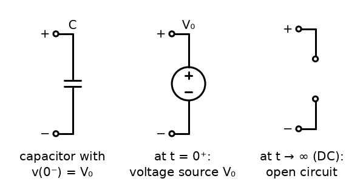

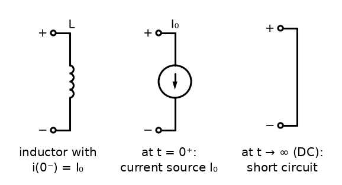

| Element | t = 0⁻ (DC) | t = 0⁺ | t → ∞ (DC) |
|---|---|---|---|
| capacitor | open | voltage source `v_C(0⁻)` (a **short** if it was uncharged) | open |
| inductor | short | current source `i_L(0⁻)` (an **open** if it carried no current) | short |

The three snapshots are exactly the "0⁺ method" used in 2021 Q28 and 2023 Q44 (§8). The same idea with *symbols* instead of numbers gives the state equations of §6.

---

## 3. First-order circuits (one L or one C)

Any circuit with **one** energy-storage element, after Thevenin reduction, is a source `V_th` and `R_th` driving that element. Every voltage and current in it then has the same form:

```
x(t) = x(∞) + [ x(0⁺) − x(∞) ] · e^(−t/τ)        for t > 0

τ = R_th·C   (RC)          τ = L / R_th   (RL)
R_th = Thevenin resistance seen by the storage element AFTER switching, with independent sources off
```

Three facts make this a one-minute method:

1. It works for **any** variable `x` (even one that jumps at t = 0). Use *that variable's own* `x(0⁺)` (from the 0⁺ resistive circuit) and `x(∞)`.
2. `τ` is a property of the **circuit after switching**, not of the sources or of the initial charge.
3. `R_th` comes from Day 2: with a dependent source, use a test source (it may even be negative, which makes the response *grow*; see Day 2 §3).

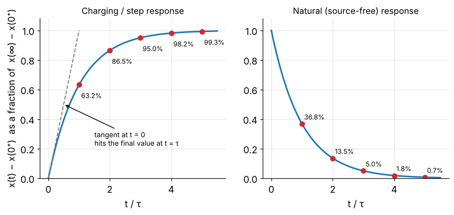

| after … | τ | 2τ | 3τ | 4τ | 5τ |
|---|---|---|---|---|---|
| fraction of the change completed | 63.2% | 86.5% | 95.0% | 98.2% | 99.3% |

Useful numbers: half the change takes `0.693 τ`; 99% takes `4.6 τ`; the 10%–90% rise time is `2.2 τ`. To reach a given value `x`:

```
t = τ · ln[ ( x(0⁺) − x(∞) ) / ( x − x(∞) ) ]
```

**Acquisition time (sample-and-hold).** To settle to within `1/2^N` of the full scale, wait `t = τ·ln(2^N) = N·τ·ln 2` (2023 Q62).

**Energy bookkeeping.** Charge a capacitor from zero to `V` through any `R` from a DC source `V`: the source supplies `CV²`, the capacitor stores `½CV²` and **`½CV²` is lost in R, whatever R is**. (Checked numerically for 10 Ω, 1 kΩ and 1 MΩ.)

### Ex 1: RC step with an initial charge

A 10 V step is applied at `t = 0` to `R = 2 kΩ` in series with `C = 5 µF`, which starts at `v(0) = 2 V`.

- `τ = RC = 10 ms`, `v(0⁺) = 2 V`, `v(∞) = 10 V`, so **v(t) = 10 − 8e^(−t/10 ms) V**.
- `i(t) = (10 − v)/R = 4 mA · e^(−t/10 ms)`: the current **jumps** from 0 to 4 mA at `t = 0⁺`.
- Time to reach 9 V: `t = 10 ms × ln(8/1) =` **20.79 ms**.

### Switching a sinusoid on (RL)

For `v = V_m sin(ωt + θ)` applied at `t = 0` to a series RL circuit (`φ = tan⁻¹(ωL/R)`, `τ = L/R`):

```
i(t) = (V_m/|Z|) · [ sin(ωt + θ − φ)  −  sin(θ − φ)·e^(−t/τ) ]
        └── forced (steady state) ──┘   └── natural (transient) ──┘
```

The transient has the **same τ** as the source-free circuit, and its size depends on the switching angle: if `θ = φ` there is **no transient at all**. (Example: R = 10 Ω, L = 0.1 H, ω = 100 rad/s gives `φ = 45°`, `τ = 10 ms`, and the formula agrees with numerical integration.)

---

## 4. Conservation of charge and flux (when the continuity rule seems to fail)

When a switch connects an ideal capacitor to another one with a different voltage, the current is an impulse, so `v_C` **does** jump. The rule that survives is **conservation of charge** at the connecting node (provided no resistive path lets charge escape):

```
C₁V₁(0⁻) + C₂V₂(0⁻) = (C₁ + C₂)·V(0⁺)
```

### Ex 2: two capacitors

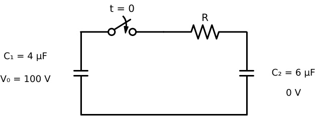

`C₁ = 4 µF` at 100 V is connected through a switch and any resistor to an uncharged `C₂ = 6 µF`.

- Final voltage: `V = 4 × 100/(4 + 6) =` **40 V**.
- Energy before: `½ × 4 µF × 100² = 20 mJ`. After: `½ × 10 µF × 40² = 8 mJ`.
- **Lost: 12 mJ = ½V₀²·C₁C₂/(C₁ + C₂)**, and it is the same whether R is 1 mΩ or 1 MΩ. With R → 0 the energy leaves as a very short, very large current pulse (heat, radiation, a spark).

The **dual** statement: an inductor current cannot be interrupted instantly either. If a switch opens the only path of an ideal inductor current, the inductor tries to produce an infinite voltage (a spark across the switch, or a flyback diode in a real circuit). Two inductors that are suddenly forced to carry the same current (connected in series) conserve **flux**: `L₁i₁ + L₂i₂ = (L₁ + L₂)·i`.

---

## 5. Second-order circuits (RLC)

Two storage elements give a second-order equation. KVL on the series loop, or KCL on the parallel node, gives the same characteristic equation:

```
s² + 2α·s + ω₀² = 0        roots  s = −α ± √(α² − ω₀²)        ω₀ = 1/√(LC)
```

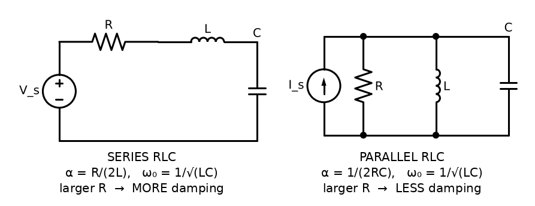

| | Series RLC | Parallel RLC |
|---|---|---|
| damping factor `α` | `R/(2L)` | `1/(2RC)` |
| damping ratio `ζ = α/ω₀` | `(R/2)·√(C/L)` | `(1/2R)·√(L/C)` |
| quality factor `Q = 1/(2ζ)` | `ω₀L/R` | `R/(ω₀L) = R√(C/L)` |
| critical damping | `R = 2√(L/C)` | `R = ½√(L/C)` |
| effect of a **larger R** | **more** damping | **less** damping |

The last row is a favourite trap: in a series loop R *opposes* the current, in a parallel node a larger R *removes* a damping path.

| Case | Condition | Roots | Natural response |
|---|---|---|---|
| overdamped | `α > ω₀` (`ζ > 1`) | two distinct real, both negative | `A₁e^(s₁t) + A₂e^(s₂t)` |
| critically damped | `α = ω₀` (`ζ = 1`) | one repeated real root `−α` | `(A₁ + A₂t)e^(−αt)` |
| underdamped | `α < ω₀` (`ζ < 1`) | complex pair `−α ± jω_d` | `e^(−αt)(A₁cos ω_d t + A₂sin ω_d t)`, `ω_d = √(ω₀² − α²)` |
| undamped | `R = 0` (`ζ = 0`) | `±jω₀` | sustained oscillation at `ω₀` (energy swaps between L and C) |

(A **negative** R, which dependent sources can create, gives a root pair in the right half-plane: a growing oscillation.)

**Constants.** Two unknowns need two initial conditions: `v_C(0⁺)` and `i_L(0⁺)` (from §2), with `dv_C/dt (0⁺) = i_C(0⁺)/C`. A step response is `final value + natural response`.

### Underdamped step response (zero initial state, series RLC, output v_C)

```
v_C(t) = V_s · [ 1 − e^(−αt)·( cos ω_d t + (α/ω_d)·sin ω_d t ) ]

peak time  t_p = π/ω_d          overshoot  = e^(−πζ/√(1−ζ²))          2% settling time ≈ 4/α
```

### Ex 3: the three damping cases

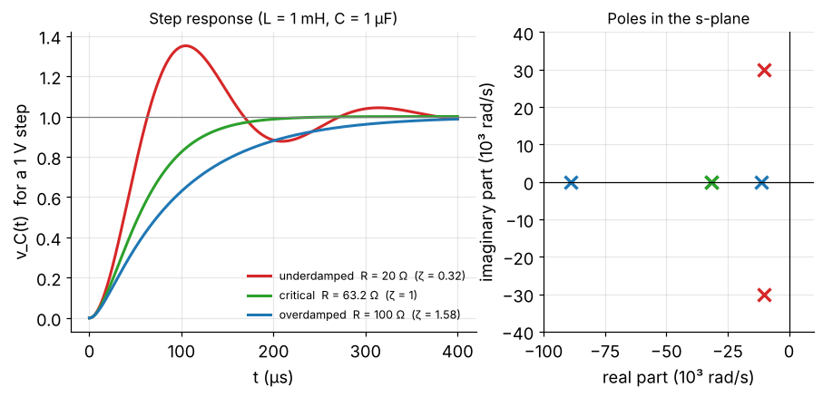

Series RLC, `L = 1 mH`, `C = 1 µF` (`ω₀ = 31 623 rad/s`, critical `R = 63.2 Ω`):

| R | α | ζ | roots (rad/s) | behaviour |
|---|---|---|---|---|
| 20 Ω | 10 000 | 0.32 | `−10 000 ± j30 000` | underdamped, overshoot **35.1%** at `t_p = 105 µs` |
| 63.2 Ω | 31 623 | 1 | `−31 623` (double) | critical, fastest approach with **no** overshoot |
| 100 Ω | 50 000 | 1.58 | `−11 270`, `−88 730` | overdamped, slow (the pole nearest the origin dominates) |

---

## 6. State equations (the 0⁺ method with symbols)

Choose `v_C` and `i_L` as **states**. Then `C·dv_C/dt = (sum of currents into the capacitor)` and `L·di_L/dt = (sum of voltages across the inductor)`. To get these sums, replace C by a voltage source `v` and L by a current source `i` (exactly the 0⁺ method) and solve the resistive circuit symbolically. The result is

```
ẋ = A·x + B·u        eigenvalues of A  =  natural frequencies  =  roots of det(sI − A) = 0
```

For the series RLC with `x = [v_C, i]`: `A = [[0, 1/C], [−1/L, −R/L]]`, and `det(sI − A) = s² + (R/L)s + 1/(LC)`, the same characteristic polynomial as above. 2020 Q30 (§8) is a worked example.

---

## 7. Laplace-domain analysis

Laplace turns the differential equations into algebra and **builds the initial conditions into the circuit**.

| Element | Zero initial state | With an initial condition |
|---|---|---|
| R | `V = R·I` | same |
| L | `V = sL·I` | `V = sL·I − L·i(0⁻)`: `sL` in series with a source `L·i(0⁻)` that **aids** the initial current |
| C | `I = sC·V` | `V = I/(sC) + v(0⁻)/s`: `1/(sC)` in series with a source `v(0⁻)/s` of the same polarity as the capacitor voltage |

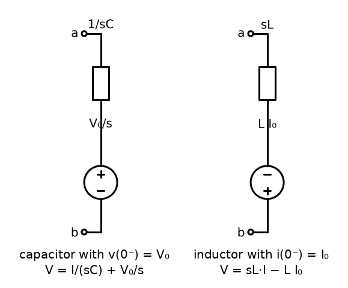

(Equivalent Norton forms: for L a parallel current source `i(0⁻)/s`; for C a parallel current source `C·v(0⁻)`.)

**Procedure:** (1) find `v_C(0⁻)`, `i_L(0⁻)`; (2) draw the s-domain circuit with the sources above; (3) solve algebraically (divider, nodal, mesh); (4) partial fractions; (5) inverse transform.

**Poles tell the story.** A real pole at `−1/τ` is the first-order exponential. A complex pair `−α ± jω_d` is a damped oscillation. Poles on the imaginary axis oscillate forever, and any pole in the right half-plane means growth.

**Transfer function of the series RLC (output v_C):** `V_C/V_s = 1/(LC·s² + RC·s + 1)`, so its poles are the roots of §5.

**Initial- and final-value theorems.**

```
f(0⁺) = lim s→∞ s·F(s)         (F proper, no impulse at t = 0)
f(∞)  = lim s→0  s·F(s)         (only if every pole of sF(s) is in the open left half-plane)
```

### Ex 4: RC step through Laplace (checks Ex 1)

`V_s/s = R·I + I/(sC) + v₀/s` gives `I = (V_s − v₀)/(R(s + 1/RC))`, so `v_C = V_s/s − R·I`, and inverting: `v_C(t) = V_s − (V_s − v₀)e^(−t/RC)`. With the numbers of Ex 1 this is `10 − 8e^(−t/10 ms)` ✓.

### Ex 5: reading a result

`I(s) = (s + 6)/(s(s + 3)) = 2/s − 1/(s + 3)`, so `i(t) = 2 − e^(−3t)`. Initial value `lim sI(s) = 1`, final value `lim sI(s) = 2`, and `i = 1.5 A` at `t = ln 2/3 = 0.231 s`.

**An impulse is an initial condition.** `L{qδ(t)} = q`, so a capacitor driven by `qδ(t)` has `V(s) = (V₀ + q/C)/s`: it is the same as starting at `V₀ + q/C`. Dually, a voltage impulse `Φδ(t)` across an inductor adds `Φ/L` to its initial current.

---

## 8. Past-year questions (all solved, all match the official keys)

Papers and keys: `02_Previous_Year_Papers/<year>/`. **Try each question from the paper first.**

| # | Question | Official answer | Concept it tests |
|---|---|---|---|
| 1 | 2019 Q41 (NAT) | 0.23 to 0.27 A | RC circuit with a *time-varying* resistor |
| 2 | 2019 Q52 (NAT) | 3.2 to 3.4 V | RC charging through an ideal diode: the capacitor holds |
| 3 | 2020 Q30 (MCQ) | A | State equations of an RLC circuit |
| 4 | 2021 Q28 (MCQ) | C: −3 V/s | `dv/dt` at 0⁺ by the 0⁺ method |
| 5 | 2021 Q38 (NAT) | 0.132 to 0.146 ms | First-order circuit with a dependent source |
| 6 | 2021 Q47 (NAT) | 1.40 to 1.45 A | Underdamped step response: the overshoot |
| 7 | 2023 Q35 (NAT) | 4 V | Opening a switch in an RL circuit |
| 8 | 2023 Q44 (MCQ) | B: −1 A | `i_C(0⁺)` after two switches operate |
| 9 | 2023 Q62 (NAT) | 8.30 to 8.34 µs | Acquisition time for N-bit accuracy |
| 10 | 2024 Q32 (NAT) | 0.75 s | Time constant from the resistance seen by L |
| 11 | 2024 Q35 (NAT) | 0.250 mJ | Energy in a Zener while a capacitor discharges |
| 12 | 2024 Q49 (MCQ) | D | Schmitt trigger and an op-amp integrator with an inductor |
| 13 | 2026 Q23 (MCQ) | A | An impulse of current is an initial condition |

### 2019 Q41: a time-varying resistor
With `R(t) = R₀(1 − t/T)`, `R₀ = 1 Ω`, `C = 1 F`, `T = 3 R₀C = 3 s`, `V_s = 1 V`. There is no single time constant, so write the equation. Let `u = V_s − v_C = R·i`. Then `du/dt = −i/C = −u/(R(t)C)`:

```
d(ln u)/dt = −1/(R₀C(1 − t/T))   →   u = (1 − t/T)^(T/(R₀C)) = (1 − t/3)³
i(t) = u/R(t) = (1 − t/3)²         i(0) = 1 A ✓,    i(T/2) = 0.5² = 0.25 A
```

### 2019 Q52: the diode makes the capacitor hold
`τ = RC = 500 Ω × 10 µF = 5 ms`. For 0–2 ms the source is +10 V: the diode conducts, and `v_C(2 ms) = 10(1 − e^(−2/5)) = 3.30 V`. For 2–4 ms the source is −10 V, below `v_C`, so the diode is **off**: nothing can discharge the capacitor and `v_C(3 ms) = 3.3 V`.

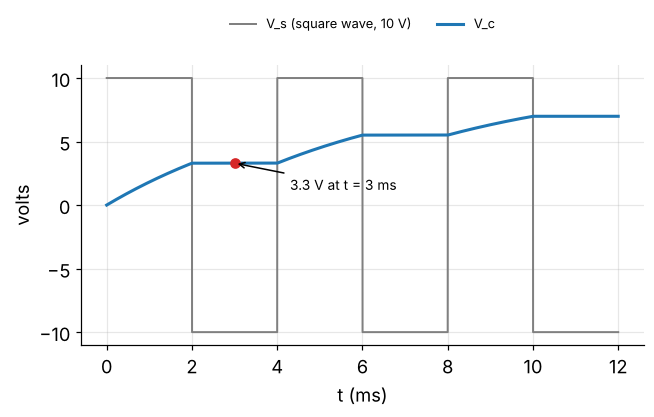

### 2020 Q30: state equations
States `v` (capacitor, + top) and `i` (inductor, left to right). Node a (with `i₁` and 2 Ω): `i₁ = V_a/2 + i`, so `V_a = 2(i₁ − i)`. The inductor: `0.5·di/dt = V_a − v`, so `di/dt = −2v − 4i + 4i₁`. Node b: `i + i₂ = 0.25·dv/dt + v/1`, so `dv/dt = −4v + 4i + 4i₂`:

```
d/dt [v; i] = [ −4   4 ] [v; i] + [ 0  4 ] [i₁; i₂]      → option (A)
              [ −2  −4 ]           [ 4  0 ]
```

(The eigenvalues are `−4 ± j2√2`, so the circuit is underdamped.)

### 2021 Q28 and 2023 Q44: the 0⁺ method
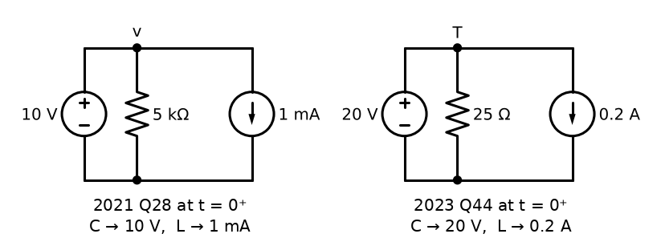

**2021 Q28.** Switch at P, DC steady state: `i = 20 V/(5k + 5k + 10k) = 1 mA`, so `i_L(0⁻) = 1 mA` and `v(0⁻) = 1 mA × 10 kΩ = 10 V`. After the switch moves to Q, the right 5 kΩ goes to ground. At 0⁺ the capacitor is a 10 V source and the inductor a 1 mA source (the 10 kΩ in series with it is irrelevant):

`C·dv/dt = −(10 V/5 kΩ + 1 mA) = −3 mA`, so **dv/dt = −3 mA/1 mF = −3 V/s, option (C)**.

**2023 Q44.** Before: `S₁` closed, `S₂` open, DC: C open, L short, so the 1 A source flows through `25 Ω ∥ 100 Ω = 20 Ω`: `v_C(0⁻) = 20 V`, `i_L(0⁻) = 20/100 = 0.2 A`. At 0⁺: `S₁` is open (source gone), `S₂` is closed (100 Ω shorted). The capacitor is a 20 V source across the top node; the 25 Ω draws `20/25 = 0.8 A`; the inductor takes 0.2 A. KCL: `i_C + 0.8 + 0.2 = 0`, so **i_C(0⁺) = −1 A, option (B)**.

### 2021 Q38: first-order with a dependent source
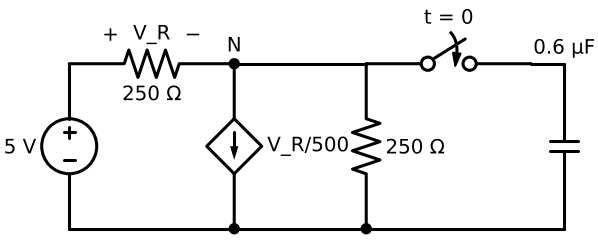

The question is solvable only with `v_c(0) = −5 V` (the minus sign is faint in the scanned paper; with +5 V the capacitor would settle at +1.67 V and never reach zero).

- **V_th** (capacitor removed): `(5 − V)/250 = V_R/500 + V/250` with `V_R = 5 − V`, so `(5 − V)/500 = V/250` and `V_th = 5/3 V`.
- **R_th** (5 V shorted, test source at N): now `V_R = −V`, and the dependent source *injects* `V/500`. `i_t = V(1/250 + 1/250 − 1/500) = 0.006·V`, so `R_th = 166.7 Ω`.
- `τ = R_th·C = 166.7 Ω × 0.6 µF = 0.1 ms`. `v_C(t) = 5/3 − (5/3 + 5)e^(−t/τ)`. It is zero when `e^(−t/τ) = 1/4`, so **t = τ ln 4 = 0.139 ms**.

### 2021 Q47: the overshoot of a parallel-type RLC
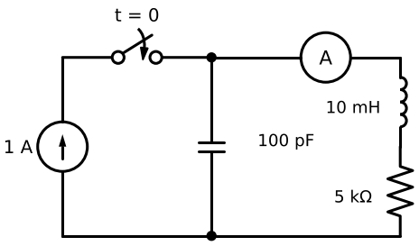

The ammeter reads the current in the L–R branch, `i`. With the 1 A source: `1 = C·dv/dt + i` and `v = L·di/dt + Ri`, so `LC·i″ + RC·i′ + i = 1`:

```
ω₀ = 1/√(LC) = 1/√(10 mH × 100 pF) = 10⁶ rad/s     α = R/(2L) = 2.5 × 10⁵      ζ = α/ω₀ = 0.25  (underdamped)
peak = 1 + e^(−πζ/√(1−ζ²)) = 1 + e^(−0.811) = 1.444 A
```

**The maximum reading is 1.44 A** (it settles to 1 A).

### 2023 Q35: opening a switch in an RL circuit
Before: DC, the 1 H inductor shorts the 2 Ω, so `i_L = 2 V/1 Ω = 2 A` and `V_R = 0`. When the switch opens, the inductor current (2 A) must continue, and its only path is through the 2 Ω resistor: `V_R(0⁺) = 2 A × 2 Ω =` **4 V** (the maximum, decaying with `τ = L/R = 0.5 s`).

### 2023 Q62: acquisition time
`1/2¹²` of the full scale left means `e^(−t/τ) = 2⁻¹²`, so **t = τ ln 4096 = 1 µs × 8.318 = 8.32 µs**.

### 2024 Q32: time constant
The source is off (open) for the time constant. From the inductor's terminals: to the left a 2 Ω resistor, to the right `4 Ω ∥ 4 Ω = 2 Ω` (S is closed). `R_th = 4 Ω` and **τ = L/R_th = 3/4 = 0.75 s**.

### 2024 Q35: energy in the Zener
The capacitor (10 V) discharges through 10 kΩ and the Zener, which clamps 5 V, until `v_C = 5 V`. The charge that flows is `ΔQ = C·ΔV = 10 µF × 5 V = 50 µC`, all of it through the Zener, so `E_Z = V_Z·ΔQ = 5 × 50 µC =` **0.250 mJ**. (Bookkeeping: the capacitor loses `½C(10² − 5²) = 0.375 mJ`; the resistor takes 0.125 mJ and the Zener 0.250 mJ.)

### 2024 Q49: Schmitt trigger, then an integrator
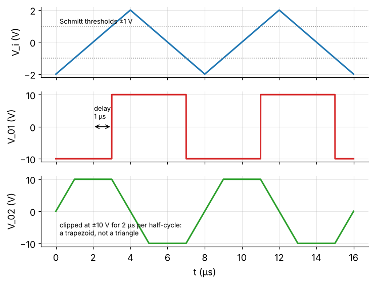

OPA1 has positive feedback (`10 kΩ`, `100 kΩ`): it is a comparator with thresholds `±V_i,th = ±10 V × 10/100 = ±1 V`. So `V_01` switches when `V_i` reaches ±1 V, which is **1 µs after** each zero-crossing of the triangle (slope 1 V/µs). OPA2 with an inductor at its input integrates: `V_02 = −(R/L)∫V_01 dt = −10⁶∫V_01 dt`, so a ±10 V square wave gives a slope of **10 V/µs**. In the 4 µs half-period that would be 40 V, but the output clips at ±10 V: a **trapezoid**. Answer **(D)**.

### 2026 Q23: an impulse is an initial condition
`C·dV/dt = qδ(t) − m(t)`. The impulse at `t = 0` makes `V` jump by `q/C` (integrate across `t = 0`; `m(t)` is bounded so it adds nothing). After the impulse the equation is `C·dV/dt = −m(t)` with starting value `V₀ + q/C`: **option (A)**.

---

## 9. Practice (answers at the end of this section)

**P1 · RC.** A 10 V step drives `R = 2 kΩ`, `C = 5 µF` with `v(0) = 2 V`. How long until `v = 9 V`?

**P2 · RL spike.** A 50 mH coil (10 Ω of winding resistance) carries 2 A. A 40 Ω resistor is switched across it and the supply is removed (figure). Find the voltage across the 40 Ω just after switching, and the time constant.
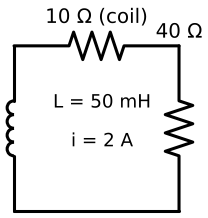

**P3 · Two capacitors.** In Ex 2, how much energy is dissipated, and does it depend on R?

**P4 · Series RLC.** `L = 1 H`, `C = 0.04 F`, `R = 6 Ω`, with a 10 V step and zero initial state. Find `α`, `ω₀`, `ζ`, `ω_d`, the peak value of `v_C` and when it occurs.

**P5 · Laplace.** A 1 H inductor carrying `i(0⁻) = 1 A` is in series with 3 Ω, and a 6 V step is applied at `t = 0`. Find `i(t)`.

<details>
<summary><b>Answers</b></summary>

- **P1:** `v(t) = 10 − 8e^(−t/10 ms)`, so `t = 10 ms × ln 8 =` **20.79 ms**.
- **P2:** the loop is the coil (10 Ω + 40 Ω) with 2 A forced through the 40 Ω: `|v| = 2 × 40 =` **80 V** (the voltage jumps; before switching it was zero). `τ = L/R = 50 mH/50 Ω =` **1 ms**, so `v = 80e^(−t/1 ms)`.
- **P3:** **12 mJ**, independent of R (see Ex 2).
- **P4:** `α = 3`, `ω₀ = 5`, **ζ = 0.6**, `ω_d = 4`. Overshoot `e^(−π·0.6/0.8) = 9.48%`, so peak `v_C = 10 × 1.0948 =` **10.95 V** at `t_p = π/4 =` **0.785 s**.
- **P5:** `I(s) = (6/s + L·i(0⁻))/(sL + R) = (6/s + 1)/(s + 3) = (s + 6)/(s(s + 3)) = 2/s − 1/(s + 3)`, so **i(t) = 2 − e^(−3t) A**. (Check: `i(0) = 1`, `i(∞) = 6/3 = 2`.)
</details>

---

## 10. The mistakes that cost marks (checklist)

1. **Treating `i_C` or `v_L` as continuous.** Only `v_C` and `i_L` are.
2. **Using the old circuit for `τ`.** `τ` belongs to the circuit **after** switching.
3. **Forgetting to replace C and L by sources at 0⁺.** An uncharged C is a *short* at 0⁺ and a zero-current L is an *open* at 0⁺, not the other way round.
4. **Using `x(0⁻)` in the exponential formula for a variable that jumps.** Use `x(0⁺)` for that variable.
5. **Wrong `R_th`.** It is what the **storage element** sees with independent sources off, and with a dependent source you need a test source.
6. **Mixing up the series and parallel RLC damping.** Larger R damps a series loop and *under-damps* a parallel one.
7. **Using `ω₀` instead of `ω_d` for the oscillation frequency** of an underdamped response.
8. **Forgetting the final (DC) value** in a step response: it is `final + natural`.
9. **Sign of the `L·i(0⁻)` or `v(0⁻)/s` source in the s-domain.** The inductor source aids the initial current; the capacitor source has the capacitor's polarity.
10. **Ignoring initial polarity** (for example 2021 Q38 needs `−5 V`).
11. **Final-value theorem with poles on the right.** Check that every pole of `sF(s)` is in the left half-plane first.
12. **Interrupting an ideal inductor current** and expecting a finite answer. Give the current a path (the resistor in 2023 Q35).

---

## 11. One-page formula sheet (copy this)

```
CONTINUITY       v_C and i_L continuous; i_C, v_L, i_R, v_R may jump.   Impulse: ΔV = q/C,  ΔI = Φ/L.
0+ MODEL         C → source v_C(0-)  (short if 0 V);   L → source i_L(0-)  (open if 0 A).   dv/dt = i_C/C,  di/dt = v_L/L.
DC (t→∞, 0-)     C open, L short.

FIRST ORDER      x(t) = x(∞) + [x(0+) − x(∞)]·e^(−t/τ)     τ = R_th·C  or  L/R_th  (R_th seen by the element AFTER switching)
                 63.2% at τ, 95% at 3τ, 99.3% at 5τ;  t_half = 0.693τ;  t = τ·ln[(x0−x∞)/(x−x∞)];  N-bit: t = N·τ·ln2
                 charging C through R from a DC source: energy lost in R = ½CV² (independent of R)
TWO CAPACITORS   V = (C1V1 + C2V2)/(C1+C2);   energy lost = ½·(V1−V2)²·C1C2/(C1+C2)   (independent of R)
SINUSOID ON (RL) i = (Vm/|Z|)[sin(ωt+θ−φ) − sin(θ−φ)e^(−t/τ)],  no transient if θ = φ

SECOND ORDER     s² + 2αs + ω0² = 0,  ω0 = 1/√(LC)
                 series: α = R/2L, ζ = (R/2)√(C/L), R_crit = 2√(L/C)      parallel: α = 1/(2RC), ζ = (1/2R)√(L/C), R_crit = ½√(L/C)
                 ζ>1 over (real roots) | ζ=1 critical | ζ<1 under: ω_d = √(ω0²−α²), %OS = 100·e^(−πζ/√(1−ζ²)), t_p = π/ω_d, t_settle(2%) ≈ 4/α
                 larger R: series → more damped;  parallel → less damped.   Q = 1/(2ζ)
STATE            ẋ = Ax + Bu,  x = [v_C, i_L];  eigenvalues of A = roots of the characteristic equation

LAPLACE          L → sL + source L·i(0-) (aids i);   C → 1/(sC) + source v(0-)/s;   f(0+) = lim sF(s);   f(∞) = lim s→0 sF(s) (LHP poles only)
                 series RLC: V_C/V_s = 1/(LC s² + RC s + 1);   qδ(t) into C  ≡  initial voltage + q/C
```

---

## 12. Self-test before you move to Day 4

You are ready if you can, **without looking**:

- [ ] say which of `v_C`, `i_L`, `i_C`, `v_L`, `i_R` can jump and why
- [ ] carry out the 0⁻ / 0⁺ / ∞ method and find `dv_C/dt (0⁺)` for a circuit with two switches
- [ ] write `x(t) = x(∞) + [x(0⁺) − x(∞)]e^(−t/τ)` and find `τ` from `R_th` (with a dependent source too)
- [ ] use charge conservation for two capacitors and explain why the energy loss does not depend on R
- [ ] classify a series and a parallel RLC from `α` and `ω₀`, and compute the overshoot of an underdamped step response
- [ ] write the s-domain model of a capacitor and an inductor with initial conditions
- [ ] solve 2021 Q28, 2023 Q44 and 2024 Q32 in under 3 minutes each
- [ ] score at least 17/20 on `Day03_Conceptual_Questions.md`

**Day 4 preview:** sinusoidal steady state. Everything you did with transients carries over by replacing `s` with `jω`: the impedances `sL` and `1/(sC)` become `jωL` and `1/(jωC)`, and resonance is the second-order circuit of §5 driven by a sinusoid.

---

## 13. Sources and further reading

**Pages read for this note** (via a research pass; the fetch of the RLC page was cut off after about 40 000 of 71 000 characters, so some of its items came from a summary and were re-derived here):

- [Wikipedia: RC circuit](https://en.wikipedia.org/wiki/RC_circuit): `τ = RC`, the charging and discharging formulas, the 63.2% and 5τ rules, the Laplace transfer function
- [Wikipedia: RL circuit](https://en.wikipedia.org/wiki/RL_circuit): `τ = L/R`, the natural and step responses, the full response with an initial current
- [Wikipedia: RLC circuit](https://en.wikipedia.org/wiki/RLC_circuit): `α`, `ω₀`, `ζ`, `Q` for series and parallel circuits, the three damping cases, the s-domain equations
- [Wikipedia: Time constant](https://en.wikipedia.org/wiki/Time_constant): the first-order differential equation, step response with an arbitrary start, the 37% and 63% points, half-life `τ ln 2`

Those pages do not state the continuity rules or the 0⁺ method.

**Derived and checked in this repo, not taken from those pages:** the continuity rules and their exceptions, the 0⁻ / 0⁺ / ∞ method, charge conservation and its energy loss, the state-equation shortcut, the sinusoidal-switching formula, the time-varying-resistor and Zener examples, and every worked example. All are verified numerically or symbolically in `tools/verify_day03.py`.

**Recommended practice:** the Gate-O-Pedia notes (`01_Notes/`), pp. 2.35–2.43, for extra problems on the same topics. Lecture series on transient analysis from MIT OCW 6.002 and the NPTEL circuits courses are good companions, but I did not extract their text for this note.
