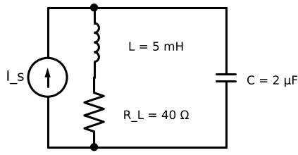

# Day 4 — 20 Conceptual Questions (Sinusoidal Steady State, Power and Resonance)

**Companion to:** `Day04_Sinusoidal_Steady_State_and_Resonance.md` (read §1–§6 first)
**Time:** 40 minutes, pencil and paper. A scientific calculator is enough for Q8, Q17 and Q19 (they need only square roots and one `tan`).
**Format:** GATE style. Each question tests **one idea**, and the wrong options are the mistakes students actually make.

| Type | How it works | Self-score |
|---|---|---|
| **MCQ** | exactly one correct option | 1 mark if right |
| **MSQ** | one or more correct options; **no partial credit** | 1 mark only if your set is exactly right |
| **NAT** | type a number, no options | 1 mark if right |

Every number in the solutions is re-checked by `tools/verify_day04.py`, and each answer was also derived by hand. All voltages and currents are **rms** unless a question says "peak" or gives a waveform.

## What is in the set

| # | Type | Concept | Level | Review in the Day 4 note |
|---|---|---|---|---|
| 1 | MSQ | What a phasor can and cannot do | Easy | §1 |
| 2 | MCQ | Sine to cosine reference | Easy | §1 |
| 3 | MCQ | Series and parallel RLC below resonance | Medium | §5 |
| 4 | MSQ | Signs of reactance and susceptance | Medium | §2 |
| 5 | NAT | Ammeter readings in a parallel circuit | Medium | §3 |
| 6 | MCQ | Apparent power and power factor from P and Q | Easy | §4 |
| 7 | MCQ | Complex power S = V·I* | Medium | §4 |
| 8 | NAT | Capacitor for unity power factor | Medium | §4 |
| 9 | MSQ | What power-factor correction changes | Medium | §4 |
| 10 | MCQ | Apparent powers do not add | Medium | §4 |
| 11 | NAT | Average power with DC and two harmonics | Medium | §4 |
| 12 | NAT | Maximum power into a pure resistor | Medium | §4 |
| 13 | MSQ | AC maximum-power conditions | Medium | §4 |
| 14 | NAT | Capacitor voltage at series resonance | Medium | §5 |
| 15 | MSQ | Facts about series resonance | Medium | §5 |
| 16 | NAT | Bandwidth from f₀ and Q | Easy | §5 |
| 17 | NAT | Unity-power-factor frequency of a lossy tank | Hard | §5 |
| 18 | MCQ | Source current in parallel resonance | Medium | §5 |
| 19 | NAT | Upper half-power frequency | Hard | §5 |
| 20 | MCQ | Impedance locus of R₁ + (R₂ ∥ C) | Medium | §6 |

---

## Part A: Phasors, impedance and phasor diagrams

### Q1 · MSQ
Which of the following statements about phasors are correct? Select **all** that apply.

- (A) A phasor represents a sinusoid of one known frequency in the steady state.
- (B) The phasor of the product `v(t)·i(t)` is the product `V·I` of the two phasors.
- (C) Differentiating a sinusoid corresponds to multiplying its phasor by `jω`.
- (D) The sum of two sinusoids of different frequencies can be found by adding their phasors.

### Q2 · MCQ
The voltage `v(t) = 10 sin(100t + 30°)` V is written as a phasor using the **cosine** as the reference. Its (peak) phasor is:

- (A) `10∠30°` V
- (B) `10∠−60°` V
- (C) `10∠120°` V
- (D) `10∠60°` V

### Q3 · MCQ
A series RLC circuit and a parallel RLC circuit have the same resonant frequency `ω₀`. Both are driven at a frequency **below** `ω₀`. Seen from the source, the series circuit and the parallel circuit behave respectively as:

- (A) capacitive; inductive
- (B) inductive; capacitive
- (C) capacitive; capacitive
- (D) inductive; inductive

### Q4 · MSQ
Select **all** correct statements about impedance `Z = R + jX` and admittance `Y = G + jB`.

- (A) A load with `X > 0` is inductive.
- (B) A load with `B > 0` is capacitive.
- (C) The admittance of an ideal inductor is `Y = +j/(ωL)`.
- (D) As `ω → ∞` an ideal capacitor behaves like an open circuit.

### Q5 · NAT
A resistor, an inductor and a capacitor are connected **in parallel** across an ideal sinusoidal voltage source. Ideal ammeters in the three branches read 6 A (resistor), 14 A (inductor) and 6 A (capacitor). The current supplied by the source is ______ A.

---

## Part B: Power and power factor

### Q6 · MCQ
A load draws a real power `P = 3 kW` and a reactive power `Q = 4 kvar` (inductive). Its apparent power and power factor are:

- (A) 7 kVA, 0.43 lagging
- (B) 5 kVA, 0.6 lagging
- (C) 5 kVA, 0.8 lagging
- (D) 5 kVA, 0.6 leading

### Q7 · MCQ
A load has terminal voltage `V = 200∠0°` V and current `I = 5∠−30°` A (both rms). The real and reactive power it absorbs are:

- (A) `P = 866 W`, `Q = +500 var`
- (B) `P = 866 W`, `Q = −500 var`
- (C) `P = 500 W`, `Q = 866 var`
- (D) `P = 1000 W`, `Q = 0`

### Q8 · NAT
A single-phase load takes 2 kW at 0.8 power factor lagging from a 230 V, 50 Hz supply. The shunt capacitor that raises the supply power factor to **unity** is ______ µF (round off to one decimal place).

### Q9 · MSQ
A load is connected to a fixed-voltage supply. A capacitor is then connected **in parallel** with it, raising the power factor from 0.8 lagging to 0.95 lagging. Select **all** that apply.

- (A) The real power drawn from the supply is unchanged.
- (B) The magnitude of the current drawn from the supply decreases.
- (C) The current through the original load decreases.
- (D) The reactive power supplied by the source decreases.

### Q10 · MCQ
Two loads are connected in parallel across a source. Load 1 takes 6 kW at 0.8 lagging. Load 2 takes 8 kW at 0.8 **leading**. The total apparent power supplied by the source is:

- (A) 17.5 kVA
- (B) 14.08 kVA
- (C) 14 kVA
- (D) 2.5 kVA

### Q11 · NAT
The current `i(t) = 2 + 4 cos(100t) + 3 sin(300t)` A flows through a 5 Ω resistor. The average power dissipated is ______ W.

---

## Part C: Maximum power transfer

### Q12 · NAT
A source has the Thevenin equivalent `V_th = 10 V` (rms) in series with `Z_th = (3 + j4) Ω`. The load is a **pure resistor** `R_L` that can be adjusted to any value. The maximum power that can be delivered to it is ______ W (round off to two decimal places).

### Q13 · MSQ
A Thevenin source (`V_th` rms, `Z_th = R_th + jX_th` with `X_th ≠ 0`) feeds a load `Z_L = R_L + jX_L`. Select **all** correct statements.

- (A) If both `R_L` and `X_L` can be adjusted, maximum power is delivered when `Z_L = Z_th`.
- (B) If both can be adjusted, the maximum load power is `V_th²/(4R_th)`.
- (C) If `R_L` is fixed and only `X_L` can be adjusted, the load power is largest at `X_L = −X_th`.
- (D) If `X_L = 0` and only `R_L` can be adjusted, the best `R_L` is `R_th`.

---

## Part D: Resonance, bandwidth and loci

### Q14 · NAT
A series RLC circuit has `R = 5 Ω`, `L = 20 mH` and `C = 2 µF`. It is driven at its resonant frequency by a 2 V (rms) source. The rms voltage across the capacitor is ______ V.

### Q15 · MSQ
Select **all** correct statements about a series RLC circuit **at resonance**.

- (A) The source current is in phase with the source voltage.
- (B) The total energy stored in the inductor and capacitor together is constant in time.
- (C) The voltages across `L` and across `C` are each equal to the source voltage.
- (D) The impedance seen by the source is at its maximum.

### Q16 · NAT
A series resonant circuit resonates at 1 MHz and has a quality factor `Q = 50`. Its half-power bandwidth is ______ kHz.

### Q17 · NAT
A coil (`L = 5 mH` with a series resistance `R_L = 40 Ω`) is connected in parallel with `C = 2 µF` and driven by a sinusoidal current source, as shown.

The angular frequency at which the voltage across the tank is **in phase** with the source current is ______ rad/s.

### Q18 · MCQ
`R`, `L` and `C` are connected in parallel across an ideal sinusoidal **voltage** source of fixed amplitude, and the frequency is varied. At the resonant frequency `ω₀ = 1/√(LC)` the current drawn from the source is:

- (A) maximum, because the impedance of the circuit is maximum
- (B) minimum, and equal to `V/R`
- (C) zero
- (D) the same at all frequencies

### Q19 · NAT
A series RLC circuit has a resonant frequency `f₀ = 10 kHz` and a half-power bandwidth of 5 kHz. Its **upper** half-power frequency is ______ kHz (round off to two decimal places).

### Q20 · MCQ
A resistor `R₁ = 1 kΩ` is in series with the parallel combination of `R₂ = 4 kΩ` and a capacitor. As the source frequency goes from `ω = 0` to `ω → ∞`, the impedance `Z(jω)` seen by the source traces:

- (A) a semicircle in the lower half-plane from 5 kΩ to 1 kΩ, with a largest `|Im Z|` of 2 kΩ
- (B) a semicircle in the upper half-plane from 1 kΩ to 5 kΩ
- (C) a semicircle in the lower half-plane from 5 kΩ to 1 kΩ, with a largest `|Im Z|` of 4 kΩ
- (D) a vertical line `Re Z = 1 kΩ`, going downward

---

## Score yourself

<b>Answer key (open after you finish all 20)</b>

| Q | Answer | Q | Answer |
|---|---|---|---|
| 1 | A, C | 11 | 82.5 (range 82.4 to 82.6) |
| 2 | B | 12 | 6.25 (range 6.24 to 6.26) |
| 3 | A | 13 | B, C |
| 4 | A, B | 14 | 40 (range 40 to 40) |
| 5 | 10 (range 10 to 10) | 15 | A, B |
| 6 | B | 16 | 20 (range 20 to 20) |
| 7 | A | 17 | 6000 (range 5990 to 6010) |
| 8 | 90.3 (range 90.0 to 90.6) | 18 | B |
| 9 | A, B, D | 19 | 12.81 (range 12.80 to 12.82) |
| 10 | B | 20 | A |

**How to read your score**

| Score | What to do |
|---|---|
| 17–20 | You are ready for Day 5 (two-port networks and coupled inductors). |
| 13–16 | Re-read the "Review" section for each question you missed, then redo only those questions tomorrow. |
| 12 or less | Re-read §1–§5 of the Day 4 note, redo the worked examples with the solution covered, then retake this set after 24 hours. |

Keep a note of **why** each miss happened: concept gap, sign slip (lag/lead, conjugate), or peak-versus-rms. Those are three different fixes.

## Solutions

<b>Q1 · What a phasor can do</b>

**Answer: A, C.**

- **(A) True.** A phasor `A∠φ` stores the amplitude and phase of `A cos(ωt + φ)`. The frequency is understood, so it must be the same everywhere in the circuit.
- **(B) False.** A product of two sinusoids at `ω` is *not* a sinusoid at `ω`: for `v = i = cos ωt`, `v·i = ½ + ½ cos 2ωt`, which has a constant part and a part at `2ω` but **nothing** at `ω`. Power needs its own definition, `S = V·I*`.
- **(C) True.** `d/dt Re{X e^{jωt}} = Re{jωX e^{jωt}}`.
- **(D) False.** Components at different frequencies are solved one frequency at a time (superposition) and the **time-domain** results are added.

*Review:* §1.

<b>Q2 · Sine to cosine</b>

**Answer: B.**

`sin x = cos(x − 90°)`, so `10 sin(100t + 30°) = 10 cos(100t − 60°)` and the phasor is `10∠−60°` (B). Option (A) forgets that the reference is the cosine. (C) adds 90° instead of subtracting it. (D) is `90° − 30°`, which reverses the sign of the angle.

*Review:* §1.

<b>Q3 · Below resonance</b>

**Answer: A.**

Series: `X = ωL − 1/(ωC)`. Below `ω₀` the capacitive term wins, so `X < 0`: the circuit looks **capacitive** and the current leads. Parallel: `B = ωC − 1/(ωL)`. Below `ω₀` the inductor's `1/(ωL)` wins, so `B < 0`, a net **inductive** susceptance, and the inductor carries the larger current.

Numerical check with `L = 1 mH`, `C = 1 µF` (`ω₀ = 31 623 rad/s`) at `ω = 10⁴ rad/s`: series `X = 10 − 100 = −90 Ω`; parallel `B = 0.01 − 0.1 = −0.09 S`. Option (B) comes from remembering "inductors win at low frequency" for **both** circuits, which is right only for the parallel one.

*Review:* §5.

<b>Q4 · Signs of X and B</b>

**Answer: A, B.**

- **(A) True.** `X_L = ωL > 0`.
- **(B) True.** `B_C = ωC > 0`. The sign habit flips between the two: positive *reactance* is inductive, positive *susceptance* is capacitive.
- **(C) False.** `Y_L = 1/(jωL) = −j/(ωL)`: an inductor's susceptance is negative.
- **(D) False.** `Z_C = 1/(jωC) → 0` as `ω → ∞`: a **short** circuit. The capacitor is open at DC.

*Review:* §2.

<b>Q5 · Parallel ammeters</b>

**Answer: 10 A.**

With `V` as the reference, `I_R = 6∠0° = 6`, `I_L = 14∠−90° = −j14`, `I_C = 6∠+90° = +j6`. The sum is `6 − j8`, so `|I| = √(6² + 8²) = 10 A`. Adding the readings (26 A) or taking `√(6² + 14² + 6²) = 16.4 A` both ignore that `I_L` and `I_C` are in antiphase. Note that the supply current (10 A) is smaller than the inductor branch current (14 A).

*Review:* §3.

<b>Q6 · Apparent power and pf</b>

**Answer: B.**

`|S| = √(P² + Q²) = √(3² + 4²) = 5 kVA` and `pf = P/|S| = 3/5 = 0.6`. `Q > 0` means inductive, so the power factor is **lagging**. (A) adds `P` and `Q`; (C) uses `Q/|S|`, the sine, as the power factor; (D) has the wrong lead/lag.

*Review:* §4.

<b>Q7 · S = V·I*</b>

**Answer: A.**

`S = V·I* = 200∠0° × 5∠+30° = 1000∠30° = 866 + j500 VA`, so `P = 866 W` and `Q = +500 var`: inductive, as expected because the current lags. Without the conjugate, `V·I = 1000∠−30°` gives `Q = −500 var` (B), a sign error that mislabels an inductive load as capacitive. (C) swaps cosine and sine, and (D) ignores the 30°.

*Review:* §4.

<b>Q8 · Capacitor for unity pf</b>

**Answer: 90.3 µF.**

`Q_load = P tan φ = 2 kW × 0.75 = 1.5 kvar` (for `cos φ = 0.8`, `tan φ = 0.75`). For unity power factor the capacitor must supply all of it:

`C = Q/(ωV²) = 1500/(2π · 50 × 230²) = 90.3 µF`.

Using `Q = P sin φ = 1.2 kvar` (sine instead of tangent) gives 72.2 µF, and putting the peak voltage 325 V into `V²` gives 45.1 µF.

*Review:* §4.

<b>Q9 · What correction changes</b>

**Answer: A, B, D.**

The supply voltage is fixed, so the load still sees the same voltage and draws the same current: (C) is **false**. The capacitor supplies reactive power locally and absorbs no real power, so (A) `P` is unchanged and (D) the source's `Q` falls. The source current `P/(V·pf)` therefore falls (B).

Numbers for the 10 kW, 230 V load of Ex 2 (0.8 → 0.95 lagging): `Q` from the source falls from 7.5 to 3.29 kvar and the line current from 54.3 A to 45.8 A, while the load's own current stays at 54.3 A.

*Review:* §4.

<b>Q10 · Apparent powers do not add</b>

**Answer: B.**

Add the complex powers, not their magnitudes. Load 1 (lagging): `S₁ = 6 + j4.5` kVA (`|S₁| = 7.5 kVA`). Load 2 (leading, so `Q < 0`): `S₂ = 8 − j6` kVA (`|S₂| = 10 kVA`). Total `S = 14 − j1.5` kVA, so `|S| = √(14² + 1.5²) = 14.08 kVA` (power factor 0.994 leading).

(A) 17.5 kVA is `7.5 + 10`. (C) 14 kVA is only `P`, forgetting `Q`. (D) 2.5 kVA is `10 − 7.5`, subtracting magnitudes.

*Review:* §4.

<b>Q11 · DC plus two harmonics</b>

**Answer: 82.5 W.**

The components at 0, 100 and 300 rad/s are orthogonal, so their mean-square values add: `I_rms² = 2² + 4²/2 + 3²/2 = 4 + 8 + 4.5 = 16.5 A²`, and `P = I_rms²·R = 16.5 × 5 = 82.5 W`. Adding the amplitudes first, `(2 + 4 + 3)² × 5 = 405 W`, treats the three components as if they were in phase at one frequency. Forgetting the DC term gives 62.5 W.

*Review:* §4.

<b>Q12 · Pure resistive load</b>

**Answer: 6.25 W.**

With a resistive load `P = V²R_L/[(R_th + R_L)² + X_th²]`. Setting `dP/dR_L = 0` gives `R_L = √(R_th² + X_th²) = |Z_th| = 5 Ω`, so

`P = 100 × 5/(8² + 4²) = 500/80 = 6.25 W`.

The DC rule `R_L = R_th = 3 Ω` gives only 5.77 W. The 8.33 W of `V²/(4R_th)` needs a **complex** load `3 − j4 Ω`, which this question does not allow.

*Review:* §4.

<b>Q13 · AC maximum power</b>

**Answer: B, C.**

- **(A) False.** The condition is the **conjugate**, `Z_L = Z_th*`, so the reactances cancel. Setting `Z_L = Z_th` doubles the reactance in the loop: for `Z_th = 3 + j4` and `V_th = 10 V` it delivers only 3 W, against 8.33 W for the conjugate match.
- **(B) True.** At `Z_L = Z_th*` the loop is a pure resistance `2R_th`, so `P_L = V_th²/(4R_th)` (8.33 W for the same source).
- **(C) True.** With `R_L` fixed, `P = V²R_L/[(R_th + R_L)² + (X_th + X_L)²]` is largest when the reactive term vanishes. Example: `Z_th = 4 + j3`, `R_L = 6 Ω` gives `X_L = −3 Ω`.
- **(D) False.** With `X_L = 0` the best `R_L` is `|Z_th| = √(R_th² + X_th²)`, as in Q12.

*Review:* §4.

<b>Q14 · Voltage magnification</b>

**Answer: 40 V.**

`ω₀ = 1/√(LC) = 1/√(20 mH × 2 µF) = 5000 rad/s` and `Q = ω₀L/R = 5000 × 0.02/5 = 20`. At resonance `I = V/R = 2/5 = 0.4 A` and `X_C = 1/(ω₀C) = 100 Ω`, so `V_C = I·X_C = 40 V = Q·V_s`. The capacitor voltage is 20 times the source voltage: this is voltage magnification, not an error.

*Review:* §5.

<b>Q15 · Series resonance facts</b>

**Answer: A, B.**

- **(A) True.** `Z = R` is real, so `V` and `I` are in phase.
- **(B) True.** With `i = I_m cos ω₀t`, the inductor holds `½LI_m² cos²ω₀t` and the capacitor `½LI_m² sin²ω₀t` (because `1/(ω₀²C) = L`). The total `½LI_m²` is constant, so the source only replaces the resistor's losses.
- **(C) False.** `V_L` and `V_C` are equal to **each other** in size and opposite in phase, and each equals `Q·V_s` (Q14: 40 V from a 2 V source).
- **(D) False.** The impedance is at its **minimum**, `R`, and the current is at its maximum.

*Review:* §5.

<b>Q16 · Bandwidth</b>

**Answer: 20 kHz.**

`BW = f₀/Q = 1 MHz/50 = 20 kHz`. (For a series RLC this also equals `R/2πL`.)

*Review:* §5.

<b>Q17 · Lossy tank</b>

**Answer: 6000 rad/s.**

The admittance is `Y = jωC + 1/(R_L + jωL)`, whose imaginary part is `Im Y = ωC − ωL/(R_L² + ω²L²)`. Setting it to zero gives `C(R_L² + ω²L²) = L`, so

`ω² = 1/(LC) − R_L²/L² = 10⁸ − (40/5 mH)² = 10⁸ − 6.4 × 10⁷ = 3.6 × 10⁷`, hence `ω = 6000 rad/s`.

At that frequency the tank is purely resistive with `Z_d = L/(C·R_L) = 62.5 Ω` (check: `ωL = 30 Ω`, `Re Y = 40/(40² + 30²) = 0.016 S`). The textbook value `1/√(LC) = 10 000 rad/s` ignores the coil resistance: there `Im Y = 7.8 mS ≠ 0`.

*Review:* §5.

<b>Q18 · Parallel resonance, voltage source</b>

**Answer: B.**

The input admittance is `Y = 1/R + j(ωC − 1/ωL)` and `I = V·|Y|`. At `ω₀` the inductor and capacitor currents are equal and opposite and cancel, so only `V/R` flows, which is the **minimum** of `|Y|`. (A) confuses "the impedance is maximum" with "the current is maximum": for a *voltage* source a maximum impedance means a **minimum** current (it is the tank *voltage* that peaks when the tank is fed by a *current* source). (C) would need `R → ∞`, and (D) is false because `Y` changes with frequency.

*Review:* §5.

<b>Q19 · Upper half-power frequency</b>

**Answer: 12.81 kHz.**

`Q = f₀/BW = 10/5 = 2`. The half-power frequencies satisfy `f₂ − f₁ = BW` and `f₁f₂ = f₀²`, which gives

`f₂ = f₀[√(1 + 1/(4Q²)) + 1/(2Q)] = 10[√1.0625 + 0.25] = 12.81 kHz`

and `f₁ = 7.81 kHz` (check: `12.81 − 7.81 = 5` and `7.81 × 12.81 = 100`). The quick estimate `f₀ + BW/2 = 12.5 kHz` is accurate only for high `Q`; at `Q = 2` the response is visibly not symmetric about `f₀`.

*Review:* §5.

<b>Q20 · Impedance locus</b>

**Answer: A.**

At `ω = 0` the capacitor is open, so `Z = R₁ + R₂ = 5 kΩ`. At `ω → ∞` it is a short, so `Z = R₁ = 1 kΩ`. In between, `R₂ ∥ C` traces a semicircle of **diameter R₂** (4 kΩ) in the lower half-plane (its admittance `1/R₂ + jωC` is a straight line, and inverting it gives a circle), so the largest `|Im Z|` is the radius `R₂/2 = 2 kΩ`. Shifting by `R₁` gives (A).

(B) puts the locus in the wrong half-plane (a capacitor has negative reactance). (C) takes the diameter for the radius. (D) is the locus of a **series** R–C.

*Review:* §6.

