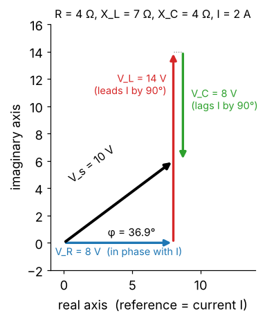
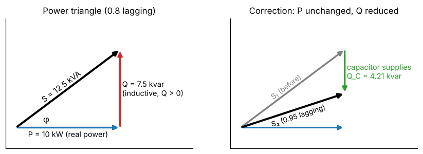
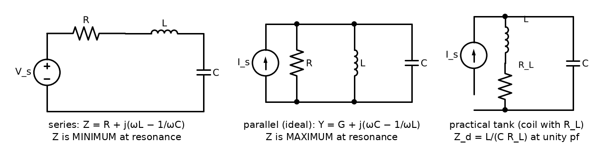
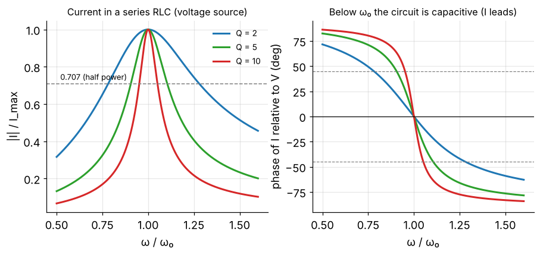
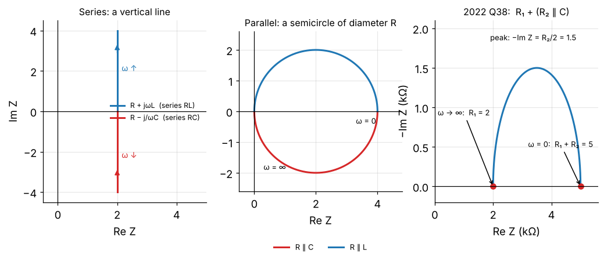
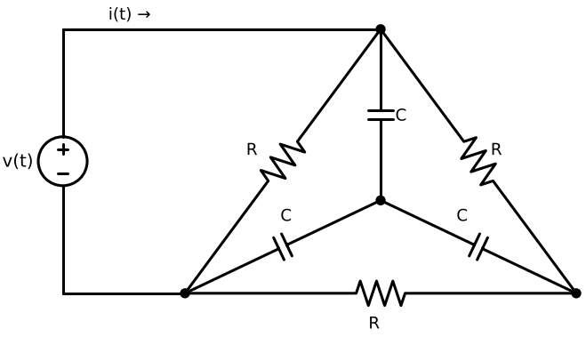
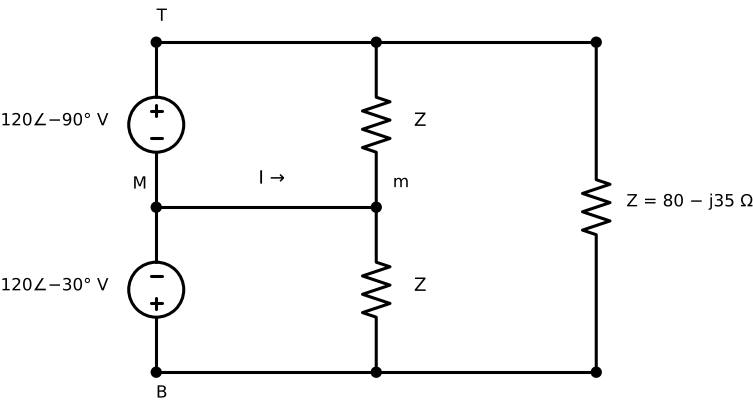
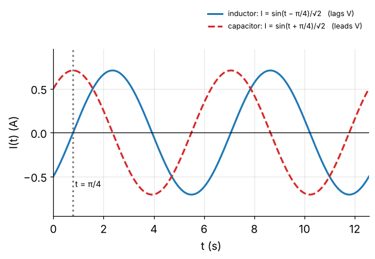
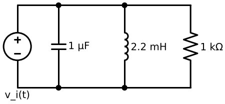
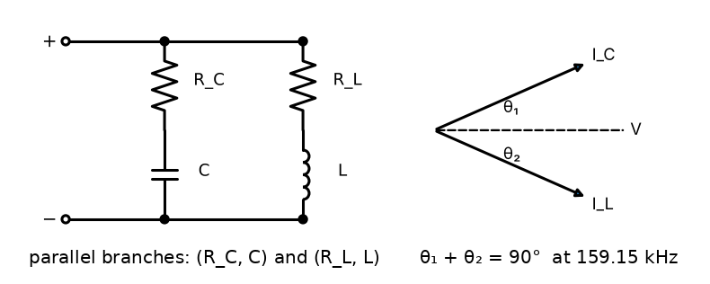

# Day 4 — Sinusoidal Steady State, Complex Power and Resonance

**Covers:** phasors · impedance and admittance · phasor diagrams · real, reactive, apparent and complex power · power-factor correction · AC maximum power transfer · series and parallel resonance · Q and bandwidth · the practical tank circuit · impedance loci
**Matches:** Day 4 of `03_Study_Plans/20_Day_Plan_Networks_Signals_Control.md` (Gate-O-Pedia pp. 2.44 – 2.57)
**Time:** about 5½ hours in total
**Companion:** `Day04_Conceptual_Questions.md`, 20 GATE-style conceptual questions with solutions
**Needs from earlier days:** Thevenin and maximum power (Day 2), second-order circuits (Day 3 §5)

Every number in this note is re-checked by `tools/verify_day04.py` (complex circuit solver and numerical sweeps), and all 11 past-year answers match the official keys in `02_Previous_Year_Papers/`.

## How to use this note

| Step | What | Time |
|---|---|---|
| 1 | Read §1–§3 (phasors, impedance, phasor diagrams). **Cover the solution, solve, then compare** | 60 min |
| 2 | Read §4–§5 (power, power factor, resonance) | 90 min |
| 3 | Read §6–§7 (loci and special cases) | 20 min |
| 4 | Do §8: the 11 past-year questions. Try each one first | 60 min |
| 5 | Do §9 practice problems, then read §10 (mistakes) | 40 min |
| 6 | Take the **20 conceptual questions** (timed, then review the ones you missed) | 40 min |
| 7 | Copy §11 onto your Networks formula sheet | 10 min |

---

## 1. Phasors: the idea

In a **linear** circuit driven by a sinusoid, once the transient has died out (the steady state) every voltage and current is a sinusoid of the **same frequency**. Only its amplitude and phase differ, so two numbers describe it. A phasor is that pair, written as a complex number:

```
x(t) = A cos(ωt + φ)   ⟷   X = A∠φ        (peak phasor)        or   X = (A/√2)∠φ   (rms phasor)
x(t) = Re{ X · e^(jωt) }                   (the factor e^(jωt) is "carried along" and never written)
```

Why it works: `e^(jωt)` passes through any linear time-invariant circuit unchanged in shape (it is an *eigenfunction*, Day 8), so differentiation and integration become multiplications:

| Time domain | Phasor (cosine reference) |
|---|---|
| `A cos(ωt + φ)` | `A∠φ` |
| `A sin(ωt + φ)` | `A∠(φ − 90°)`  (because `sin x = cos(x − 90°)`) |
| `dx/dt` | `jω·X` |
| `∫x dt` | `X/(jω)` |

**Rules of use**

1. Steady state only, linear circuit only, **one frequency** at a time. Sources at different frequencies are solved separately and the **waveforms** (not the phasors) are added (Day 2 §2).
2. Products and squares are **not** phasor operations. Power needs its own definitions (§4).
3. Decide at the start whether your phasors are **peak** or **rms**. Power formulas below use rms.
4. Pick one reference (cosine). If a source is given as a sine, subtract 90°.

A sine-reference shortcut that is handy in questions written with `sin`: if you treat every source as `sin`, a phasor `a + jb` stands for `a·sin(ωt) + b·cos(ωt)` (2019 Q30 in §8).

---

## 2. Impedance and admittance

| Element | Impedance `Z` | Admittance `Y = 1/Z` | Phase |
|---|---|---|---|
| resistor | `R` | `G = 1/R` | `V` and `I` in phase |
| inductor | `jωL` | `−j/(ωL)` | `I` **lags** `V` by 90° |
| capacitor | `1/(jωC) = −j/(ωC)` | `jωC` | `I` **leads** `V` by 90° |

("ELI the ICE man": in an inductor `E` leads `I`; in a capacitor `I` leads `E`.)

```
Z = R + jX     X > 0 inductive,  X < 0 capacitive          Y = G + jB     B > 0 CAPACITIVE,  B < 0 inductive
series: Z add          parallel: Y add          dividers: same formulas as DC, with complex numbers
```

Note the two opposite sign habits: positive **reactance** `X` is inductive, but positive **susceptance** `B` is capacitive. At low frequency an inductor looks like a short and a capacitor like an open circuit; at high frequency it is the other way round.

---

## 3. Analysis in the phasor domain, and phasor diagrams

Every DC technique carries over unchanged with complex numbers: KVL, KCL, nodal, mesh, dividers, source transformation, Thevenin, Norton and superposition (at one frequency). Replace R by `Z` and G by `Y`.

**Phasor diagrams** show the geometry of the phases. Choose the quantity that is *common* as the reference: **current** in a series circuit, **voltage** in a parallel circuit.

In a **parallel** circuit the branch currents add as phasors: `I_R` is in phase with `V`, `I_L` lags it by 90° and `I_C` leads it by 90°. So `I_L` and `I_C` point in opposite directions and `|I| = √(I_R² + (I_C − I_L)²)`. Ammeter readings therefore do **not** add arithmetically (Conceptual Q5).

### Ex 1: series RLC at one frequency



`R = 4 Ω`, `X_L = 7 Ω`, `X_C = 4 Ω`, source 10 V rms.

- `Z = 4 + j(7 − 4) = 4 + j3`, so `|Z| = 5 Ω` and `|I| = 10/5 = 2 A`.
- `V_R = 8 V`, `V_L = 14 V`, `V_C = 8 V`, and `V_s = V_R + j(V_L − V_C) = 8 + j6`, so `|V_s| = 10 V` ✓.
- The voltage across the inductor (14 V) is **larger than the source** (10 V). That is normal: `V_L` and `V_C` point in opposite directions, so they partly cancel.
- Phase: `φ = tan⁻¹(3/4) = 36.9°` (voltage leads current, so the circuit is inductive). Power factor `0.8` lagging.

---

## 4. Power in AC circuits

With `v = √2·V cos ωt` and `i = √2·I cos(ωt − φ)` (rms values `V`, `I`; `φ = ∠V − ∠I = ∠Z`):

```
p(t) = v·i = V·I·[ cos φ + cos(2ωt − φ) ]       average = V·I·cos φ,   plus a component at 2ω that sloshes back and forth
```

| Quantity | Formula | Unit | Meaning |
|---|---|---|---|
| real (active) power `P` | `V I cos φ = I²R` | W | average power actually consumed |
| reactive power `Q` | `V I sin φ = I²X` | var | energy swapped with the field each cycle |
| apparent power `S` | `V I = √(P² + Q²)` | VA | what the wires and the source must carry |
| **complex power** | `S = V·I* = P + jQ` | VA | all of the above in one number |
| power factor | `cos φ = P/|S|` | – | fraction of `|S|` that is useful |

Also `S = |I|²·Z = |V|²/Z*`. **Sign convention:** an inductive load (current lags, "lagging pf") has `Q > 0`; a capacitive load (current leads, "leading pf") has `Q < 0`. Inductors *absorb* reactive power, capacitors *supply* it. A pure reactance has `P = 0`.

**Complex power is conserved.** Over all elements of a circuit (sources negative), `ΣS = 0`, so `ΣP = 0` and `ΣQ = 0` separately. But **apparent powers do not add** unless the loads have the same power factor.

Check with Ex 1: `P = I²R = 16 W`, `Q = I²X = 12 var`, `|S| = V·I = 20 VA`, and `√(16² + 12²) = 20` ✓.

**Loads that add.** 6 kW at 0.8 lagging is `6 + j4.5` kVA. 8 kW at 0.8 *leading* is `8 − j6` kVA. Together `14 − j1.5` kVA, so `|S| = 14.08 kVA`, not `7.5 + 10 = 17.5 kVA` (Conceptual Q10).

**Non-sinusoidal waveforms.** For `i = I₀ + Σ I_k cos(kωt + …)` (peak harmonics) the rms value is `√(I₀² + ½ΣI_k²)`; for example `3 + 4cos ωt` has `I_rms = √(9 + 8) = 4.12 A`. Average power comes only from a voltage and a current **at the same frequency**. **Ideal AC meters read rms** (2025 Q39).

### Power-factor correction

Most loads are inductive (`Q > 0`). A **shunt capacitor** supplies the reactive power locally, so the source delivers less `Q`, the line current falls, but the real power `P` is unchanged. The load itself is untouched: it still sees the same voltage and draws the same current. Only the **source** current (load current plus capacitor current) falls:

```
Q_C = P (tan φ₁ − tan φ₂)          C = Q_C / (ω·V_rms²)
```



### Ex 2: correcting a load

10 kW at 0.8 lagging, 230 V, 50 Hz, to be raised to 0.95 lagging.

- `Q₁ = 10 × tan(cos⁻¹0.8) = 7.5 kvar`, `Q₂ = 10 × tan(cos⁻¹0.95) = 3.29 kvar`, so `Q_C = 4.21 kvar`.
- `C = 4213/(314.16 × 230²) =` **253.5 µF**.
- The line current falls from `10 000/(230 × 0.8) = 54.3 A` to `10 000/(230 × 0.95) = 45.8 A`. (For *unity* pf the same load needs 451 µF.)

### AC maximum power transfer

Source `V_th` (rms) with `Z_th = R_th + jX_th`, load `Z_L = R_L + jX_L`. The load power is `P = V_th²·R_L / [(R_th + R_L)² + (X_th + X_L)²]`.

| What you can adjust | Optimum | `P_max` |
|---|---|---|
| `R_L` and `X_L` | `Z_L = Z_th*` (complex conjugate) | `V_th²/(4R_th)` |
| `X_L` only (`R_L` fixed) | `X_L = −X_th` | `V_th² R_L/(R_th + R_L)²` |
| `R_L` only (`X_L` fixed) | `R_L = √(R_th² + (X_th + X_L)²)`; with `X_L = 0` this is `|Z_th|` | less than the conjugate value |
| `|Z_L|` only (angle fixed) | `|Z_L| = |Z_th|` | less than the conjugate value |

Numbers: `Z_th = 3 + j4 Ω`, `V_th = 10 V`. The conjugate match `Z_L = 3 − j4` gives `100/(4 × 3) =` **8.33 W**. A purely resistive load at the best value `R_L = |Z_th| = 5 Ω` gives only **6.25 W**, and `R_L = 3 Ω` (the "DC rule", wrong here) gives 5.77 W.

---

## 5. Resonance

A circuit is **at resonance** when its input impedance is purely real (voltage and current in phase, power factor 1), which happens when the inductive and capacitive reactances cancel.



### Series RLC (driven by a voltage source)

```
Z = R + j(ωL − 1/ωC)        ω₀ = 1/√(LC)
at ω₀:  |Z| = R (the MINIMUM),  I = V/R (the MAXIMUM),  V_L = V_C = Q·V  (equal magnitudes, opposite phases, so they cancel)

Q = ω₀L/R = 1/(ω₀CR) = (1/R)√(L/C)          bandwidth  BW = ω₀/Q = R/L  (rad/s)
half-power frequencies:  ω₁,₂ = ω₀[ √(1 + 1/(4Q²)) ∓ 1/(2Q) ]          ω₂ − ω₁ = BW (exactly)     ω₀ = √(ω₁ω₂)
at the half-power points |I| = I_max/√2 and the phase is ±45°
```

Energy view: `Q = 2π × (maximum stored energy)/(energy dissipated per cycle)`. A high `Q` means a narrow, selective response. At resonance the energy just swaps between L and C: when the inductor's energy is at its peak the capacitor's is zero, and the **total** `½LI_m²` is constant in time, so the source only has to replace what the resistor dissipates.



**Normalised form** with `x = ω/ω₀`: `Z = R[1 + jQ(x − 1/x)]` and `|I|/I_max = 1/√(1 + Q²(x − 1/x)²)`. The half-power points are where `Q(x − 1/x) = ±1`.

### Ex 3: a series resonant circuit

`L = 1 mH`, `C = 10 µF`, `R = 1 Ω`.

| Quantity | Value |
|---|---|
| `ω₀ = 1/√(LC)` | `10⁴ rad/s` |
| `Q = ω₀L/R` | `10` |
| `BW = R/L` | `1000 rad/s` |
| `ω₁, ω₂` | `10⁴(√(1 + 1/400) ∓ 0.05) = 9512.5, 10 512.5 rad/s` (difference exactly 1000 ✓, geometric mean exactly 10⁴ ✓) |
| source 5 V at `ω₀` | `I = 5 A`, `V_C = V_L = Q × 5 = 50 V` |

### Parallel RLC (driven by a current source): the dual

```
Y = G + j(ωC − 1/ωL)        same ω₀ = 1/√(LC)
at ω₀:  |Y| = G (minimum), so |Z| = R (the MAXIMUM) and V = I·R is largest;   I_L = I_C = Q·I_s
Q = R/(ω₀L) = ω₀RC = R√(C/L)          BW = ω₀/Q = 1/(RC)
```

| | Series RLC | Parallel RLC |
|---|---|---|
| impedance at resonance | minimum (`R`) | maximum (`R`) |
| larger R | **lower** Q, wider BW | **higher** Q, narrower BW |
| magnification | voltages `V_L = V_C = QV` | currents `I_L = I_C = QI` |
| source current (voltage source across it) | maximum | **minimum** |

With an ideal **voltage** source across a parallel RLC the source current is *smallest* at resonance (only the resistor current remains), while the L and C branch currents circulate.

**Which side of resonance?** Below `ω₀` the series circuit is **capacitive** (`X < 0`, the current leads) and the parallel circuit is **inductive** (`B < 0`: the inductor draws the larger current). Above `ω₀` each one flips (Conceptual Q3).

### The practical tank (coil with its own resistance)

A real coil is `L` in series with `R_L`, in parallel with `C`:

```
Y = jωC + 1/(R_L + jωL)        Im Y = 0 at      ω_r = √( 1/(LC) − R_L²/L² )      (exists only if R_L < √(L/C))
at that frequency  Z_d = L/(C·R_L) = Q²R_L        with  Q = ω₀L/R_L   (the "dynamic impedance")
```

**Ex 4.** `L = 1 mH`, `R_L = 10 Ω`, `C = 1 µF`:

- `ω_r = √(10⁹ − 10⁸) =` **30 000 rad/s**, and there `Z_d = 1 mH/(1 µF × 10 Ω) =` **100 Ω**.
- But `1/√(LC) = 31 623` and the *peak of |Z|* is at 31 551 rad/s. For a **lossy** tank these three "resonant frequencies" differ (unity pf, maximum impedance, `1/√(LC)`). They coincide only for high `Q` (`R_L ≪ ω₀L`), where all three are `≈ 1/√(LC)`.

---

## 6. Impedance loci

A locus is the path of `Z(jω)` in the complex plane as `ω` goes from 0 to ∞.



- **Series** R with L or C: a **vertical line** `Re Z = R` (upward for L, downward for C).
- **Parallel** R with C: a **semicircle of diameter R** in the lower half-plane. From `Z = R/(1 + jωRC)`: `(Re Z − R/2)² + (Im Z)² = (R/2)²`. Parallel R with L: the upper semicircle.
- **R₁ in series with (R₂ ∥ C)**: the same semicircle shifted right by `R₁`: it starts at `R₁ + R₂` (ω = 0) and ends at `R₁` (ω → ∞), with diameter `R₂` (2022 Q38).

Why: the admittance of a parallel RC is a straight line (`G + jωC`), and inverting a line that does not pass through the origin gives a circle through the origin.

---

## 7. Three special cases that GATE likes

- **Same current in a series path.** In a series R–C circuit the conduction current in the resistor equals the displacement current "through" the capacitor, because current is continuous around the loop (2022 Q24).
- **An ideal voltage source across a parallel LC–R.** The source forces its own voltage across every branch. At the LC resonance the L and C currents cancel, but the resistor still sees the full source voltage, so its power is `V_rms²/R` whatever L and C are (2026 Q31).
- **Two parallel branches whose currents are 90° apart.** With `R_C` in series with `C` and `R_L` in series with `L`, the two branch currents are at right angles when `R_C·R_L = X_C·X_L = L/C` (2026 Q39).

---

## 8. Past-year questions (all solved, all match the official keys)

Papers and keys: `02_Previous_Year_Papers/<year>/`. **Try each question from the paper first.**

| # | Question | Official answer | Concept it tests |
|---|---|---|---|
| 1 | 2019 Q30 (MCQ) | C | Phasor solution of a delta of R with a star of C |
| 2 | 2020 Q16 (NAT) | 2.80 to 2.85 H | Recover `L` from the phase of an RL current |
| 3 | 2020 Q28 (MCQ) | C | Phasor network with two sources: node choice makes it easy |
| 4 | 2022 Q24 (MCQ) | C | Conduction and displacement current in a series loop |
| 5 | 2022 Q38 (MCQ) | A | Impedance locus of `R₁ + (R₂ ∥ C)` |
| 6 | 2022 Q39 (MCQ) | B | Lag or lead from a waveform |
| 7 | 2023 Q18 (MCQ) | D | `Q = ω₀L/R` of a series RLC |
| 8 | 2025 Q20 (MCQ) | A | Phasor currents from admittances |
| 9 | 2025 Q39 (MCQ) | A | Rms meter readings and resonance |
| 10 | 2026 Q31 (NAT) | 71.50 to 72.50 mW | An ideal source across a resonant tank |
| 11 | 2026 Q39 (MCQ) | B | Orthogonal branch currents |

### 2019 Q30: delta of R, star of C


`ω = 1000 rad/s`, so `X_C = 1/(ωC) = 1 kΩ = R`. Use the sine reference: `V_T = 2∠0°`, with the lower-left vertex as ground. In mS: `g = 1`, `y = jωC = j1`.

- Centre node O: `y(V_T − V_O) + y(0 − V_O) + y(V_BR − V_O) = 0`, so `V_O = (V_T + V_BR)/3`.
- Node BR: `g(V_T − V_BR) + g(0 − V_BR) + y(V_O − V_BR) = 0`. Substituting gives `V_BR = V_T/2`, and then `V_O = V_T/2` too.
- Input current: `I = g·V_T + g(V_T − V_BR) + y(V_T − V_O) = V_T(1 + ½ + j½) = 2(1.5 + j0.5) = 3 + j1 mA`.

In the sine reference `3 + j1` means `3 sin(1000t) + cos(1000t)` mA: **option (C)**.

### 2020 Q16: the inductor from the phase
`v = 200 cos 5t`, `i = 10 cos(5t − π/4)`. So `|Z| = 200/10 = 20 Ω` and the current lags by 45°: `R = 20 cos 45° = 14.14 Ω`, `X = ωL = 20 sin 45° = 14.14 Ω`. **L = 14.14/5 = 2.83 H.**

### 2020 Q28: choose the node that makes it easy


All three impedances are `Z = 80 − j35 Ω`. Take the left node M as the reference. The sources fix `V_T = 120∠−90°` and `V_B = 120∠−30°` (the second source has its + at the bottom). The wire joins M to the middle node m, and the Z between T and B never touches the wire. KCL at m (current `I` entering from the wire):

```
V_T/Z + V_B/Z + I = 0   →   I = −(V_T + V_B)/Z = −(207.85∠−60°)/(87.32∠−23.63°) = −2.38∠−36.37° = 2.38∠143.63° A
```

**Option (C).**

### 2022 Q24: same current
The resistor and the capacitor are in series, so they carry the same current. The "displacement current" through the capacitor is just the continuation of the conduction current around the loop: `2 sin(t + π/2)`, **option (C)**.

### 2022 Q38: the locus
At `ω = 0` the capacitor is open, so `Z = R₁ + R₂ = 5 kΩ`. At `ω → ∞` it is a short, so `Z = R₁ = 2 kΩ`. So **R₁ = 2 kΩ and R₂ = 3 kΩ, option (A)**. (Check: the semicircle's diameter is `R₂ = 3 kΩ`, so its highest point is `R₂/2 = 1.5 kΩ`, as plotted.)

### 2022 Q39: lag or lead
`V = sin t` gives `ω = 1`. The current amplitude is `1/√2`, so `|1 + jX| = √2` and `X = ±1`: an inductor of 1 H or a capacitor of 1 F. The graph is the discriminator: at `t = π/4` the current crosses **zero going upward**, so `I = (1/√2) sin(t − π/4)` and the current **lags** the voltage. A lagging current means an inductor: **1 H, option (B)**.



### 2023 Q18: Q of a series RLC
For all options `ω₀ = 1/√(1 µH × 1 µF) = 10⁶ rad/s`. `Q = ω₀L/R = 10⁶ × 10⁻⁶/R = 1/R`. For `Q = 1000` we need **R = 0.001 Ω, option (D)**.

### 2025 Q20: currents from admittances
With `V = 1∠90°` the currents are `I = Y·V`:

- `i_C = j0.25 × 1∠90° = 0.25∠180°` A
- `i_L = −j0.1 × 1∠90° = 0.1∠0°` A
- `i_R = 0.2 × 1∠90° = 0.2∠90°` A

**Option (A).**

### 2025 Q39: rms readings and resonance
The rms voltage is 25 V and the rms current 5 A, so the branch has `|Z| = 25/5 = 5 Ω`. That equals its resistance `R = 5 Ω`, so the reactances cancel (resonance): `ωL = 1/(ωC)`. With `ω = 200 rad/s` and `L = 1 H`: `C = 1/(ω²L) = 1/(200² × 1) =` **25 µF, option (A)**. (The linear circuit that feeds the branch is irrelevant, because the meters see only the branch.)

### 2026 Q31: an ideal source across the tank


The source is **ideal** and directly across all three elements, so the 1 kΩ always has `v_i` across it. At resonance `ω₀ = 1/√(2.2 mH × 1 µF) = 21 320 rad/s` the L and C currents cancel, but that does not change the resistor voltage. `P = V_rms²/R = (12/√2)²/1000 =` **72 mW**.

### 2026 Q39: orthogonal branch currents


At `f = 159.15 kHz`, `ω = 10⁶ rad/s`, so `X_C = 1/(ωC) = 1 Ω` and `X_L = ωL = 1 Ω`. `I_C` leads `V` by `θ₁ = tan⁻¹(X_C/R_C) = tan⁻¹(1/R_C)` and `I_L` lags by `θ₂ = tan⁻¹(1/R_L)`. `θ₁ + θ₂ = 90°` means `tan θ₁ · tan θ₂ = 1`, so `1/(R_C R_L) = 1` and **R_C × R_L = 1, option (B)**. (In general `R_C R_L = L/C`.)

---

## 9. Practice (answers at the end of this section)

**P1 · Parallel loads.** `100 V rms` is applied to `Z₁ = 3 + j4 Ω` in parallel with `Z₂ = 6 − j8 Ω`. Find the source current, `P`, `Q` and the power factor.

**P2 · Correction.** A 5 kW load at 0.6 lagging (230 V, 50 Hz) is to be corrected to unity pf. Find the capacitor.

**P3 · Series resonance.** `L = 0.1 H`, `C = 10 µF`, `R = 10 Ω`, source 5 V rms. Find `ω₀`, `Q`, `I`, `V_C` and the bandwidth.

**P4 · Tank.** A coil `L = 2 mH` with `R_L = 4 Ω` is in parallel with `C = 5 µF`. Find the unity-pf frequency and the impedance there.

**P5 · Phasor to time.** `v = 20 sin(100t + 30°)` V is applied to `20 Ω` in series with `0.2 H`. Find `i(t)`.

<details>
<summary><b>Answers</b></summary>

- **P1:** `Y = 1/(3 + j4) + 1/(6 − j8) = (0.12 − j0.16) + (0.06 + j0.08) = 0.18 − j0.08 S`. `I = 100Y = 18 − j8 A`, so **|I| = 19.7 A**. `S = VI* = 100(18 + j8) = 1800 + j800`: **P = 1800 W, Q = 800 var (lagging)**, `pf = 1800/1970 =` **0.914 lagging**.
- **P2:** `Q = 5 kW × tan(cos⁻¹0.6) = 6.67 kvar`, so `C = 6667/(314.16 × 230²) =` **401 µF**.
- **P3:** `ω₀ = 1/√(0.1 × 10 µF) =` **1000 rad/s**, `Q = ω₀L/R = 10`, `I = 5/10 =` **0.5 A**, **V_C = V_L = Q × 5 = 50 V**, `BW = R/L =` **100 rad/s**.
- **P4:** `ω_r = √(1/(2 mH × 5 µF) − (4/2 mH)²) = √(10⁸ − 4 × 10⁶) =` **9798 rad/s** (a little below `1/√(LC) = 10⁴`); `Z_d = L/(C R_L) = 2 mH/(5 µF × 4 Ω) =` **100 Ω**.
- **P5:** `ω = 100`, `Z = 20 + j20`, `|Z| = 28.28 Ω`, `∠Z = 45°`. **i(t) = 0.707 sin(100t − 15°) A** (`30° − 45°`).
</details>

---

## 10. The mistakes that cost marks (checklist)

1. **Adding phasors of different frequencies.** Solve each frequency separately and add the waveforms.
2. **Mixing peak and rms.** `P = V_rms·I_rms·cos φ`; with peak values `P = ½V_m I_m cos φ`.
3. **Sine versus cosine.** The phasor of `sin(ωt + φ)` is `∠(φ − 90°)` in the cosine reference.
4. **Lag and lead.** Inductor: current lags. Capacitor: current leads. `Q > 0` for inductive loads.
5. **Adding apparent powers.** Add `P` and `Q`, never `|S|`, unless the power factors are equal.
6. **Using the series `Q` for a parallel circuit.** Series `Q = ω₀L/R`; parallel `Q = R/(ω₀L)`.
7. **Believing that the voltage across L or C cannot exceed the source.** At series resonance each is `Q` times the source.
8. **Assuming a lossy tank resonates at `1/√(LC)`.** Unity pf is at `√(1/LC − R_L²/L²)`; the maximum impedance is somewhere in between.
9. **Applying `R_L = R_th` in AC.** With `X_L` fixed use `√(R_th² + (X_th + X_L)²)`; the full conjugate match needs `X_L = −X_th`.
10. **Thinking a parallel LC "blocks" the load** when an ideal voltage source is across it (2026 Q31).
11. **Reading meters as peak.** Ideal AC meters read rms.
12. **Wrong sign of `B`.** Positive susceptance is capacitive; positive reactance is inductive.

---

## 11. One-page formula sheet (copy this)

```
PHASOR        A cos(ωt+φ) ↔ A∠φ (peak),  sin → subtract 90°;   d/dt ↔ jω,  ∫ ↔ 1/jω.     one frequency only.
IMPEDANCE     Z_R = R,  Z_L = jωL,  Z_C = 1/(jωC) = −j/(ωC);   Y_C = jωC,  Y_L = −j/(ωL).   I lags V in L, leads V in C.

POWER (rms)   S = V I* = P + jQ;   P = VI cos φ = I²R;   Q = VI sin φ = I²X;   |S| = VI = √(P²+Q²);   pf = cos φ = P/|S|
              inductive: lagging, Q > 0;  capacitive: leading, Q < 0.   Σ S = 0 (P and Q separately); |S| does NOT add.
PF CORRECTION Q_C = P(tan φ1 − tan φ2),   C = Q_C/(ω V²);   P unchanged, line current falls.
MAX POWER     R_L, X_L both free: Z_L = Z_th*,  P = V²/(4R_th);   X_L fixed: R_L = √(R_th² + (X_th+X_L)²);   |Z_L| only: |Z_L| = |Z_th|.
NON-SINUSOIDAL  I_rms = √(I_0² + ½ΣI_k²);  P only from same-frequency pairs;  meters read rms.

SERIES RLC    ω0 = 1/√(LC);  Q = ω0L/R = 1/(ω0CR) = (1/R)√(L/C);  BW = ω0/Q = R/L;  |Z|min = R;  V_L = V_C = QV
              ω1,2 = ω0[√(1+1/(4Q²)) ∓ 1/(2Q)];  ω2 − ω1 = BW;  ω0 = √(ω1ω2);  |I| = I_max/√2 and phase ±45° at ω1, ω2
              |I|/I_max = 1/√(1 + Q²(x − 1/x)²),  x = ω/ω0
PARALLEL RLC  same ω0;  Q = R/(ω0L) = ω0RC;  BW = 1/(RC);  |Z|max = R;  I_L = I_C = QI_s;   source current (voltage source) is MINIMUM at resonance
TANK (coil R_L)  unity pf: ω_r = √(1/LC − R_L²/L²) (needs R_L < √(L/C));  Z_d = L/(C R_L) = Q²R_L;  max |Z| and 1/√(LC) are slightly different
LOCI          series R + jX: vertical line;  R ∥ C: semicircle of diameter R below the axis;  R₁ + (R₂ ∥ C): from R₁+R₂ (ω=0) to R₁ (ω=∞), diameter R₂
```

---

## 12. Self-test before you move to Day 5

You are ready if you can, **without looking**:

- [ ] convert between `sin`, `cos`, phasors and back, and say whether a phasor is peak or rms
- [ ] sketch the phasor diagram of a series and a parallel RLC with the right reference
- [ ] compute `P`, `Q`, `S` and the power factor, and say why `|S|` does not add
- [ ] size a power-factor correcting capacitor
- [ ] give the AC maximum-power condition for the three "what can be adjusted" cases
- [ ] write `Q`, `BW`, `ω₁`, `ω₂` for a series RLC and `Q`, `BW` for a parallel RLC
- [ ] find the unity-pf frequency and `Z_d` of a coil in parallel with a capacitor
- [ ] solve 2020 Q28, 2025 Q39 and 2026 Q31 in under 2 minutes each
- [ ] score at least 17/20 on `Day04_Conceptual_Questions.md`

**Day 5 preview:** two-port networks and coupled inductors. Everything is phasor algebra, and the output impedance trick of Day 2 (maximum power at a two-port's output, 2020 Q15 and 2023 Q33) returns with the Z, Y, h and ABCD parameters.

---

## 13. Sources and further reading

**Pages read for this note** (via a research pass over the full pages):

- [Wikipedia: Phasor](https://en.wikipedia.org/wiki/Phasor): cosine-reference convention, differentiation and integration rules, validity only for steady-state sinusoids
- [Wikipedia: AC power](https://en.wikipedia.org/wiki/AC_power): `S = VI*`, `P`, `Q`, the power triangle, the sign convention for lagging and leading loads
- [Wikipedia: Electrical resonance](https://en.wikipedia.org/wiki/Electrical_resonance): `ω = 1/√(LC)`, minimum series impedance and maximum parallel impedance, voltage magnification at resonance (its `Q` formula is garbled in the text I received, so it was re-derived here)
- [Wikipedia: Power factor](https://en.wikipedia.org/wiki/Power_factor): `pf = P/S`, lagging for inductive and leading for capacitive loads, correction with capacitors, the effect of harmonic currents

Those pages do not give the half-power frequencies, bandwidth formulas, parallel-resonance `Q`, tank-circuit formulas or a capacitor-sizing formula.

**Derived and checked in this repo, not taken from those pages:** the half-power and bandwidth results, the AC maximum-power cases, the power-factor correction formula, the practical tank (including the three different "resonant" frequencies), the impedance loci, and every worked example. All are verified numerically in `tools/verify_day04.py`.

**Recommended practice:** the Gate-O-Pedia notes (`01_Notes/`), pp. 2.44–2.57, for extra problems on the same topics. Lectures on AC circuit analysis and resonance from MIT OCW 6.002 and the NPTEL circuits courses are good companions, but I did not extract their text for this note.
