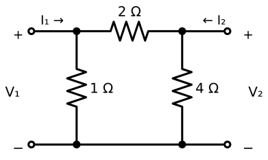
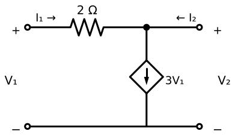
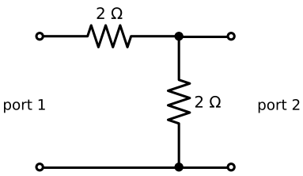

# Day 5 — 20 Conceptual Questions (Two-Port Networks)

**Companion to:** `Day05_Two_Port_Networks.md` (read §1–§6 first)
**Time:** 40 minutes, pencil and paper. A scientific calculator helps for Q17 and Q19.
**Format:** GATE style. Each question tests **one idea**, and the wrong options are the mistakes students actually make.

| Type | How it works | Self-score |
|---|---|---|
| **MCQ** | exactly one correct option | 1 mark if right |
| **MSQ** | one or more correct options; **no partial credit** | 1 mark only if your set is exactly right |
| **NAT** | type a number, no options | 1 mark if right |

Every number in the solutions is re-checked by `tools/verify_day05.py`, and each answer was also derived by hand. **In every question `I₁` and `I₂` point INTO the network**, `V₁` and `V₂` are measured from the top terminal to the bottom terminal of each port, and all circuits are linear and resistive unless a question says otherwise.

## What is in the set

| # | Type | Concept | Level | Review in the Day 5 note |
|---|---|---|---|---|
| 1 | MSQ | Which port condition measures which parameter | Easy | §2 |
| 2 | MCQ | A parameter set that does not exist | Medium | §2 |
| 3 | MSQ | Reciprocity conditions | Easy | §4 |
| 4 | MCQ | What makes a network non-reciprocal | Medium | §4 |
| 5 | NAT | Using AD − BC = 1 | Medium | §4 |
| 6 | NAT | `y₂₁` of a Π network (sign!) | Easy | §3 |
| 7 | NAT | `y₂₁` with a controlled source | Medium | §3 |
| 8 | MCQ | ABCD of a series–shunt chain | Medium | §3, §5 |
| 9 | NAT | `y₂₂` from ABCD | Medium | §4 |
| 10 | NAT | `z₁₂` from open- and short-circuit tests | Medium | §2, §4 |
| 11 | MSQ | Symmetrical reciprocal two-port | Medium | §4 |
| 12 | MCQ | Z → Y conversion | Medium | §4 |
| 13 | MCQ | Which matrices add or multiply | Easy | §5 |
| 14 | NAT | Cascade of identical sections | Medium | §5 |
| 15 | MSQ | When the combining rules are valid | Medium | §5 |
| 16 | NAT | Input impedance of a terminated two-port | Medium | §6 |
| 17 | NAT | Maximum power at port 2 | Hard | §6 |
| 18 | MCQ | Voltage gain in ABCD form | Medium | §6 |
| 19 | NAT | Voltage gain from h-parameters | Medium | §6 |
| 20 | MSQ | Transformer and coupled-inductor facts | Medium | §8 |

---

## Part A: Definitions, existence and reciprocity

### Q1 · MSQ
Select **all** correct statements about measuring two-port parameters.

- (A) `z₁₁ = V₁/I₁` is measured with port 2 **open-circuited**.
- (B) `y₂₁ = I₂/V₁` is measured with port 2 **short-circuited**.
- (C) `h₂₁ = I₂/I₁` is measured with port 2 **short-circuited**.
- (D) `A = V₁/V₂` is measured with port 2 **short-circuited**.

### Q2 · MCQ
A two-port consists of a single resistor `R` connected between the top terminals of port 1 and port 2; the bottom terminals are joined by a wire. Which parameter set does **not** exist for this network?

- (A) Z
- (B) Y
- (C) h
- (D) ABCD

### Q3 · MSQ
Select **all** conditions that hold for a **reciprocal** two-port.

- (A) `z₁₂ = z₂₁`
- (B) `y₁₂ = −y₂₁`
- (C) `AD − BC = 1`
- (D) `h₁₂ = h₂₁`

### Q4 · MCQ
A two-port is built from resistors, inductors and capacitors. Adding which of the following can make it **non-reciprocal**?

- (A) a pair of mutually coupled inductors
- (B) an ideal transformer
- (C) a voltage-controlled current source
- (D) a T-network of resistors

### Q5 · NAT
A reciprocal two-port has `A = 2`, `B = 5 Ω` and `C = 1.5 S`. The parameter `D` is ______ (round off to two decimal places).

---

## Part B: Computing and converting parameters

### Q6 · NAT
For the Π network shown, the parameter `y₂₁` is ______ S.

### Q7 · NAT
A 2 Ω resistor connects the top terminals of port 1 and port 2. A voltage-controlled current source draws `3V₁` amperes (`V₁` in volts) from the top terminal of port 2 to the common bottom terminal, as shown. The parameter `y₂₁` is ______ S.

### Q8 · MCQ
Port 1 is followed by a **series** 2 Ω resistor, then a **shunt** 2 Ω resistor (0.5 S) connected across port 2, as shown. Its ABCD matrix `[[A, B],[C, D]]` (`B` in Ω, `C` in S) is:

- (A) `[[2, 2],[0.5, 1]]`
- (B) `[[1, 2],[0.5, 2]]`
- (C) `[[5, 2],[2, 1]]`
- (D) `[[2, 2],[0.5, 2]]`

### Q9 · NAT
A reciprocal two-port has `A = 3`, `B = 5 Ω`, `C = 1 S` and `D = 2`. Its parameter `y₂₂` is ______ S.

### Q10 · NAT
A reciprocal resistive two-port has `z₂₂ = 9 Ω`. Its input resistance is 10 Ω when port 2 is **open** and 6 Ω when port 2 is **short-circuited**. The magnitude of `z₁₂` is ______ Ω.

### Q11 · MSQ
Select **all** statements that hold for a **symmetrical, reciprocal** two-port.

- (A) `z₁₁ = z₂₂`
- (B) `A = D`
- (C) `B = C`
- (D) `h₁₁h₂₂ − h₁₂h₂₁ = 1`

### Q12 · MCQ
A two-port has `Z = [[4, 2],[2, 3]] Ω`. Its parameter `y₁₁` is:

- (A) 0.25 S
- (B) 0.375 S
- (C) 0.5 S
- (D) 0.1875 S

---

## Part C: Interconnections

### Q13 · MCQ
Which pairing of connection and combining rule is correct?

- (A) cascade: the Y matrices add
- (B) series at both ports: the Z matrices add
- (C) parallel at both ports: the ABCD matrices multiply
- (D) series at the input, parallel at the output: the g matrices add

### Q14 · NAT
Two identical two-ports, each with `ABCD = [[2, 3 Ω],[1 S, 2]]`, are connected in cascade. The overall `B` parameter is ______ Ω.

### Q15 · MSQ
Select **all** correct statements about interconnecting two-ports.

- (A) The ABCD matrix of a cascade is the product of the individual ABCD matrices, in the order in which the signal passes through them.
- (B) Two three-terminal networks that share a common terminal can be connected in parallel at both ports by adding their Y matrices.
- (C) Connecting two three-terminal networks in series at both ports, with their reference terminals tied together, always allows the Z matrices to be added.
- (D) If the port condition is violated by an interconnection, the sum rule still holds provided both networks are reciprocal.

---

## Part D: Terminated two-ports

### Q16 · NAT
A two-port has `Z = [[20, 10],[10, 15]] Ω` and port 2 is terminated by `R_L = 5 Ω`. The input resistance at port 1 is ______ Ω.

### Q17 · NAT
The same two-port (`Z = [[20, 10],[10, 15]] Ω`) is driven at port 1 by a 50 V source with 5 Ω series resistance. The maximum power that can be delivered to a load connected at port 2 is ______ W (round off to two decimal places).

### Q18 · MCQ
A two-port with ABCD parameters `A, B, C, D` is terminated at port 2 by `Z_L`. The voltage gain `V₂/V₁` is:

- (A) `Z_L/(A·Z_L + B)`
- (B) `(A·Z_L + B)/Z_L`
- (C) `Z_L/(D·Z_L + C)`
- (D) `1/(C·Z_L + D)`

### Q19 · NAT
A transistor stage is modelled by `h₁₁ = 1 kΩ`, `h₁₂ = 0`, `h₂₁ = 50` and `h₂₂ = 20 µS`. A load `R_L = 5 kΩ` is connected across port 2. The voltage gain `V₂/V₁` is ______ (round off to one decimal place).

---

## Part E: Transformer and coupled inductors

### Q20 · MSQ
Select **all** correct statements.

- (A) For two coupled inductors `M = k√(L₁L₂)` with `0 ≤ k ≤ 1`.
- (B) Two coupled inductors connected in series so that their fluxes aid each other have `L_eq = L₁ + L₂ + 2M`.
- (C) An ideal transformer with turns ratio `n = N₁/N₂` presents `Z_in = n²·Z_L` at port 1 when port 2 is loaded by `Z_L`.
- (D) The ABCD matrix of an ideal transformer with `V₁ = nV₂` is `[[1/n, 0],[0, n]]`.

---

## Score yourself

<b>Answer key (open after you finish all 20)</b>

| Q | Answer | Q | Answer |
|---|---|---|---|
| 1 | A, B, C | 11 | A, B, D |
| 2 | A | 12 | B |
| 3 | A, C | 13 | B |
| 4 | C | 14 | 12 (range 12 to 12) |
| 5 | 4.25 (range 4.25 to 4.25) | 15 | A, B |
| 6 | -0.5 (range -0.5 to -0.5) | 16 | 15 (range 15 to 15) |
| 7 | 2.5 (range 2.5 to 2.5) | 17 | 9.09 (range 9.08 to 9.10) |
| 8 | A | 18 | A |
| 9 | 0.6 (range 0.6 to 0.6) | 19 | -227.3 (range -227.5 to -227.1) |
| 10 | 6 (range 6 to 6) | 20 | A, B, C |

**How to read your score**

| Score | What to do |
|---|---|
| 17–20 | You are ready for Day 6 (Networks revision and mock test). |
| 13–16 | Re-read the "Review" section for each question you missed, then redo only those questions tomorrow. |
| 12 or less | Re-read §1–§6 of the Day 5 note, redo the worked examples with the solution covered, then retake this set after 24 hours. |

Keep a note of **why** each miss happened: concept gap, sign slip (`−I₂`, `y₂₁`), or open/short swapped. Those are three different fixes.

## Solutions

<b>Q1 · Measuring the parameters</b>

**Answer: A, B, C.**

- **(A) True.** `z₁₁ = V₁/I₁` with `I₂ = 0`, i.e. port 2 open.
- **(B) True.** `y₂₁ = I₂/V₁` with `V₂ = 0`, i.e. port 2 shorted, with the source at port 1.
- **(C) True.** `h₂₁` is the short-circuit current gain, `I₂/I₁` with `V₂ = 0`.
- **(D) False.** `A = V₁/V₂` with `I₂ = 0`, so port 2 is **open**. The short-circuit entries of the ABCD set are `B` and `D`.

*Review:* §2.

<b>Q2 · A set that does not exist</b>

**Answer: A.**

With port 2 open, no current can flow in the lone series resistor, so `I₁ = 0` whatever `V₁` is: `V₁` is not determined by `I₁`, so the Z-matrix does not exist. Equivalently `Y = [[1/R, −1/R],[−1/R, 1/R]]` has `det Y = 0` and cannot be inverted. The other sets exist: `h = [[R, 1],[−1, 0]]` and `ABCD = [[1, R],[0, 1]]`.

*Review:* §2.

<b>Q3 · Reciprocity conditions</b>

**Answer: A, C.**

- **(A) True** and **(C) True**: `z₁₂ = z₂₁` and `AD − BC = 1`.
- **(B) False.** For the Y set the condition is `y₁₂ = y₂₁` (no minus sign).
- **(D) False.** For the hybrid set it is `h₁₂ = −h₂₁`. The minus signs appear in the mixed sets (`h`, `g`), whose off-diagonal entries have different units.

*Review:* §4.

<b>Q4 · What breaks reciprocity</b>

**Answer: C.**

A controlled source makes the forward transfer different from the reverse transfer (the output depends on the input but not the other way round), so the two-port is non-reciprocal. Mutual inductors, ideal transformers and resistor networks are all reciprocal. (Gyrators and ferrite circulators also break reciprocity.)

*Review:* §4.

<b>Q5 · Using AD − BC = 1</b>

**Answer: 4.25.**

A reciprocal network has `AD − BC = 1`, so `D = (1 + BC)/A = (1 + 5 × 1.5)/2 = 8.5/2 = 4.25`. Check: `2 × 4.25 − 5 × 1.5 = 1`.

*Review:* §4.

<b>Q6 · y₂₁ of a Π network</b>

**Answer: −0.5 S.**

`y₂₁ = I₂/V₁` with port 2 shorted. The 4 Ω shunt is shorted out, and the current in the 2 Ω series resistor flows **out of** port 2, so `I₂ = −V₁/2` and `y₂₁ = −0.5 S`. In general `y₂₁ = y₁₂ = −Y_c`, the **negative** of the admittance connected directly between the two top terminals; the shunts only change the diagonal entries (`y₁₁ = 1.5 S`, `y₂₂ = 0.75 S`). Answering +0.5 forgets the sign.

*Review:* §3.

<b>Q7 · y₂₁ with a controlled source</b>

**Answer: 2.5 S.**

KCL at the port-2 top node (currents leaving the node): `3V₁ + (V₂ − V₁)/2 − I₂ = 0`, so `I₂ = (3 − 0.5)V₁ + 0.5V₂`: `y₂₁ = 2.5 S` and `y₂₂ = 0.5 S`. At port 1, `I₁ = (V₁ − V₂)/2`, so `y₁₁ = 0.5 S` and `y₁₂ = −0.5 S`. Since `y₁₂ ≠ y₂₁` the network is non-reciprocal. Ignoring the source gives −0.5, and adding the 0.5 instead of subtracting gives 3.5.

*Review:* §3.

<b>Q8 · A series–shunt chain</b>

**Answer: A.**

Multiply the blocks in the order the signal passes through them:

`T = [[1, 2],[0, 1]]·[[1, 0],[0.5, 1]] = [[1 + 2 × 0.5, 2],[0.5, 1]] = [[2, 2],[0.5, 1]]`.

(B) is the reverse order (shunt first, then series). (C) treats the 2 Ω shunt as 2 S. (D) adds the two matrices instead of multiplying. Check: `AD − BC = 2 − 1 = 1` ✓.

*Review:* §3, §5.

<b>Q9 · y₂₂ from ABCD</b>

**Answer: 0.6 S.**

`y₂₂ = A/B = 3/5 = 0.6 S`. (The whole matrix is `Y = [[D/B, −ΔT/B],[−1/B, A/B]] = [[0.4, −0.2],[−0.2, 0.6]] S`, with `ΔT = AD − BC = 6 − 5 = 1`.) Using `B/A` instead of `A/B` gives 1.67, the ratio upside down.

*Review:* §4.

<b>Q10 · z₁₂ from open and short tests</b>

**Answer: 6 Ω.**

With port 2 open the input resistance is `z₁₁ = 10 Ω`. With port 2 shorted it is `1/y₁₁ = z₁₁ − z₁₂z₂₁/z₂₂ = z₁₁ − z₁₂²/z₂₂` (reciprocal network). So `10 − z₁₂²/9 = 6`, which gives `z₁₂² = 36` and `|z₁₂| = 6 Ω`. Check: `det Z = 90 − 36 = 54` and `54/9 = 6 Ω` ✓.

*Review:* §2, §4.

<b>Q11 · Symmetrical reciprocal two-port</b>

**Answer: A, B, D.**

- **(A), (B), (D) True.** A symmetrical network has `z₁₁ = z₂₂` and `A = D`. Also `Δh = z₁₁/z₂₂`, so `h₁₁h₂₂ − h₁₂h₂₁ = 1`.
- **(C) False.** `B` is in ohms and `C` is in siemens, so `B = C` cannot be a symmetry condition. Example: the T network `(3 Ω, 3 Ω, 5 Ω)` has `A = D = 1.6`, `B = 7.8 Ω`, `C = 0.2 S`.

*Review:* §4.

<b>Q12 · Z → Y</b>

**Answer: B.**

`Y = Z⁻¹`, so `y₁₁ = z₂₂/ΔZ` with `ΔZ = 4·3 − 2·2 = 8`: `y₁₁ = 3/8 = 0.375 S`. (The full matrix is `Y = [[0.375, −0.25],[−0.25, 0.5]] S`.) (A) takes `1/z₁₁`, an element-wise reciprocal. (C) uses `z₁₁/ΔZ` (diagonal entries swapped). (D) has a sign error in the determinant (`12 + 4 = 16`).

*Review:* §4.

<b>Q13 · Combining rules</b>

**Answer: B.**

Series at both ports: Z add (B). Parallel at both ports: Y add. Cascade: ABCD multiply. Series at the input and parallel at the output: **h** add (not g). Parallel at the input and series at the output: g add.

*Review:* §5.

<b>Q14 · Cascade of identical sections</b>

**Answer: 12 Ω.**

`T² = [[2, 3],[1, 2]]·[[2, 3],[1, 2]] = [[2·2 + 3·1, 2·3 + 3·2],[1·2 + 2·1, 1·3 + 2·2]] = [[7, 12],[4, 7]]`, so `B = 12 Ω` (and `AD − BC = 49 − 48 = 1`). Squaring every element would give `B = 9`, and adding the matrices would give `B = 6`.

*Review:* §5.

<b>Q15 · When the rules hold</b>

**Answer: A, B.**

- **(A) True.** The cascade rule is `T = T_a·T_b` in signal order.
- **(B) True.** In a parallel connection of three-terminal networks that share a common terminal, the port condition is preserved and `Y = Y_a + Y_b`.
- **(C) False.** Tying the two reference terminals together shorts parts of the second network. For the T networks `(4, 6, 12) Ω` and `(3, 5, 9) Ω` the connected circuit has `z₁₁ = 26.875`, `z₁₂ = 22.875`, `z₂₂ = 28.875`, but `Z_a + Z_b` gives 28, 21, 32.
- **(D) False.** Reciprocity does not rescue a violated port condition. The fix is to restore the condition (for example with 1:1 ideal transformers) or to analyse the connected circuit directly.

*Review:* §5.

<b>Q16 · Input resistance of a terminated two-port</b>

**Answer: 15 Ω.**

`Z_in = z₁₁ − z₁₂z₂₁/(z₂₂ + R_L) = 20 − 100/(15 + 5) = 20 − 5 = 15 Ω`. The value `z₁₁ = 20 Ω` would be correct only with port 2 **open**.

*Review:* §6.

<b>Q17 · Maximum power at port 2</b>

**Answer: 9.09 W.**

Seen from port 2 the circuit is a Thevenin source with the source resistance **left in place**:

- `Z_out = z₂₂ − z₁₂z₂₁/(z₁₁ + R_s) = 15 − 100/(20 + 5) = 11 Ω`
- `V_th = z₂₁V_s/(z₁₁ + R_s) = 10 × 50/25 = 20 V`

So the best load is `R_L = 11 Ω` and `P_max = V_th²/(4R_out) = 400/44 = 9.09 W`. If you drop `R_s` you get `Z_out = 10 Ω`, `V_th = 25 V` and `15.6 W`, which is wrong. Choosing `R_L = z₂₂ = 15 Ω` gives only 8.88 W.

*Review:* §6.

<b>Q18 · Voltage gain in ABCD form</b>

**Answer: A.**

`V₁ = A·V₂ + B·(−I₂)` and the load gives `−I₂ = V₂/Z_L`, so `V₁ = V₂(A + B/Z_L)` and `V₂/V₁ = Z_L/(A·Z_L + B)`. (B) is the reciprocal (`V₁/V₂`). (D) is the current gain `I_L/I₁ = 1/(C·Z_L + D)`. (C) is a mixture of the two.

*Review:* §6.

<b>Q19 · Gain from h-parameters</b>

**Answer: −227.3.**

`Δh = h₁₁h₂₂ − h₁₂h₂₁ = 1000 × 20 × 10⁻⁶ − 0 = 0.02`. Then

`V₂/V₁ = −h₂₁R_L/(h₁₁ + Δh·R_L) = −50 × 5000/(1000 + 0.02 × 5000) = −250 000/1100 = −227.3`.

The negative sign is the inversion of a common-emitter-type stage. Ignoring `h₂₂` gives −250. (Check by solving the equations: `I₂ = h₂₁I₁ + h₂₂V₂` with `V₂ = −R_L I₂`.)

*Review:* §6.

<b>Q20 · Transformer and coupled inductors</b>

**Answer: A, B, C.**

- **(A) True.** `k` is the coupling coefficient, from 0 (no coupling) to 1 (perfect coupling).
- **(B) True.** Series aiding adds `2M`; series opposing subtracts it: `L₁ + L₂ − 2M`.
- **(C) True.** `V₁ = nV₂` and `I₁ = −I₂/n` with `V₂ = −Z_L I₂` give `Z_in = V₁/I₁ = n²Z_L`. For example `n = 1/2` and `Z_L = 100 Ω` give 25 Ω.
- **(D) False.** With `V₁ = nV₂` the ABCD matrix is `[[n, 0],[0, 1/n]]`; the matrix in (D) is for the reversed ratio.

*Review:* §8.

