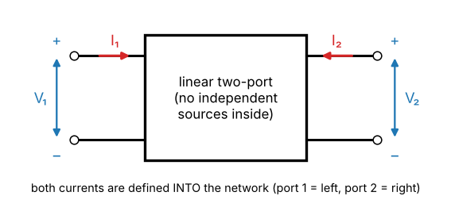
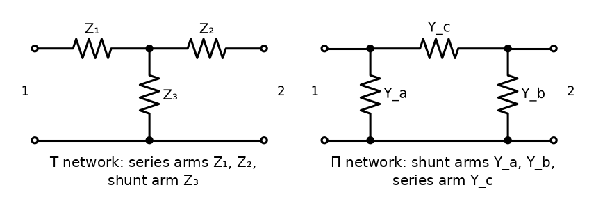
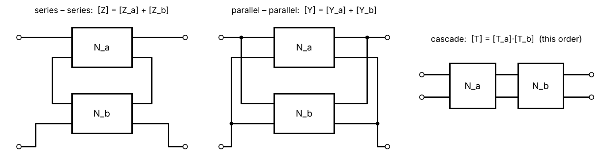
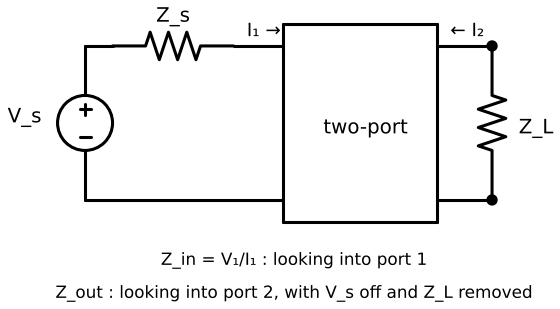
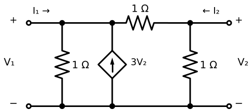
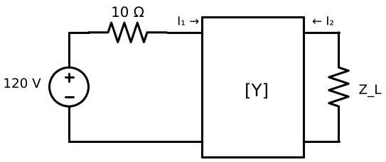
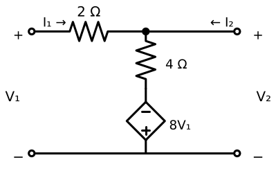
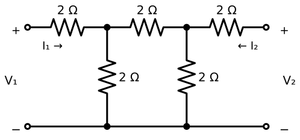
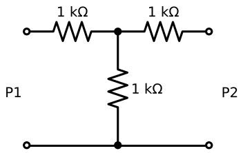
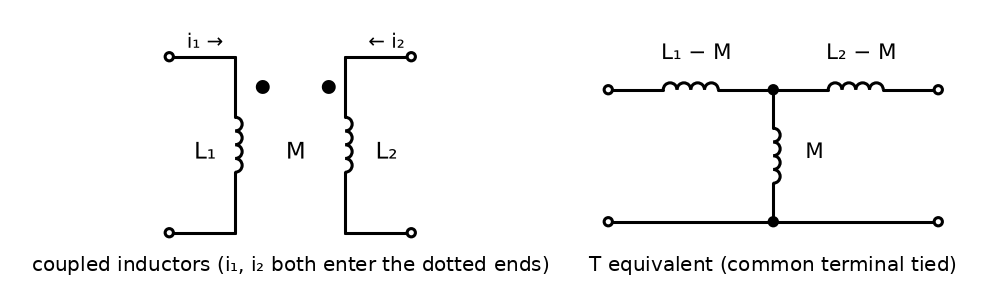

# Day 5 — Two-Port Networks (plus the ideal transformer and coupled inductors)

**Covers:** the port condition · the five parameter sets Z, Y, h, g, ABCD · measuring them · T and Π networks · conversions · reciprocity and symmetry · series, parallel and cascade connections · terminated two-ports (`Z_in`, `Z_out`, gains, maximum power) · the ideal transformer and coupled inductors
**Matches:** Day 5 of `03_Study_Plans/20_Day_Plan_Networks_Signals_Control.md` (Gate-O-Pedia pp. 2.20 – 2.29 and 2.58 – 2.61)
**Time:** about 5½ hours in total
**Companion:** `Day05_Conceptual_Questions.md`, 20 GATE-style conceptual questions with solutions
**Needs from earlier days:** Thevenin and maximum power (Day 2), phasor algebra (Day 4)

> **Syllabus check.** The GATE 2027 EC syllabus (`00_Syllabus/`) lists only *"linear 2-port network parameters"* for this topic. **Coupled inductors and the ideal transformer are not listed**, and no past question from 2019 to 2026 asks about mutual inductance. They are in §8 as short, supporting material (one past question, 2020 Q46, uses an ideal transformer). Spend your time on §1–§7.

Every number in this note is re-checked by `tools/verify_day05.py`. It **measures** the parameters on circuits by exciting the ports (exactly as the definitions say), so the conversion tables and the terminated-two-port formulas are tested against real circuit solutions. All seven new past-year answers (2020 Q15, 2020 Q46, 2021 Q29, 2023 Q33, 2024 Q60, 2025 Q40, 2026 Q51) match the official keys in `02_Previous_Year_Papers/`.

**Why it is worth a day:** every paper from 2019 to 2026 has at least one two-port question (nine in total).

## How to use this note

| Step | What | Time |
|---|---|---|
| 1 | Read §1–§3 (definitions, measuring, T and Π). **Cover the solution of each example, solve it, then compare** | 60 min |
| 2 | Read §4–§6 (reciprocity, conversions, interconnections, terminated two-ports) | 90 min |
| 3 | Do §7: the past-year questions. Try each one first | 70 min |
| 4 | Read §8 (transformer and coupled inductors) | 20 min |
| 5 | Do §9 practice problems, then read §10 (mistakes) | 40 min |
| 6 | Take the **20 conceptual questions** (timed, then review the ones you missed) | 40 min |
| 7 | Copy §11 onto your Networks formula sheet | 10 min |

---

## 1. What a two-port is

A **two-port** is a network that you look at through two pairs of terminals, called **ports**. The only things that matter are the voltages and currents at the ports; the inside can be as complicated as you like.



Three rules define the model:

1. **Port condition.** At each port, the current entering one terminal equals the current leaving the other terminal. A circuit that violates this at some port cannot be treated as a two-port.
2. **Linear, no independent sources inside.** Resistors, capacitors, inductors and *dependent* sources are allowed. Initial energy storage is zero (everything is in the Laplace or phasor domain).
3. **Sign convention.** `I₁` and `I₂` both point **into** the network. So a load `Z_L` connected to port 2 has `V₂ = −Z_L·I₂`. (The minus sign is the most common source of sign errors in this topic.)

There are four variables, `V₁, I₁, V₂, I₂`, and two linear equations between them. Choosing which two variables are the *independent* ones gives the different parameter sets below.

---

## 2. The five parameter sets

| Set | Equations | Independent variables | How the four entries are measured | Units |
|---|---|---|---|---|
| **Z** (open-circuit impedance) | `V₁ = z₁₁I₁ + z₁₂I₂`<br>`V₂ = z₂₁I₁ + z₂₂I₂` | `I₁, I₂` | `z₁₁ = V₁/I₁`, `z₂₁ = V₂/I₁` with **port 2 open** (`I₂ = 0`)<br>`z₁₂ = V₁/I₂`, `z₂₂ = V₂/I₂` with **port 1 open** | Ω |
| **Y** (short-circuit admittance) | `I₁ = y₁₁V₁ + y₁₂V₂`<br>`I₂ = y₂₁V₁ + y₂₂V₂` | `V₁, V₂` | `y₁₁ = I₁/V₁`, `y₂₁ = I₂/V₁` with **port 2 shorted** (`V₂ = 0`)<br>`y₁₂ = I₁/V₂`, `y₂₂ = I₂/V₂` with **port 1 shorted** | S |
| **h** (hybrid) | `V₁ = h₁₁I₁ + h₁₂V₂`<br>`I₂ = h₂₁I₁ + h₂₂V₂` | `I₁, V₂` | `h₁₁ = V₁/I₁`, `h₂₁ = I₂/I₁` with **port 2 shorted**<br>`h₁₂ = V₁/V₂`, `h₂₂ = I₂/V₂` with **port 1 open** | Ω, –, –, S |
| **g** (inverse hybrid) | `I₁ = g₁₁V₁ + g₁₂I₂`<br>`V₂ = g₂₁V₁ + g₂₂I₂` | `V₁, I₂` | `g₁₁ = I₁/V₁`, `g₂₁ = V₂/V₁` with **port 2 open**<br>`g₁₂ = I₁/I₂`, `g₂₂ = V₂/I₂` with **port 1 shorted** | S, –, –, Ω |
| **ABCD** (transmission) | `V₁ = A·V₂ + B·(−I₂)`<br>`I₁ = C·V₂ + D·(−I₂)` | `V₂, −I₂` | `A = V₁/V₂`, `C = I₁/V₂` with **port 2 open**<br>`B = −V₁/I₂`, `D = −I₁/I₂` with **port 2 shorted** | –, Ω, S, – |

**What the entries mean.**

- `h₁₁` is the input impedance with the output shorted; `h₂₁` is the short-circuit current gain; `h₁₂` is the reverse voltage gain (input open); `h₂₂` is the output admittance (input open). This is why `h` is the natural set for transistors.
- `A` is the reciprocal of the open-circuit voltage gain (`A = V₁/V₂`). `D` is the reciprocal of the short-circuit current gain in magnitude.
- The minus sign on `I₂` in the ABCD equations is chosen so that, in a cascade, the output current of one stage is the input current of the next. Some books define `I₂` as flowing *out* of port 2 and drop the minus sign; check which convention a problem uses.

**Which set to use.**

| Situation | Best set |
|---|---|
| two-ports in series at both ports | Z |
| two-ports in parallel at both ports | Y |
| two-ports in cascade (chain) | ABCD |
| inputs in series, outputs in parallel | h |
| inputs in parallel, outputs in series | g |
| transistor small-signal models | h (or Y) |
| circuit with voltage-controlled sources | Y (KCL is natural) |

**A set may not exist.** A lone series impedance between the ports has **no Z-matrix**: with port 2 open `I₁ = 0`, so `V₁` is not determined by `I₁`. (Its `Y` is singular, `det Y = 0`.) A lone shunt element has **no Y-matrix**. An ideal transformer has neither Z nor Y; it has `h`, `g` and ABCD. If a question asks for a parameter that does not exist, change sets instead of forcing the formula.

---

## 3. Computing the parameters

**Recipe.** (1) Choose the set. (2) Apply a 1 V or 1 A source at one port and impose the port condition at the other (short or open). (3) Solve with ordinary circuit analysis (KCL, KVL, nodal analysis): dependent sources **stay** in the circuit. (4) Read off the two entries. (5) Repeat from the other port.

### T and Π networks (memorise)



| Network | Parameters |
|---|---|
| **T** (series arms `Z₁` at port 1, `Z₂` at port 2, shunt arm `Z₃`) | `Z = [[Z₁+Z₃, Z₃],[Z₃, Z₂+Z₃]]`<br>`A = 1 + Z₁/Z₃`, `B = Z₁ + Z₂ + Z₁Z₂/Z₃`, `C = 1/Z₃`, `D = 1 + Z₂/Z₃` |
| **Π** (shunt arms `Y_a` at port 1, `Y_b` at port 2, series arm `Y_c`) | `Y = [[Y_a+Y_c, −Y_c],[−Y_c, Y_b+Y_c]]`<br>`A = 1 + Y_b/Y_c`, `B = 1/Y_c`, `C = Y_a + Y_b + Y_aY_b/Y_c`, `D = 1 + Y_a/Y_c` |

Elementary ABCD blocks for cascades: **series impedance** `Z`: `[[1, Z],[0, 1]]`; **shunt admittance** `Y`: `[[1, 0],[Y, 1]]`; **ideal transformer** (`V₁ = nV₂`): `[[n, 0],[0, 1/n]]`.

Rule of thumb: `y₁₂` is minus the admittance connected *directly between* the two top terminals, which is why `y₁₂` and `y₂₁` are negative for resistive networks.

### Ex 1: a T network

`Z₁ = 4 Ω`, `Z₂ = 6 Ω`, `Z₃ = 12 Ω`.

- `Z = [[16, 12],[12, 18]] Ω`, so `det Z = 16·18 − 12·12 = 144`.
- `Y = Z⁻¹ = (1/144)[[18, −12],[−12, 16]] S`, so `y₁₁ = 0.125 S`. **It is not `1/z₁₁ = 0.0625 S`**: a matrix inverse is not an element-wise reciprocal.
- `A = 4/3`, `B = 12 Ω`, `C = 1/12 S`, `D = 1.5`. Check: `AD − BC = 2 − 1 = 1` ✓ (reciprocal).

### Ex 2: a unilateral amplifier (dependent source)

Input: `R_i = 1 kΩ` across port 1. Output: a current source `g_m V₁` (`g_m = 40 mS`) drawn from the port-2 node to the common terminal, in parallel with `R_o = 5 kΩ`.

- KCL at port 2: `I₂ = V₂/R_o + g_m V₁`. At port 1: `I₁ = V₁/R_i`.
- `Y = [[1 mS, 0],[40 mS, 0.2 mS]]`. Since `y₁₂ = 0 ≠ y₂₁`, the network is **not reciprocal**.
- Other sets: `Z = [[1000, 0],[−200 000, 5000]] Ω` (`z₂₁ = −g_m R_i R_o`, large and negative: an inverting amplifier), `h = [[1000 Ω, 0],[40, 200 µS]]`, `ABCD = [[−0.005, −25 Ω],[−5 µS, −0.025]]` with `AD − BC = 0`.
- With `R_L = 5 kΩ`: `V₂/V₁ = −y₂₁/(y₂₂ + 1/R_L) = −0.04/(0.2 mS + 0.2 mS) = −100`. The `h` form `−h₂₁R_L/(h₁₁ + Δh·R_L) = −40·5000/(1000 + 0.2·5000) = −100` agrees.

---

## 4. Reciprocity, symmetry and conversions

A network made only of linear resistors, inductors, capacitors, mutual inductors and ideal transformers is **reciprocal**. Dependent sources, gyrators and ferrite circulators generally make it **non-reciprocal**.

| Set | Reciprocal if | Symmetric if (ports can be swapped) |
|---|---|---|
| Z | `z₁₂ = z₂₁` | `z₁₁ = z₂₂` |
| Y | `y₁₂ = y₂₁` | `y₁₁ = y₂₂` |
| h | `h₁₂ = −h₂₁` | `h₁₁h₂₂ − h₁₂h₂₁ = 1` |
| g | `g₁₂ = −g₂₁` | `g₁₁g₂₂ − g₁₂g₂₁ = 1` |
| ABCD | `AD − BC = 1` | `A = D` |

(The g-row is derived in this repository; the standard references list the other four. The symmetry conditions are stated for reciprocal networks.)

**One test for all sets** (verified on circuits): `AD − BC = z₁₂/z₂₁ = y₁₂/y₂₁ = −h₁₂/h₂₁`. The network is reciprocal exactly when this ratio is 1. Also `Δh = h₁₁h₂₂ − h₁₂h₂₁ = z₁₁/z₂₂`, so `Δh = 1` is the symmetry test.

For a **lossless reciprocal** two-port all `z` (and all `y`) are purely imaginary, and `A, D` are real while `B, C` are imaginary.

### Conversions (all verified on circuits)

Write `ΔZ = z₁₁z₂₂ − z₁₂z₂₁`, `ΔY`, `Δh`, `ΔT = AD − BC` likewise. `Y = Z⁻¹` and `g = h⁻¹`.

| From → to | Formulas |
|---|---|
| **Z → Y** (and **Y → Z**, same form) | `y₁₁ = z₂₂/ΔZ`, `y₁₂ = −z₁₂/ΔZ`, `y₂₁ = −z₂₁/ΔZ`, `y₂₂ = z₁₁/ΔZ` |
| **Z → ABCD** | `A = z₁₁/z₂₁`, `B = ΔZ/z₂₁`, `C = 1/z₂₁`, `D = z₂₂/z₂₁` |
| **Y → ABCD** | `A = −y₂₂/y₂₁`, `B = −1/y₂₁`, `C = −ΔY/y₂₁`, `D = −y₁₁/y₂₁` |
| **ABCD → Z** | `z₁₁ = A/C`, `z₁₂ = ΔT/C`, `z₂₁ = 1/C`, `z₂₂ = D/C` |
| **ABCD → Y** | `y₁₁ = D/B`, `y₁₂ = −ΔT/B`, `y₂₁ = −1/B`, `y₂₂ = A/B` |
| **Z → h** | `h₁₁ = ΔZ/z₂₂`, `h₁₂ = z₁₂/z₂₂`, `h₂₁ = −z₂₁/z₂₂`, `h₂₂ = 1/z₂₂` |
| **Y → h** | `h₁₁ = 1/y₁₁`, `h₁₂ = −y₁₂/y₁₁`, `h₂₁ = y₂₁/y₁₁`, `h₂₂ = ΔY/y₁₁` |
| **h → Z** | `z₁₁ = Δh/h₂₂`, `z₁₂ = h₁₂/h₂₂`, `z₂₁ = −h₂₁/h₂₂`, `z₂₂ = 1/h₂₂` |
| **h → Y** | `y₁₁ = 1/h₁₁`, `y₁₂ = −h₁₂/h₁₁`, `y₂₁ = h₂₁/h₁₁`, `y₂₂ = Δh/h₁₁` |
| **ABCD → h** | `h₁₁ = B/D`, `h₁₂ = ΔT/D`, `h₂₁ = −1/D`, `h₂₂ = C/D` |
| **h → ABCD** | `A = −Δh/h₂₁`, `B = −h₁₁/h₂₁`, `C = −h₂₂/h₂₁`, `D = −1/h₂₁` |

Do not memorise the table. Memorise **`Y = Z⁻¹`**, the ABCD-from-Z row (`z₂₁ = 1/C` is the easy anchor), and derive anything else by eliminating variables.

---

## 5. Interconnecting two-ports



| Connection | Matrices combine as | Why |
|---|---|---|
| series at both ports | `[Z] = [Z_a] + [Z_b]` | same currents, voltages add |
| parallel at both ports | `[Y] = [Y_a] + [Y_b]` | same voltages, currents add |
| series at input, parallel at output | `[h] = [h_a] + [h_b]` | `I₁` and `V₂` are common |
| parallel at input, series at output | `[g] = [g_a] + [g_b]` | `V₁` and `I₂` are common |
| **cascade** (port 2 of `a` to port 1 of `b`) | `[T] = [T_a]·[T_b]` in **that order** | `V₂, −I₂` of `a` are `V₁, I₁` of `b` |

For a chain of several sections, multiply the ABCD matrices **left to right** in the order the signal travels. (`T_a·T_b ≠ T_b·T_a`: series-then-shunt `[[2, 2],[0.5, 1]]` is not shunt-then-series `[[1, 2],[0.5, 2]]`.)

**The port condition can fail.** The rules above hold only if connecting the networks does not change either one's port currents. A **cascade** is always safe, and a **parallel** connection of two three-terminal networks that share a common terminal is safe. A **series** connection often is not. Example (checked in the script): two T networks, `(4, 6, 12) Ω` and `(3, 5, 9) Ω`, joined in series at both ports with their reference terminals tied together:

| | `z₁₁` | `z₁₂` | `z₂₂` |
|---|---|---|---|
| naive `Z_a + Z_b` | 28 | 21 | 32 |
| measured on the circuit | 26.875 | 22.875 | 28.875 |

The common terminals short out part of one network, so the sum is wrong. The **Brune test** checks whether a connection is allowed; the usual cure is to insert 1:1 ideal transformers at the outputs, which restores the port condition. For GATE, remember: *cascade and parallel are safe, series needs a thought*.

---

## 6. Terminated two-ports



A source `(V_s, Z_s)` drives port 1 and a load `Z_L` sits on port 2. Using `V₂ = −Z_L·I₂`:

- **Input impedance** `Z_in = V₁/I₁` (looking into port 1 with the load connected).
- **Output impedance** `Z_out` (looking into port 2 with the **source turned off but its `Z_s` left in place**, and the load removed).
- **Voltage gain** `A_v = V₂/V₁` and **current gain** `A_i = I_L/I₁ = −I₂/I₁` (the current into the load).

| | `Z_in` | `Z_out` | `A_v = V₂/V₁` | `A_i = I_L/I₁` |
|---|---|---|---|---|
| **Z** | `z₁₁ − z₁₂z₂₁/(z₂₂ + Z_L)` | `z₂₂ − z₁₂z₂₁/(z₁₁ + Z_s)` | `z₂₁Z_L/(z₁₁Z_L + ΔZ)` | `z₂₁/(z₂₂ + Z_L)` |
| **Y** (`Y_L = 1/Z_L`, `Y_s = 1/Z_s`) | `1/[y₁₁ − y₁₂y₂₁/(y₂₂ + Y_L)]` | `1/[y₂₂ − y₁₂y₂₁/(y₁₁ + Y_s)]` | `−y₂₁/(y₂₂ + Y_L)` | `−y₂₁Y_L/[y₁₁(y₂₂ + Y_L) − y₁₂y₂₁]` |
| **ABCD** | `(A Z_L + B)/(C Z_L + D)` | `(D Z_s + B)/(C Z_s + A)` | `Z_L/(A Z_L + B)` | `1/(C Z_L + D)` |
| **h** | `h₁₁ − h₁₂h₂₁Z_L/(1 + h₂₂Z_L)` | `(h₁₁ + Z_s)/(Δh + h₂₂Z_s)` | `−h₂₁Z_L/(h₁₁ + Δh·Z_L)` | `−h₂₁/(1 + h₂₂Z_L)` |

Derivation of the first Z entry: `V₂ = −Z_L I₂` in `V₂ = z₂₁I₁ + z₂₂I₂` gives `I₂ = −z₂₁I₁/(z₂₂ + Z_L)`; substitute into `V₁ = z₁₁I₁ + z₁₂I₂`. For `Z_out`, set `V₁ = −Z_s I₁` in the first equation to get `I₁ = −z₁₂I₂/(z₁₁ + Z_s)` and substitute into the second. With the source included, `V₂/V_s = z₂₁Z_L/[(z₁₁ + Z_s)(z₂₂ + Z_L) − z₁₂z₂₁]`.

### The load sees a Thevenin source (Day 2 meets Day 5)

Seen from port 2, everything to the left is a Thevenin equivalent:

```
Z_out = z22 − z12·z21/(z11 + Z_s)            V_th = z21·V_s/(z11 + Z_s)       (port 2 open, I2 = 0)
```

so for **maximum power** the load must be `Z_L = Z_out*` (a plain `R_L = Z_out` for resistive networks) and `P_max = V_th²/(4R_out)`. Two past questions (2020 Q15, 2023 Q33) are exactly this. The common mistake is to drop `Z_s` and use `z₂₂ − z₁₂z₂₁/z₁₁`.

### Ex 3: Ex 1's T network, terminated

`R_s = 4 Ω`, `V_s = 24 V`, `R_L = 6 Ω` (with `Z = [[16, 12],[12, 18]]`).

- `Z_in = 16 − 144/(18 + 6) = 10 Ω`, so `V₁ = 24·10/(4 + 10) = 17.14 V`.
- `A_v = z₂₁R_L/(z₁₁R_L + ΔZ) = 72/(96 + 144) = 0.3`, so `V₂ = 5.14 V` (that is `0.2143·V_s`). `A_i = 12/24 = 0.5`.
- `Z_out = 18 − 144/(16 + 4) = 10.8 Ω` and `V_th = 12·24/20 = 14.4 V`, so the best load is **10.8 Ω** with `P_max = 14.4²/(4·10.8) = 4.8 W`. (At `R_L = 6 Ω` the load gets only `5.14²/6 = 4.41 W`.)
- The four columns of the table (Z, Y, ABCD, h) all give the same `Z_in`, `A_v`, `A_i` and `Z_out`, checked on a circuit.

---

## 7. Past-year questions (all solved, all match the official keys)

Papers and keys: `02_Previous_Year_Papers/<year>/`. **Try each question from the paper first.**

| # | Question | Official answer | Concept it tests |
|---|---|---|---|
| 1 | 2019 Q4 (MCQ) | B (1 A) | Reciprocity: **solved on Day 2** (the circuit values are decoys) |
| 2 | 2020 Q15 (NAT) | 48 Ω | Z-matrix: load for maximum power at port 2 |
| 3 | 2020 Q46 (NAT) | 0.80 | S₂₁ of an ideal 2:1 transformer |
| 4 | 2021 Q29 (MCQ) | C | Y-parameters of a circuit with a dependent source |
| 5 | 2022 Q54 (NAT) | 3.9 to 4.1 mA | A Thevenin line measured at port 2: **solved on Day 2** |
| 6 | 2023 Q33 (NAT) | 80 Ω | Y-matrix: load for maximum power at port 2 |
| 7 | 2024 Q60 (NAT) | 1.5 S | `y₂₁` with a dependent source |
| 8 | 2025 Q40 (MCQ) | A | Z-parameters of a resistive ladder |
| 9 | 2026 Q51 (MCQ) | D | ABCD parameters of a T network |

Also on the papers: 2023 Q46 (h-parameters of a transistor amplifier, official answer "marks to all") and the S-parameter questions 2023 Q51 and 2026 Q34 belong to the analog and microwave parts of the syllabus.

### 2020 Q15: load for maximum power (Z-matrix)


`[Z] = [[40, 60],[60, 120]] Ω`, source 120 V with 10 Ω at port 1. Port 2 sees a Thevenin source:

`Z_out = z₂₂ − z₁₂z₂₁/(z₁₁ + R_s) = 120 − 60·60/(40 + 10) = 120 − 72 =` **48 Ω.**

(`V_th = 60·120/50 = 144 V`, so `P_max = 144²/(4·48) = 108 W`.) Dropping `R_s` gives `120 − 3600/40 = 30 Ω`, the typical wrong answer.

### 2020 Q46: S₂₁ of an ideal 2:1 transformer
For an ideal transformer with ratio `n = 2` between the ports, with both ports terminated in the reference impedance `Z₀ = 10 Ω`, `S₂₁ = 2V₂/V_s` (generator EMF `V_s` with source resistance `Z₀`, output across a matched load `Z₀`). Take `V₂` across the load: the load current is `V₂/Z₀`, so `I₁ = V₂/(nZ₀)` and `V₁ = nV₂`. Then

`V_s = V₁ + Z₀I₁ = nV₂ + V₂/n`  →  `S₂₁ = 2/(n + 1/n) = 2n/(n² + 1) = 4/5 =` **0.80.**

It does not depend on `Z₀` because the transformer is ideal. The general formula `S₂₁ = 2/(A + B/Z₀ + CZ₀ + D)` with `ABCD = [[n, 0],[0, 1/n]]` gives the same number (the script checks the formula on a real circuit). S-parameters belong to the microwave topics, so this is the only S-parameter result you need from this note.

### 2021 Q29: Y-parameters with a dependent source


Unknowns `V₁` (left node) and `V₂` (right node). The source `3V₂` injects current **into** the left node.

- Left node: `I₁ + 3V₂ = V₁/1 + (V₁ − V₂)/1`, so `I₁ = 2V₁ − 4V₂`: `y₁₁ = 2`, `y₁₂ = −4`.
- Right node: `I₂ = (V₂ − V₁)/1 + V₂/1`, so `I₂ = −V₁ + 2V₂`: `y₂₁ = −1`, `y₂₂ = 2`.

**Option (C).** Because `y₁₂ ≠ y₂₁` the network is non-reciprocal, as it must be with a controlled source. (Options (A) and (D) have `y₁₂ = y₂₁`, which should make you suspicious immediately.)

### 2023 Q33: load for maximum power (Y-matrix)


`[Y] = (1/100)[[2, −1],[−1, 4/3]] S`, source 120 V with `R_s = 10 Ω`. In the Y form the output admittance with the source off is

`Y_out = y₂₂ − y₁₂y₂₁/(y₁₁ + 1/R_s) = 0.013333 − 0.0001/(0.02 + 0.1) = 0.0125 S`,

so `Z_L = 1/Y_out =` **80 Ω**. (Check with `Z = Y⁻¹`: `z₂₂ − z₁₂z₂₁/(z₁₁ + 10) = 80`. Also `V_th = 80 V`, `P_max = 20 W`.)

### 2024 Q60: `y₂₁` with a dependent source


`y₂₁ = I₂/V₁` with port 2 **shorted** (`V₂ = 0`), so the middle node `X` is at 0 V.

- The 2 Ω carries `I₁ = V₁/2` into `X`.
- The source `8V₁` has its `+` at the bottom (ground), so its `−` terminal, at the bottom of the 4 Ω, is at `−8V₁`. The 4 Ω carries `(0 − (−8V₁))/4 = 2V₁` **down** and out of `X`.
- KCL at `X`: `I₁ + I₂ = 2V₁`, so `I₂ = 2V₁ − V₁/2 = 1.5V₁`.

`y₂₁ =` **1.5 S.** (The full matrix is `[[0.5, −0.5],[1.5, 0.75]] S`, non-reciprocal.)

### 2025 Q40: Z-parameters of a ladder


Cascade the blocks (series 2 Ω, shunt 0.5 S, series 2 Ω, shunt 0.5 S, series 2 Ω):

`T = [[1,2],[0,1]]·[[1,0],[0.5,1]]·[[1,2],[0,1]]·[[1,0],[0.5,1]]·[[1,2],[0,1]] = [[5, 16],[1.5, 5]]`,

(`AD − BC = 25 − 24 = 1`). Then `z₁₁ = A/C = 10/3`, `z₁₂ = z₂₁ = 1/C = 2/3`, `z₂₂ = D/C = 10/3`: **option (A)**. Direct check of `z₁₁`: `2 + 2 ∥ (2 + 2) = 2 + 4/3 = 10/3` with port 2 open.

### 2026 Q51: ABCD of a T network


With `Z₁ = Z₂ = Z₃ = 1 kΩ` in the T formulas: `A = 1 + Z₁/Z₃ = 2`, `B = Z₁ + Z₂ + Z₁Z₂/Z₃ = 3 kΩ`, `C = 1/Z₃ = 10⁻³ S`, `D = 1 + Z₂/Z₃ = 2`. **Option (D).** Check: `AD − BC = 4 − 3 = 1` ✓. Option (B) has `B = 3 Ω`, `C = 1 S`, which forgets the kilo prefixes.

---

## 8. The ideal transformer and coupled inductors (supporting material)

### Ideal transformer

An ideal transformer is **linear, lossless and perfectly coupled** (infinite winding inductances, no leakage). With both currents defined into the dotted ends and turns ratio `n = N₁/N₂`:

```
V1 = n·V2        I1 = −I2/n        V1·I1 + V2·I2 = 0        Z_in = n²·Z_L
```

Its ABCD matrix is `[[n, 0],[0, 1/n]]` and its h-matrix is `[[0, n],[−n, 0]]`; it has no Z or Y matrix. A **real** transformer adds a series leakage inductance in each winding and a shunt magnetising branch (core loss and magnetising reactance) to this ideal model.

### Coupled inductors

With both currents entering the dotted ends:

```
v1 = L1·di1/dt + M·di2/dt        v2 = M·di1/dt + L2·di2/dt        M = k·√(L1·L2),   0 ≤ k ≤ 1
stored energy  W = ½L1·i1² + ½L2·i2² + M·i1·i2   (positive for all currents only if M² ≤ L1·L2)
```

In the phasor domain the two-port is `Z = jω[[L₁, M],[M, L₂]]` (reciprocal, so `z₁₂ = z₂₁`). It has the **T equivalent** `L₁ − M`, `L₂ − M` in the series arms and `M` in the shunt arm (with the two reference terminals tied together; with strong coupling and unequal inductances one series arm can come out negative). Two coupled coils in series have

```
L_eq = L1 + L2 + 2M   (series aiding: the currents produce fluxes in the same direction)
L_eq = L1 + L2 − 2M   (series opposing)
L_eq = (L1·L2 − M²)/(L1 + L2 − 2M)   (parallel, aiding)
```

As `k → 1` with `L₁, L₂ → ∞` and `L₁/L₂ = n²` the pair becomes the ideal transformer. Numbers: see P5.



---

## 9. Practice (answers at the end of this section)

**P1 · T network.** A T network has series arms 3 Ω (port 1) and 5 Ω (port 2) and a 2 Ω shunt arm. Find `Z` and the ABCD parameters, and check `AD − BC`.

**P2 · Π network.** A Π network has shunt admittances `Y_a = 1 S` (port 1) and `Y_b = 2 S` (port 2) and series admittance `Y_c = 3 S`. Find `Y` and the ABCD parameters.

**P3 · Terminated two-port.** A two-port has `ABCD = [[2, 3 Ω],[1 S, 2]]`. A 12 V source with `R_s = 3 Ω` drives port 1 and `R_L = 4 Ω` loads port 2. Find `Z_in`, `V₂`, `Z_out`, and the maximum power obtainable at port 2.

**P4 · Cascade.** Two copies of the T network of Ex 1 are cascaded. Find the overall ABCD matrix and check `AD − BC`.

**P5 · Coupled inductors.** `L₁ = 0.4 H`, `L₂ = 0.9 H`, `k = 0.5`. Find `M`, the series-aiding and series-opposing inductances, and the stored energy for `i₁ = 2 A`, `i₂ = 1 A` (both into the dots), and again with `i₂` reversed.

<details>
<summary><b>Answers</b></summary>

- **P1:** `Z = [[5, 2],[2, 7]] Ω`. `A = 1 + 3/2 = 2.5`, `B = 3 + 5 + 15/2 = 15.5 Ω`, `C = 1/2 = 0.5 S`, `D = 1 + 5/2 = 3.5`; `AD − BC = 8.75 − 7.75 = 1` ✓.
- **P2:** `Y = [[4, −3],[−3, 5]] S`. `A = 1 + 2/3 = 5/3`, `B = 1/3 Ω`, `C = 1 + 2 + 2/3 = 11/3 S`, `D = 1 + 1/3 = 4/3`; `AD − BC = 20/9 − 11/9 = 1` ✓.
- **P3:** `Z_in = (2·4 + 3)/(1·4 + 2) = 11/6 = 1.83 Ω`. `V₁ = 12·1.83/(3 + 1.83) = 4.55 V`, `V₂ = V₁·R_L/(A·R_L + B) = 4.55·4/11 =` **1.66 V**. `Z_out = (D·R_s + B)/(C·R_s + A) = (6 + 3)/(3 + 2) =` **1.8 Ω**. Open-circuit voltage at port 2: `V_s/(A + C·R_s) = 12/5 = 2.4 V`, so `P_max = 2.4²/(4·1.8) =` **0.8 W** at `R_L = 1.8 Ω`.
- **P4:** `T = [[4/3, 12],[1/12, 3/2]]`, `T² = [[25/9, 34 Ω],[17/72 S, 13/4]]` = `[[2.78, 34],[0.236, 3.25]]`; `AD − BC = 9.03 − 8.03 = 1` ✓. (Cascading is matrix multiplication, not elementwise.)
- **P5:** `M = 0.5·√(0.4·0.9) = 0.3 H`. Aiding `0.4 + 0.9 + 0.6 =` **1.9 H**, opposing `1.3 − 0.6 =` **0.7 H**. Energy `½·0.4·4 + ½·0.9·1 + 0.3·2·1 = 0.8 + 0.45 + 0.6 =` **1.85 J**; with `i₂` reversed `0.8 + 0.45 − 0.6 =` **0.65 J**.
</details>

---

## 10. The mistakes that cost marks (checklist)

1. **Inverting element by element.** `y₁₁ ≠ 1/z₁₁`; use the matrix inverse (`y₁₁ = z₂₂/ΔZ`).
2. **Sign of `I₂`.** `I₂` points into the network, so `V₂ = −Z_L·I₂` and the load current is `−I₂`. The ABCD set uses `−I₂`.
3. **Cascade in the wrong order.** `T = T_a·T_b`, left to right as the signal flows.
4. **Open and short swapped.** Z: other port **open**. Y: other port **shorted**. `h₁₁, h₂₁`: output shorted. `A, C`: output open.
5. **Assuming every set exists.** A lone series element has no Z; a lone shunt element has no Y.
6. **Using reciprocity with a dependent source.** `y₁₂ = y₂₁` is false when a controlled source is inside (2021 Q29, 2024 Q60).
7. **Adding matrices when the port condition fails.** Series connections of three-terminal networks are the usual culprit.
8. **Dropping `Z_s` in `Z_out`.** `Z_out = z₂₂ − z₁₂z₂₁/(z₁₁ + Z_s)`, with the source *off*, not removed.
9. **Turning off a dependent source** when finding `Z_out` or a Thevenin resistance. Only independent sources are turned off.
10. **Mixing up `h₁₂` and `h₂₁`.** `h₂₁` is the forward current gain (output shorted); `h₁₂` is the reverse voltage gain (input open); reciprocity says `h₁₂ = −h₂₁`.
11. **Forgetting units.** `B` is in ohms, `C` in siemens, `h₁₁` in ohms, `h₂₂` in siemens (2026 Q51 tests kΩ versus Ω).
12. **Using the symmetry conditions on a non-reciprocal network.** Symmetry (`z₁₁ = z₂₂`, `A = D`) is only half the story if `z₁₂ ≠ z₂₁`.

---

## 11. One-page formula sheet (copy this)

```
PORT CONVENTION  I1, I2 INTO the network;  load on port 2:  V2 = −Z_L·I2;  load current = −I2.
SETS             Z: V = Z·I (other port OPEN)   Y: I = Y·V (other port SHORT)   Y = Z⁻¹,  g = h⁻¹
                 h: [V1; I2] = h·[I1; V2]   (h11 = Vin/Iin, output shorted;  h21 = current gain, output shorted)
                 ABCD: [V1; I1] = [A B; C D]·[V2; −I2]   (A, C: port 2 open;  B, D: port 2 shorted)
T NETWORK        Z = [[Z1+Z3, Z3],[Z3, Z2+Z3]];   A = 1+Z1/Z3, B = Z1+Z2+Z1Z2/Z3, C = 1/Z3, D = 1+Z2/Z3
PI NETWORK       Y = [[Ya+Yc, −Yc],[−Yc, Yb+Yc]];  A = 1+Yb/Yc, B = 1/Yc, C = Ya+Yb+YaYb/Yc, D = 1+Ya/Yc
BLOCKS (ABCD)    series Z: [[1,Z],[0,1]];  shunt Y: [[1,0],[Y,1]];  ideal transformer V1 = nV2: [[n,0],[0,1/n]]
RECIPROCAL       z12 = z21;  y12 = y21;  h12 = −h21;  g12 = −g21;  AD − BC = 1     (AD−BC = z12/z21 = y12/y21 = −h12/h21)
SYMMETRIC        z11 = z22;  y11 = y22;  Δh = 1;  A = D
CONVERSIONS      y11 = z22/ΔZ, y12 = −z12/ΔZ;   A = z11/z21, B = ΔZ/z21, C = 1/z21, D = z22/z21;   z11 = A/C, z12 = ΔT/C, z21 = 1/C, z22 = D/C
                 y11 = D/B, y12 = −ΔT/B, y21 = −1/B, y22 = A/B;   h11 = ΔZ/z22, h21 = −z21/z22, h22 = 1/z22
INTERCONNECT     series-series: Z add;  parallel-parallel: Y add;  series-parallel: h add;  parallel-series: g add;  cascade: T = Ta·Tb (order!)
TERMINATED       Z_in  = z11 − z12z21/(z22+Z_L) = (A·Z_L+B)/(C·Z_L+D)         Z_out = z22 − z12z21/(z11+Z_s) = (D·Z_s+B)/(C·Z_s+A)
                 A_v = V2/V1 = Z_L/(A·Z_L+B) = −y21/(y22+Y_L) = −h21·Z_L/(h11+Δh·Z_L)          A_i = I_L/I1 = 1/(C·Z_L+D) = z21/(z22+Z_L)
MAX POWER AT PORT 2   V_th = z21·V_s/(z11+Z_s) = V_s/(A+C·Z_s);   Z_L = Z_out*;   P_max = V_th²/(4·R_out)
TRANSFORMER      V1 = nV2, I1 = −I2/n, Z_in = n²Z_L;   coupled coils: M = k√(L1L2), series ±: L1+L2±2M, Z = jω[[L1,M],[M,L2]], T-equiv (L1−M),(L2−M),M
```

---

## 12. Self-test before you move to Day 6

You are ready if you can, **without looking**:

- [ ] write the equations of Z, Y, h, g and ABCD and say which port is open or shorted for each entry
- [ ] find the Z, Y or ABCD parameters of a T or Π network, and of a circuit with a dependent source
- [ ] convert Z ↔ Y ↔ ABCD (at least Z ↔ Y and Z → ABCD) without a table
- [ ] state the reciprocity and symmetry conditions in all four sets and say why a dependent source breaks them
- [ ] cascade, in the right order, series and shunt blocks into one ABCD matrix
- [ ] compute `Z_in`, `Z_out`, `A_v` and the maximum-power load at port 2
- [ ] solve 2020 Q15, 2023 Q33 and 2025 Q40 in under 3 minutes each
- [ ] score at least 17/20 on `Day05_Conceptual_Questions.md`

**Day 6 preview:** a Networks revision day: formula sheet, a map of every past question from 2019 to 2026, 20 mixed conceptual questions and a 25-question timed mock test.

---

## 13. Sources and further reading

**Pages read for this note** (a research pass read the full pages; the Inductance page was reached through the *Mutual inductance* link, which redirects to it):

- [Wikipedia: Two-port network](https://en.wikipedia.org/wiki/Two-port_network): the equations of the Z, Y, h, g, ABCD and S sets and the current-direction convention (including the minus sign on `I₂` in ABCD), the reciprocity and symmetry conditions for Z, Y, h, ABCD and S, series, parallel, series-parallel, parallel-series and cascade combinations, the port condition and the Brune test (named, not explained), `Z_in = z₁₁ − z₁₂z₂₁/(Z_L + z₂₂)`
- [Wikipedia: Reciprocity (electrical networks)](https://en.wikipedia.org/wiki/Reciprocity_(electrical_networks)): symmetric Z, Y, S matrices, `h₁₂ = −h₂₁`, `AD − BC = 1`, passive R, L, C (including mutual inductors) reciprocal, active networks and ferrite devices generally not
- [Wikipedia: Transformer](https://en.wikipedia.org/wiki/Transformer): the ideal transformer is linear, lossless and perfectly coupled; `V_P/V_S = I_S/I_P = N_P/N_S`; load referred to the primary is `a²Z_L`; the equivalent circuit with leakage and magnetising branch
- [Wikipedia: Inductance](https://en.wikipedia.org/wiki/Inductance) (section on mutual inductance): `v₁ = L₁di₁/dt ± M di₂/dt` with the sign set by the dot convention, `M = k√(L₁L₂)`, `[z] = s[[L₁, M],[M, L₂]]`, the stored-energy expression, the T equivalent and the ideal-transformer limit

**Not on those pages, so derived and verified in this repository** (`tools/verify_day05.py`): the full conversion table (the page has one, but its text did not survive extraction, so every entry here was derived and checked on circuits), `Z_out` and the voltage and current gains for all four sets, the g-parameter reciprocity and symmetry conditions, `AD − BC = z₁₂/z₂₁`, the series-aiding, series-opposing and parallel inductance formulas, the `S₂₁` solution of 2020 Q46, and every worked example and past-year solution.

**Recommended practice:** the Gate-O-Pedia notes (`01_Notes/`), pp. 2.20–2.29 for extra two-port problems. Two-port lectures from MIT OCW 6.002/6.003 and the NPTEL circuits courses are good companions, but I did not extract their text for this note.
