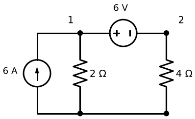

# Day 6 — 20 Mixed Conceptual Questions (Days 1–5)

**Companion to:** `Day06_Networks_Revision.md`. Use this set as a quick concept check **before** the timed mock test. It mixes ideas from all five Networks days; each question tests **one idea**, and the wrong options are the mistakes students actually make.
**Time:** 35–40 minutes, pencil and paper, a scientific calculator for a few NAT answers.
**Format:** GATE style.

| Type | How it works | Self-score |
|---|---|---|
| **MCQ** | exactly one correct option | 1 mark if right |
| **MSQ** | one or more correct options; **no partial credit** | 1 mark only if your set is exactly right |
| **NAT** | type a number, no options | 1 mark if right |

Every number in the solutions is re-checked by `tools/verify_day06.py`, and each answer was also derived by hand. AC quantities are rms unless a question says "peak"; `I₁` and `I₂` of a two-port point **into** the network.

## What is in the set

| # | Type | Concept | Level | Review |
|---|---|---|---|---|
| 1 | MSQ | Which parts of a branch with an ideal source can be removed | Medium | Day 1 §4, §10 |
| 2 | NAT | A floating voltage source between two nodes | Medium | Day 1 §7 |
| 3 | NAT | Thevenin resistance from `V_oc` and `I_sc` | Easy | Day 2 §3 |
| 4 | MCQ | Power fraction away from the matched load | Medium | Day 2 §5 |
| 5 | MSQ | What superposition can and cannot do | Medium | Day 2 §1, §2 |
| 6 | NAT | Time to reach 90 % with `τ = L/R_th` | Easy | Day 3 §3 |
| 7 | MCQ | Source current at `0⁺` and `∞` | Medium | Day 3 §2 |
| 8 | NAT | Energy lost in the resistor when a charged capacitor is recharged | Medium | Day 3 §3 |
| 9 | MSQ | Damping of a parallel RLC | Medium | Day 3 §5 |
| 10 | NAT | Final value from a Laplace expression | Easy | Day 3 §7 |
| 11 | NAT | Average power with a DC and an AC source | Medium | Day 2 §2, Day 4 §4 |
| 12 | MCQ | Power and power factor from peak waveforms | Medium | Day 4 §4 |
| 13 | MSQ | Facts about parallel resonance | Medium | Day 4 §5 |
| 14 | NAT | Impedance magnitude of a parallel R–C | Easy | Day 4 §2 |
| 15 | NAT | Reciprocity with short-circuit currents | Medium | Day 2 §6, Day 5 §4 |
| 16 | MCQ | `h₁₁` from the Y matrix | Medium | Day 5 §4 |
| 17 | NAT | Output impedance of a two-port | Medium | Day 5 §6 |
| 18 | MCQ | Independent parameters of a two-port | Medium | Day 5 §4 |
| 19 | NAT | A T network with a capacitor at one frequency | Hard | Day 4 §2, Day 5 §6 |
| 20 | MCQ | The load for maximum AC power | Medium | Day 2 §5, Day 4 §4 |

---

## Part A: Circuit analysis and theorems

### Q1 · MSQ
Select **all** correct statements.

- (A) A resistor in series with an ideal current source can be replaced by a short circuit without changing any current or voltage in the rest of the network.
- (B) A resistor in parallel with an ideal voltage source can be removed without changing any current or voltage in the rest of the network.
- (C) Two ideal voltage sources of different values can be connected in parallel.
- (D) A Thevenin source and its Norton equivalent dissipate the same power inside the source.

### Q2 · NAT
In the circuit shown, a 6 A current source feeds node 1, and a 6 V source is connected between node 1 (positive) and node 2. The voltage of node 1 is ______ V.

### Q3 · NAT
A linear network gives an open-circuit voltage of 12 V and a short-circuit current of 3 A at its terminals. A 6 Ω resistor is connected across the terminals. The power in the resistor is ______ W (round off to two decimal places).

### Q4 · MCQ
A source has Thevenin resistance `R_th` and is connected to a load `R_L = 4R_th`. The power delivered to the load is what fraction of the maximum power the source could deliver?

- (A) 0.25
- (B) 0.5
- (C) 0.64
- (D) 0.8

### Q5 · MSQ
Select **all** correct statements about superposition in a linear circuit.

- (A) The response to several independent sources is the sum of the responses to each source acting alone.
- (B) The power in a resistor can be found by adding the powers due to each source acting alone.
- (C) When one independent source is considered, all dependent sources must also be set to zero.
- (D) If sources of different frequencies act together, their responses are added in the time domain, not as phasors.

---

## Part B: Transients and Laplace

### Q6 · NAT
After a switch operates, an inductor `L = 0.5 H` sees a network with Thevenin resistance 25 Ω and a DC source. The inductor current reaches 90 % of its final value ______ ms after the switching instant (round off to one decimal place).

### Q7 · MCQ
A 12 V DC source is connected at `t = 0` to a 4 Ω resistor in series with the **parallel combination** of (i) an uncharged capacitor and (ii) a 6 Ω resistor in series with an inductor that has no initial current. The source current at `t = 0⁺` and at `t → ∞` is respectively:

- (A) 1.2 A and 3 A
- (B) 3 A and 1.2 A
- (C) 3 A and 3 A
- (D) 2 A and 1.2 A

### Q8 · NAT
A 4 µF capacitor initially charged to 2 V is connected through a resistor to a 10 V DC source. The total energy dissipated in the resistor is ______ µJ.

### Q9 · MSQ
A **parallel** RLC circuit has `L = 1 H` and `C = 1 F`. Select **all** correct statements.

- (A) With `R = 1 Ω` the response is underdamped.
- (B) With `R = 0.5 Ω` the response is critically damped.
- (C) Increasing `R` makes the response more damped.
- (D) With `R = 0.25 Ω` the response is overdamped.

### Q10 · NAT
The Laplace transform of a current is `I(s) = (4s + 10)/(s(s + 2))`. The final value `i(∞)` is ______ A.

---

## Part C: AC steady state and resonance

### Q11 · NAT
A voltage `v(t) = 10 + 10√2·sin(ωt)` V (a DC source in series with a 10 V rms sinusoid) is applied across a 5 Ω resistor. The average power dissipated is ______ W.

### Q12 · MCQ
A load has `v = 100 cos ωt` V and `i = 5 cos(ωt − 60°)` A (both **peak** values). The average power and the power factor are:

- (A) 250 W, 0.5 lagging
- (B) 216.5 W, 0.866 lagging
- (C) 125 W, 0.5 leading
- (D) 125 W, 0.5 lagging

### Q13 · MSQ
A parallel RLC circuit is driven by an ideal current source `I_s`. Select **all** correct statements.

- (A) The impedance magnitude is largest at the resonant frequency.
- (B) At resonance the inductor and capacitor currents each have magnitude `Q·I_s`.
- (C) The quality factor is `Q = ω₀RC`.
- (D) Increasing `R` increases the half-power bandwidth.

### Q14 · NAT
A 100 Ω resistor is connected in parallel with a 10 µF capacitor. At `ω = 1000 rad/s` the magnitude of the impedance is ______ Ω (round off to one decimal place).

---

## Part D: Two-port networks

### Q15 · NAT
A reciprocal two-port has port 2 short-circuited and 10 V applied at port 1, giving `I₂ = −2 A` (into port 2). Now port 1 is short-circuited and 5 V is applied at port 2. The current `I₁` into port 1 is ______ A.

### Q16 · MCQ
A two-port has `Y = [[0.2, −0.1],[−0.1, 0.3]] S`. Its parameter `h₁₁` is:

- (A) 6 Ω
- (B) 3.33 Ω
- (C) 0.2 Ω
- (D) 5 Ω

### Q17 · NAT
A two-port has `Z = [[10, 4],[4, 6]] Ω`. Port 1 is driven by a source with 2 Ω series resistance. With the source turned off (its 2 Ω left in place), the impedance seen looking into port 2 is ______ Ω (round off to two decimal places).

### Q18 · MCQ
A general linear two-port has 4 independent parameters. How many independent parameters does a **reciprocal** two-port have, and how many does one that is both reciprocal and **symmetrical** have?

- (A) 3 and 2
- (B) 4 and 3
- (C) 3 and 1
- (D) 2 and 1

### Q19 · NAT
At one frequency a T network has series arms of 4 Ω and 4 Ω and a shunt arm that is a capacitor of reactance −4 Ω (impedance `−j4 Ω`). Port 2 is loaded by 4 Ω. The magnitude of the input impedance at port 1 is ______ Ω (round off to two decimal places).

---

## Part E: Across topics

### Q20 · MCQ
A source has Thevenin impedance `Z_th = 3 + j4 Ω` at `ω = 1000 rad/s`. For maximum power transfer the load should be a 3 Ω resistor in series with:

- (A) an inductor of 4 mH
- (B) a capacitor of 4 mF
- (C) an inductor of 4 H
- (D) a capacitor of 250 µF

---

## Score yourself

<b>Answer key (open after you finish all 20)</b>

| Q | Answer | Q | Answer |
|---|---|---|---|
| 1 | A, B | 11 | 40 (range 40 to 40) |
| 2 | 10 (range 10 to 10) | 12 | D |
| 3 | 8.64 (range 8.63 to 8.65) | 13 | A, B, C |
| 4 | C | 14 | 70.7 (range 70.6 to 70.8) |
| 5 | A, D | 15 | -1 (range -1 to -1) |
| 6 | 46.1 (range 46.0 to 46.2) | 16 | D |
| 7 | B | 17 | 4.67 (range 4.66 to 4.68) |
| 8 | 128 (range 128 to 128) | 18 | A |
| 9 | A, B, D | 19 | 6.45 (range 6.40 to 6.50) |
| 10 | 5 (range 5 to 5) | 20 | D |

**How to read your score**

| Score | What to do |
|---|---|
| 17–20 | Take the timed mock test (`Day06_Mock_Test.md`). |
| 13–16 | Re-read the "Review" section for each question you missed, then take the mock test. |
| 12 or less | Re-read the formula sheet in the revision note and the mistakes checklists of the days you missed, then retake this set after 24 hours. |

## Solutions

<b>Q1 · Ideal sources and series or parallel elements</b>

**Answer: A, B.**

- **(A) True.** The series resistor carries the source's current whatever its value, so the rest of the network sees the same current. Only the voltage across the current source itself changes.
- **(B) True.** The ideal voltage source fixes the voltage across the parallel resistor; the resistor only changes the current the source supplies.
- **(C) False.** Two different ideal voltages across the same pair of nodes violate KVL.
- **(D) False.** The two models are equivalent only at the terminals. With the terminals open, the Norton resistor still dissipates `I_N²R`, while the Thevenin source dissipates nothing.

*Review:* Day 1 §4, §10.

<b>Q2 · Floating source: use a supernode</b>

**Answer: 10 V.**

Put nodes 1 and 2 in one **supernode** and write one KCL equation for it, with the constraint `V₁ − V₂ = 6`:

`6 = V₁/2 + V₂/4`, so `6 = (V₂ + 6)/2 + V₂/4`, giving `3 = 0.75V₂`, `V₂ = 4 V` and **`V₁ = 10 V`**. Treating the 2 Ω and 4 Ω as if they were in parallel (ignoring the 6 V source) would give 8 V.

*Review:* Day 1 §7.

<b>Q3 · Thevenin resistance from two measurements</b>

**Answer: 8.64 W.**

`R_th = V_oc/I_sc = 12/3 = 4 Ω`. With the 6 Ω resistor connected, `I = 12/(4 + 6) = 1.2 A`, so `P = 1.2² × 6 = 8.64 W`.

*Review:* Day 2 §3.

<b>Q4 · Power fraction away from the match</b>

**Answer: C.**

`P/P_max = 4R_LR_th/(R_L + R_th)² = 4·4/25 = 0.64`. The value 0.8 is the **efficiency** `R_L/(R_L + R_th)`, not the power fraction; 0.5 is the efficiency at the matched load.

*Review:* Day 2 §5.

<b>Q5 · What superposition can do</b>

**Answer: A, D.**

- **(A) True.** This is linearity.
- **(B) False.** Power is quadratic, so powers do not add; add the voltages or currents first, then square.
- **(C) False.** Dependent sources are part of the circuit and **stay** in place; only independent sources are turned off.
- **(D) True.** Phasors of different frequencies cannot be added; solve each frequency separately and add the time-domain results.

*Review:* Day 2 §1, §2.

<b>Q6 · Time to 90 %</b>

**Answer: 46.1 ms.**

`τ = L/R_th = 0.5/25 = 20 ms`. `i(t) = I_f(1 − e^(−t/τ)) = 0.9I_f` gives `e^(−t/τ) = 0.1`, so `t = τ ln 10 = 20 × 2.303 = 46.1 ms`.

*Review:* Day 3 §3.

<b>Q7 · Source current at 0⁺ and ∞</b>

**Answer: B.**

At `0⁺` the uncharged capacitor is a **short**, so it shorts out the whole parallel combination and the source sees only the 4 Ω: `12/4 = 3 A`. At `t → ∞` the capacitor is **open** and the inductor is a **short**, so the 6 Ω branch carries the current: `12/(4 + 6) = 1.2 A`. (A) swaps the two instants.

*Review:* Day 3 §2.

<b>Q8 · Energy lost recharging a capacitor</b>

**Answer: 128 µJ.**

The source delivers `V_sC(V_s − V₀)`, the capacitor's stored energy rises by `½C(V_s² − V₀²)`, and the difference is dissipated: `½C(V_s − V₀)² = ½ × 4 µF × 8² = 128 µJ`, independent of the resistance. Using `½CV_s² = 200 µJ` ignores the initial charge.

*Review:* Day 3 §3.

<b>Q9 · Damping of a parallel RLC</b>

**Answer: A, B, D.**

For a parallel RLC `ζ = (1/2R)√(L/C)`. With `L = C = 1`, `ζ = 1/(2R)`: `R = 1 Ω` gives 0.5 (underdamped, A ✓), `R = 0.5 Ω` gives 1 (critical, B ✓), `R = 0.25 Ω` gives 2 (overdamped, D ✓). **(C) is false:** a larger `R` in a parallel circuit means **less** damping (the opposite of the series circuit).

*Review:* Day 3 §5.

<b>Q10 · Final value theorem</b>

**Answer: 5 A.**

The poles of `sI(s)` are at `s = −2` (left half-plane), so the theorem applies: `i(∞) = lim_{s→0} sI(s) = 10/2 = 5 A`. Check with partial fractions: `I(s) = 5/s − 1/(s + 2)`, so `i(t) = 5 − e^(−2t)` and `i(0⁺) = 4 A`.

*Review:* Day 3 §7.

<b>Q11 · DC plus AC in a resistor</b>

**Answer: 40 W.**

The mean-square value adds: `V_rms² = 10² + 10² = 200`, so `P = 200/5 = 40 W`. Adding the DC and the **peak** value, `(10 + 14.1)²/5 = 116.6 W`, is wrong; so is `(10 + 10)²/5 = 80 W`.

*Review:* Day 2 §2, Day 4 §4.

<b>Q12 · Power from peak values</b>

**Answer: D.**

`P = ½V_mI_m cos φ = ½ × 100 × 5 × cos 60° = 125 W`, and the current lags the voltage by 60°, so the power factor is 0.5 **lagging**. (A) forgets the ½ for peak values; (B) is the reactive power `Q = 216.5 var` with `sin φ`; (C) has the wrong lead or lag.

*Review:* Day 4 §4.

<b>Q13 · Parallel resonance facts</b>

**Answer: A, B, C.**

- **(A) True.** At resonance `Y = G` is smallest, so `|Z| = R` is largest.
- **(B) True.** `I_L = I_C = Q·I_s` in magnitude (current magnification).
- **(C) True.** `Q = R/(ω₀L) = ω₀RC`.
- **(D) False.** `BW = ω₀/Q = 1/(RC)`: a larger `R` gives a **narrower** band.

*Review:* Day 4 §5.

<b>Q14 · Parallel R–C</b>

**Answer: 70.7 Ω.**

`Z = R/(1 + jωRC)` with `ωRC = 1000 × 100 × 10 µF = 1`, so `|Z| = 100/√2 = 70.7 Ω`. (Here `X_C = 100 Ω` equals `R`, so the two branch currents are equal in size.)

*Review:* Day 4 §2.

<b>Q15 · Reciprocity</b>

**Answer: −1 A.**

`y₂₁ = I₂/V₁ = −2/10 = −0.2 S`. A reciprocal network has `y₁₂ = y₂₁`, so `I₁ = y₁₂V₂ = −0.2 × 5 = −1 A`. The "same current in both directions" idea holds for the **ratio** `I/V`, not for the current itself, because the source voltage is different (10 V versus 5 V).

*Review:* Day 2 §6, Day 5 §4.

<b>Q16 · h₁₁ from Y</b>

**Answer: D.**

`h₁₁ = 1/y₁₁ = 1/0.2 = 5 Ω` (input impedance with the output shorted, which is the reciprocal of `y₁₁`). (A) is `z₁₁ = y₂₂/ΔY = 0.3/0.05 = 6 Ω`, the open-circuit input impedance; (B) is `1/y₂₂`; (C) quotes `y₁₁` with the wrong unit.

*Review:* Day 5 §4.

<b>Q17 · Output impedance</b>

**Answer: 4.67 Ω.**

`Z_out = z₂₂ − z₁₂z₂₁/(z₁₁ + R_s) = 6 − 16/(10 + 2) = 4.67 Ω`. Dropping `R_s` gives `6 − 16/10 = 4.4 Ω`.

*Review:* Day 5 §6.

<b>Q18 · Counting independent parameters</b>

**Answer: A.**

A general two-port has four entries (`z₁₁, z₁₂, z₂₁, z₂₂`). Reciprocity adds `z₁₂ = z₂₁`, leaving **3** independent parameters. Symmetry adds `z₁₁ = z₂₂`, leaving **2**.

*Review:* Day 5 §4.

<b>Q19 · A T network with a capacitor</b>

**Answer: 6.45 Ω.**

`z₁₁ = Z₁ + Z₃ = 4 − j4`, `z₁₂ = z₂₁ = Z₃ = −j4`, `z₂₂ = Z₂ + Z₃ = 4 − j4`. Then

`Z_in = z₁₁ − z₁₂²/(z₂₂ + R_L) = (4 − j4) − (−j4)²/(8 − j4) = (4 − j4) + 16/(8 − j4) = (4 − j4) + (1.6 + j0.8) = 5.6 − j3.2 Ω`,

so `|Z_in| = √(5.6² + 3.2²) = 6.45 Ω` (checked on a circuit). Note `(−j4)² = −16`.

*Review:* Day 4 §2, Day 5 §6.

<b>Q20 · The load for maximum AC power</b>

**Answer: D.**

The conjugate match needs `Z_L = Z_th* = 3 − j4 Ω`: a 3 Ω resistor in series with a **capacitive** reactance of 4 Ω. `X_C = 1/(ωC) = 4 Ω` gives `C = 1/(1000 × 4) = 250 µF`. (A) is an inductor (+j4); (B) 4 mF gives only 0.25 Ω; (C) 4 H gives 4 kΩ.

*Review:* Day 2 §5, Day 4 §4.

