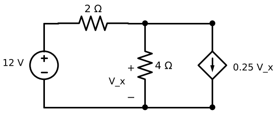
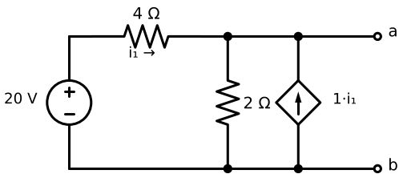

# Day 6 — Timed Mock Test: Networks (25 questions, 35 marks, 60 minutes)

**Companion to:** `Day06_Networks_Revision.md`. Take this test **after** reading the PYQ map and the formula sheet, and **before** you open the answer key.

## Rules

| | |
|---|---|
| **Time** | 60 minutes: about 25 for Section A and 35 for Section B. Start a timer. |
| **Allowed** | a pen, paper and a scientific calculator. No notes, no formula sheet. |
| **Marks** | Section A: Q1–Q15, one mark each. Section B: Q16–Q25, two marks each. Total 35. |
| **Negative marking (as in GATE)** | MCQ: −⅓ for a wrong one-mark answer, −⅔ for a wrong two-mark answer. NAT: none. |
| **Skipping** | Leave a question blank rather than guess blindly on an MCQ; for a NAT a guess costs nothing. |

Conventions: all AC values are rms, `I₁` and `I₂` of a two-port point **into** the network, and NAT answers are entered as numbers with the requested rounding. The mock follows the same topic mix as the past papers (see the map in the revision note): transients and AC about 55 %, two-ports about 17 %, circuit analysis and theorems the rest.

| Topic | Questions | Marks |
|---|---|---|
| Circuit analysis (Day 1) | Q1, Q2, Q14, Q16 | 5 |
| Theorems (Day 2) | Q3, Q4, Q15, Q17 | 5 |
| Transients (Day 3) | Q5, Q6, Q7, Q18, Q19, Q20 | 9 |
| AC and resonance (Day 4) | Q8, Q9, Q10, Q11, Q21, Q22, Q23 | 10 |
| Two-ports (Day 5) | Q12, Q13, Q24, Q25 | 6 |

---

## Section A: one mark each (Q1–Q15)

### Q1 · MCQ
Three resistors of 18 Ω each are connected in a **delta** (triangle). The resistance measured between any two of its corners is:

- (A) 6 Ω
- (B) 12 Ω
- (C) 18 Ω
- (D) 36 Ω

### Q2 · NAT
A 10 V source in series with 2 Ω is connected to a node a. Node a is connected to ground through a 3 Ω resistor, and a 2 A current source also pushes current into node a. The voltage of node a is ______ V (round off to one decimal place).

### Q3 · MCQ
A 12 V source with 6 Ω series resistance feeds terminals A and B, and a 3 Ω resistor is connected across A and B. The Thevenin equivalent seen from A and B is:

- (A) `V_th = 12 V`, `R_th = 6 Ω`
- (B) `V_th = 4 V`, `R_th = 9 Ω`
- (C) `V_th = 4 V`, `R_th = 2 Ω`
- (D) `V_th = 8 V`, `R_th = 2 Ω`

### Q4 · NAT
A 12 V source with 4 Ω series resistance feeds terminals A and B, and a 12 Ω resistor is connected across A and B. A variable load `R_L` is then connected across A and B. The maximum power that can be delivered to `R_L` is ______ W (round off to two decimal places).

### Q5 · MCQ
A capacitor `C = 1 µF`, initially charged to 4 V, is connected at `t = 0` through `R = 2 kΩ` to a 10 V DC source. The capacitor voltage at `t = 3 ms` is:

- (A) 7.77 V
- (B) 8.66 V
- (C) 9.70 V
- (D) 1.34 V

### Q6 · NAT
A 20 V step is applied at `t = 0` to a series circuit of `R = 10 Ω` and `L = 2 H` (zero initial current). The time at which the inductor voltage equals the resistor voltage is ______ s (round off to three decimal places).

### Q7 · MCQ
A series RLC circuit has `R = 20 Ω`, `L = 0.1 H` and `C = 100 µF`. Its damping ratio and the nature of its response are:

- (A) `ζ = 3.16`, overdamped
- (B) `ζ = 1`, critically damped
- (C) `ζ = 0.79`, underdamped
- (D) `ζ = 0.316`, underdamped

### Q8 · NAT
A series circuit with `R = 6 Ω`, `X_L = 12 Ω` and `X_C = 4 Ω` is connected to a 100 V (rms) supply. The current is ______ A.

### Q9 · MCQ
A load takes 5 kVA at 0.6 power factor **lagging**. A capacitor bank supplying 4 kvar is connected in parallel with the load. The apparent power drawn from the supply is now:

- (A) 5 kVA
- (B) 4 kVA
- (C) 3 kVA
- (D) 1 kVA

### Q10 · NAT
A series RLC circuit has `L = 5 mH` and `C = 20 µF`. Its resonant frequency is ______ Hz (round off to one decimal place).

### Q11 · MCQ
The currents `i₁ = 10 cos ωt` A and `i₂ = 10 sin ωt` A flow into a node. The total current `i₁ + i₂` is:

- (A) `20 cos(ωt − 45°)` A
- (B) `14.14 cos(ωt − 45°)` A
- (C) `14.14 cos(ωt + 45°)` A
- (D) `14.14 sin(ωt − 45°)` A

### Q12 · MCQ
A T network has series arms of 2 Ω (port 1 side) and 2 Ω (port 2 side) and a shunt arm of 4 Ω. Its ABCD matrix `[[A, B],[C, D]]` (`B` in Ω, `C` in S) is:

- (A) `[[1.5, 4],[0.25, 1.5]]`
- (B) `[[1.5, 5],[4, 1.5]]`
- (C) `[[1.5, 8],[0.25, 1.5]]`
- (D) `[[1.5, 5],[0.25, 1.5]]`

### Q13 · NAT
A reciprocal two-port has `y₁₁ = 0.5 S`, `y₁₂ = −0.25 S` and `y₂₂ = 0.75 S`. A 2 Ω load is connected to port 2. The resistance seen at port 1 is ______ Ω (round off to two decimal places).

### Q14 · MCQ
A circuit has 10 branches and 6 nodes. The numbers of independent KCL equations and independent KVL equations are respectively:

- (A) 6 and 4
- (B) 5 and 6
- (C) 6 and 5
- (D) 5 and 5

### Q15 · NAT
A 12 V source in series with 3 Ω and a 6 V source in series with 6 Ω are both connected (positive terminals toward the common node) to a node N. N is connected to ground through a 6 Ω load. The current in the load is ______ A (round off to two decimal places).

---

## Section B: two marks each (Q16–Q25)

### Q16 · NAT (2 marks)
In the circuit shown the dependent current source has the value `0.25·V_x` amperes, where `V_x` is the voltage across the 4 Ω resistor. The power **absorbed** by the dependent source is ______ W.

### Q17 · NAT (2 marks)
In the circuit shown, `i₁` is the current through the 4 Ω resistor, and the dependent source injects `1·i₁` into the top node. The maximum power that can be delivered to a load connected across the terminals a and b is ______ W.

### Q18 · NAT (2 marks)
A source-free series RLC circuit has `R = 6 Ω`, `L = 1 H` and `C = 0.04 F`, with `v_C(0) = 10 V` and `i_L(0) = 0`. The first instant at which the capacitor voltage is zero is ______ s (round off to three decimal places).

### Q19 · NAT (2 marks)
A current step `I_s·u(t)` drives a parallel RLC circuit with `R = 50 Ω`, `L = 16 mH` and `C = 10 µF`, with zero initial conditions. The percentage overshoot of the **inductor current** is ______ % (round off to one decimal place).

### Q20 · MCQ (2 marks)
For the circuit of Q18, with the state vector `x = [v_C, i_L]ᵀ`, the eigenvalues of the state matrix `A` are:

- (A) −2 and −4
- (B) −3 ± j4
- (C) −3 and −3
- (D) +3 ± j4

### Q21 · NAT (2 marks)
A source has `V_th = 20 V` (rms) and `Z_th = (3 + j4) Ω`. The load is a resistance `R_L` (adjustable) in series with a **fixed inductive reactance of 2 Ω**. The maximum power that can be delivered to `R_L` is ______ W (round off to one decimal place).

### Q22 · NAT (2 marks)
Two loads are connected in parallel across a 230 V, 50 Hz supply: 8 kW at 0.8 lagging and 6 kW at 0.6 lagging. The capacitor that raises the **combined** power factor to unity is ______ µF (round off to the nearest integer).

### Q23 · MCQ (2 marks)
A parallel RLC circuit has `R = 10 kΩ`, `L = 1 mH` and `C = 1 nF` and is driven by a current source. Its resonant frequency, quality factor and half-power bandwidth are:

- (A) `f₀ = 159 kHz`, `Q = 0.1`, `BW = 1.59 MHz`
- (B) `f₀ = 1 MHz`, `Q = 10`, `BW = 100 kHz`
- (C) `f₀ = 159 kHz`, `Q = 10`, `BW = 15.9 kHz`
- (D) `f₀ = 159 kHz`, `Q = 10`, `BW = 100 kHz`

### Q24 · NAT (2 marks)
A two-port has `Y = [[0.5, −0.2],[−0.1, 0.4]] S`. It is driven at port 1 by a 12 V source with 1 Ω series resistance and loaded by 5 Ω at port 2. The voltage `V₂` is ______ V (round off to two decimal places).

### Q25 · MCQ (2 marks)
Two identical sections, each a series 2 Ω resistor followed by a shunt 2 Ω resistor, are cascaded (the second section follows the first). With the output open-circuited, `V₂/V₁` of the cascade is:

- (A) 0.2
- (B) 0.25
- (C) 0.5
- (D) 0.1

---

## Score yourself

<b>Answer key (open only after you stop the timer)</b>

| Q | Answer | Q | Answer |
|---|---|---|---|
| 1 | B | 13 | 2.22 (range 2.21 to 2.23) |
| 2 | 8.4 (range 8.4 to 8.4) | 14 | D |
| 3 | C | 15 | 1.25 (range 1.24 to 1.26) |
| 4 | 6.75 (range 6.74 to 6.76) | 16 | 9 (range 9 to 9) |
| 5 | B | 17 | 25 (range 25 to 25) |
| 6 | 0.139 (range 0.138 to 0.140) | 18 | 0.554 (range 0.552 to 0.556) |
| 7 | D | 19 | 25.4 (range 25.2 to 25.6) |
| 8 | 10 (range 10 to 10) | 20 | B |
| 9 | C | 21 | 20.6 (range 20.5 to 20.7) |
| 10 | 503.3 (range 503.0 to 503.6) | 22 | 842 (range 840 to 845) |
| 11 | B | 23 | C |
| 12 | D | 24 | 1.36 (range 1.35 to 1.38) |
| 25 | A |

**Marks:** Section A: 1 per correct answer (−⅓ per wrong MCQ). Section B: 2 per correct answer (−⅔ per wrong MCQ). Maximum 35.

| Score | What it means | What to do |
|---|---|---|
| 28 – 35 | Strong. You are exam-ready on Networks. | Keep the formula sheet fresh; do the PYQs again in a month. |
| 21 – 27 | Good, with gaps. | List every miss in the error log; redo those Day questions. |
| 14 – 20 | Needs one more pass. | Re-read the day notes for the topics you missed, then retake Section B after two days. |
| below 14 | Concepts not yet secure. | Redo each day's worked examples with the solutions covered before retaking the full test. |

**Error log (fill in for every lost mark):** question number · topic · cause (concept gap, formula forgotten, sign or unit slip, arithmetic, misread, ran out of time). Count each cause: two or more of the same cause is your next study target.

## Solutions

<b>Q1 · Delta of equal resistors</b>

**Answer: B.**

Between two corners, one resistor `R` is in parallel with the other two in series: `R ∥ 2R = 2R/3 = 12 Ω` for `R = 18 Ω`. (Converting to a star gives `R/3 = 6 Ω` arms, and two arms in series give 12 Ω too.)

*Review:* Day 1 §11.

<b>Q2 · Nodal equation</b>

**Answer: 8.4 V.**

KCL at node a: `(10 − V_a)/2 + 2 = V_a/3`, so `7 = V_a(1/2 + 1/3) = 5V_a/6` and `V_a = 8.4 V`.

*Review:* Day 1 §7.

<b>Q3 · Thevenin equivalent</b>

**Answer: C.**

`V_th = 12 × 3/(6 + 3) = 4 V` (open-circuit voltage across the 3 Ω). `R_th = 6 ∥ 3 = 2 Ω` (source off).

*Review:* Day 2 §3.

<b>Q4 · Maximum power</b>

**Answer: 6.75 W.**

`V_th = 12 × 12/(4 + 12) = 9 V`, `R_th = 4 ∥ 12 = 3 Ω`, so `P_max = V_th²/(4R_th) = 81/12 = 6.75 W` (at `R_L = 3 Ω`).

*Review:* Day 2 §5.

<b>Q5 · RC with initial charge</b>

**Answer: B.**

`τ = RC = 2 ms`. `v_C(t) = 10 − (10 − 4)e^(−t/τ)`, so `v_C(3 ms) = 10 − 6e^(−1.5) = 8.66 V`. (A) ignores the initial charge (`10(1 − e^(−1.5))`), (C) uses `τ = 1 ms`, and (D) is only the decaying term `6e^(−1.5)`.

*Review:* Day 3 §3.

<b>Q6 · Inductor voltage equals resistor voltage</b>

**Answer: 0.139 s.**

`τ = L/R = 0.2 s`. `v_L = 20e^(−t/τ)` and `v_R = 20(1 − e^(−t/τ))`. Setting them equal: `e^(−t/τ) = 0.5`, so `t = τ ln 2 = 0.2 × 0.693 = 0.139 s`.

*Review:* Day 3 §3.

<b>Q7 · Damping of a series RLC</b>

**Answer: D.**

`α = R/2L = 100`, `ω₀ = 1/√(LC) = 316 rad/s`, so `ζ = α/ω₀ = (R/2)√(C/L) = 0.316 < 1`: **underdamped**. (C) uses the parallel formula `(1/2R)√(L/C) = 0.79`, (A) inverts the ratio.

*Review:* Day 3 §5.

<b>Q8 · Series RLC current</b>

**Answer: 10 A.**

`|Z| = √(6² + (12 − 4)²) = 10 Ω`, so `I = 100/10 = 10 A`.

*Review:* Day 4 §2.

<b>Q9 · Power-factor correction</b>

**Answer: C.**

`S = 5 kVA × (0.6 + j0.8) = 3 kW + j4 kvar`. The capacitor supplies `−j4 kvar`, leaving `3 kW + j0`: the supply now carries only the real power, **3 kVA** at unity power factor.

*Review:* Day 4 §4.

<b>Q10 · Resonant frequency</b>

**Answer: 503.3 Hz.**

`f₀ = 1/(2π√(LC)) = 1/(2π√(5×10⁻³ × 20×10⁻⁶)) = 1/(2π × 3.162×10⁻⁴) = 503.3 Hz`.

*Review:* Day 4 §5.

<b>Q11 · Adding sinusoids</b>

**Answer: B.**

`10∠0° + 10∠−90° = 10 − j10 = 14.14∠−45°`, i.e. `14.14 cos(ωt − 45°)`. (Amplitudes do not add: (A) is wrong. `sin ωt` is `cos(ωt − 90°)`.)

*Review:* Day 4 §1.

<b>Q12 · ABCD of a T network</b>

**Answer: D.**

`A = 1 + Z₁/Z₃ = 1.5`, `B = Z₁ + Z₂ + Z₁Z₂/Z₃ = 2 + 2 + 1 = 5 Ω`, `C = 1/Z₃ = 0.25 S`, `D = 1 + Z₂/Z₃ = 1.5`; `AD − BC = 2.25 − 1.25 = 1` ✓. (A) drops the `Z₁Z₂/Z₃` term, (B) uses `Z₃` instead of `1/Z₃`, (C) forgets to divide by `Z₃`.

*Review:* Day 5 §3.

<b>Q13 · Input resistance of a terminated two-port</b>

**Answer: 2.22 Ω.**

`Y_in = y₁₁ − y₁₂y₂₁/(y₂₂ + Y_L)` with `y₂₁ = y₁₂ = −0.25` and `Y_L = 0.5 S`: `Y_in = 0.5 − 0.0625/1.25 = 0.45 S`, so `R_in = 1/0.45 = 2.22 Ω`.

*Review:* Day 5 §6.

<b>Q14 · Independent equations</b>

**Answer: D.**

Independent KCL equations: `n − 1 = 5`. Independent KVL equations: `b − n + 1 = 10 − 6 + 1 = 5`.

*Review:* Day 1 §1.

<b>Q15 · Two sources, one node</b>

**Answer: 1.25 A.**

Millman: `V_N = (12/3 + 6/6)/(1/3 + 1/6 + 1/6) = 5/(2/3) = 7.5 V`, so `I = 7.5/6 = 1.25 A`. By superposition: the 12 V source alone gives `12 × 3/6 = 6 V` at N (the other branch and the load in parallel make 3 Ω), and the 6 V source alone gives `6 × 2/8 = 1.5 V`; together 7.5 V. Ignoring the 6 V source gives 1 A.

*Review:* Day 2 §2.

<b>Q16 · A dependent source</b>

**Answer: 9 W.**

A self-controlled VCCS `0.25·V_x` is just a resistor of `1/0.25 = 4 Ω` across the 4 Ω, so the node sees `4 ∥ 4 = 2 Ω`: `V_x = 12 × 2/(2 + 2) = 6 V` (check by KCL: `(12 − 6)/2 = 6/4 + 0.25 × 6`, i.e. `3 = 1.5 + 1.5`). The dependent source carries `0.25 × 6 = 1.5 A` downward with 6 V across it, so it **absorbs** `6 × 1.5 = 9 W`. (Ignoring the source gives 8 V.)

*Review:* Day 1 §4, §7.

<b>Q17 · Thevenin with a CCCS</b>

**Answer: 25 W.**

*Open circuit:* `i₁ = (20 − V)/4` and the node carries `i₁ + 1·i₁ = V/2`, so `20 − V = V` and `V_th = 10 V`.
*Short circuit (a–b shorted):* `V = 0`, `i₁ = 5 A`, `I_sc = i₁ + i₁ = 10 A`, so `R_th = 10/10 = 1 Ω`. (A test source gives the same.)

`P_max = V_th²/(4R_th) = 100/4 =` **25 W**. Ignoring the dependent source gives `V_th = 6.67 V`, `R_th = 1.33 Ω` and 8.3 W, which is wrong.

*Review:* Day 2 §3, §4.

<b>Q18 · First zero of an underdamped response</b>

**Answer: 0.554 s.**

`α = R/2L = 3`, `ω₀ = 1/√(LC) = 5`, `ω_d = √(25 − 9) = 4`. With `v_C(0) = 10` and `dv_C/dt(0) = i_L(0)/C = 0`:

`v_C(t) = e^(−3t)(10 cos 4t + 7.5 sin 4t) = 12.5e^(−3t) cos(4t − θ)`, `θ = tan⁻¹(0.75) = 0.6435 rad`.

It first vanishes when `4t − θ = π/2`: `t = (1.5708 + 0.6435)/4 = 0.554 s`. (Setting `4t = π/2` forgets the sine term and gives 0.393 s.) A numerical integration of the ODE agrees.

*Review:* Day 3 §5.

<b>Q19 · Overshoot of a parallel RLC</b>

**Answer: 25.4 %.**

For a parallel RLC `α = 1/(2RC) = 1000`, `ω₀ = 1/√(LC) = 2500`, so `ζ = α/ω₀ = (1/2R)√(L/C) = 0.4`. The inductor current follows a second-order low-pass step response, with overshoot `e^(−πζ/√(1 − ζ²)) = e^(−1.371) = 25.4 %`. Using the **series** formula `ζ = (R/2)√(C/L) = 0.625` would give 8.1 %.

*Review:* Day 3 §5.

<b>Q20 · State matrix eigenvalues</b>

**Answer: B.**

`ẋ = Ax` with `A = [[0, 1/C],[−1/L, −R/L]] = [[0, 25],[−1, −6]]`. The characteristic polynomial is `λ² + 6λ + 25 = 0`, so `λ = −3 ± j4`, the same `−α ± jω_d` found in Q18.

*Review:* Day 3 §6.

<b>Q21 · AC maximum power with a fixed reactance</b>

**Answer: 20.6 W.**

With `X_L` fixed the power is `P = V²R_L/[(R_th + R_L)² + (X_th + X_L)²]`, which is largest at `R_L = √(R_th² + (X_th + X_L)²) = √(9 + 36) = 6.708 Ω`. Then `P = 400 × 6.708/(9.708² + 36) = 20.6 W`. (`R_L = R_th = 3 Ω` gives 16.7 W; the full conjugate-match value `V²/4R_th = 33.3 W` needs a reactance of −4 Ω that this load does not have.)

*Review:* Day 4 §4.

<b>Q22 · Two loads, unity power factor</b>

**Answer: 842 µF.**

Load 1: `Q₁ = 8 × tan(cos⁻¹0.8) = 8 × 0.75 = 6 kvar`. Load 2: `Q₂ = 6 × tan(cos⁻¹0.6) = 6 × 1.333 = 8 kvar`. Total `14 kvar`. `C = Q/(ωV²) = 14 000/(2π·50 × 230²) = 842.4 µF`. (Using only the second load gives 481 µF.)

*Review:* Day 4 §4.

<b>Q23 · Parallel resonance</b>

**Answer: C.**

`ω₀ = 1/√(LC) = 10⁶ rad/s`, so `f₀ = 159.2 kHz`. For a **parallel** circuit `Q = R/(ω₀L) = 10⁴/(10⁶ × 10⁻³) = 10`, and `BW = f₀/Q = 15.9 kHz`. (A) uses the series `Q = ω₀L/R = 0.1`. (B) reads `ω₀` as a frequency in Hz. (D) quotes the bandwidth in rad/s (`10⁵`) as if it were kHz.

*Review:* Day 4 §5.

<b>Q24 · Two-port with source and load</b>

**Answer: 1.36 V.**

Port 1: `(12 − V₁)/1 = 0.5V₁ − 0.2V₂`. Port 2: `−V₂/5 = −0.1V₁ + 0.4V₂`, so `0.6V₂ = 0.1V₁` and `V₂ = V₁/6`. Substituting: `12 = 1.5V₁ − 0.2V₁/6 = 1.4667V₁`, `V₁ = 8.18 V`, `V₂ =` **1.36 V**. (Using `V₂/V₁ = 1/6` with `V₁ = 12 V` forgets the source resistance and gives 2 V.) Note `y₁₂ ≠ y₂₁`: this two-port is non-reciprocal.

*Review:* Day 5 §6.

<b>Q25 · Loading in a cascade</b>

**Answer: A.**

One section is `[[1, 2],[0, 1]]·[[1, 0],[0.5, 1]] = [[2, 2],[0.5, 1]]`, with open-circuit voltage gain `1/A = 0.5`. The cascade is `[[2, 2],[0.5, 1]]² = [[5, 6],[1.5, 2]]`, so `V₂/V₁ = 1/A = 0.2`. The naive product `0.5 × 0.5 = 0.25` ignores that the second section **loads** the first.

*Review:* Day 5 §5.

