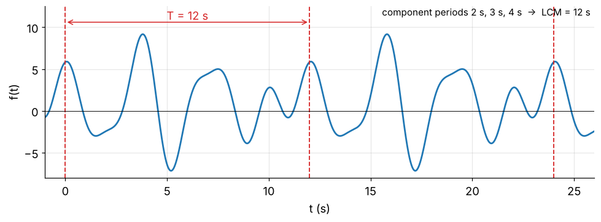
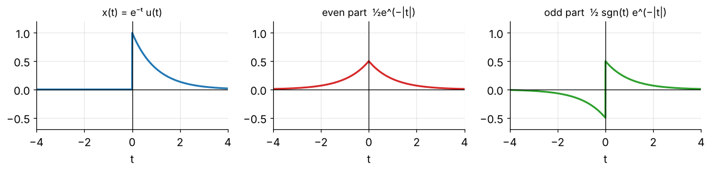
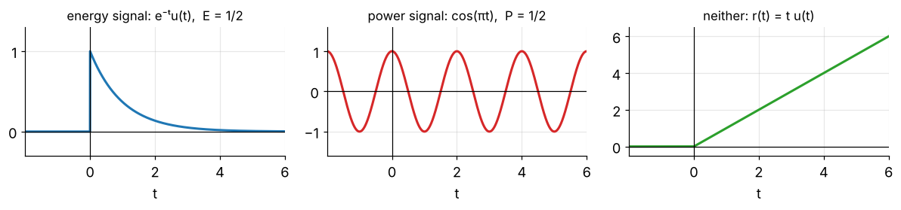
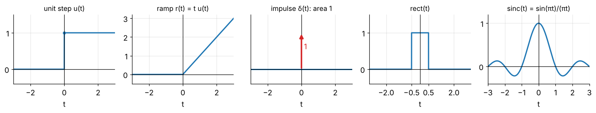
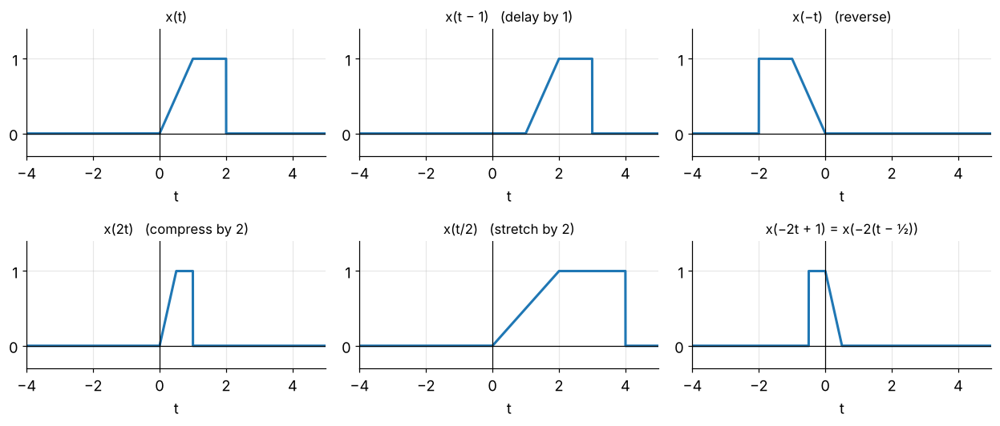
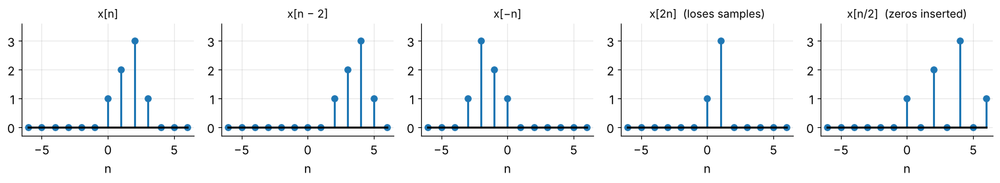
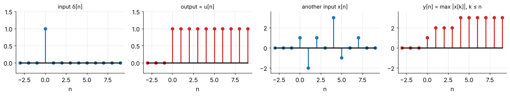
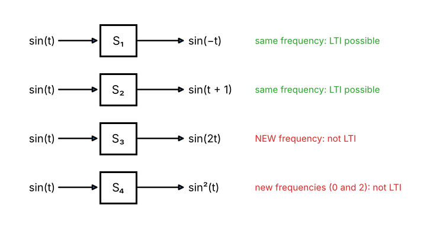
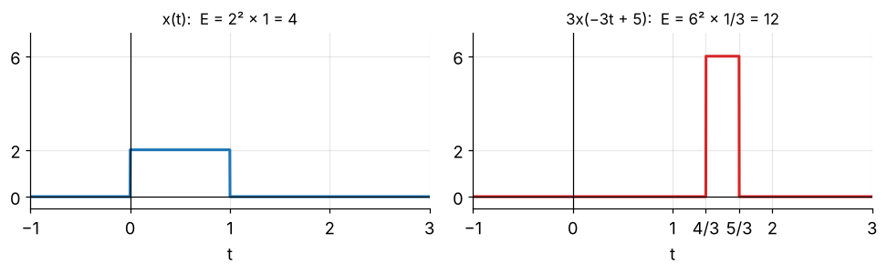

# Day 7 — Signals and Systems I: Signals, Operations and System Properties

**Covers:** signal classification (periodic, even/odd, energy/power, causal) · standard signals (step, ramp, impulse, rectangle, sinc, exponentials) · operations on the time axis (shift, reversal, scaling) and on the amplitude · energy and power · system properties (memory, causality, linearity, time invariance, BIBO stability, invertibility) · why an LTI system cannot create new frequencies
**Matches:** Day 7 of `03_Study_Plans/20_Day_Plan_Networks_Signals_Control.md` (Gate-O-Pedia pp. 3.1 – 3.22)
**Time:** about 5 hours in total
**Companion:** `Day07_Conceptual_Questions.md`, 20 GATE-style conceptual questions with solutions
**Needs from earlier days:** the first-order exponential (Day 3) and sinusoids/phasors (Day 4). Nothing else.

> **Why spend a day on "basics"?** Only five past questions (2019 Q21, 2020 Q5, 2022 Q46, 2023 Q26, 2026 Q43; 7 marks in eight papers) are *purely* about this material. But every later signals question (convolution, Fourier series and transform, sampling, Laplace and z-transform) assumes you can shift and scale a signal correctly, find a period, recognise an energy signal and classify a system in seconds. A slip here costs marks everywhere in Days 8–13.

Every number in this note is re-checked by `tools/verify_day07.py`. The two classification tables in §5 are **the output of numerical tests**, not hand-made: the script feeds each system test inputs and looks for counter-examples to linearity, time invariance, causality, memorylessness and BIBO stability (16 continuous-time and 12 discrete-time systems). All five past-year answers match the official keys in `02_Previous_Year_Papers/`.

## How to use this note

| Step | What | Time |
|---|---|---|
| 1 | Read §1–§3 (signal classes, periodicity, even/odd, energy and power, standard signals). **Cover each example's solution, solve it, then compare** | 80 min |
| 2 | Read §4 (operations on the time axis). **Draw every example by hand** | 45 min |
| 3 | Read §5–§6 (system properties and the LTI preview). Learn the table by testing three systems yourself first | 70 min |
| 4 | Do §7: the five past-year questions. Try each one first | 30 min |
| 5 | Do §8 practice problems, then read §9 (mistakes) | 40 min |
| 6 | Take the **20 conceptual questions** (timed, then review the ones you missed) | 40 min |
| 7 | Copy §10 onto your Signals formula sheet | 10 min |

---

## 1. Signals and systems: the picture

A **signal** is a function that carries information: `x(t)` for a continuous-time (CT) signal (`t` real) or `x[n]` for a discrete-time (DT) signal (`n` an integer). A **system** maps an input signal to an output signal, `y = H{x}`.

```
 x(t) ──►[ system H ]──► y(t)           x[n] ──►[ system H ]──► y[n]
```

Sampling a CT signal every `T` seconds gives the DT signal `x[n] = x(nT)`. The rest of the course (Days 7–13) builds one idea on top of another:

| Day | Topic | What it adds |
|---|---|---|
| **7** | **signals and system properties** | the vocabulary and the tests (today) |
| 8 | convolution and the impulse response | the formula for the output of an LTI system |
| 9 | Fourier series | periodic signals as sums of sinusoids |
| 10 | Fourier transform, sampling | non-periodic signals, frequency response |
| 11 | Laplace transform | poles, zeros, stability from the ROC |
| 12 | z-transform and DTFT | the same for DT |
| 13 | DFT and filter design | computing it |

---

## 2. Classifying signals

### 2.1 Periodic signals

A signal is **periodic** if `x(t + T) = x(t)` for **all** `t` for some `T > 0`. Every integer multiple of a period is also a period; the smallest one is the **fundamental period** `T₀`. (A constant has no smallest period; treat it as periodic with any `T`.)

**Rules you will use constantly**

1. `cos(ω₀t + φ)` and `sin(ω₀t + φ)` have period `T = 2π/ω₀`. The phase `φ` and any added constant (DC) **do not affect** the period.
2. **Time scaling:** if `x(t)` has period `T₀`, then `x(bt)` has period `T₀/|b|`, and a shift `x(t − c)` has the same period `T₀`. (So `x(3t − 1)` has period `T₀/3`.)
3. **A sum of periodic signals** `x₁ + x₂ + …` is periodic **only if the ratio of every pair of periods is rational**. Then the fundamental period is the **least common multiple** of the individual periods; equivalently the fundamental *frequency* is the **greatest common divisor** of the individual frequencies. If any ratio is irrational the sum is not periodic.
4. **Products** are handled by rewriting them as sums: `cos A cos B = ½[cos(A − B) + cos(A + B)]`. Squares too: `sin²θ = (1 − cos 2θ)/2`, which has **half** the period of `sin θ`.

**Ex 1.** `x(t) = cos(2πt) + cos(3πt)`: periods `1 s` and `2/3 s`; the ratio `1/(2/3) = 3/2` is rational, and `lcm(1, 2/3) = 2 s`. (In frequencies: `1 Hz` and `1.5 Hz`, with GCD `0.5 Hz`, so `T = 2 s`.)

**Not periodic:** `cos t + cos(√2·t)` (ratio of periods `√2`, irrational: the sum comes close to repeating but never repeats exactly), `e^{−t}`, `t`.

**Discrete time is different.** `x[n] = cos(Ω₀n + φ)` is periodic **only if `Ω₀/(2π)` is a rational number** `p/q` (in lowest terms), and then the fundamental period is `N = q`.

- `cos(0.4πn)`: `Ω₀/2π = 1/5`, so `N = 5`.
- `cos(3πn/7)`: `Ω₀/2π = 3/14`, so `N = 14`.
- `cos(n)`: `1/(2π)` is irrational, so it is **not periodic** at all.

Also, `Ω` and `Ω + 2π` give the **identical** DT signal (unlike CT, where every `ω` is a different signal). A sum of DT periodic signals has period `lcm(N₁, N₂)`.



### 2.2 Even and odd signals

`x` is **even** if `x(−t) = x(t)` and **odd** if `x(−t) = −x(t)`. Every signal is the **unique** sum of an even and an odd part:

```
x_e(t) = [x(t) + x(−t)]/2          x_o(t) = [x(t) − x(−t)]/2          x = x_e + x_o
```

| Parity rules | |
|---|---|
| even ± even is even; odd ± odd is odd | even + odd is neither (unless one of them is zero) |
| even × even, odd × odd | **even** |
| even × odd | **odd** |
| derivative of even / of odd | **odd** / **even** |
| `∫_{−a}^{a}` of an odd signal | **0** |
| `∫_{−a}^{a}` of an even signal | `2∫_{0}^{a}` |
| an odd signal that is defined at 0 | `x(0) = 0` |



**Ex 3.** `x(t) = e^{−t}u(t)` has `x_e = ½e^{−|t|}` and `x_o = ½sgn(t)e^{−|t|}`. The even part is **not zero for `t < 0`**: a causal signal has a non-causal even part. Energies add: `E_x = E_e + E_o` (the cross term integrates to zero), and here `½ = ¼ + ¼`.

### 2.3 Energy and power

```
CT:  E = ∫_{−∞}^{∞} |x(t)|² dt                        DT:  E = Σ_{n} |x[n]|²
CT:  P = lim_{T→∞} (1/2T) ∫_{−T}^{T} |x(t)|² dt       DT:  P = lim_{N→∞} (1/(2N+1)) Σ_{n=−N}^{N} |x[n]|²
periodic:  P = (1/T₀) ∫_{T₀} |x(t)|² dt
```

| Class | Condition | Examples |
|---|---|---|
| **energy signal** | `0 < E < ∞` (then `P = 0`) | `e^{−at}u(t)` with `a > 0`: `E = 1/(2a)`; a pulse: `E =` amplitude² × width; `sinc(t)`: `E = 1`; DT `aⁿu[n]`, `\|a\| < 1`: `E = 1/(1 − a²)` |
| **power signal** | `0 < P < ∞` (then `E = ∞`) | `u(t)`: `P = ½`; `A cos(ωt)`: `P = A²/2`; every periodic signal; DT `u[n]`: `P = ½` |
| **neither** | `E = ∞` and `P = ∞` (or undefined) | the ramp `t·u(t)`, `e^{t}u(t)` |



For a sum of sinusoids at **different** frequencies the powers add: `P = A₁²/2 + A₂²/2 + (DC)²`. At the **same** frequency, add the phasors first: `6cos(50t) − 8sin(50t)` has amplitude `√(6² + 8²) = 10`, so `P = 50`.

**Energy and time operations.** For `y(t) = a·x(bt + c)`:

```
E_y = a²·E_x / |b|        (the shift c does not matter; compressing time by |b| divides the energy by |b|)
```

while the **power** of a periodic signal is unchanged by time scaling. (2026 Q43 is exactly this.)

### 2.4 Causal signals

A signal is **causal** if `x(t) = 0` for `t < 0`, **anti-causal** if `x(t) = 0` for `t > 0`, and non-causal otherwise. Do not confuse this with a causal *system* (§5.2).

---

## 3. Standard signals



- **Unit step** `u(t) = 1` for `t ≥ 0`, `0` for `t < 0`. (The value at 0 rarely matters in CT; in DT `u[0] = 1` matters.) **Ramp** `r(t) = t·u(t) = ∫_{−∞}^{t} u(τ)dτ`.
- **Rectangle** `rect(t) = 1` for `|t| < ½`; **triangle** `tri(t) = 1 − |t|` for `|t| ≤ 1`.
- **Sinc** (normalised) `sinc(t) = sin(πt)/(πt)`: zeros at the **non-zero integers**, `sinc(0) = 1`, `∫sinc = 1`, `∫sinc² = 1` (so `E = 1`). It is the Fourier transform of a rectangle (Day 10).
- **Complex exponential** `e^{st}`, `s = σ + jω`: a growing or decaying sinusoid; `e^{jω₀t}` is periodic with `T = 2π/ω₀`.

### The unit impulse `δ(t)`

`δ(t)` is not an ordinary function: it is defined by what it does inside an integral. It is zero except at `t = 0`, with unit area. Its properties:

```
∫ x(t) δ(t − t₀) dt = x(t₀)                (sifting)            x(t)δ(t − t₀) = x(t₀)δ(t − t₀)
δ(at) = δ(t)/|a|        δ(−t) = δ(t)        (even)               du/dt = δ(t),   ∫_{−∞}^{t} δ = u(t)
δ(g(t)) = Σ_i δ(t − t_i)/|g′(t_i)|   over the simple roots t_i of g
```

- `∫(t² + 1)δ(3t − 6)dt`: write `δ(3(t − 2)) = ⅓δ(t − 2)`, so the value is `⅓(2² + 1) = 5/3`.
- `∫e^{−t}δ(t² − 4)dt`: roots `±2` with `|g′| = 4`, so `¼(e^{−2} + e^{2}) = 1.88`.

**DT impulse** `δ[n] = 1` at `n = 0` and `0` elsewhere (a Kronecker delta: no area, no infinity). `δ[n] = u[n] − u[n − 1]`, `u[n] = Σ_{k≤n} δ[k]`, and every DT signal is `x[n] = Σ_k x[k]δ[n − k]` (the starting point of convolution on Day 8).

---

## 4. Operations on the time axis



| Operation | Effect |
|---|---|
| `x(t − t₀)` | **delay** by `t₀` (graph moves **right** for `t₀ > 0`) |
| `x(−t)` | reversal (mirror about `t = 0`) |
| `x(bt)`, `\|b\| > 1` | compression by `\|b\|` (the signal is `\|b\|` times faster); `\|b\| < 1`: stretch |
| `x(bt)`, `b < 0` | scaling **and** reversal |

**The combination `x(at + b)`** is where marks are lost. Write it as `x(a(t + b/a))`: **scale first** (`t → at`), **then shift by `b/a`** (to the **left** by `b/a`). The foolproof check is to match the **edges**: set `at + b` equal to each edge of the original signal and solve for `t`.

**Ex 5.** `x(t)` is the signal of the figure (a ramp on `[0, 1]`, then a plateau of 1 on `(1, 2]`). For `y(t) = x(−2t + 1)`: `−2t + 1 = 0 ⇒ t = ½` and `−2t + 1 = 2 ⇒ t = −½`. So `y` lives on `[−½, ½]`, with the plateau on the **left** (the reversal puts the old right edge on the left). Equivalently `y(t) = x(−2(t − ½))`: reverse and compress by 2, then **delay by ½**.

**Amplitude operations** act on the value: `a·x(t) + c`, `x₁(t) + x₂(t)`, `x₁(t)·x₂(t)`, `dx/dt`, `∫x dt`.

### Discrete time



- `x[n − k]` delays, `x[−n]` reverses.
- `x[2n]` (**decimation**) keeps every second sample and **throws information away**.
- `x[n/2]` (**expansion**) is defined for even `n` and is **zero** for odd `n` (zeros are inserted). `x[2n]` applied to it gives back `x[n]`, but not the other way round.

---

## 5. System properties

A system has a property if it holds for **every** input. To **disprove** a property one counter-example suffices; to prove it you need an argument for all inputs. The tests below are the ones you should be able to run in your head.

### 5.1 Memory

A system is **memoryless** if `y(t₀)` depends only on `x(t₀)` (the same instant): `y = x²`, `y = 2x + 3`, `y = t·x(t)`, `y = x(t)cos(2πt)`. Anything that looks at another instant, at a window, at an accumulation or at a derivative has **memory**: `x(t − 1)`, `x(−t)` (it looks at `x(−t)`, which is a different instant unless `t = 0`), `∫x`, `dx/dt`, `x[n] + x[n − 1]`.

### 5.2 Causality

A system is **causal** if the output at `t₀` depends only on inputs at `t ≤ t₀`: two inputs that agree up to `t₀` give outputs that agree up to `t₀`. A system that depends only on the future is **anti-causal**; one that depends on some future input is **non-causal**.

**Test for `y(t) = x(g(t))`:** causal if and only if `g(t) ≤ t` for **every** `t`.

| `g(t)` | Causal? | Why |
|---|---|---|
| `t − 2` | yes | looks 2 s into the past |
| `t + 2` | no | always 2 s ahead |
| `−t` | no | for `t < 0`, `−t > t` (e.g. `t = −3` needs `x(3)`) |
| `2t` | no | for `t > 0`, `2t > t` |
| **`t/2`** | **no** | for `t < 0`, `t/2 > t` (e.g. `t = −4` needs `x(−2)`) |
| `t²` | no | `t = 2` needs `x(4)` |
| `eᵗ` | no | `eᵗ > t` for **all** `t` (2023 Q26) |

Integrals: `∫_{−∞}^{t} x` is causal; `∫_{t−2}^{t+1} x` is not (it uses `x` up to `t + 1`). For an **LTI** system, causal means `h(t) = 0` for `t < 0` (Day 8).

### 5.3 Linearity

`H` is **linear** if `H{a·x₁ + b·x₂} = a·H{x₁} + b·H{x₂}` for all constants (additivity and homogeneity together).

- **Test:** compare `H{a x₁ + b x₂}` with `a·y₁ + b·y₂`.
- **Zero in, zero out** is necessary but **not sufficient** (`x²` maps 0 to 0 and is not linear). An **affine** map `y = 2x + 3` is *not* linear.
- Non-linear: `x²`, `|x|`, `eˣ`, `x + 1`, `max`, `x[n]x[n−1]`. Linear: `x(−t)`, `x(2t)`, `x(t²)`, `t·x(t)`, `dx/dt`, `∫x`, `x(t)cos(2πt)`.

### 5.4 Time invariance

`H` is **time-invariant** if delaying the input delays the output by the same amount: with `y(t) = H{x(t)}`, the response to `x(t − t₀)` must equal `y(t − t₀)`.

- **Delay test:** compute both and compare. For `y = t·x(t)`: the response to `x(t − t₀)` is `t·x(t − t₀)`, but `y(t − t₀) = (t − t₀)·x(t − t₀)`. **Different, so time-varying.**
- **Quick rules:** if `t` appears **explicitly** (`t·x(t)`, `x(t)cos 2πt`), or the argument is **scaled, reversed or squared** (`x(2t)`, `x(−t)`, `x(t²)`, `x(eᵗ)`), the system is **time-varying**. Pure shifts, derivatives, fixed-width integrals and memoryless functions of `x` alone (`x²`, `|x|`) are time-invariant. For a memoryless `y = f(x(t), t)` the test is `∂f/∂t = 0`.

### 5.5 BIBO stability

**Bounded input, bounded output:** `|x| ≤ M₁` for all `t` must imply `|y| ≤ M₂` for all `t`.

- **Unstable:** `t·x(t)` (`x = 1` gives `y = t`), the integrator `∫_{−∞}^{t} x` (`x = u(t)` gives the ramp), the differentiator `dx/dt` (`x = sin(t²)` gives `2t·cos(t²)`), the accumulator `Σ_{k≤n} x[k]`, `n·x[n]`.
- **Stable:** `x²`, `|x|`, `eˣ` (`|x| ≤ M` gives `e^{−M} ≤ y ≤ e^{M}`), every pure delay or reversal, `∫_{t−1}^{t} x` (`|y| ≤ M`).
- **LTI systems:** BIBO stable if and only if the impulse response is **absolutely integrable**, `∫|h(t)|dt < ∞` (DT: `Σ|h[n]| < ∞`). The integrator has a *bounded* `h = u(t)` but is **not** stable, because `∫|u| = ∞`.

### 5.6 Invertibility

A system is **invertible** if different inputs always give different outputs. `y = 2x`, `y = x(t − 2)` and the accumulator are invertible (the inverses: `y/2`, an advance by 2, the first difference). `y = x²` (the sign is lost), `y = |x|`, `y = dx/dt` (constants are lost) and DT `y[n] = x[2n]` (odd samples are lost) are not.

### 5.7 The big table (output of the numerical tests)

**Continuous time**

| System | Linear | Time-invariant | Causal | Memoryless | BIBO stable |
|---|---|---|---|---|---|
| `y = x(t − 2)` | yes | yes | yes | no | yes |
| `y = x(t + 2)` | yes | yes | **no** | no | yes |
| `y = x(−t)` | yes | **no** | no | no | yes |
| `y = x(2t)` | yes | **no** | no | no | yes |
| `y = x(t/2)` | yes | **no** | no | no | yes |
| `y = x(t²)` | yes | **no** | no | no | yes |
| `y = x(eᵗ)` | yes | **no** | no | no | yes |
| `y = t·x(t)` | yes | **no** | yes | yes | **no** |
| `y = x²(t)` | **no** | yes | yes | yes | yes |
| `y = x(t) + 1` | **no** | yes | yes | yes | yes |
| `y = abs(x(t))` | **no** | yes | yes | yes | yes |
| `y = e^{x(t)}` | **no** | yes | yes | yes | yes |
| `y = x(t)cos(2πt)` | yes | **no** | yes | yes | yes |
| `y = dx/dt` | yes | yes | yes | no | **no** |
| `y = ∫_{−∞}^{t} x dτ` | yes | yes | yes | no | **no** |
| `y = ∫_{t−1}^{t} x dτ` | yes | yes | yes | no | yes |

**Discrete time**

| System | Linear | Time-invariant | Causal | Memoryless | BIBO stable |
|---|---|---|---|---|---|
| `y[n] = x[n − 2]` | yes | yes | yes | no | yes |
| `y[n] = x[n + 1]` | yes | yes | **no** | no | yes |
| `y[n] = x[−n]` | yes | **no** | no | no | yes |
| `y[n] = x[2n]` | yes | **no** | no | no | yes |
| `y[n] = x[n/2]` (zeros inserted) | yes | **no** | no | no | yes |
| `y[n] = n·x[n]` | yes | **no** | yes | yes | **no** |
| `y[n] = x[n] − x[n − 1]` | yes | yes | yes | no | yes |
| `y[n] = (x[n + 1] + x[n − 1])/2` | yes | yes | **no** | no | yes |
| `y[n] = Σ_{k≤n} x[k]` | yes | yes | yes | no | **no** |
| `y[n] = max_{k≤n} abs(x[k])` | **no** | yes | yes | no | yes |
| `y[n] = x²[n]` | **no** | yes | yes | yes | yes |
| `y[n] = x[n]·x[n − 1]` | **no** | yes | yes | no | yes |

**Ex 6 (by hand).** `y(t) = x(t²)`: **linear** (the output is `x` evaluated somewhere else); **time-varying** (the argument is squared: the response to `x(t − t₀)` is `x(t² − t₀)`, while `y(t − t₀) = x((t − t₀)²)`); **non-causal** (`g(2) = 4 > 2`); **has memory**; **stable** (`|y| ≤ M`).

---

## 6. A preview of LTI systems (Day 8)

A system that is both **linear** and **time-invariant** is completely described by its **impulse response** `h(t)` (the output for `δ(t)`): `y = x ∗ h`, the convolution of Day 8. Three consequences you can already use:

- **Causal LTI:** `h(t) = 0` for `t < 0`. **BIBO-stable LTI:** `∫|h| < ∞`.
- **Complex exponentials are eigenfunctions:** `e^{st}` in gives `H(s)e^{st}` out, with `H(s) = ∫h(t)e^{−st}dt`. Hence a **real sinusoid in gives a sinusoid of the same frequency out**, only scaled by `|H(jω)|` and shifted in phase.
- **An LTI system cannot create new frequencies.** If the output contains a frequency that the input does not have, the system is **not LTI** (2022 Q46). The converse is false: keeping the frequency does not prove the system is LTI.

---

## 7. Past-year questions (all solved, all match the official keys)

Papers and keys: `02_Previous_Year_Papers/<year>/`. **Try each question from the paper first.**

| # | Question | Official answer | Concept it tests |
|---|---|---|---|
| 1 | 2019 Q21 (NAT) | 11.99 to 12.01 s | Fundamental period of a sum of sinusoids: the LCM rule |
| 2 | 2020 Q5 (MCQ) | C | Impulse response of a **non-linear** system `y[n] = max_{k≤n}\|x[k]\|` |
| 3 | 2022 Q46 (MSQ) | C, D | Which systems are definitely **not LTI**: new frequencies |
| 4 | 2023 Q26 (MCQ) | B | `y(t) = x(eᵗ)`: causality and time invariance |
| 5 | 2026 Q43 (MCQ) | C | Energy ratio of `x(t)` and `3x(−3t + 5)` |

Related questions that belong to later days: 2024 Q21 (a time-scaled convolution: Day 8), 2025 Q55 (Fourier series of `f(αt)`: Day 9), 2021 Q4 (Nyquist rate of `x(t)x(1 + t/2)`: Day 10).

### 2019 Q21: the fundamental period


`f(t) = 1 + 2cos(πt) + 3sin(2πt/3) + 4cos(πt/2 + π/4)`. The DC term and the phases do not matter. The components have `ω = π, 2π/3, π/2`, so periods `2 s, 3 s, 4 s`. Their ratios are rational, and `lcm(2, 3, 4) =` **12 s**. (In frequencies: `½, ⅓, ¼ Hz` have GCD `1/12 Hz`.)

### 2020 Q5: impulse response of `y[n] = max_{−∞≤k≤n}|x[k]|`


With `x[n] = δ[n]`: for `n < 0` every `|δ[k]|` with `k ≤ n` is 0, so `y = 0`; for `n ≥ 0` the maximum includes `k = 0`, so `y = 1`. The unit impulse response is the **unit step `u[n]`**: **option (C)**. Notice that this system is **non-linear**: additivity fails (the response to `δ[n] + δ[n − 1]` is `u[n]`, but `u[n] + u[n − 1]` equals 2 for `n ≥ 1`), and so does homogeneity (`y(−x) = y(x)`, not `−y(x)`). So the impulse response does **not** describe it. The question only asks for the response to an impulse.

### 2022 Q46: which systems are definitely not LTI


An LTI system turns `sin t` into a sinusoid of the **same frequency** (1 rad/s), changing only amplitude and phase. So:

- `S₁`: `sin(−t) = −sin t` has frequency 1: **possible** for an LTI system (a gain of −1).
- `S₂`: `sin(t + 1)` has frequency 1: **possible** (a phase shift of 1 rad).
- `S₃`: `sin(2t)` has frequency **2**: a **new frequency**, so **definitely not LTI**.
- `S₄`: `sin²t = (1 − cos 2t)/2` contains frequencies **0 and 2**: **definitely not LTI**.

**Options (C) and (D).** (`S₁` and `S₂` might also be non-LTI, for example time reversal and a time shift of a different kind, but the question asks for *definitely* not LTI.)

### 2023 Q26: `y(t) = x(eᵗ)`
At time `t` the output uses `x(eᵗ)`, and `eᵗ > t` for **every** `t` (the minimum of `eᵗ − t` is 1, at `t = 0`). The system looks into the future: **non-causal**. Time invariance fails because the argument is not a plain shift: the response to `x(t − t₀)` is `x(eᵗ − t₀)`, but `y(t − t₀) = x(e^{t − t₀})`. **Option (B), non-causal and time-varying.**

### 2026 Q43: the energy ratio


`x = 2` on `[0, 1)`, so `E[x] = 2² × 1 = 4`. For `y(t) = 3x(−3t + 5)`: the amplitude is `6` and the support is where `0 ≤ −3t + 5 < 1`, that is `4/3 < t ≤ 5/3`, a width of `1/3`. So `E[y] = 6² × 1/3 = 12`. (By the rule `E_y = a²E_x/|b| = 9 × 4/3 = 12`.)

`E[x]/E[y] = 4/12 =` **1/3, option (C)**. The shift by 5 and the reversal do not change the energy.

---

## 8. Practice (answers at the end of this section)

**P1 · Period.** Find the fundamental period of `x(t) = cos(6πt) + sin(4πt) + cos(10πt + 1)`.

**P2 · Energy and power.** Classify each signal and find its energy or power: (a) `3e^{−2t}u(t)`; (b) `6cos(50t) − 8sin(50t)`; (c) `x[n] = (0.5)ⁿu[n]`.

**P3 · Even and odd.** Find the even and odd parts of `x(t) = 1 + 2t + 3t² − t³`.

**P4 · Time axis.** `x(t)` is the signal of the figure in §4 (ramp on `[0, 1]`, plateau 1 on `(1, 2]`). Describe `y(t) = x(3 − 2t)`: where does it live, and where is its plateau?

**P5 · Classify.** For each system state linear / time-invariant / causal / memoryless / stable: (a) `y(t) = ∫_{t−2}^{t+1} x(τ)dτ`; (b) `y[n] = x[n]cos(0.2πn)`; (c) `y(t) = x(t) + x(−t)`.

<details>
<summary><b>Answers</b></summary>

- **P1:** frequencies `3, 2, 5 Hz` have GCD `1 Hz`, so **T = 1 s** (periods `1/3, 1/2, 1/5` have lcm 1).
- **P2:** (a) energy signal, `E = 9/(2·2) =` **9/4**. (b) amplitude `10`, a power signal, `P = 100/2 =` **50**. (c) energy signal, `E = Σ0.25ⁿ = 1/(1 − 0.25) =` **4/3**.
- **P3:** `x_e = 1 + 3t²`, `x_o = 2t − t³`.
- **P4:** edges: `3 − 2t = 2 ⇒ t = 0.5`, `3 − 2t = 1 ⇒ t = 1`, `3 − 2t = 0 ⇒ t = 1.5`. So `y` lives on **[0.5, 1.5]**, equals **1 on [0.5, 1]**, then falls linearly to 0 at `t = 1.5` (`y = 3 − 2t`).
- **P5:** (a) linear, time-invariant, **non-causal** (uses `x` up to `t + 1`), has memory, stable. (b) linear, **time-varying** (explicit `n`), causal, memoryless, stable. (c) linear, **time-varying** (the response to `x(t − t₀)` is `x(t − t₀) + x(−t − t₀)` but `y(t − t₀) = x(t − t₀) + x(−t + t₀)`), non-causal, has memory, stable.
</details>

---

## 9. The mistakes that cost marks (checklist)

1. **Adding periods** instead of taking the LCM, or calling any sum of periodic signals periodic. The ratio of periods must be rational.
2. **Assuming a DT sinusoid is always periodic.** `cos(Ω₀n)` needs `Ω₀/2π` rational; the period is the denominator in lowest terms.
3. **Squares and products halve or change the period:** `sin²(3πt)` has period `1/3`, not `2/3`.
4. **Scaling direction.** `x(2t)` is compressed (faster), `x(t/2)` stretched; the period of `x(bt)` is `T₀/|b|`.
5. **`x(at + b)`: shifting by `b` instead of `b/a`.** Match the edges to be sure.
6. **Energy vs power.** `u(t)` and every periodic signal are *power* signals; a ramp is neither.
7. **Treating `δ` like a function.** `δ(at) = δ(t)/|a|`, and `δ(g(t))` sums over roots.
8. **`x(t/2)` is not causal** (for `t < 0` it looks ahead), even though `x(2t)` is the one that looks ahead for `t > 0`.
9. **Affine is not linear.** `y = x + 1` fails; zero-in-zero-out is only necessary.
10. **Mixing up time-varying systems.** `x(2t)`, `x(−t)`, `t·x(t)`, `x(t)cos 2πt` are all time-varying; `x²` is time-invariant.
11. **An integrator is not BIBO stable** even though its impulse response is bounded. The test is `∫|h| < ∞`.
12. **Thinking a differentiator or accumulator is memoryless.** Both have memory.
13. **Believing an LTI system can change a sinusoid's frequency.** It cannot (2022 Q46).

---

## 10. One-page formula sheet (copy this)

```
PERIOD         cos(ω0 t + φ): T = 2π/ω0 (DC and φ irrelevant);  x(bt): T0/|b|;  sum: T = LCM of periods (frequencies: f0 = GCD), needs rational ratios;
               sin²θ = (1 − cos2θ)/2 has half the period;   DT: cos(Ω0 n): periodic iff Ω0/2π = p/q rational, N = q;  Ω and Ω+2π are the same signal.
EVEN / ODD     x_e = [x(t) + x(−t)]/2,  x_o = [x(t) − x(−t)]/2;  even·even, odd·odd = even;  even·odd = odd;  d/dt flips parity;  ∫_{−a}^{a} odd = 0;  E_x = E_e + E_o.
ENERGY / POWER E = ∫|x|²dt;  P = lim (1/2T)∫_{−T}^{T}|x|²dt = (1/T0)∫_{T0}|x|²dt for periodic;  A cos: A²/2;  different frequencies: powers add;  E[a x(bt+c)] = a²E/|b|.
               energy signal: 0<E<∞ (P = 0);  power signal: 0<P<∞ (E = ∞);  u(t): P = ½;  e^{−at}u(t): E = 1/2a;  ramp: neither.   DT: aⁿu[n]: E = 1/(1−a²).
STANDARD       u(t), r(t) = t u(t), rect, tri, sinc(t) = sin πt/(πt) (zeros at non-zero integers, ∫ = 1, E = 1).
IMPULSE        ∫x(t)δ(t−t0)dt = x(t0);  δ(at) = δ(t)/|a|;  δ(−t) = δ(t);  δ(g(t)) = Σ δ(t−t_i)/|g′(t_i)|;  du/dt = δ;   DT: δ[n] = u[n] − u[n−1];  x[n] = Σ x[k]δ[n−k].
TIME AXIS      x(t−t0): delay;  x(−t): mirror;  x(at+b) = x(a(t + b/a)): scale, then shift left by b/a;  match the edges.   DT: x[2n] loses samples;  x[n/2] inserts zeros.
SYSTEM TESTS   memoryless: y(t0) depends on x(t0) only;   causal: y(t0) depends on x(t ≤ t0) (y = x(g(t)): g(t) ≤ t for all t);
               linear: H{a x1 + b x2} = a H{x1} + b H{x2} (affine is NOT linear);   time-invariant: response to x(t−t0) = y(t−t0) (explicit t, or x(2t), x(−t), x(t²) ⇒ time-varying);
               BIBO: bounded in ⇒ bounded out; LTI: ∫|h| < ∞ (Σ|h[n]| < ∞);   invertible: distinct inputs give distinct outputs.
LTI PREVIEW    y = x∗h;  causal ⇔ h(t) = 0 for t<0;  e^{st} → H(s)e^{st};  a sinusoid in gives the same frequency out; new output frequencies ⇒ NOT LTI.
```

---

## 11. Self-test before you move to Day 8

You are ready if you can, **without looking**:

- [ ] find the fundamental period of a sum of sinusoids (CT and DT) and say when the sum is not periodic
- [ ] split a signal into its even and odd parts and state the parity rules
- [ ] compute energy and power, and classify a signal as energy, power or neither
- [ ] sketch `x(−2t + 1)` and similar signals by matching edges, and apply `E = a²E_x/|b|`
- [ ] evaluate integrals with `δ(at + b)` and `δ(g(t))`
- [ ] classify any of the systems in §5.7 for memory, causality, linearity, time invariance and stability, and give the one-line reason
- [ ] explain why an LTI system cannot create new frequencies
- [ ] score at least 17/20 on `Day07_Conceptual_Questions.md`

**Day 8 preview:** convolution. With `δ` as the building block (`x = Σ x[k]δ[n − k]`) and linearity plus time invariance, the output of an LTI system is the convolution `y = x ∗ h`. You will compute it graphically and algebraically, in CT and DT, and read causality and stability straight off `h`.

---

## 12. Sources and further reading

**Pages read for this note** (a research pass read the pages; the Dirac delta and LTI pages were read only in part, with the remainder covered by a summary, so every statement that matters was also checked numerically in this repository):

- [Wikipedia: Even and odd functions](https://en.wikipedia.org/wiki/Even_and_odd_functions): the even/odd decomposition and its uniqueness, the parity of sums, products, derivatives and integrals over symmetric intervals, `f(0) = 0` for an odd function
- [Wikipedia: Periodic function](https://en.wikipedia.org/wiki/Periodic_function): periods, multiples of a period, the fundamental period, `sin(5x)` having period `2π/5`, superposed periodic components and the common-denominator method
- [Wikipedia: Energy (signal processing)](https://en.wikipedia.org/wiki/Energy_(signal_processing)): the CT and DT energy `∫|x|²` and `Σ|x|²`
- [Wikipedia: Heaviside step function](https://en.wikipedia.org/wiki/Heaviside_step_function): the step, its value at 0, `δ = dH/dx`, the ramp as its integral, the DT step and `δ[n] = H[n] − H[n − 1]`
- [Wikipedia: Dirac delta function](https://en.wikipedia.org/wiki/Dirac_delta_function): the sifting and scaling properties, `δ(−x) = δ(x)`, the formula for `δ(g(x))`, the Kronecker delta
- [Wikipedia: Linear time-invariant system](https://en.wikipedia.org/wiki/Linear_time-invariant_system): the impulse response, the convolution integral and sum, causality (`h(t) = 0` for `t < 0`), BIBO stability (`∫|h| < ∞`), complex exponentials as eigenfunctions
- [Wikipedia: Causal system](https://en.wikipedia.org/wiki/Causal_system): the definition and examples of causal, anti-causal and non-causal systems, `y(t) = x(t)cos(ωt)` as a memoryless system
- [Wikipedia: BIBO stability](https://en.wikipedia.org/wiki/BIBO_stability): the definition and the absolute-integrability and absolute-summability conditions
- [Wikipedia: Time-invariant system](https://en.wikipedia.org/wiki/Time-invariant_system): the delay-operator definition, the delay test, `y(t) = t·x(t)` as a time-varying system, the test `∂f/∂t = 0`
- [Wikipedia: Sinc function](https://en.wikipedia.org/wiki/Sinc_function): the normalised sinc, its zeros at the non-zero integers, its integral, its Fourier transform

**Not on those pages, so derived and verified in this repository** (`tools/verify_day07.py`): the power definitions and the energy-signal / power-signal classes, the LCM rule for the period of a sum, the rule `E[a·x(bt + c)] = a²E/|b|`, the test `g(t) ≤ t` for causality of `x(g(t))`, the discrete-time periodicity rule, the classification tables of §5.7, a standalone definition of "memoryless", and every worked example and past-year solution.

**Recommended practice:** the Gate-O-Pedia notes (`01_Notes/`), pp. 3.1–3.22, for extra problems. Lectures on signals and systems from MIT OCW 6.003 and the NPTEL courses are good companions, but I did not extract their text for this note.
