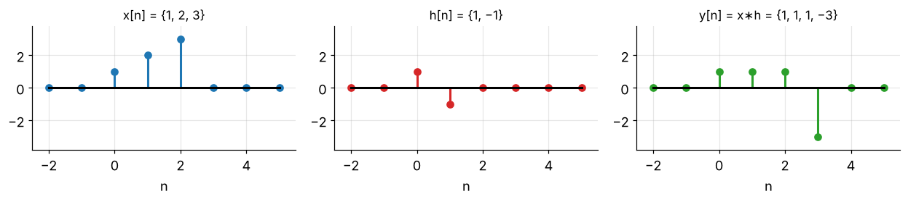
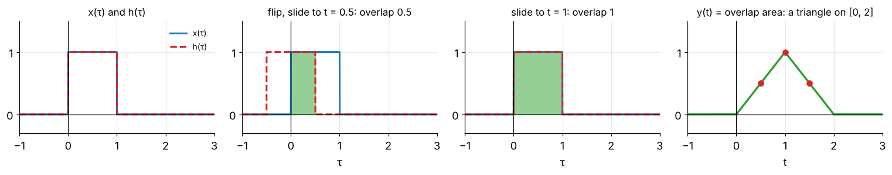
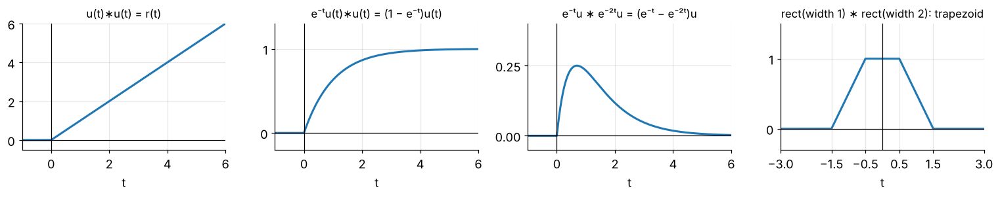
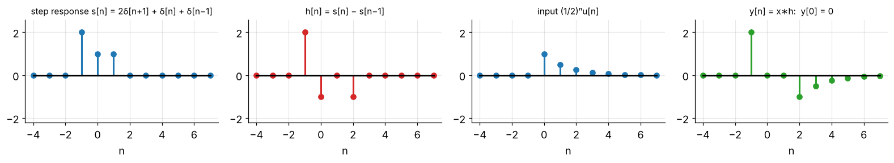
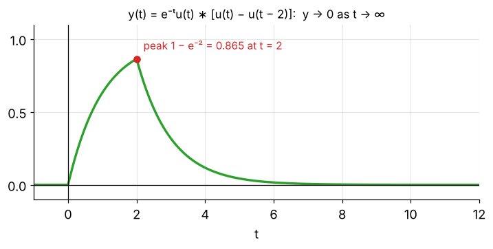
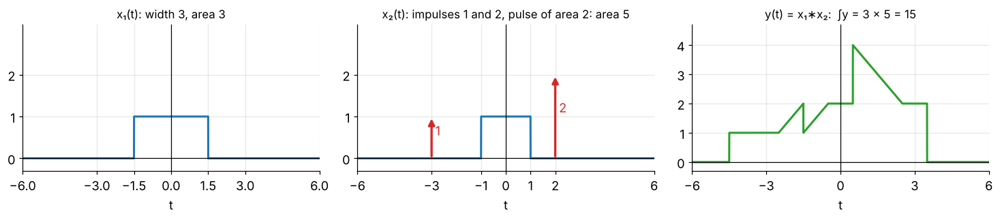
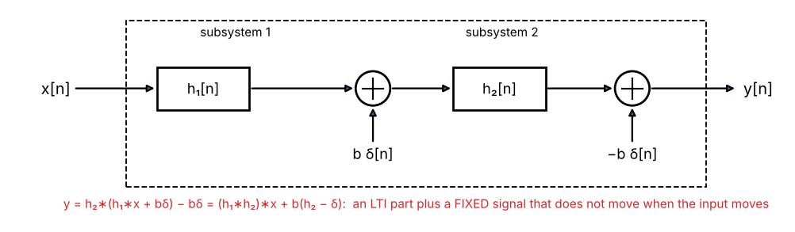
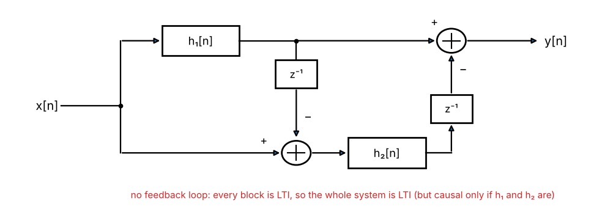

# Day 8 — Signals and Systems II: Convolution and LTI Systems

**Covers:** why an LTI system is described by its impulse response, `y = x ∗ h` · discrete-time convolution (sum, table, polynomial method) · continuous-time convolution (flip and slide, standard results) · the properties of convolution (commutative, associative, distributive, shift, scaling, derivative, area, support) · the step response · memory, causality and stability read from `h` · cascade and parallel · which interconnections are still LTI · frequency response and the convolution theorem (a preview)
**Matches:** Day 8 of `03_Study_Plans/20_Day_Plan_Networks_Signals_Control.md` (Gate-O-Pedia pp. 3.1 – 3.22)
**Time:** about 5 hours in total
**Companion:** `Day08_Conceptual_Questions.md`, 20 GATE-style conceptual questions with solutions
**Needs from earlier days:** Day 7 (system properties, the unit step and impulse, operations on the time axis). The Laplace transform of Day 3 helps in §6 but is not required.

> **Why this day matters.** The syllabus line "LTI systems: definitions and properties; causality, stability, impulse response, convolution" is today. I found **nine** past questions on it in the papers 2019–2026 (**14 marks**; I found none in 2020, whose paper is mostly scanned images): 2019 Q29, 2021 Q40, 2022 Q33, 2023 Q48, 2023 Q58, 2024 Q21, 2025 Q17, 2026 Q13 and 2026 Q47. They come in three flavours: a **number** that you can get in seconds with the right property (an area, a peak, one sample), a **classification** (is this interconnection LTI? causal? stable?), and a **link to a transform** (`Y = X·H`). Almost none of them needs a long calculation, but almost all of them punish a missing flip, a missing factor `1/|a|` or a mixed-up property.

Every number in this note is re-checked by `tools/verify_day08.py`: discrete convolutions with `np.convolve`, continuous ones by numerical integration, and the system-property claims with the numerical property tests of `tools/signals_lib.py`. All nine past-year answers match the official keys in `02_Previous_Year_Papers/`.

## How to use this note

| Step | What | Time |
|---|---|---|
| 1 | Read §1–§2 (why `y = x ∗ h`, discrete-time convolution). **Do Ex 1 and Ex 2 with the solution covered** | 45 min |
| 2 | Read §3 (continuous-time convolution, standard results, properties). **Redraw the flip-and-slide pictures by hand** | 65 min |
| 3 | Read §4–§5 (what `h` tells you, cascade and parallel, what is still LTI) | 50 min |
| 4 | Read §6 (frequency response, the convolution theorem) | 20 min |
| 5 | Do §7: the nine past-year questions. Try each one from the paper first | 45 min |
| 6 | Do §8 practice, then read §9 (mistakes) | 40 min |
| 7 | Take the **20 conceptual questions** (timed, then review the ones you missed) | 40 min |
| 8 | Copy §10 onto your Signals formula sheet | 10 min |

---

## 1. Why `y = x ∗ h`: the whole idea on one page

An LTI system has two properties, and together they give one formula.

1. **Build the input from impulses.** Every discrete-time signal is a sum of scaled, shifted unit impulses: `x[n] = Σ_k x[k] δ[n − k]`. In continuous time the same statement is the sifting property, `x(t) = ∫ x(τ) δ(t − τ) dτ`.
2. **Use time invariance.** If the response to `δ[n]` is `h[n]`, the response to `δ[n − k]` is `h[n − k]`.
3. **Use linearity.** The response to `Σ_k x[k]δ[n − k]` is `Σ_k x[k]h[n − k]`.

```
DT:  y[n] = Σ_{k=−∞}^{∞} x[k] h[n − k]  = (x ∗ h)[n]            CT:  y(t) = ∫_{−∞}^{∞} x(τ) h(t − τ) dτ = (x ∗ h)(t)
```

`h` is the **impulse response**: the output when the input is `δ`. There are two ways to read the sum, and you need both:

- **Superposition (the output side).** Every input sample `x[k]` launches a copy of `h`, delayed by `k` and scaled by `x[k]`; the output is the sum of all the copies. This is the *table method* of §2.
- **Flip and slide (the overlap view).** To get one output value, flip `h` about the origin, slide it so that its origin sits at time `n` (or `t`), multiply with `x` and add (integrate). The result is the overlap of the two signals. This is the picture of §3.

Three things follow at once, and the rest of the day is their consequences:

1. **`h` describes an LTI system completely.** Memory, causality and stability are properties of `h` (§4).
2. **It describes nothing else.** For a non-linear or time-varying system, `h` is just one particular output and cannot be used to find the others. (2020 Q5 of Day 7 asked for the impulse response of the non-linear system `y[n] = max_{k≤n}|x[k]|`. The answer, `u[n]`, is a fine signal, but convolving with it would give wrong outputs.)
3. **Combining LTI systems** means combining their impulse responses, by convolution or by addition (§5).

| | Discrete time | Continuous time |
|---|---|---|
| input built from impulses | `x[n] = Σ x[k]δ[n − k]` | `x(t) = ∫ x(τ)δ(t − τ)dτ` |
| output | `y[n] = Σ x[k]h[n − k]` | `y(t) = ∫ x(τ)h(t − τ)dτ` |
| identity of `∗` | `δ[n]` | `δ(t)` |
| causal LTI | `h[n] = 0` for `n < 0` | `h(t) = 0` for `t < 0` |
| BIBO-stable LTI | `Σ \|h[n]\| < ∞` | `∫ \|h(t)\| dt < ∞` |

---

## 2. Discrete-time convolution

### 2.1 Three ways to compute `y = x ∗ h`

**Method 1, the sum.** `y[n] = Σ_k x[k]h[n − k]`. For one value of `n`: flip `h`, shift it so that its origin is at `n`, multiply with `x` and add. This is the best method when you need **one** sample (2021 Q40 asks only for `y[0]`).

**Method 2, the table (superposition).** Write one row per input sample: row `k` is `h` scaled by `x[k]` and shifted by `k`. Add the columns.

**Ex 1.** `x = {1, 2, 3}` (at `n = 0, 1, 2`) and `h = {1, −1}` (at `n = 0, 1`):

| `n` | 0 | 1 | 2 | 3 |
|---|---|---|---|---|
| `x[0]·h[n]` | 1 | −1 | | |
| `x[1]·h[n − 1]` | | 2 | −2 | |
| `x[2]·h[n − 2]` | | | 3 | −3 |
| **`y[n]`** | **1** | **1** | **1** | **−3** |



**Method 3, polynomial multiplication.** Write each sequence as a polynomial whose coefficients are the samples, `X(w) = Σ x[n]wⁿ` (the variable is `z⁻¹` in the z-transform of Day 12), and multiply the polynomials. The coefficients of the product are the convolution. For Ex 1: `(1 + 2w + 3w²)(1 − w) = 1 + w + w² − 3w³`. This is the fastest hand method for short sequences, and it is the reason `Y(z) = X(z)H(z)`.

### 2.2 Rules that save time

| Rule | Statement | Example |
|---|---|---|
| **Length** | `len(y) = len(x) + len(h) − 1` | 3 and 2 samples give 4 samples |
| **Support** | first index = sum of the first indices; last index = sum of the last indices | `x` on `[2, 6]` and `h` on `[−3, 0]` give `y` on `[−1, 6]` (8 samples) |
| **Sum** | `Σ y = (Σ x)(Σ h)` | Ex 1: `6 × 0 = 0` and `1 + 1 + 1 − 3 = 0` ✓ |
| **Shifted impulse** | `x[n] ∗ δ[n − k] = x[n − k]` | `x[n] ∗ (δ[n − 2] + δ[n + 1]) = x[n − 2] + x[n + 1]` |
| **Running sum** | `x[n] ∗ u[n] = Σ_{k ≤ n} x[k]` | |
| **FIR** | if `h` has `M` non-zero taps, `y[n]` is a weighted sum of `M` consecutive inputs | `h = {1, 1, 1}` is a 3-point moving sum |

**Ex 2 (an infinite sequence).** `x[n] = (0.5)ⁿu[n]` through `h[n] = u[n]` (a running sum): `y[n] = Σ_{k=0}^{n} 0.5ᵏ = 2(1 − 0.5ⁿ⁺¹)` for `n ≥ 0`. At `n = 5` this is `2(1 − 1/64) = 1.96875`, and `y[n] → 2 = Σ x` as `n → ∞`.

**Standard discrete-time results** (each `y[n]` is for `n ≥ 0` and zero before; `a ≠ b`):

| `x[n]` | `h[n]` | `y[n]` |
|---|---|---|
| `u[n]` | `u[n]` | `n + 1` |
| `aⁿu[n]` | `u[n]` | `(1 − aⁿ⁺¹)/(1 − a)` |
| `aⁿu[n]` | `bⁿu[n]` | `(aⁿ⁺¹ − bⁿ⁺¹)/(a − b)` |
| `aⁿu[n]` | `aⁿu[n]` | `(n + 1)aⁿ` |

---

## 3. Continuous-time convolution

### 3.1 The integral and the flip-and-slide recipe

`y(t) = ∫ x(τ)h(t − τ)dτ`. The integration variable is `τ`; the time `t` is a fixed number during the integral. The recipe:

1. Write both signals in the dummy variable `τ`: `x(τ)` and `h(τ)`.
2. **Flip** one of them: `h(−τ)`.
3. **Shift** it by `t`: `h(t − τ)`, to the **right** for `t > 0` and to the **left** for `t < 0`.
4. For each `t`, multiply `x(τ)h(t − τ)` and take the **area** of the product. Start at `t = −∞` (no overlap) and slide to the right.
5. The formula for the area changes only when an edge of the sliding signal passes an edge of the fixed one. The **break-points** in `t` are therefore *(an edge of `x`) + (an edge of `h`)*. Solve one integral per region.

When both signals are zero for negative arguments, the integral shortens to `y(t) = ∫₀ᵗ x(τ)h(t − τ)dτ` for `t ≥ 0`.

**Ex 3 (two rectangles).** `x = h =` a unit-height pulse on `[0, 1]`. For `0 ≤ t ≤ 1` the overlap is the interval `[0, t]`, so `y = t`; for `1 ≤ t ≤ 2` it is `[t − 1, 1]`, so `y = 2 − t`; elsewhere `y = 0`. The result is a **triangle** on `[0, 2]` with peak 1.



**Ex 4 (two exponentials).** `x = e^{−t}u(t)` and `h = e^{−2t}u(t)`. For `t ≥ 0`: `y = ∫₀ᵗ e^{−τ}e^{−2(t−τ)}dτ = e^{−2t}∫₀ᵗ e^{τ}dτ = e^{−2t}(eᵗ − 1) = e^{−t} − e^{−2t}`.

### 3.2 Standard results (checked numerically)



| `x(t)` | `h(t)` | `y(t)` (each multiplied by `u(t)` unless stated) |
|---|---|---|
| `u(t)` | `u(t)` | `t`, the ramp |
| `e^{−at}u(t)` | `u(t)` | `(1 − e^{−at})/a` |
| `e^{−at}u(t)` | `e^{−bt}u(t)`, `a ≠ b` | `(e^{−bt} − e^{−at})/(a − b)` |
| `e^{−at}u(t)` | `e^{−at}u(t)` | `t e^{−at}` |
| rectangle: height `p`, width `T₁` | rectangle: height `q`, width `T₂ ≥ T₁` | a **trapezoid** on `[0, T₁ + T₂]`: rises for `T₁`, stays flat at `p·q·T₁` for `T₂ − T₁`, falls for `T₁`. A **triangle** if `T₁ = T₂` |
| any `x(t)` | `δ(t − t₀)` | `x(t − t₀)` |
| any `x(t)` | `u(t)` | `∫_{−∞}^{t} x(τ)dτ` (not multiplied by `u(t)`) |

### 3.3 Properties of convolution

| Property | Statement | Use |
|---|---|---|
| Commutative | `x ∗ h = h ∗ x` | flip whichever signal is easier |
| Associative | `(x ∗ h₁) ∗ h₂ = x ∗ (h₁ ∗ h₂)` | cascade (§5) |
| Distributive | `x ∗ (h₁ + h₂) = x ∗ h₁ + x ∗ h₂` | parallel (§5) |
| Identity and shift | `x(t) ∗ δ(t) = x(t)`, `x(t) ∗ δ(t − t₀) = x(t − t₀)` | an impulse in `h` gives a shifted, scaled copy of `x` |
| Shift | `x(t − t₁) ∗ h(t − t₂) = y(t − t₁ − t₂)` | the delays **add**. In particular `f(t − t₀) ∗ g(t − t₀) = (f ∗ g)(t − 2t₀)`, not `t − t₀` |
| Time scaling | `x(at) ∗ h(at) = y(at)/\|a\|` | 2024 Q21 |
| Derivative | `(x ∗ h)′ = x′ ∗ h = x ∗ h′` | |
| Integral | `x ∗ u = ∫_{−∞}^{t} x` | the step response (§4.1) |
| **Area** | `∫ y = (∫ x)(∫ h)`; DT: `Σ y = (Σ x)(Σ h)` | 2023 Q58. The area of `h` is the DC gain |
| **Support** | `y` is non-zero only on `[a_x + a_h, b_x + b_h]`, so the **durations add** | |

*Why the scaling rule has `1/|a|`.* For `a > 0` substitute `v = aτ`: `∫ x(aτ)h(a(t − τ))dτ = (1/a)∫ x(v)h(at − v)dv = y(at)/a`. For `a < 0` the substitution also reverses the limits, which turns `1/a` into `1/|a|`.

**Ex 5 (impulses).** `x(t) =` a unit-height pulse on `[−½, ½]` and `h(t) = δ(t + 1) + 2δ(t − 3)`. Then `y(t) = x(t + 1) + 2x(t − 3)`: one copy of the pulse centred at `t = −1` and one twice as tall centred at `t = 3`. No integral is needed. The area rule agrees: `1 × (1 + 2) = 3`.

### 3.4 Shortcuts for numerical questions

1. **The total area (sum) is asked.** Multiply the areas (sums). No convolution is needed (2023 Q58).
2. **A single value at `n = 0`.** `y[0] = Σ_k x[k]h[−k]`: flip once and read off the overlap (2021 Q40).
3. **Rectangles.** The peak is `p·q·T₁`, where `T₁` is the **shorter** width; the duration is `T₁ + T₂`.
4. **Impulses in `h`.** The output is a sum of shifted, scaled copies of `x`.
5. **A limit as `t → ∞`.** If both signals die out (decaying exponentials, finite pulses), `y(t) → 0` (2022 Q33). If `x` settles at a constant `M` and `h` is absolutely integrable, `y → M∫h`.
6. **The question is phrased in a transform domain** (`X(e^{jΩ})H(e^{jΩ})`, the Laplace transform of `x ∗ h`). Multiply the transforms instead of convolving (§6).

---

## 4. What the impulse response tells you

### 4.1 Step response

The **step response** `s` is the output when the input is `u`. Since `u` is the running integral (sum) of `δ`, and the system is LTI:

```
CT:  s(t) = (h ∗ u)(t) = ∫_{−∞}^{t} h(τ)dτ          h(t) = ds/dt
DT:  s[n] = Σ_{k=−∞}^{n} h[k]                         h[n] = s[n] − s[n − 1]
```

So `s` is the **running integral (sum)** of `h`, and `h` is the **derivative (first difference)** of `s`. For a stable system `s(∞) = ∫h = H(0)`, the **DC gain**.

**Ex 6.** `h(t) = e^{−2t}u(t)` gives `s(t) = (1 − e^{−2t})/2` for `t ≥ 0`, which settles at `½ = ∫h`. In discrete time, `s[n] = {1, 3, 6, 6, 6, …}` gives `h = {1, 2, 3, 0, 0, …}`. When a question hands you the **step** response and asks for an output (2021 Q40), take the difference first.

### 4.2 Memory, causality and stability

| Property | Condition on `h` | Why |
|---|---|---|
| **memoryless** | `h(t) = Kδ(t)` (DT: `h[n] = Kδ[n]`) | the output at `t` may use only the input at `t` |
| **causal** | `h(t) = 0` for `t < 0` (DT: `h[n] = 0` for `n < 0`) | in `y(t) = ∫x(τ)h(t − τ)dτ` the inputs with `τ > t` meet `h` at a negative argument |
| **BIBO stable** | `∫ \|h\| dt < ∞` (DT: `Σ \|h[n]\| < ∞`) | see below |
| **FIR** | `h[n]` has finite length | always stable; causal when `h[n] = 0` for `n < 0` |

**Why `∫|h| < ∞` is exactly the stability condition.** If `|x| ≤ M`, then `|y(t)| ≤ ∫|x(τ)||h(t − τ)|dτ ≤ M∫|h|`, so a finite `∫|h|` is **sufficient**. It is also **necessary**: the bounded input `x(τ) = M·sgn(h(−τ))` gives `y(0) = M∫|h|`. So the largest possible output is exactly `M∫|h|`.

| `h` | Causal | BIBO stable | Reason |
|---|---|---|---|
| `e^{−2t}u(t)` | yes | yes | `∫\|h\| = ½` |
| `e^{2t}u(t)` | yes | **no** | grows |
| `u(t)` (the integrator) | yes | **no** | `h` is bounded, but `∫\|h\| = ∞` |
| `e^{−\|t\|}` | **no** | yes | `∫\|h\| = 2`, and `h ≠ 0` for `t < 0` |
| `δ(t − 3)` | yes | yes | a pure delay, `∫\|δ\| = 1` |
| `δ(t + 3)` | **no** | yes | a pure advance |
| `sinc(t)` (the ideal low-pass filter) | **no** | **no** | `∫\|sinc\| = ∞`: already `∫₀ᵀ\|sinc\|` grows like `(2/π²)·ln T` |
| DT `(0.5)ⁿu[n]` | yes | yes | `Σ = 2` |
| DT `(0.5)^{\|n\|}` | **no** | yes | `Σ = 3` |
| DT `2ⁿu[n]` | yes | **no** | diverges |
| DT `u[n]` (the accumulator) | yes | **no** | `Σ = ∞` |

*Preview of Day 11 and Day 12.* For a rational transfer function, a **causal** system is BIBO stable exactly when all its poles lie in the open left half-plane (CT) or inside the unit circle (DT).

---

## 5. Combining systems, and what is still LTI

### 5.1 Cascade and parallel

```
 x ──►[ h₁ ]──►[ h₂ ]──► y             h = h₁ ∗ h₂     (cascade; the order does not matter because ∗ is commutative)

 x ──┬──►[ h₁ ]──┐
     └──►[ h₂ ]──┴─(+)──► y            h = h₁ + h₂     (parallel)
```

- Both rules need **LTI** blocks. For general systems the order matters (squaring then differentiating is not differentiating then squaring).
- A cascade of causal systems is causal, and a cascade of stable systems is stable (`∫|h₁ ∗ h₂| ≤ ∫|h₁|·∫|h₂|`).
- A delay is the impulse response `δ(t − T)`, and cascading with it just delays the other `h`.
- **Ex 7.** `δ(t − 1)` followed by `e^{−t}u(t)` has `h(t) = e^{−(t−1)}u(t − 1)`. In discrete time, two 2-point sums in cascade have `h = {1, 1} ∗ {1, 1} = {1, 2, 1}`.
- A feedback loop is **not** a simple convolution; it is handled with transforms (Laplace on Day 11, z on Day 12).

### 5.2 What is still LTI?

A system built from LTI blocks, unit delays, gains and adders with **no feedback loop** is LTI: every piece is linear and time-invariant and the signal only flows forward. It is **causal only if every block is causal**; a block is allowed to have a non-causal `h`.

**Ex 8 (the diagram of 2026 Q47).** Call the output of `h₁` `a = h₁ ∗ x`. The lower adder forms `v = x − a[n − 1]`, the block `h₂` gives `w = h₂ ∗ v`, and the output is `y = a − w[n − 1]`. In the transform domain (a unit delay is `z⁻¹`):

`Y = [H₁ − z⁻¹H₂ + z⁻²H₁H₂] X`, that is, `h_S[n] = h₁[n] − h₂[n − 1] + (h₁ ∗ h₂)[n − 2]`.

(I checked this impulse response numerically against the block diagram.) It is a sum of delayed copies of `h₁`, `h₂` and `h₁ ∗ h₂`, so the system is LTI, and it is non-causal as soon as `h₁` or `h₂` is.

What **breaks** LTI-ness:

| System | Linear | Time-invariant | Why |
|---|---|---|---|
| `y = x ∗ h + c`, a constant `c ≠ 0` | **no** | yes | zero input gives `c`, not 0; but a constant looks the same at every time |
| `y = x ∗ h + g`, a fixed non-constant signal `g` | **no** | **no** | zero input gives `g ≠ 0`, and `g` does not move when the input is delayed |
| `y = g · (x ∗ h)` or `y = t · (x ∗ h)` | yes | **no** | explicit dependence on time |
| `y(t) = x(2t)`, `x(−t)` | yes | **no** | the time axis is scaled or reversed (Day 7) |

**Ex 9 (2025 Q17).** `y = h₂ ∗ (h₁ ∗ x + bδ) − bδ = (h₁ ∗ h₂) ∗ x + b(h₂ − δ)`. The first term is LTI. The second, `b(h₂ − δ)`, is a **fixed signal that does not depend on `x`**, and it is not zero because `h₂ ≠ δ`. The zero input gives this non-zero output, so the system is **not linear**; and the fixed signal does not shift with the input, so it is **time-varying**.

**A five-second LTI check:** (1) Does the zero input give the zero output? (2) Is every block LTI? (3) Is a fixed signal added or multiplied in? (4) Does `t` or `n` appear explicitly? (5) Is the time axis scaled, reversed or squared?

---

## 6. Frequency response and the convolution theorem (a preview of Days 10–12)

**Complex exponentials are eigenfunctions of LTI systems.** Feed `x[n] = e^{jΩn}` into an LTI system:

`y[n] = Σ_k h[k] e^{jΩ(n−k)} = e^{jΩn} · Σ_k h[k] e^{−jΩk} = H(e^{jΩ}) e^{jΩn}`.

The exponential comes out with the same shape, multiplied by the complex number `H(e^{jΩ}) = Σ_k h[k]e^{−jΩk}`, the **frequency response** (the DTFT of `h`). In continuous time, `e^{jωt} → H(jω)e^{jωt}` with `H(jω) = ∫h(t)e^{−jωt}dt`. For a real `h` and a real sinusoid:

```
A cos(Ωn + φ)  ──►  A·|H(e^{jΩ})|·cos(Ωn + φ + ∠H(e^{jΩ}))
```

**The convolution theorem.** `y = x ∗ h` becomes `Y = X · H` in the Fourier, Laplace, z and DTFT domains. Convolution in time is a **product** in the transform domain, and for a cascade the frequency responses multiply. This is why a long convolution can be replaced by one multiplication, and why a sinusoidal input needs only a single value of `H`.

**Ex 10 (a filter that blocks a frequency).** `h = {1, 2, 1}`:

`H(e^{jΩ}) = 1 + 2e^{−jΩ} + e^{−j2Ω} = e^{−jΩ}(2 + 2cosΩ)`.

At `Ω = 0` it is `4` (the DC gain `Σh`); at `Ω = π/2` it is `−2j`, magnitude 2 and phase `−π/2`; at `Ω = π` it is `0`. It is a low-pass filter (it is also `{1, 1} ∗ {1, 1}`, so `H = (1 + e^{−jΩ})²`). A steady-state input `cos(πn/2)` therefore comes out as `2cos(πn/2 − π/2)`.

**Designing an FIR filter that blocks a frequency** means placing a zero of `H(e^{jΩ})` there. That is 2019 Q29 (§7).

*Where this goes next.* Day 9 uses the same idea for **periodic** inputs: each Fourier-series term `a_k e^{jkω₀t}` is an eigenfunction, so `y(t) = Σ a_k H(jkω₀) e^{jkω₀t}`.

---

## 7. Past-year questions (all solved, all match the official keys)

Papers and keys: `02_Previous_Year_Papers/<year>/`. **Try each question from the paper first.**

| # | Question | Marks | Official answer | Concept it tests |
|---|---|---|---|---|
| 1 | 2019 Q29 (MCQ) | 2 | D | A three-tap filter that must annihilate `e^{±jπn/2}`: zeros of the frequency response |
| 2 | 2021 Q40 (NAT) | 2 | 0.0 to 0.0 | A **step** response is given: difference it, then convolve for one sample |
| 3 | 2022 Q33 (NAT) | 1 | 0.0 to 0.0 | `e^{−t}u(t)` convolved with a pulse: the limit as `t → ∞` |
| 4 | 2023 Q48 (MCQ) | 2 | C | `Y = XH` is the convolution of the sequences: polynomial multiplication |
| 5 | 2023 Q58 (NAT) | 2 | 15 to 15 | The area of a convolution is the product of the areas (impulses included) |
| 6 | 2024 Q21 (MCQ) | 1 | A | Time scaling: `x(at) ∗ h(at) = y(at)/\|a\|` |
| 7 | 2025 Q17 (MCQ) | 1 | D | LTI blocks plus fixed offsets: non-linear and time-varying |
| 8 | 2026 Q13 (MCQ) | 1 | D | The Laplace transform of a convolution is a product |
| 9 | 2026 Q47 (MCQ) | 2 | B | A feedback-free network of LTI blocks is LTI, but not necessarily causal |

Related questions that belong elsewhere: 2021 Q39 and 2025 Q55 (Fourier series: Day 9), 2021 Q41 (a DTFT inner product: Day 12), 2023 Q59 (white noise through an LTI system: random processes in Communications).

### 2019 Q29: the filter that annihilates `e^{±jπn/2}`

A causal three-tap filter has `h[0] = 1`, `h[1] = a`, `h[2] = b`, and `h[n] = 0` otherwise. It must give `y[n] = 0` for all `n` when `x[n] = c₁e^{jπn/2} + c₂e^{−jπn/2}` with arbitrary `c₁`, `c₂`. Find `a` and `b`. Options: (A) `a = 1, b = 1`; (B) `a = 0, b = −1`; (C) `a = −1, b = 1`; (D) `a = 0, b = 1`.

Each exponential is an eigenfunction, so `y[n] = c₁H(e^{jπ/2})e^{jπn/2} + c₂H(e^{−jπ/2})e^{−jπn/2}`. For this to vanish for arbitrary `c₁`, `c₂` we need `H(e^{jπ/2}) = H(e^{−jπ/2}) = 0`. With `H(e^{jΩ}) = 1 + ae^{−jΩ} + be^{−j2Ω}`, at `Ω = π/2`:

`1 − ja − b = (1 − b) − ja = 0`, so `b = 1` and `a = 0`.

The other frequency gives the complex conjugate, which is zero automatically because `h` is real. Time-domain check: `y[n] = x[n] + x[n − 2]`, and `e^{±jπ(n−2)/2} = −e^{±jπn/2}`, so the two terms cancel. **Option (D).**

| Option | (A) | (B) | (C) | (D) |
|---|---|---|---|---|
| `\|H(e^{±jπ/2})\|` | 1 | 2 | 1 | **0** |

### 2021 Q40: a step response in, one output sample out


For a unit step input `u[n]`, a discrete-time LTI system produces the output `2δ[n + 1] + δ[n] + δ[n − 1]`. Let `y[n]` be the output for the input `(1/2)ⁿu[n]`. Find `y[0]`.

The given signal is the **step response** `s[n]`, not `h[n]`. Take the first difference:

`h[n] = s[n] − s[n − 1] = (2δ[n + 1] + δ[n] + δ[n − 1]) − (2δ[n] + δ[n − 1] + δ[n − 2]) = 2δ[n + 1] − δ[n] − δ[n − 2]`,

that is, `h = 2` at `n = −1`, `−1` at `n = 0`, `0` at `n = 1` and `−1` at `n = 2`. Then

`y[0] = Σ_k h[k]x[−k] = h[−1]x[1] + h[0]x[0] + h[2]x[−2] = 2·½ − 1·1 − 1·0 =` **0**.

(The trap: using `s` directly as `h` gives `2·½ + 1·1 + 1·0 = 2`.) The system is non-causal (`h[−1] ≠ 0`), which is perfectly allowed.

### 2022 Q33: an exponential convolved with a pulse


`x₁(t) = e^{−t}u(t)` and `x₂(t) = u(t) − u(t − 2)`. Find `lim_{t→∞} y(t)` for `y = x₁ ∗ x₂`.

Flip the pulse: `x₂(t − τ) = 1` for `t − 2 < τ < t`. The break-points are `t = 0` and `t = 2`.

- `0 ≤ t < 2`: the window is `[0, t]`, so `y = ∫₀ᵗ e^{−τ}dτ = 1 − e^{−t}`.
- `t ≥ 2`: the window is `[t − 2, t]`, so `y = e^{−(t−2)} − e^{−t} = (e² − 1)e^{−t}`.

The peak is `1 − e^{−2} = 0.865` at `t = 2`, and `y(t) → 0` as `t → ∞`: **0.0**. (Shortcut: a fixed-width window slides along a decaying exponential, so the area under it must vanish.)

### 2023 Q48: the product of two DTFTs
`X(e^{jΩ}) = 1 − e^{−jΩ} + 2e^{−3jΩ}` and `H(e^{jΩ}) = 1 − ½e^{−j2Ω}`. Find `y[n]`.

`Y = XH`, so `y = x ∗ h` with `x = {1, −1, 0, 2}` (at `n = 0…3`) and `h = {1, 0, −½}` (at `n = 0…2`). Multiply the polynomials in `w = e^{−jΩ}`:

`(1 − w + 2w³)(1 − ½w²) = 1 − w − ½w² + (2 + ½)w³ + 0·w⁴ − w⁵`.

So `y[n] = δ[n] − δ[n − 1] − ½δ[n − 2] + (5/2)δ[n − 3] − δ[n − 5]`: **option (C)**. (Checks: the length is `4 + 3 − 1 = 6`, and `Σy = 1 − 1 − ½ + 5/2 + 0 − 1 = 1 = (Σx)(Σh) = 2 × ½`.)

### 2023 Q58: the area of a convolution


`x₁(t) = u(t + 1.5) − u(t − 1.5)`, and `x₂(t)` is shown in the paper: an impulse of weight 1 at `t = −3`, a unit-height pulse on `[−1, 1]`, and an impulse of weight 2 at `t = 2`. Find `∫y dt` for `y = x₁ ∗ x₂`.

By the area rule, `∫y = (∫x₁)(∫x₂)`. The area of `x₁` is `3` (height 1, width 3). The area of `x₂` is `1 + 2 + 2 = 5` (the two impulse weights plus the pulse, height 1 times width 2). So `∫y = 3 × 5 =` **15**.

(Seen directly, `y` is the sum of three pieces: `x₁(t + 3)`, then `2x₁(t − 2)`, then `x₁` convolved with the pulse, a trapezoid. Their areas are `3 + 6 + 6 = 15`.)

### 2024 Q21: time scaling
A causal and stable LTI system with impulse response `h(t)` gives the output `y(t)` for the input `x(t)`. The signal `x(0.5t)` is applied to another causal and stable LTI system with impulse response `h(0.5t)`. The output is: (A) `2y(0.5t)`, (B) `4y(0.5t)`, (C) `0.25y(2t)`, (D) `0.25y(0.25t)`.

By the scaling property `x(at) ∗ h(at) = y(at)/|a|`, with `a = 0.5` the output is `y(0.5t)/0.5 = 2y(0.5t)`: **option (A)**. Directly: `∫x(0.5τ)h(0.5(t − τ))dτ`, with `v = 0.5τ` and `dτ = 2dv`, equals `2∫x(v)h(0.5t − v)dv = 2y(0.5t)`. The words "causal and stable" are decoration.

### 2025 Q17: LTI blocks with fixed offsets


The system is `x → h₁ → (+bδ[n]) → h₂ → (−bδ[n]) → y`, with `h₂ ≠ δ` and `b > 0`.

`y = h₂ ∗ (h₁ ∗ x + bδ) − bδ = (h₁ ∗ h₂) ∗ x + b(h₂ − δ)`. The first part is LTI. The second part is a fixed signal, non-zero because `h₂ ≠ δ`. It is non-zero for zero input, so the system is **not linear**; it does not move when the input moves, so it is **time-varying** (a *constant* offset would have kept time invariance). **Option (D).** With `b = 0` the system would be LTI.

### 2026 Q13: the Laplace transform of a convolution
`x(t) = u(t − 2) ∗ (t·u(t))`. Options: (A) `e^{−2s}/(s²(s − 2))`, (B) `e^{−2(s−2)}/s³`, (C) `s·e^{−2s}/(s − 2)²`, (D) `e^{−2s}/s³`.

Convolution becomes a product: `L{u(t − 2)} = e^{−2s}/s` (the delay gives `e^{−2s}`), and `L{t·u(t)} = 1/s²`. So `X(s) = e^{−2s}/s³`, with region of convergence `Re s > 0`: **option (D)**. In the time domain, `x(t) = (t − 2)²/2 · u(t − 2)`, whose transform is `e^{−2s}/s³` (I checked this numerically at `s = 1.5`).

### 2026 Q47: a feedback-free network of LTI blocks


`h₁[n]` and `h₂[n]` are LTI, and the diagram (above) has two unit delays and two adders. Which statement is **necessarily true**? (A) `S` is causal; (B) `S` is linear and time-invariant; (C) linear and time-varying; (D) non-linear.

There is no feedback loop, and every block is LTI, so the whole system is LTI (Ex 8 gives `h_S[n] = h₁[n] − h₂[n − 1] + (h₁ ∗ h₂)[n − 2]`): **option (B)**. (C) and (D) are false. (A) is **not necessarily** true: the question only says that `h₁` and `h₂` are LTI, so either could be non-causal, and the same diagram built with a non-causal `h₁` is non-causal (I checked this numerically).

---

## 8. Practice (answers at the end of this section)

**P1 · Discrete convolution.** `x = {2, 1, 0, −1}` at `n = 0, …, 3` and `h = {1, 3, 2}` at `n = −1, 0, 1`. Find `y = x ∗ h` with its support, and check it with the sum rule.

**P2 · Continuous convolution.** `x(t) = e^{−2t}u(t)` and `h(t) = u(t − 1) − u(t − 3)`. Find `y(t)` in each region, and its maximum.

**P3 · Properties.** `y(t) = x(t) ∗ h(t)` has `y(1) = 3`, `∫y dt = 12` and `∫x dt = 4`. Find: (a) the value of `x(2t) ∗ h(2t)` at `t = 0.5`; (b) the value of `x(t − 1) ∗ h(t + 2)` at `t = 0`; (c) `∫h dt`; (d) the area under `x(t − 5) ∗ h(t + 1)`.

**P4 · Read `h`.** Decide whether each is causal and whether it is BIBO stable: (a) `h[n] = (−0.8)ⁿu[n]`; (b) `h(t) = eᵗu(−t)`; (c) `h(t) = t·e^{−t}u(t)`; (d) `h[n] = 2ⁿu[−n − 1]`; (e) `h(t) = cos(t)·u(t)`.

**P5 · Step response and cascade.** A causal DT LTI system has the step response `s[n] = {1, 3, 4, 4, 4, …}` for `n = 0, 1, 2, …`. (a) Find `h[n]`. (b) Find the output for the pulse `x[n] = u[n] − u[n − 2]`, and `y[2]`. (c) Find the impulse response of two such systems in cascade and its peak. (d) Find the DC gain.

**P6 · An FIR filter.** `h[n] = δ[n] − δ[n − 2]`. Find `H(e^{jΩ})`, the steady-state output for `x[n] = 3cos(πn/2 + 0.3)`, and the frequencies in `[0, π]` that the filter blocks.

<details>
<summary><b>Answers</b></summary>

- **P1:** `y = {2, 7, 7, 1, −3, −2}` at `n = −1, 0, 1, 2, 3, 4`. The support runs from `0 + (−1) = −1` to `3 + 1 = 4` (6 samples). Sum rule: `2 + 7 + 7 + 1 − 3 − 2 = 12 = (2)(6)` ✓.
- **P2:** `h(t − τ) = 1` for `t − 3 < τ < t − 1`. So `y = 0` for `t < 1`; `y = (1 − e^{−2(t−1)})/2` for `1 ≤ t ≤ 3`; and `y = (e^{−2(t−3)} − e^{−2(t−1)})/2 = e^{−2t}(e⁶ − e²)/2` for `t ≥ 3`. The maximum is at `t = 3`: `(1 − e^{−4})/2 = 0.491`. Check: `∫y = (½)(2) = 1`.
- **P3:** (a) `y(2t)/2` at `t = 0.5` is `y(1)/2 =` **1.5**. (b) `x(t − 1) ∗ h(t + 2) = y(t − 1 + 2) = y(t + 1)`, so at `t = 0` it is `y(1) =` **3**. (c) `∫h = 12/4 =` **3**. (d) shifting does not change the area: **12**.
- **P4:** (a) causal and stable (`Σ 0.8ⁿ = 5`). (b) **not causal** (non-zero for `t < 0`), stable (`∫_{−∞}^{0}eᵗdt = 1`). (c) causal and stable (`∫te^{−t}dt = 1`). (d) **not causal** (non-zero only for `n ≤ −1`), **stable** (`Σ_{n≤−1}2ⁿ = ½ + ¼ + … = 1`). (e) causal but **not stable**: `∫|cos t|dt = ∞`, and the bounded input `cos(t)u(t)` gives `(t·cos t + sin t)/2`, which grows like `t/2`.
- **P5:** (a) `h = s[n] − s[n − 1] = {1, 2, 1}` and zero afterwards. (b) `y = h ∗ {1, 1} = {1, 3, 3, 1}`; equivalently `y[n] = s[n] − s[n − 2]`, so `y[2] = 4 − 1 =` **3**. (c) `{1, 2, 1} ∗ {1, 2, 1} = {1, 4, 6, 4, 1}`, with peak **6**. (d) `Σh = 4 = s[∞]`.
- **P6:** `H(e^{jΩ}) = 1 − e^{−j2Ω} = e^{−jΩ}(e^{jΩ} − e^{−jΩ}) = 2j·sinΩ·e^{−jΩ}`. At `Ω = π/2` it equals `2j·e^{−jπ/2} = 2`, magnitude 2 and phase 0, so the output is **`6cos(πn/2 + 0.3)`**. It blocks `Ω = 0` (DC) and `Ω = π`, where `sinΩ = 0`.
</details>

---

## 9. The mistakes that cost marks (checklist)

1. **Forgetting to flip.** Computing `Σ x[k]h[k − n]` is correlation, not convolution. One of the two signals must be reversed.
2. **A wrong support.** The first index is the sum of the first indices, the last is the sum of the last ones, and `len(y) = len(x) + len(h) − 1`. Check the length of your answer before you move on.
3. **Multiplying instead of shifting.** `x(t) ∗ δ(t − t₀) = x(t − t₀)`, while the product `x(t)δ(t − t₀)` is `x(t₀)δ(t − t₀)`.
4. **Shift bookkeeping.** `x(t − t₁) ∗ h(t − t₂) = y(t − t₁ − t₂)`; shifting both by the same `t₀` shifts the result by `2t₀`.
5. **Scaling.** `x(at) ∗ h(at) = y(at)/|a|`: not `y(at)`, and not `|a|·y(at)`.
6. **Slips with the area rule.** Impulses count with their weights, negative samples count with their sign, and the rule gives the area of **all** of `y`, not one value.
7. **Skipping regions.** Split the `t` axis at *(edge of `x`) + (edge of `h`)*, and remember the last region, where the overlap has gone or only a decaying tail is left.
8. **Using `s` as `h`.** A given **step** response must be differenced first (2021 Q40).
9. **"A bounded `h` means a stable system."** `u(t)` and `u[n]` are bounded but not absolutely integrable. The test is `∫|h| < ∞`.
10. **Mixing up stable and causal.** `e^{−|t|}`, `eᵗu(−t)` and `2ⁿu[−n − 1]` are stable and **not** causal.
11. **Using `h` on a non-LTI system.** Only LTI systems obey `y = x ∗ h`.
12. **Combining blocks.** A cascade has `h₁ ∗ h₂` (the order is irrelevant for LTI blocks); a parallel connection has `h₁ + h₂` (a sum, not a product).
13. **Adding a constant or a fixed signal and still calling it LTI.** A constant: non-linear but time-invariant. A fixed non-constant signal: non-linear **and** time-varying (2025 Q17).
14. **Assuming a feedback-free network of LTI blocks is causal.** It is LTI; it is causal only if its blocks are (2026 Q47).
15. **Transform confusion.** Convolution in time is a **product** in the transform domain (`Y = XH`), and a delay of 2 contributes `e^{−2s}`: `L{u(t − 2)} = e^{−2s}/s` (2026 Q13).

---

## 10. One-page formula sheet (copy this)

```
DEFINITION     DT: y[n] = Σ_k x[k]h[n−k];   CT: y(t) = ∫x(τ)h(t−τ)dτ;   h = response to δ;   y = x∗h holds ONLY for LTI systems.
RECIPE         flip one signal, slide by t (n), multiply, integrate (add); split t at (edge of x) + (edge of h).   DT: table method = polynomial multiplication.
ALGEBRA        commutative, associative, distributive;   x∗δ(t−t0) = x(t−t0);   x∗u = running integral (sum);   (x∗h)' = x'∗h = x∗h'.
SHIFT, SCALE   x(t−t1)∗h(t−t2) = y(t−t1−t2);   x(at)∗h(at) = y(at)/|a|.
AREA, SUPPORT  ∫y = ∫x·∫h (DT: Σy = Σx·Σh);   y lives on [a_x+a_h, b_x+b_h]: durations add;   DT length = Lx + Lh − 1.
RECTANGLES     heights p, q, widths T1 ≤ T2: trapezoid on [0, T1+T2], flat at p·q·T1 for a width T2−T1;  T1 = T2: triangle.
STANDARD CT    u∗u = t·u;   e^{−at}u∗u = (1−e^{−at})/a;   e^{−at}u∗e^{−bt}u = (e^{−bt}−e^{−at})/(a−b);   e^{−at}u∗e^{−at}u = t·e^{−at}u.
STANDARD DT    u∗u = (n+1)u[n];   aⁿu∗u = (1−aⁿ⁺¹)/(1−a);   aⁿu∗bⁿu = (aⁿ⁺¹−bⁿ⁺¹)/(a−b);   aⁿu∗aⁿu = (n+1)aⁿu[n].
STEP RESPONSE  s = h∗u:  s(t) = ∫_{−∞}^{t}h, h = ds/dt;   DT: s[n] = Σ_{k≤n}h[k], h[n] = s[n] − s[n−1];   s(∞) = ∫h = H(0) = DC gain.
FROM h         memoryless ⇔ h = Kδ;   causal ⇔ h = 0 for t<0 (n<0);   BIBO stable ⇔ ∫|h| < ∞ (Σ|h| < ∞), and max|y| = M·∫|h| for |x| ≤ M;   FIR: finite-length h.
INTERCONNECT   cascade h1∗h2 (order irrelevant); parallel h1+h2;   a feedback-free network of LTI blocks, delays, gains and adders is LTI, causal only if all blocks are.
NOT LTI        + constant: non-linear, still TI;   + fixed non-constant signal: non-linear and time-varying (2025 Q17);   × t or n, x(2t), x(−t): time-varying.
FREQUENCY      e^{jΩn} → H(e^{jΩ})e^{jΩn}, H = Σ h[k]e^{−jΩk};   e^{jωt} → H(jω)e^{jωt};   A cos(Ωn+φ) → A|H|cos(Ωn+φ+∠H);   y = x∗h ⇔ Y = X·H (Fourier, Laplace, z).
```

---

## 11. Self-test before you move to Day 9

You are ready if you can, **without looking**:

- [ ] derive `y = x ∗ h` from time invariance and linearity in two lines
- [ ] convolve two short sequences by the table method, and state the length and support of the result before computing it
- [ ] do flip and slide for two rectangles and for an exponential with a pulse, with the correct regions
- [ ] use the properties: commutative, associative, distributive, shift, scaling `y(at)/|a|`, derivative, area and support
- [ ] convolve with impulses by writing shifted, scaled copies
- [ ] get `s` from `h` and `h` from `s`, in continuous and in discrete time
- [ ] read memory, causality and BIBO stability off `h`, including `e^{−|t|}`, `u(t)` and `2ⁿu[−n − 1]`
- [ ] find the impulse response of a cascade or a parallel connection, and say whether a block diagram is LTI, linear, time-invariant or causal
- [ ] compute `H(e^{jΩ})` of an FIR filter and the steady-state output for a sinusoid
- [ ] score at least 17/20 on `Day08_Conceptual_Questions.md`

**Day 9 preview:** continuous-time Fourier series. A periodic signal is a sum of complex exponentials `a_k e^{jkω₀t}`; you will find the coefficients `a_k`, use symmetry to shortcut the work, and apply Parseval's theorem for the power. Because each exponential is an eigenfunction (§6), the output of an LTI system for a periodic input is obtained by multiplying every coefficient by `H(jkω₀)`.

---

## 12. Sources and further reading

**Pages read for this note.** A research pass read the Wikipedia page below; it came back only in part, so I mark what was read and what was not:

- [Wikipedia: Convolution](https://en.wikipedia.org/wiki/Convolution). **Read in part:** about the first 29 % of the page (to the start of the "Distributions" section) came back verbatim, and the rest only as a model-written summary. From the verbatim part: the continuous and discrete definitions (both equivalent forms), the causal-support form `∫₀ᵗ`, the four-step flip-and-slide ("visual explanation") description, the identity `∫δ(τ)g(t − τ)dτ = g(t)`, the notation warning that `f(t − t₀) ∗ g(t − t₀)` is `(f ∗ g)(t − 2t₀)`, the Laplace-transform derivation of `F(s)G(s)`, the polynomial-multiplication statement (the coefficients of a product of polynomials are the convolution of the coefficient sequences), and the statement that the convolution of compactly supported continuous functions is compactly supported and continuous. The page's Fourier statement was prose only, without a formula. **Not read verbatim** (summary only): commutativity, associativity, distributivity, the derivative rule and the rule `∫(f ∗ g) = ∫f · ∫g`. The summary also reported **no time-scaling property** on the page.

**Pages relied on that were read for Day 7** (also read only in part; see the Day 7 note): [Linear time-invariant system](https://en.wikipedia.org/wiki/Linear_time-invariant_system) (the impulse response, the convolution integral and sum, causality, BIBO stability, eigenfunctions), [Causal system](https://en.wikipedia.org/wiki/Causal_system), [BIBO stability](https://en.wikipedia.org/wiki/BIBO_stability), [Time-invariant system](https://en.wikipedia.org/wiki/Time-invariant_system), [Dirac delta function](https://en.wikipedia.org/wiki/Dirac_delta_function) and [Heaviside step function](https://en.wikipedia.org/wiki/Heaviside_step_function).

**Not on those pages, so derived and verified in this repository** (`tools/verify_day08.py`): the time-scaling rule `x(at) ∗ h(at) = y(at)/|a|`; the area and support rules as used here, including the case with impulses; the step-response relations; the sharp bound `max|y| = M∫|h|`; the peak rule for rectangles; both tables of standard results; the claim that stable cascades are stable; the claim that `sinc` is not absolutely integrable (checked by its logarithmic growth); the overall impulse response of the 2026 Q47 diagram and its causality behaviour; the classification of the 2025 Q17 system; the eigenfunction derivation; and every worked example, practice answer and past-year solution (with the nine official answers).

**Recommended practice:** the Gate-O-Pedia notes (`01_Notes/`), pp. 3.1–3.22, for extra problems. Lectures on signals and systems from MIT OCW 6.003 and the NPTEL courses are good companions, but I did not extract their text for this note.
