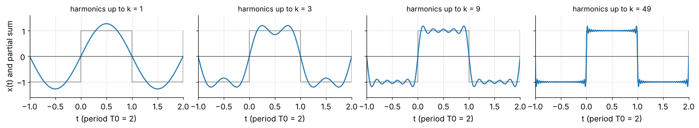
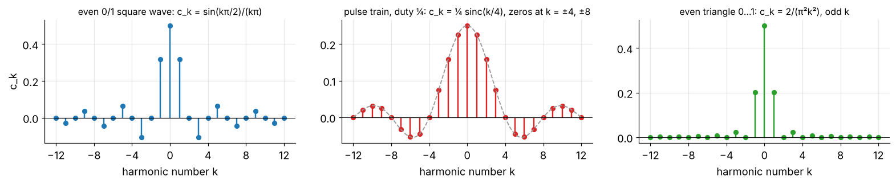
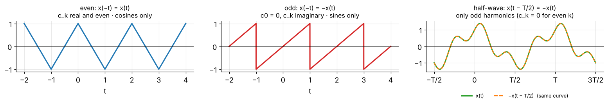
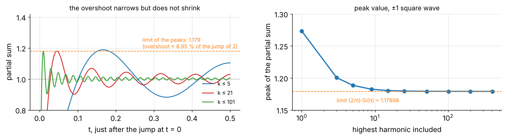
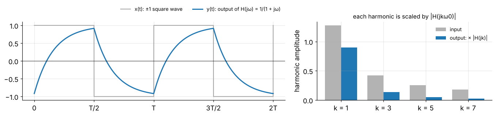
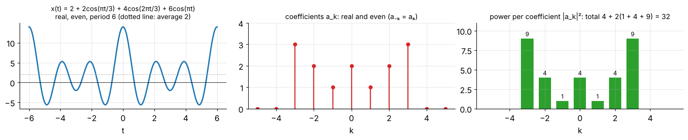
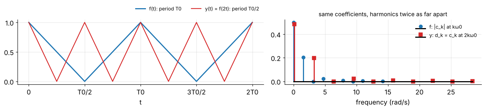
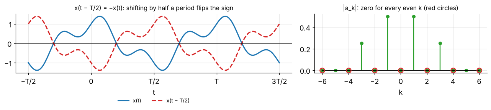
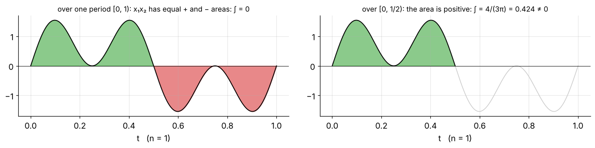
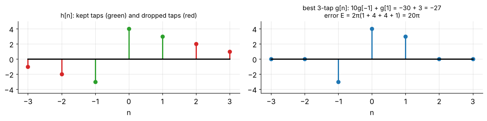

# Day 9 — Signals and Systems III: Continuous-Time Fourier Series

**Covers:** a periodic signal as a sum of harmonics · orthogonality · the exponential, trigonometric and compact forms and how to convert between them · computing coefficients (the standard waveforms) · symmetry (even, odd, half-wave) as a source of zero coefficients · properties (shift, scaling, differentiation, product, …) · Parseval's theorem and power · convergence, the Dirichlet conditions and the Gibbs phenomenon · the response of an LTI system to a periodic input · which spectra are discrete or periodic, and the discrete-time series
**Matches:** Day 9 of `03_Study_Plans/20_Day_Plan_Networks_Signals_Control.md` (Gate-O-Pedia pp. 3.23 – 3.33)
**Time:** about 5 hours in total
**Companion:** `Day09_Conceptual_Questions.md`, 20 GATE-style conceptual questions with solutions
**Needs from earlier days:** Day 7 (periodicity, even and odd signals, power), Day 8 §6 (complex exponentials are eigenfunctions of LTI systems), Day 4 (phasors).

> **Why this day matters.** I found **seven** past questions (**13 marks**) in the papers 2019–2026 that use Fourier-series ideas. Five are about the continuous-time series itself: 2021 Q39 (average power from the coefficients), 2023 Q29 (which spectra are discrete), 2025 Q55 (time scaling), 2026 Q37 (half-wave symmetry) and 2026 Q58 (orthogonality). Two are discrete-time cousins that use the same ideas: 2023 Q47 (extracting a coefficient by orthogonality) and 2019 Q44 (a least-squares truncation of a DTFT, which is a Fourier series in the frequency variable). I found none in 2020 (a mostly scanned paper), 2022 or 2024. The questions are short: each is settled by one property, **if** you know it. They punish a missing negative-`k` term, a wrong symmetry rule and a sign slip.

Every number in this note is re-checked by `tools/verify_day09.py`: coefficients are computed numerically from the waveforms and compared with the closed forms, the properties and the symmetry rules are tested on example signals, the Gibbs constants and a filter example are checked against numerical integration and an ODE simulation, and all seven past-year answers match the official keys in `02_Previous_Year_Papers/`.

## How to use this note

| Step | What | Time |
|---|---|---|
| 1 | Read §1–§2 (the idea, orthogonality, the three forms). **Do Ex 1 with the solution covered** | 45 min |
| 2 | Read §3 (computing coefficients, the standard waveforms). **Derive two of the table entries yourself** | 60 min |
| 3 | Read §4–§5 (symmetry, properties). Learn the symmetry table and the time-scaling rule by heart | 50 min |
| 4 | Read §6–§7 (Parseval, convergence, Gibbs) | 35 min |
| 5 | Read §8–§9 (periodic input to an LTI system, spectrum types, the DT series) | 25 min |
| 6 | Do §10: the seven past-year questions. Try each one from the paper first | 40 min |
| 7 | Do §11 practice, then read §12 (mistakes) | 35 min |
| 8 | Take the **20 conceptual questions** (timed), then copy §13 onto your Signals formula sheet | 50 min |

---

## 1. The idea: a periodic signal is a sum of harmonics

Let `x(t)` be periodic with fundamental period `T₀` (Day 7). Write `ω₀ = 2π/T₀` (the fundamental angular frequency) and `f₀ = 1/T₀`. The **harmonics** `e^{jkω₀t}`, `k = 0, ±1, ±2, …`, all repeat every `T₀`, so any sum of them is periodic with period `T₀`. The Fourier series says that **every** reasonable periodic signal is such a sum:

```
synthesis:   x(t) = Σ_{k=−∞}^{∞} c_k e^{jkω₀t}
analysis:    c_k  = (1/T₀) ∫_{T₀} x(t) e^{−jkω₀t} dt        (any interval of length T₀)
```

- `c₀ = (1/T₀)∫x dt` is the **average value** (the DC term).
- `c_k` is the complex amplitude of the harmonic at frequency `kω₀`. The terms `k = ±1` are the **fundamental**, `k = ±2` the second harmonic, and so on.
- The set of numbers `c_k` is the **line spectrum**: lines at `0, ±ω₀, ±2ω₀, …`. A periodic signal has a **discrete** spectrum.



*(The figure builds a ±1 square wave from its first harmonics; §3 gives the coefficients and §7 explains the ringing at the jumps.)*

### 1.1 Why the analysis formula works: orthogonality

Over one period the harmonics are **orthogonal**:

```
(1/T₀) ∫_{T₀} e^{jkω₀t} e^{−jmω₀t} dt  =  1 if k = m,   0 if k ≠ m
```

For `k ≠ m` the integrand is a complex exponential with `k − m` whole cycles in `T₀`, so its integral is zero. Now multiply the synthesis equation by `e^{−jmω₀t}` and integrate over a period: every term vanishes except `k = m`, which leaves `T₀c_m`. That is the analysis formula.

The real versions, for integers `k, m ≥ 1`, all integrals over one period:

| Integral | Value |
|---|---|
| `∫ cos(kω₀t) cos(mω₀t) dt` | `T₀/2` if `k = m`, else `0` |
| `∫ sin(kω₀t) sin(mω₀t) dt` | `T₀/2` if `k = m`, else `0` |
| `∫ sin(kω₀t) cos(mω₀t) dt` | **`0` always** |
| `∫ 1² dt` (the `k = 0` term) | `T₀` |

**Orthogonal and orthonormal.** Two signals are **orthogonal** on an interval when `∫ x(t)y*(t)dt = 0` there; they are **orthonormal** when, in addition, each has unit energy on that interval. Orthogonality is what makes the power of a sum of harmonics the *sum* of the powers (§6). In 2026 Q58, `cos(2πnt)` has energy `1/(2n)` on `[0, 1/n)`, so it can be orthogonal to `2sin(4πnt)` but never orthonormal.

**Orthogonality depends on the interval.** Over **half** a period `[0, T₀/2]`, two cosines (or two sines) with different integer harmonic numbers are still orthogonal, but a sine and a cosine are orthogonal only when their harmonic numbers have the **same parity**:

- `∫₀^π cosθ cos2θ dθ = 0` and `∫₀^π sinθ sin2θ dθ = 0` (orthogonal),
- `∫₀^π sinθ cos2θ dθ = −2/3` and `∫₀^π cosθ sin2θ dθ = 4/3` (**not** orthogonal; harmonic numbers 1 and 2 have different parity),
- `∫₀^π sinθ cos3θ dθ = 0` (orthogonal; 1 and 3 have the same parity).

---

## 2. The three forms of the series, and how to convert

For a **real** signal there are three equivalent ways to write the series:

```
exponential:     x(t) = Σ_{k=−∞}^{∞} c_k e^{jkω₀t}
trigonometric:   x(t) = a₀ + Σ_{k=1}^{∞} [ a_k cos(kω₀t) + b_k sin(kω₀t) ]
compact:         x(t) = C₀ + Σ_{k=1}^{∞} C_k cos(kω₀t + θ_k)
```

with

```
a₀ = (1/T₀)∫x dt = c₀        a_k = (2/T₀)∫ x(t) cos(kω₀t) dt        b_k = (2/T₀)∫ x(t) sin(kω₀t) dt
```

**Conversions** (real `x`, `k ≥ 1`):

| From | To |
|---|---|
| `a_k`, `b_k` | `c_k = (a_k − j b_k)/2`, `c_{−k} = (a_k + j b_k)/2 = c_k*` |
| `c_k` | `a_k = c_k + c_{−k} = 2 Re c_k`, `b_k = j(c_k − c_{−k}) = −2 Im c_k` |
| `c_k` | `C_k = 2\|c_k\|`, `θ_k = ∠c_k` (and `C₀ = c₀`) |
| `a_k`, `b_k` | `C_k = √(a_k² + b_k²)`, `a_k = C_k cosθ_k`, `b_k = −C_k sinθ_k` |

**Memory aid.** `A cos(kω₀t + φ)` has `c_{±k} = (A/2)e^{±jφ}`. A cosine gives real coefficients `A/2`; a sine `A sin(kω₀t) = A cos(kω₀t − π/2)` gives `c_k = −jA/2` and `c_{−k} = +jA/2`. The `−j` on the sine is the sign that exam questions test.

**Real signals have conjugate-symmetric coefficients:** `c_{−k} = c_k*`. So `|c_k|` is even in `k`, `∠c_k` is odd, `Re c_k` is even and `Im c_k` is odd.

**Ex 1 (read the coefficients; no integral).** `x(t) = 3 − 2cos(2t) + 4sin(6t)`. The frequencies 2 and 6 rad/s have greatest common divisor 2, so `ω₀ = 2`, `T₀ = π`, and the terms are harmonics `k = 1` and `k = 3`. Using Euler: `−2cos(2t)` gives `c_{±1} = −1`; `4sin(6t) = −2j e^{j6t} + 2j e^{−j6t}` gives `c₃ = −2j` and `c_{−3} = +2j`; and `c₀ = 3`. The average power is `Σ|c_k|² = 9 + 2(1) + 2(4) = 19` (§6).

**Ex 2 (convert).** `x(t) = 4 + 6cos(ω₀t) + 8sin(ω₀t)` has `a₁ = 6`, `b₁ = 8`, so `c₁ = (6 − 8j)/2 = 3 − 4j` and `c_{−1} = 3 + 4j`. The compact form has `C₁ = 2|c₁| = 10` and `θ₁ = ∠c₁ = −53.13°`: `x(t) = 4 + 10cos(ω₀t − 53.13°)`.

---

## 3. Computing the coefficients

### 3.1 Method

1. **Read them off** if `x(t)` is already a sum of sinusoids at harmonically related frequencies (Ex 1).
2. Otherwise choose the period window that makes the integral easiest (`[−T₀/2, T₀/2]` for even and odd signals; `[0, T₀]` for one-sided pieces), and use **symmetry first** (§4) to decide which coefficients are zero, real or imaginary.
3. For a piecewise signal, integrate piece by piece; for a derivative or integral of a known waveform, use the properties of §5.

### 3.2 Standard waveforms (all checked numerically)

| Waveform (period `T₀`, `ω₀ = 2π/T₀`) | Exponential coefficients `c_k` | Notes |
|---|---|---|
| **Rectangular pulse train**: height `A` for `\|t\| < T₁`, else 0 | `c₀ = 2AT₁/T₀`, `c_k = (A/(πk)) sin(kω₀T₁) = (2AT₁/T₀) sinc(2kT₁/T₀)` | even, real; zeros at `k = nT₀/(2T₁)` when that is an integer |
| **0/A square wave**, 50 % duty, even | `c₀ = A/2`, `c_k = (A/(πk)) sin(kπ/2)` | `a₁ = 2A/π`, `a₃ = −2A/(3π)`, even `k ≠ 0`: 0 |
| **±A square wave** (`+A` on `(0, T₀/2)`, `−A` on `(T₀/2, T₀)`), odd | `c_k = −j 2A/(πk)` for odd `k`; 0 for even `k` | `b_k = 4A/(πk)`: `x = (4A/π)[sin ω₀t + ⅓ sin 3ω₀t + ⅕ sin 5ω₀t + …]` |
| **Even triangle** `A(1 − 2\|t\|/T₀)` on `\|t\| ≤ T₀/2` (between 0 and `A`) | `c₀ = A/2`, `c_k = 2A/(π²k²)` for odd `k`; 0 for even `k ≠ 0` | decays as `1/k²` |
| **Sawtooth** `At/T₀` on `\|t\| < T₀/2`, odd | `c_k = jA(−1)^k/(2πk)` | `b_k = A(−1)^{k+1}/(πk)` |
| **Full-wave rectified sine** `A\|sin(ω_s t)\|` (`T₀ = π/ω_s`, `ω₀ = 2ω_s`) | `c_k = 2A/(π(1 − 4k²))` | `c₀ = 2A/π`; `a₁ = 2c₁ = −4A/(3π)` |
| **Half-wave rectified sine** `A sin(ω₀t)` on `(0, T₀/2)`, 0 on `(T₀/2, T₀)` | `c₀ = A/π`, `c_{±1} = ∓jA/4`, `c_k = −A/(π(k² − 1))` for even `k`, 0 for odd `k ≥ 3` | has even harmonics (no half-wave symmetry) |
| **Impulse train** `Σ_n δ(t − nT₀)` | `c_k = 1/T₀` for **all** `k` | flat line spectrum; `Σ A δ(t − nT₀)` gives `A/T₀` |
| **Decaying exponential** `e^{−t}` on `[0, 1)`, `T₀ = 1` | `c_k = (1 − e^{−1})/(1 + j2πk)` | complex: the signal has no symmetry |

*Derivations to practise.* The pulse train: `c_k = (1/T₀)∫_{−T₁}^{T₁}A e^{−jkω₀t}dt = (A/T₀)·2sin(kω₀T₁)/(kω₀)`, and `ω₀T₀ = 2π` turns `2/(T₀kω₀)` into `1/(πk)`. The exponential: `c_k = ∫₀¹ e^{−t}e^{−j2πkt}dt = (1 − e^{−1}e^{−j2πk})/(1 + j2πk)`, and `e^{−j2πk} = 1`.



### 3.3 The pulse train and its sinc envelope

The lines of a rectangular pulse train sit on the envelope `(2AT₁/T₀) sinc(f·2T₁)`, where `f = kf₀`. Two facts follow:

- The **line spacing** is `f₀ = 1/T₀`: it depends only on the period.
- The **first null** of the envelope is at `f = 1/(2T₁)`, the inverse of the pulse width: a **narrower** pulse has a **wider** spectrum. For duty cycle `d = 2T₁/T₀`, the nulls fall on the harmonics `k = n/d` when that is an integer (for `d = ¼`, at `k = 4, 8, 12, …`).

### 3.4 How fast the coefficients decay

| Signal | What it contains | `\|c_k\|` decays like |
|---|---|---|
| impulse train | impulses | no decay (`1/k⁰`) |
| square wave, sawtooth, pulse train | **jumps** in `x` | `1/k` |
| triangle wave, rectified sine | **kinks**: `x` continuous, `x′` has jumps | `1/k²` |
| smoother | `x, x′` continuous, `x″` has jumps | `1/k³` |

This is the differentiation property of §5 at work: `x′` has coefficients `jkω₀c_k`, so differentiating multiplies by `k`. The derivative of the ±1 triangle with period 2 is a ±2 square wave: `|c_k(x′)| = kπ · 4/(π²k²) = 4/(πk)`, and the first harmonic of the square wave has amplitude `2|d₁| = 8/π = 2.55`. A smoother signal needs fewer harmonics.

---

## 4. Symmetry: the shortcuts that tell you which coefficients vanish

| Property of the `T₀`-periodic signal `x(t)` | Effect on the coefficients |
|---|---|
| **real** | `c_{−k} = c_k*`; `a_k`, `b_k` real |
| **even**: `x(−t) = x(t)` | `c_{−k} = c_k`; for real `x` every `c_k` is **real** and only **cosines** appear (`b_k = 0`) |
| **odd**: `x(−t) = −x(t)` | `c_{−k} = −c_k` and `c₀ = 0`; for real `x` every `c_k` is **purely imaginary** and only **sines** appear (`a_k = 0`) |
| **half-wave**: `x(t − T₀/2) = −x(t)` | `c_k = 0` for **every even `k`** (including `k = 0`): only **odd** harmonics |
| even **and** half-wave | only odd **cosines**: `c_k` real, odd `k` (the ±1 triangle) |
| odd **and** half-wave | only odd **sines**: `c_k` imaginary, odd `k` (the ±A square wave) |
| zero average | `c₀ = 0` |
| period really `T₀/2` (`x(t + T₀/2) = x(t)`) | only **even** harmonics survive; the true fundamental is `2ω₀` |



**Why half-wave symmetry kills the even harmonics.** By the shift property (§5), `x(t − T₀/2)` has coefficients `c_k e^{−jkω₀T₀/2} = (−1)^k c_k`. If `x(t − T₀/2) = −x(t)`, then `(−1)^k c_k = −c_k`, which forces `c_k = 0` whenever `k` is even. The converse also holds: a signal with only odd harmonics satisfies `x(t − T₀/2) = −x(t)`. (This is 2026 Q37.)

**Symmetry cuts the integral.** For a real even signal, `c_k = (2/T₀)∫₀^{T₀/2} x(t)cos(kω₀t)dt`. For a real odd signal, `c_k = −j(2/T₀)∫₀^{T₀/2} x(t)sin(kω₀t)dt`. With **both** an odd/even and a half-wave symmetry only a quarter period is needed: for the ±A square wave `b_k = (8/T₀)∫₀^{T₀/4} A sin(kω₀t)dt = 4A/(πk)` for odd `k`.

**Check the mean, too.** The 0/1 square wave has no half-wave symmetry, because its average is ½. But `x(t) − ½` does, which is why its coefficients are zero for every even `k ≠ 0` and only `c₀ = ½` survives at `k = 0`.

**Pick the true period.** `|sin t|` has period `π`, not `2π`. Seen with `T₀ = 2π` its odd-numbered harmonics vanish (they are not there at all); with `T₀ = π` every coefficient is non-zero. Always find the *fundamental* period first.

---

## 5. Properties of the Fourier series

Let `x(t) ↔ c_k` and `y(t) ↔ d_k`, both with period `T₀` unless stated otherwise.

| Property | In time | In coefficients | Remarks |
|---|---|---|---|
| Linearity | `αx + βy` | `αc_k + βd_k` | same `T₀` |
| **Time shift** | `x(t − t₀)` | `c_k e^{−jkω₀t₀}` | `\|c_k\|` unchanged; the phase changes by `−kω₀t₀` |
| Time reversal | `x(−t)` | `c_{−k}` | |
| Conjugation | `x*(t)` | `c_{−k}*` | |
| Frequency shift | `x(t)e^{jMω₀t}` | `c_{k−M}` | so `x(t)cos(Mω₀t) ↔ (c_{k−M} + c_{k+M})/2` |
| **Time scaling** | `x(αt)`, `α > 0` | the **same** `c_k` | the period becomes `T₀/α`; the harmonics move to `kαω₀` |
| Differentiation | `dx/dt` | `jkω₀ c_k` | removes `c₀`; slower decay |
| Integration | `∫x dt` (needs `c₀ = 0`) | `c_k/(jkω₀)` | faster decay |
| Multiplication | `x(t)y(t)` | `Σ_m c_m d_{k−m}` | convolution of the coefficient sequences |
| Periodic convolution | `∫_{T₀} x(τ)y(t − τ)dτ` | `T₀ c_k d_k` | the product of the coefficients |
| Parseval | `(1/T₀)∫\|x\|²dt` | `Σ_k \|c_k\|²` | §6 |

**Time scaling, the exam trap (2025 Q55).** If `x` has period `T₀` and `y(t) = x(αt)`, then `y(t) = Σ c_k e^{jk(αω₀)t}`: the coefficients are **unchanged**, but they now belong to the new fundamental frequency `αω₀`, so `y` has period `T₀/α`. Time scaling stretches the line spectrum along the frequency axis without changing the heights. (For the Fourier *transform* of Day 10, scaling also changes the amplitude; for the series it does not.) The power of `y` equals the power of `x`.

**Shift versus scaling.** A shift changes only the *phase* of each coefficient, proportionally to `k`; a scaling changes only the *frequency* of each line.

---

## 6. Parseval's theorem and power

```
P = (1/T₀) ∫_{T₀} |x(t)|² dt  =  Σ_{k=−∞}^{∞} |c_k|²
  = a₀² + ½ Σ_{k≥1} (a_k² + b_k²)  =  C₀² + ½ Σ_{k≥1} C_k²            (real x)
```

The cross terms between different harmonics integrate to zero (orthogonality, §1.1), so **the power is the sum of the powers of the harmonics**. The two terms `±k` together contribute `2|c_k|² = C_k²/2`, the power of a sinusoid of amplitude `C_k`; the DC term contributes `c₀²`.

**The most common slip: forgetting the negative `k`.** The sum runs over **all** `k`. For a real signal, `P = c₀² + 2Σ_{k≥1}|c_k|²`.

**Ex 3.** `x(t) = 2 + 3cos(ω₀t) + 4sin(2ω₀t)`: `P = 4 + 9/2 + 16/2 = 16.5`.

**Power in the first harmonics of a ±1 square wave** (total power 1; the `k`-th odd harmonic carries `(8/π²)/k²`):

| Harmonics included | Fraction of the power |
|---|---|
| `k = 1` | 81.06 % |
| up to `k = 3` | 90.06 % |
| up to `k = 5` | 93.31 % |
| up to `k = 7` | 94.96 % |
| up to `k = 9` | 95.96 % |

**The least-squares property.** Among all sums of harmonics up to `|k| ≤ N`, the **truncated series** `S_N(t) = Σ_{|k|≤N} c_k e^{jkω₀t}` has the smallest mean-square error, and that error is `Σ_{|k|>N}|c_k|²` (Parseval applied to the error signal). For the ±1 square wave it falls from `0.189` (up to `k = 1`) through `0.099` (`k ≤ 3`) and `0.040` (`k ≤ 9`) to `0.014` (`k ≤ 27`), and changing any coefficient only makes it worse. The same statement for the discrete-time Fourier transform is 2019 Q44 (§10): the DTFT `H(e^{jω}) = Σ h[n]e^{−jωn}` is a Fourier series in `ω`, with the impulse response as its coefficients.

---

## 7. Convergence, the Dirichlet conditions and the Gibbs phenomenon

**Dirichlet conditions** (sufficient, not necessary). Over one period: (1) `x` is absolutely integrable, `∫_{T₀}|x| dt < ∞`; (2) `x` has a finite number of maxima and minima; (3) `x` has a finite number of discontinuities, all finite jumps. Every waveform in this note, and almost every one in GATE, satisfies them. Then the series converges:

- to `x(t)` at every point where `x` is **continuous**;
- to the **midpoint** `[x(t⁻) + x(t⁺)]/2` at a **jump**, whatever the value of `x` at the jump itself.

The series also converges in the **mean-square** sense for every finite-power signal (Parseval), and **uniformly** for a continuous signal whose derivative is piecewise continuous, such as the triangle wave.

**Gibbs phenomenon.** Near a jump the partial sums **overshoot**. The first peak exceeds the upper level by about **8.95 % of the jump**, exactly `Si(π)/π − ½ = 0.08949`, where `Si(π) = ∫₀^π (sin t)/t dt = 1.8519`. As more harmonics are added the overshoot moves **closer to the jump** and gets **narrower**, but its **height does not shrink**. The error *energy* still goes to zero, so the convergence in the mean-square sense is not contradicted.



- For the ±1 square wave (a jump of 2) the peak tends to `1 + 2(0.08949) = 1.1790`, the value `(2/π)Si(π)`.
- For a ±2 square wave (a jump of 4) it tends to `2 + 4(0.08949) = 2.358`.
- At the jump itself every partial sum of the square wave is exactly the midpoint `0`.

---

## 8. A periodic input to an LTI system

Complex exponentials are eigenfunctions of LTI systems (Day 8 §6): `e^{jkω₀t} → H(jkω₀)e^{jkω₀t}`. By linearity,

```
x(t) = Σ c_k e^{jkω₀t}   ──►  [ H(jω) ]  ──►   y(t) = Σ c_k H(jkω₀) e^{jkω₀t}        d_k = c_k · H(jkω₀)
```

The output is periodic with the same `T₀` (or a shorter period, if the system removes harmonics); each harmonic is scaled by `|H(jkω₀)|` and shifted in phase by `∠H(jkω₀)`; and the output power is `Σ|c_k|²|H(jkω₀)|²`. For a real system and input, the output is real.

**Ex 4 (an RC low-pass filter).** `H(jω) = 1/(1 + jω/ω₀)` (cut-off at the fundamental frequency) driven by the ±1 square wave `x = (4/π)Σ_{odd k} sin(kω₀t)/k`. Each harmonic is multiplied by `1/√(1 + k²)` and delayed in phase by `arctan k`:

`y(t) = Σ_{odd k} [4/(πk√(1 + k²))] sin(kω₀t − arctan k)`,

so the harmonic amplitudes are `0.900` (`k = 1`, phase `−45°`), `0.134` (`k = 3`), `0.0499` (`k = 5`), … I checked these numbers against a direct simulation of the circuit equation `y′ + y = x(t)`.



**Ex 5 (a filter that keeps only the odd harmonics).** Let `h(t) = δ(t) − δ(t − T₀/2)`, so `y(t) = x(t) − x(t − T₀/2)`. Then `H(jkω₀) = 1 − e^{−jkπ} = 1 − (−1)^k`, which is `0` for even `k` (including DC) and `2` for odd `k`. The output has only the odd harmonics, doubled, and therefore always has half-wave symmetry.

**Distortion-free transmission** needs `H(jω) = K e^{−jωt₀}`: every harmonic is scaled by the same `K` and delayed by the same `t₀`, so `y(t) = Kx(t − t₀)`. An ideal low-pass filter keeps the harmonics with `kω₀` below its cut-off.

---

## 9. Which spectra are discrete, which are periodic, and the discrete-time series

**The pairing rule.** *Periodic in one domain means discrete in the other, and discrete in one domain means periodic in the other.*

| Signal | Representation | Spectrum |
|---|---|---|
| continuous, **periodic** | Fourier series | **discrete** and **aperiodic** (lines at `kω₀`, for all `k`) |
| continuous, aperiodic | Fourier transform (Day 10) | continuous, aperiodic |
| discrete, aperiodic | DTFT (Day 12) | continuous, **periodic** (period `2π`) |
| discrete, **periodic** (period `N`) | DTFS (≈ DFT, Day 13) | **discrete** and **periodic** (period `N`) |

This table is 2023 Q29: (i) → (a), (ii) → (c), (iii) → (b), (iv) → (d).

**The discrete-time Fourier series.** A signal with period `N`:

```
x[n] = Σ_{k=0}^{N−1} a_k e^{j2πkn/N}         a_k = (1/N) Σ_{n=0}^{N−1} x[n] e^{−j2πkn/N}         a_{k+N} = a_k
(1/N) Σ_{n=0}^{N−1} |x[n]|²  =  Σ_{k=0}^{N−1} |a_k|²
```

There are only **`N` distinct coefficients**, because the harmonics `e^{j2πkn/N}` repeat with period `N` in `k`. The orthogonality is `Σ_{n=0}^{N−1} e^{j2π(k−m)n/N} = N` if `k ≡ m (mod N)` and `0` otherwise, and `Na_k` is the `N`-point DFT of one period. For example `x[n] = 1 + 2cos(πn/2)` (`N = 4`) has `a = {1, 1, 0, 1}` and power `3`.

---

## 10. Past-year questions (all solved, all match the official keys)

Papers and keys: `02_Previous_Year_Papers/<year>/`. **Try each question from the paper first.**

| # | Question | Marks | Official answer | Concept it tests |
|---|---|---|---|---|
| 1 | 2021 Q39 (NAT) | 2 | 31.9 to 32.1 | Average power from the exponential coefficients of a real, even signal (Parseval) |
| 2 | 2023 Q29 (MCQ) | 1 | B | Spectrum types: periodic ↔ discrete |
| 3 | 2023 Q47 (MCQ) | 2 | A | Extracting DTFS coefficients by orthogonality (the DT cousin) |
| 4 | 2025 Q55 (MSQ) | 2 | A; D | Time scaling of a Fourier series |
| 5 | 2026 Q37 (MCQ) | 2 | A | Half-wave symmetry kills the even harmonics |
| 6 | 2026 Q58 (MSQ) | 2 | A; C; D | Orthogonality over a period and over half a period; harmonics |
| 7 | 2019 Q44 (NAT) | 2 | −27.01 to −26.99 | Least-squares truncation of a DTFT (a Fourier series in `ω`) |

Related questions that belong elsewhere: 2021 Q41 (a DTFT inner product: Day 12) and 2020's question asking for `∫|X(ω)|²dω` of a triangular pulse (Parseval for the Fourier transform: Day 10).

### 2021 Q39: average power from the coefficients


The exponential Fourier series of a continuous-time periodic signal is `x(t) = Σ a_k e^{jkω₀t}`. Given: (I) `x(t)` is real and even with fundamental period 6; (II) its average value is 2; (III) `a_k = k` for `1 ≤ k ≤ 3` and `a_k = 0` for `k > 3`. Find the average power.

The average value gives `a₀ = 2`. A real **and** even signal has `a_{−k} = a_k* = a_k`, so the coefficients are `a₀ = 2`, `a_{±1} = 1`, `a_{±2} = 2`, `a_{±3} = 3` and zero beyond. By Parseval, summing over **all** `k`:

`P = Σ|a_k|² = 4 + 2(1 + 4 + 9) =` **32**.

The period (6) is not needed; the signal is `x(t) = 2 + 2cos(πt/3) + 4cos(2πt/3) + 6cos(πt)`. (The trap: summing only `k ≥ 0` gives `4 + 14 = 18`.)

### 2023 Q29: spectrum types
Match the signal type with its spectral characteristics: (i) continuous, aperiodic; (ii) continuous, periodic; (iii) discrete, aperiodic; (iv) discrete, periodic, against (a) continuous, aperiodic; (b) continuous, periodic; (c) discrete, aperiodic; (d) discrete, periodic.

By the pairing rule of §9: (i) is a Fourier transform, continuous and aperiodic, so (a). (ii) is a Fourier series, with a discrete, aperiodic spectrum, so (c). (iii) is a DTFT, continuous and periodic, so (b). (iv) is a DTFS, discrete and periodic, so (d). That is **option (B)**: (i)–(a), (ii)–(c), (iii)–(b), (iv)–(d).

### 2023 Q47: extracting a coefficient by orthogonality
A discrete-time signal with period `N = 5` has `x[n] = Σ_{k=0}^{4} a_k e^{j2πkn/5}`, with `a₀ = 1`, `a₁ = 3j`, `a₂ = 2j`, `a₃ = −2j`, `a₄ = −3j`. Find `Σ_{n=0}^{4} x[n] sin(4πn/5)`. Options: (A) −10, (B) 10, (C) −2, (D) 2.

Write `sin(4πn/5) = (e^{j2π(2)n/5} − e^{−j2π(2)n/5})/(2j)`. By the analysis formula, `Σ_n x[n]e^{−j2πmn/5} = 5a_m`. The term `e^{−j2π(2)n/5}` therefore gives `5a₂`, and `e^{+j2π(2)n/5} = e^{−j2π(−2)n/5}` gives `5a_{−2} = 5a₃` (the coefficients repeat with period 5). So

`Σ = (5a₃ − 5a₂)/(2j) = 5(−2j − 2j)/(2j) =` **−10**: **option (A)**.

No closed form for `x[n]` is needed, which is the point of orthogonality.

### 2025 Q55: time scaling
`f(t)` is periodic with fundamental period `T₀`; `y(t) = f(αt)` with `α > 1`. With `f(t) = Σ c_k e^{j(2π/T₀)kt}` and `y(t) = Σ d_k e^{j(2π/T₀)αkt}`, which of these are true? (A) `c_k = d_k` for all `k`; (B) `y` has fundamental period `αT₀`; (C) `c_k = d_k/α`; (D) `y` has fundamental period `T₀/α`.



Substitute: `y(t) = f(αt) = Σ c_k e^{j(2π/T₀)k(αt)}`, which is exactly the form given for `y`, so `d_k = c_k`: **(A) is true and (C) is false**. The period: `y(t + T₀/α) = f(αt + T₀) = f(αt) = y(t)`, and no shorter shift works, so the fundamental period is `T₀/α`: **(D) is true and (B) is false**. **Options (A) and (D).**

### 2026 Q37: half-wave symmetry
`x(t)` is real, periodic with period `T`, satisfies the Dirichlet conditions, has Fourier series `x(t) = Σ a_n e^{j(2πnt/T)}` and obeys `x(t − T/2) = −x(t)`. For any integer `m`, which is correct? (A) `a_{2m} = 0`; (B) `a_{2m} = 1`; (C) `a_{2m} = a_{2m+1}`; (D) `a_{2m} = −1`.



The shift `x(t − T/2)` has coefficients `a_n e^{−jnπ} = (−1)^n a_n`. Setting this equal to the coefficients of `−x(t)`, which are `−a_n`, gives `(−1)^n a_n = −a_n`. For even `n = 2m` that reads `a_{2m} = −a_{2m}`, so **`a_{2m} = 0`**: **option (A)**. (The other options do not follow: nothing fixes a coefficient at 1 or −1, and for the ±1 square wave `a_{2m} = 0` while `a_{2m+1}` is not.)

### 2026 Q58: orthogonality
`x₁(t) = cos(2πnt)` and `x₂(t) = 2sin(4πnt)` for a positive integer `n`. Which statements are valid? (A) orthogonal over `0 ≤ t < 1/n`; (B) orthonormal over `0 ≤ t < 1/n`; (C) `x₂` is a harmonic of `x₁`; (D) non-orthogonal over `0 ≤ t < 1/(2n)`.



- **(A) True.** `1/n` is the period of `x₁` and twice that of `x₂`, so both are harmonics of one fundamental (`n` Hz) over this interval, and different harmonics are orthogonal (a sine against a cosine is orthogonal over a full period anyway).
- **(B) False.** Orthonormal would need unit energy, but `∫₀^{1/n}cos²(2πnt)dt = 1/(2n)`.
- **(C) True.** `x₁` has frequency `n` Hz and `x₂` has `2n` Hz: the second harmonic.
- **(D) True.** `∫₀^{1/(2n)} cos(2πnt)·2sin(4πnt)dt = 4/(3πn) ≠ 0` (for `n = 1`, 0.424). Over half a period a sine and a cosine with harmonic numbers 1 and 2 are not orthogonal (§1.1).

**Options (A), (C), (D).**

### 2019 Q44: least-squares truncation of a DTFT
`h[n]` is a length-7 FIR filter: `h[0] = 4`, `h[1] = 3`, `h[2] = 2`, `h[3] = 1`, `h[−1] = −3`, `h[−2] = −2`, `h[−3] = −1`, and zero for `|n| ≥ 4`. A length-3 FIR `g[n]` is to approximate `h[n]` so that `E(h, g) = ∫_{−π}^{π}|H(e^{jω}) − G(e^{jω})|²dω` is minimal. Find `10g[−1] + g[1]`.



`H(e^{jω}) − G(e^{jω}) = Σ (h[n] − g[n])e^{−jωn}` is a Fourier series in `ω`, and the functions `e^{−jωn}` are orthogonal on `[−π, π]`. Parseval gives `E = 2π Σ_n |h[n] − g[n]|²`. A 3-tap `g` can match three taps of `h` exactly; the error is then the energy of the remaining taps, so `g` should copy the three taps of **largest energy**. Those are `n = −1, 0, 1` (`9 + 16 + 9 = 34`, which is also the best window of three consecutive taps), leaving the error `2π(4 + 1 + 4 + 1) = 20π`. So `g[−1] = −3`, `g[0] = 4`, `g[1] = 3`, and

`10g[−1] + g[1] = −30 + 3 =` **−27**.

(This is the least-squares property of §6, in the frequency variable.)

---

## 11. Practice (answers at the end of this section)

**P1 · Read the coefficients.** `x(t) = 1 + 2cos(πt) + 3sin(3πt + π/4)`. Find the fundamental period, `c₀`, `c_{±1}`, `c_{±3}`, and the average power.

**P2 · Integrate.** `x(t) = e^{−t}` for `0 ≤ t < 1`, repeated with period 1. Find `c_k`, then `|c₁|` and `∠c₁`, and the fraction of the average power that is in the DC term.

**P3 · Symmetry.** For each signal, say whether it is even, odd and/or half-wave symmetric, and which coefficients vanish: (a) `cos t + 3cos 3t − 2cos 5t`; (b) `2sin t + sin 2t`; (c) `|sin t|`; (d) the 0/1 square wave.

**P4 · Power fractions.** For a ±1 square wave, what fraction of the power is in the fundamental? How many non-zero harmonics are needed to capture at least 95 %?

**P5 · A periodic input to a filter.** The ±1 square wave `x = (4/π)Σ_{odd k} sin(kω₀t)/k` drives `H(jω) = 1/(1 + jω/ω₀)`. Give the fundamental component of the output and the amplitude of its third harmonic.

**P6 · Combining properties.** `x(t)` has period `T₀ = 4 s` and `c₂ = 0.2`. For `y(t) = 2x(t − 1) + dx/dt`, find `|d₂|`.

<details>
<summary><b>Answers</b></summary>

- **P1:** the frequencies `π` and `3π` have greatest common divisor `π`, so `ω₀ = π` and **`T₀ = 2`**. `c₀ = 1`; `2cos(πt)` gives `c_{±1} = 1`; and `3sin(θ + π/4) = 3cos(θ − π/4)` gives `c₃ = (3/2)e^{−jπ/4}`, `c_{−3} = (3/2)e^{jπ/4}`. Power: `1 + 4/2 + 9/2 =` **7.5**.
- **P2:** `c_k = ∫₀¹e^{−t}e^{−j2πkt}dt = (1 − e^{−1})/(1 + j2πk)`. So `c₀ = 0.632`, `|c₁| = 0.632/√(1 + 4π²) =` **0.0993** and `∠c₁ = −arctan 2π =` **−80.96°**. The power is `(1/T₀)∫₀¹e^{−2t}dt = (1 − e^{−2})/2 = 0.4323`, so the DC term carries `c₀²/P = 2tanh(½) =` **92.4 %**.
- **P3:** (a) **even** and **half-wave** (odd harmonics only): `c_k` real and even, zero for even `k` (`ω₀ = 1`). (b) **odd** but **not** half-wave (it has a second harmonic): `c₀ = 0`, every `c_k` imaginary, non-zero only for `k = ±1, ±2`. (c) **even**, with true period `π` (`ω₀ = 2`): `c₀ = 2/π ≠ 0`, all `c_k` real and non-zero, no half-wave symmetry. (d) neither even nor odd as written; `x(t) − ½` is half-wave symmetric, so `c₀ = ½` and `c_k = 0` for every even `k ≠ 0`.
- **P4:** the fundamental carries `8/π² =` **81.06 %**. Up to `k = 7` the total is 94.96 % (just short); up to `k = 9` it is 95.96 %, so **5 non-zero harmonics** (`k = 1, 3, 5, 7, 9`) are needed.
- **P5:** `y(t) = Σ_{odd k}[4/(πk√(1 + k²))]sin(kω₀t − arctan k)`. The fundamental is **`0.900 sin(ω₀t − 45°)`** (`4/(π√2) = 0.900`), and the third harmonic has amplitude `4/(3π√10) =` **0.134**.
- **P6:** `d_k = 2c_k e^{−jkω₀(1)} + jkω₀c_k = c_k(2e^{−jkω₀} + jkω₀)`, with `ω₀ = π/2`. For `k = 2`: `2e^{−jπ} + jπ = −2 + jπ`, so `|d₂| = 0.2√(4 + π²) =` **0.745**.
</details>

---

## 12. The mistakes that cost marks (checklist)

1. **Forgetting the negative `k` in Parseval.** The sum is over all `k` (2021 Q39: 32, not 18).
2. **A wrong constant.** `c_k = (1/T₀)∫…`, but `a_k = (2/T₀)∫…` and `b_k = (2/T₀)∫…`; only the DC term has `1/T₀` in the trigonometric form.
3. **The sign between the forms.** `c_k = (a_k − jb_k)/2`: a **sine** contributes `−j` at positive `k`.
4. **Using the wrong period.** `|sin t|` has period `π`; the harmonic number is counted from the *fundamental* frequency.
5. **Dividing the coefficients when scaling time.** `x(αt)` has the *same* `c_k` and period `T₀/α` (2025 Q55).
6. **Thinking a time shift changes the magnitude.** It multiplies `c_k` by `e^{−jkω₀t₀}`: only the phase changes.
7. **Half-wave symmetry removes the *even* harmonics** (including DC), not the odd ones (2026 Q37).
8. **Real even ⇒ real `c_k` and cosines; real odd ⇒ imaginary `c_k`, `c₀ = 0` and sines.** Do not mix them up.
9. **Missing a hidden symmetry.** The 0/1 square wave is half-wave symmetric *about its mean*.
10. **Orthogonal is not orthonormal, and orthogonality depends on the interval.** Over half a period a sine and a cosine with harmonic numbers of different parity are *not* orthogonal (2026 Q58).
11. **The pulse-train nulls.** They fall on harmonics `k = nT₀/(2T₁)` only when that number is an integer; otherwise the sinc envelope crosses zero between two lines.
12. **Differentiation and integration.** The factor is `jkω₀` (not just `k`); differentiation removes the DC term; integration needs `c₀ = 0`.
13. **At a jump** the series gives the **midpoint**, not either side's value; the **Gibbs overshoot** (≈ 9 % of the jump) does **not** shrink as terms are added.
14. **Spectrum types.** CT periodic gives a discrete, **aperiodic** spectrum; DT aperiodic gives a continuous, **periodic** one (2023 Q29).
15. **Symbols.** GATE writes the exponential coefficients as `a_k` (2021 Q39, 2026 Q37) or `c_k` (2025 Q55), while many textbooks use `a_k` for the cosine coefficients. Read the definition in the question.

---

## 13. One-page formula sheet (copy this)

```
SERIES         x(t) = Σ c_k e^{jkω0t};   c_k = (1/T0)∫_{T0} x e^{−jkω0t}dt;   ω0 = 2π/T0;   c_0 = average;   periodic in time ⇒ discrete spectrum.
ORTHOGONAL     (1/T0)∫ e^{jkω0t}e^{−jmω0t}dt = δ[k−m];   ∫cos·cos = ∫sin·sin = T0/2 (k = m ≥ 1), ∫sin·cos = 0 (one full period).
               Half period: cos–cos and sin–sin stay orthogonal; sin–cos only for harmonic numbers of equal parity.   orthonormal = orthogonal + unit energy.
FORMS          x = a0 + Σ(a_k cos kω0t + b_k sin kω0t) = C0 + ΣC_k cos(kω0t + θ_k);   a_k = (2/T0)∫x cos,  b_k = (2/T0)∫x sin.
               c_k = (a_k − j b_k)/2,  c_{−k} = c_k*;   a_k = 2Re c_k,  b_k = −2Im c_k,  C_k = 2|c_k|,  θ_k = ∠c_k.   A cos(kω0t+φ): c_{±k} = (A/2)e^{±jφ};  A sin(kω0t): c_k = −jA/2.
STANDARD       pulse train (A, |t|<T1): c_k = (A/πk)sin(kω0T1) = (2AT1/T0)sinc(2kT1/T0), c_0 = 2AT1/T0 (zeros at k = nT0/2T1).   ±A square: c_k = −j2A/(πk) (odd k), b_k = 4A/(πk).
               even triangle 0..A: c_0 = A/2, c_k = 2A/(π²k²) (odd k).   sawtooth At/T0: b_k = A(−1)^{k+1}/(πk).   |A sin| : c_k = 2A/(π(1−4k²)).   impulse train: c_k = 1/T0.
DECAY          jumps: 1/k;  kinks (continuous, jumps in x'): 1/k²;  impulses: no decay.
SYMMETRY       real: c_{−k} = c_k*;  even: c_{−k} = c_k (real x: real c_k, cosines);  odd: c_{−k} = −c_k, c_0 = 0 (real x: imaginary c_k, sines);
               half-wave x(t−T0/2) = −x(t): c_k = 0 for even k (incl. 0), only odd harmonics.
PROPERTIES     shift: c_k e^{−jkω0t0};  reversal: c_{−k};  conjugate: c*_{−k};  x e^{jMω0t}: c_{k−M};  x(αt): SAME c_k, period T0/α;  x': jkω0 c_k;  ∫x (c_0 = 0): c_k/(jkω0);
               product: Σ c_m d_{k−m};  periodic convolution: T0 c_k d_k.
PARSEVAL       P = (1/T0)∫|x|² = Σ_{all k}|c_k|² = a0² + ½Σ(a_k² + b_k²) = C0² + ½ΣC_k²;   ±1 square wave: fundamental 8/π² = 81 %.   Truncation is the least-squares fit: error = Σ_{|k|>N}|c_k|².
CONVERGENCE    Dirichlet: absolutely integrable, finitely many extrema, finitely many finite jumps ⇒ series → x(t) (continuity) or [x(t−)+x(t+)]/2 (jump).
               Gibbs: overshoot ≈ 8.95 % of the jump = Si(π)/π − 1/2; narrows, never shrinks;  ±1 square wave peak → 1.179.
LTI            x periodic ⇒ y(t) = Σ c_k H(jkω0)e^{jkω0t};   power Σ|c_k|²|H(jkω0)|²;   y = x(t) − x(t−T0/2): H = 1 − (−1)^k keeps (doubles) odd harmonics only.
SPECTRA        CT periodic: discrete + aperiodic;  CT aperiodic: continuous + aperiodic;  DT aperiodic: continuous + periodic (2π);  DT periodic (N): discrete + periodic (N).
DTFS           a_k = (1/N)Σ x[n]e^{−j2πkn/N},  x[n] = Σ_{k=0}^{N−1} a_k e^{j2πkn/N},  N distinct coefficients,  (1/N)Σ|x|² = Σ|a_k|²,  Na_k = DFT.
```

---

## 14. Self-test before you move to Day 10

You are ready if you can, **without looking**:

- [ ] write the synthesis and analysis equations and explain, using orthogonality, why the analysis formula works
- [ ] convert between `a_k, b_k`, `c_k` and the compact form, with the right sign for a sine
- [ ] read the coefficients off a sum of sinusoids, and state the fundamental period
- [ ] write down the coefficients of the pulse train, the ±A square wave and the triangle wave, and explain the `1/k` versus `1/k²` decay
- [ ] use symmetry (even, odd, half-wave) to say which coefficients are zero, real or imaginary
- [ ] apply shift, scaling, differentiation, modulation and product to the coefficients, and state what time scaling does to `c_k`
- [ ] compute average power with Parseval, summing over all `k`
- [ ] state the Dirichlet conditions, the value at a jump and the 9 % Gibbs overshoot
- [ ] find the output of an LTI system for a periodic input with `c_k H(jkω₀)`
- [ ] say which spectra are discrete and which are periodic, and write the DT series
- [ ] score at least 17/20 on `Day09_Conceptual_Questions.md`

**Day 10 preview:** the Fourier transform. Let the period `T₀ → ∞`: the lines at `kω₀` crowd together into a continuous spectrum, and the sum becomes the integral `x(t) = (1/2π)∫X(jω)e^{jωt}dω` with `X(jω) = ∫x(t)e^{−jωt}dt`. The properties you learned today (shift, scaling, differentiation, convolution ↔ product, Parseval) all carry over, with one change in the scaling rule, and a periodic signal has the transform `2πΣ c_k δ(ω − kω₀)`: impulses at the harmonics. Sampling (also Day 10) rests on the pairing rule of §9: sampling in time makes the spectrum periodic.

---

## 15. Sources and further reading

**Pages read for this note.** Research passes read the three Wikipedia pages below. Each came back only in part or with some garbled formulas, so I mark what was read and what was not; every statement that matters was also verified numerically in this repository.

- [Wikipedia: Fourier series](https://en.wikipedia.org/wiki/Fourier_series). **Read in part:** about 63 % of the page (about 79,900 of 126,700 characters) came back verbatim, and the rest only as a model-written summary. From the verbatim part: the exponential and sine-cosine definitions with the coefficient integrals (written there with period `P`), the amplitude-phase form, Parseval's identity in the exponential form `(1/P)∫|s|² = Σ|S[n]|²`, the table of basic rules (linearity, time reversal, conjugation, the shifts in time and frequency, differentiation as `(i2πn/P)^k`, and the products and periodic convolutions), the sawtooth example, a table of common series (rectified sines, a rectangular pulse, sawtooth, parabola), the midpoint value at a jump and uniform convergence for a continuous signal with a square-integrable derivative. **Not found on the page as read:** even/odd and half-wave symmetry results, a list of the Dirichlet conditions, the trigonometric form of Parseval, the Gibbs overshoot, the square-wave and triangle-wave coefficients, and a time-scaling rule. **One discrepancy:** the transcription of the page's relation between the sine-cosine coefficients and `c_n` that I received had the signs reversed relative to the derivation in §2 (`c_k = (a_k − jb_k)/2`, which I verified numerically), so I used my derivation and not the transcription; check §2 against the rendered page if in doubt.
- [Wikipedia: Parseval's theorem](https://en.wikipedia.org/wiki/Parseval%27s_theorem). **Read in full** (about 20,400 characters, verbatim): Parseval for the Fourier series with complex coefficients (the factor `1/P`), the real trigonometric form (on that page written with a `½a₀` convention, which differs from the `a₀` = mean convention used here), the continuous Fourier-transform form `∫|x|² = (1/2π)∫|X|²dω`, the discrete-time forms for the DTFT and DFT, and the reading of the identity as conservation of energy. The page does not discuss the *average power* of a periodic signal; that reading is derived here.
- [Wikipedia: Gibbs phenomenon](https://en.wikipedia.org/wiki/Gibbs_phenomenon). **Read in part:** about 68 % (about 39,900 of 58,800 characters) verbatim, which contains everything quoted: the overshoot of about 9 % of the jump, the constant `0.0894898722…` and its closed form `(c/π)∫₀^π (sin t)/t dt − c/2`, the statement that the peak-to-peak jump of the partial sum is about 18 % larger, the narrowing of the overshoot without a decrease in its height, and the convergence to the midpoint of the jump (Dirichlet's theorem).

**Relied on from earlier days:** the Linear time-invariant system page and the eigenfunction argument of Day 8 §6 (for §8).

**Standard results not taken from those pages, so derived and verified in this repository** (`tools/verify_day09.py`): the real and complex orthogonality relations (including the half-period parity rule); the conversions between the three forms; every coefficient formula in §3.2 and the decay rates; the symmetry table (even, odd, half-wave, quarter-wave, true-period cases); the properties of §5 (shift, reversal, conjugation, modulation, scaling, differentiation, integration, product, periodic convolution); Parseval and the power fractions; the least-squares property; the Dirichlet statement as given here (a textbook statement, checked on the example waveforms, not read from the pages); the Gibbs numbers; the RC-filter example (checked against a simulation of the circuit equation); the DTFS formulas, the pairing rule of §9, and every worked example, practice answer and past-year solution (with the seven official answers).

**Recommended practice:** the Gate-O-Pedia notes (`01_Notes/`), pp. 3.23–3.33, for extra problems. Lectures on signals and systems from MIT OCW 6.003 and the NPTEL courses are good companions, but I did not extract their text for this note.
